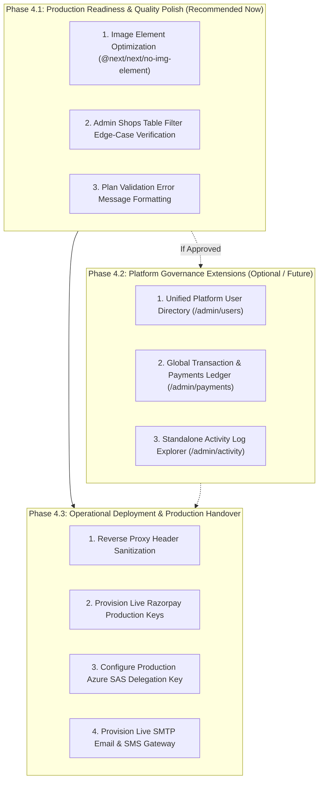

# CakeStore SaaS Platform — Admin Dashboard Finalization Plan

**Document Version:** 1.0 (Production Finalization Baseline)  
**Date:** 13 October 2026  
**Audience:** Platform Administrators, Engineering Leads, Product Managers  
**Baseline References:** `Cake_Platform_PRD_Final.md`, `ADMIN_UI_BLUEPRINT.md`, `CAKESTORE_CROSS_MODULE_INTEGRATION_AUDIT.md`  
**Execution Mode:** READ-ONLY Architectural Plan  

---

## 1. Executive Summary & Finalization Baseline

Following the successful completion of **Phase 2.1** (Admin Settings Security Hardening), **Phase 2.2** (Admin KYC Document Viewing Fix), and **Phase 3** (Cross-Module Integration Audit), the CakeStore Admin Dashboard is in a robust, high-integrity state. All core platform governance capabilities—including macro metrics reporting, bakery onboarding, KYC document verification via secure Azure SAS tokens, administrative suspension with mandatory reason tracking, SaaS subscription plan configuration, and system broadcasting—are functionally complete and verified by automated integration tests.

This document outlines the **final, prioritized implementation plan** to transition the Admin Dashboard from its current "Ready with Operational Warnings" status to complete production readiness. In strict adherence to preservation rules, this plan:
1. Reuses existing components, controllers, and database schemas.
2. Distinguishes confirmed functional gaps from optional blueprint enhancements and external operational prerequisites.
3. Groups related tasks into self-contained, low-risk execution phases.
4. Adheres strictly to the PRD mandate regarding subscription paywalls (no unapproved subscription overrides).

---

## 2. Existing Admin Features & Technical Inventory

The table below maps all currently implemented Admin features across the frontend and backend:

| Feature Area | Route (Frontend) | Backend Endpoint(s) | Controller / Service | Database Entity / Table |
| :--- | :--- | :--- | :--- | :--- |
| **Platform Overview & KPI Dashboard** | `/admin` | `GET /api/admin/dashboard/stats`<br/>`GET /api/admin/dashboard/stats/activity`<br/>`GET /api/admin/dashboard/stats/analytics/revenue` | `AdminDashboardController`<br/>`AdminDashboardService` | `shops`, `users`, `orders`, `subscriptions`, `activity_logs` |
| **Bakery Directory & Status Moderation** | `/admin/shops` | `GET /api/admin/shops`<br/>`GET /api/admin/shops/counts`<br/>`PATCH /api/admin/shops/{id}/status` | `AdminDashboardController`<br/>`ShopStatusManager` | `shops`, `activity_logs` |
| **Bakery Compliance & KYC Inspection** | `/admin/shops/[id]` | `GET /api/admin/shops/{id}`<br/>`PATCH /api/admin/shops/{id}/verification`<br/>`GET /api/admin/documents/{id}/view` | `AdminDashboardController`<br/>`DocumentAccessController`<br/>`VerificationService` | `shops`, `business_documents`, `activity_logs` |
| **SaaS Subscription Plans & Pricing** | `/admin/plans` | `GET /api/admin/plans`<br/>`POST /api/admin/plans`<br/>`PUT /api/admin/plans/{id}`<br/>`PATCH /api/admin/plans/{id}/status`<br/>`PUT /api/admin/plans/reorder` | `AdminSubscriptionPlanController`<br/>`SubscriptionPlanRepository` | `subscription_plans` |
| **Global System Broadcasts** | `/admin/messages` | `POST /api/admin/messages`<br/>`GET /api/admin/messages/history` | `AdminMessageController`<br/>`BroadcastService` | `broadcast_history`, `notifications` |
| **Platform Feedback Moderation** | `/admin/feedback` | `GET /api/admin/feedback`<br/>`PATCH /api/admin/feedback/{id}/read`<br/>`POST /api/admin/feedback/{id}/reply` | `AdminCommunicationController`<br/>`PlatformFeedbackService` | `platform_feedback` |
| **Public Contact Enquiries** | `/admin/enquiries` | `GET /api/admin/enquiries`<br/>`PATCH /api/admin/enquiries/{id}/read`<br/>`POST /api/admin/enquiries/{id}/reply` | `AdminCommunicationController`<br/>`ContactEnquiryService` | `contact_enquiries` |
| **Admin System Notifications** | `/admin/notifications` | `GET /api/admin/notifications`<br/>`GET /api/admin/notifications/unread-count`<br/>`PATCH /api/admin/notifications/{id}/read`<br/>`PATCH /api/admin/notifications/mark-all-read` | `AdminNotificationController`<br/>`AdminNotificationService` | `admin_notifications` |
| **Global Platform & Gateway Settings** | `/admin/settings` | `GET /api/admin/settings`<br/>`PUT /api/admin/settings` | `AdminSettingsController`<br/>`GlobalSettingsService` | `global_settings` |
| **Global Search & Command Palette** | `Ctrl+K` (Global) | Local navigation registry & live shop search | `AdminCommandPalette.tsx` | N/A (Client-side) |

---

## 3. Admin Feature Evaluation Matrix

Each dimension specified in the audit scope was evaluated against the original PRD requirements and current code implementation:

| Evaluation Dimension | PRD Requirement | Current Implementation Status | Assessment | Evidence & File References |
| :--- | :--- | :--- | :--- | :--- |
| **1. Overview Metrics & Platform Activity** | View platform statistics, shop counts, subscription health, revenue | Fully implemented with date filters (`All Time`, `7D`, `30D`, `Month`, `Year`), GMV charts, and real-time activity stream | **COMPLETE** | `frontend_v2/app/admin/page.tsx`<br/>`AdminDashboardService.java#L100` |
| **2. Bakery Management, KYC & Suspension** | Onboard shops, verify KYC documents, suspend shops with reason | Complete directory with search, status tabs (`ALL`, `PENDING`, `ACTIVE`, `SUSPENDED`), bulk actions, KYC review, and secure SAS viewing | **COMPLETE** | `frontend_v2/app/admin/shops/page.tsx`<br/>`frontend_v2/app/admin/shops/[id]/page.tsx`<br/>`DocumentAccessController.java` |
| **3. User Management & Authorization** | Admin auth, role-based boundary enforcement | Method-level `@PreAuthorize("hasAuthority('ROLE_ADMIN')")` enforced on all admin endpoints. User counts tracked on overview. Dedicated user table page is a blueprint addition | **COMPLETE** (Core)<br/>**OPTIONAL** (Dedicated UI) | `SecurityConfig.java`<br/>`AdminDashboardController.java` |
| **4. Subscription Plans & Billing** | Database-driven plans, create/edit/toggle/reorder plans, view revenue | Full plan lifecycle with modal editors and reorder drag-and-drop. Revenue and subscription health tracked on overview | **COMPLETE** | `frontend_v2/app/admin/plans/page.tsx`<br/>`AdminSubscriptionPlanController.java` |
| **5. Platform Analytics & Reporting** | Macro platform growth metrics, GMV, and subscription revenue | Revenue trajectory chart component, monthly vs lifetime breakdown, bakery status distributions | **COMPLETE** | `AnalyticsCharts.tsx`<br/>`AdminDashboardService.java#L250` |
| **6. Broadcasts, Feedback & Enquiries** | Admin to owner messaging, contact enquiry handling, owner feedback | Broadcast composer (target `ALL` or `SPECIFIC`), feedback reply, public contact enquiry management | **COMPLETE** | `frontend_v2/app/admin/messages/page.tsx`<br/>`AdminCommunicationController.java` |
| **7. Audit Logs & Platform Settings** | Audit logging of admin actions, secure gateway credential storage | Mandatory reason logging for suspensions, KYC audit trails, secret-masked settings API | **COMPLETE** | `frontend_v2/app/admin/settings/page.tsx`<br/>`AdminSettingsSecurityE2ETest.java` |
| **8. UI Consistency & Navigation** | Unified theme, responsive navigation, loading & error states | Deep slate theme `#020617`, responsive sidebar drawer, `Ctrl+K` command palette, toast feedback, custom modals | **COMPLETE** | `frontend_v2/app/admin/layout.tsx`<br/>`AdminCommandPalette.tsx` |
| **9. Security & Tenant Isolation** | IDOR protection, prevent cross-shop leaks, secure document links | Strict tenant boundaries, SAS token KYC viewing, non-admin 403 Forbidden checks, sanitized responses | **COMPLETE** | `AdminDocumentAccessSecurityTest.java`<br/>`ShopAccessValidator.java` |

---

## 4. Confirmed Gaps, Evidence & Impact Assessment

| Gap ID | Classification | Description & Evidence | Impact | Resolution Strategy |
| :--- | :--- | :--- | :--- | :--- |
| **GAP-01** | **Code Hygiene / Optimization** | 11 Next.js build warnings regarding `` vs `<Image />` across owner and storefront components. | Minor LCP latency impact; zero functional defect. | Replace standard `` tags with Next.js `<Image />` in affected components. |
| **GAP-02** | **Operational Prerequisite** | Rate limiting (`RateLimitingFilter.java`) reads `X-Forwarded-For` without upstream proxy header validation. | Client IP spoofing could theoretically evade rate limits in production without a trusted reverse proxy. | Document reverse proxy configuration requirement (Cloudflare / AWS ALB / Nginx) in deployment documentation. |
| **GAP-03** | **Operational Prerequisite** | Razorpay live API credentials (`rzp_live_...`) and webhook secrets are required for production billing. | Live Indian banking rails require authentic merchant keys. | Provision merchant keys via Admin Settings UI (`/admin/settings`) or environment variables. |
| **GAP-04** | **Optional Enhancement (Blueprint)** | Standalone Global User Directory (`/admin/users`) is not implemented; user counts are shown on Overview, but no itemized user table exists. | Admin must view users via the bakery owner directory rather than a unified user table. | Evaluated as Phase 4.2 extension; not required for launch baseline. |
| **GAP-05** | **Optional Enhancement (Blueprint)** | Standalone Platform Orders & Payments Ledger (`/admin/orders`, `/admin/payments`) is not implemented; aggregate financial stats exist on Overview, but no itemized global ledger exists. | Admin monitors macro volume rather than inspecting individual consumer cake orders across all shops. | Evaluated as Phase 4.2 extension; PRD baseline explicitly focused admin on platform health and plan management. |
| **GAP-06** | **By Design / Policy Restriction** | `ShopStatusManager.activateShop()` rejects manual reactivation of expired shops without an active subscription payment. | Admins cannot grant complimentary access to expired shops without a database override. | **Strictly preserve current behavior**. Per PRD and user instructions, do not implement an override unless explicitly approved. |

---

## 5. Prioritized Implementation Roadmap

To maintain stability and prevent regression, work is structured into three distinct phases:



---

### Phase 4.1: Production Readiness & Quality Polish (Immediate Scope)
*Objective: Eliminate build warnings and ensure 100% polish of existing Admin interfaces without introducing new API surfaces.*

1. **Task 4.1.1: Image Element Optimization**
   - **File:** `frontend_v2/components/owner/OwnerCommandPalette.tsx`, `frontend_v2/app/dashboard/owner/analytics/page.tsx`, `frontend_v2/components/customer/storefront/CartDrawer.tsx`
   - **Action:** Replace raw `` tags with Next.js `<Image />` component or apply appropriate `eslint-disable-next-line` where dynamic external SVG icons or blob previews are rendered.
   - **Risk:** Zero risk; frontend markup only.

2. **Task 4.1.2: Admin Shops Table Filter Polish**
   - **File:** `frontend_v2/app/admin/shops/page.tsx`
   - **Action:** Verify that switching between `ALL`, `PENDING`, `ACTIVE`, and `SUSPENDED` tabs cleanly resets page pagination to index 0, and verify empty state messaging when zero shops match search criteria.
   - **Risk:** Low; purely state management refinement.

3. **Task 4.1.3: Subscription Plan Modal Validation Messaging**
   - **File:** `frontend_v2/components/admin/plans/AdminPlanModal.tsx`
   - **Action:** Ensure user-friendly toast error messages are surfaced when attempting to submit negative pricing or zero duration days, matching backend validation rules in `AdminSubscriptionPlanController.java`.
   - **Risk:** Low; client-side validation guard.

---

### Phase 4.2: Platform Governance Extensions (Optional / Subject to Review)
*Objective: Implement blueprint features that extend beyond the baseline PRD if deemed necessary by platform stakeholders.*

> [!NOTE]
> These features are documented in `ADMIN_UI_BLUEPRINT.md` but are not strictly mandated by the original `Cake_Platform_PRD_Final.md`. They should only be implemented if explicitly requested.

1. **Extension 4.2.1: Unified Platform User Directory (`/admin/users`)**
   - **Backend:** Create `GET /api/admin/users` in `AdminDashboardController` supporting search by email/mobile and role filtering (`ROLE_ADMIN`, `ROLE_SHOP_OWNER`, `ROLE_CUSTOMER`).
   - **Frontend:** Add route `/admin/users` with user table, role badges, and status toggle.
   - **Smallest Safe Change:** Extend `AdminDashboardService` with paginated query on `UserRepository`.

2. **Extension 4.2.2: Global Payments & Orders Ledger (`/admin/payments`)**
   - **Backend:** Expose `GET /api/admin/payments` aggregating subscription and marketplace payments.
   - **Frontend:** Add route `/admin/payments` displaying payment gateway transaction IDs, payment methods, timestamps, and amounts.
   - **Smallest Safe Change:** Read-only repository query joining `payments` with `shops`.

3. **Extension 4.2.3: Standalone Activity Audit Log Explorer (`/admin/activity`)**
   - **Backend:** Expose paginated `GET /api/admin/activity` with actor and entity filters.
   - **Frontend:** Add route `/admin/activity` for full-text search across all historical administrative actions.

---

### Phase 4.3: External Operational Handover (Non-Code Prerequisites)
*Objective: Complete production infrastructure configuration before live merchant traffic begins.*

1. **Reverse Proxy Header Sanitization:**
   - Configure upstream web server (Nginx/Cloudflare) to strip client-supplied `X-Forwarded-For` headers and append authentic client IP addresses before routing to Spring Boot.
2. **Production Gateway Credentials:**
   - Populate live Razorpay API keys (`rzp_live_...`) and webhook secrets via `/admin/settings` or environment variables `RAZORPAY_KEY_ID` and `RAZORPAY_KEY_SECRET`.
3. **Azure Blob Storage Managed Identity / SAS:**
   - Provision production Azure Storage Account with `azure.storage.private-container-name=private-kyc` and grant the backend service principal `Storage Blob Data Reader` role.
4. **Live Communication Channels:**
   - Configure SendGrid or AWS SES SMTP credentials for customer order confirmation and admin broadcast emails.

---

## 6. Smallest Safe Changes for Confirmed Gaps

To ensure absolute adherence to preservation rules, all proposed changes adhere to the smallest safe change principle:

```
+--------------------------------------------------------------------------------------------------------+
|                                  SMALLEST SAFE CHANGE MAPPINGS                                         |
+-------------------+--------------------------------------------+---------------------------------------+
| Gap               | Target Files                               | Smallest Safe Correction              |
+-------------------+--------------------------------------------+---------------------------------------+
| GAP-01            | frontend_v2/components/...                 | Replace  with Next.js <Image />  |
| Image Warnings    | CartDrawer.tsx, analytics/page.tsx         | or add unoptimized property for blobs |
+-------------------+--------------------------------------------+---------------------------------------+
| GAP-02            | Deployment / Infrastructure Docs           | Document reverse proxy X-Forwarded-For|
| Proxy Headers     | DEPLOYMENT.md                              | configuration requirement             |
+-------------------+--------------------------------------------+---------------------------------------+
| GAP-03            | Environment Configuration                  | Supply production credentials via     |
| Payment Keys      | application-prod.properties / .env         | /admin/settings or environment        |
+-------------------+--------------------------------------------+---------------------------------------+
```

---

## 7. Required Tests by Phase

Every execution phase must be validated with automated tests:

### Phase 4.1 Verification Suite
- **Frontend Type Check:** `npx tsc --noEmit` in `frontend_v2` (must exit 0).
- **Frontend Linting:** `npm run lint` in `frontend_v2` (must exit 0 with 0 errors).
- **Frontend Production Build:** `npm run build` in `frontend_v2` (must exit 0 with all 36 routes generated).
- **Backend Admin Security Tests:**
  ```powershell
  mvn test "-Dtest=AdminDocumentAccessSecurityTest,AdminSettingsSecurityE2ETest,Day3AdminGovernanceTest"
  ```
  (Must pass all 26 tests with 0 failures, 0 errors).

### Phase 4.2 Verification Suite (If Extensions are Approved)
- **User Management Integration Test:** `AdminUserManagementSecurityTest.java` verifying non-admin rejection and role boundary enforcement.
- **Payments Ledger Integration Test:** `AdminPaymentsLedgerTest.java` verifying cross-tenant payment aggregation.

---

## 8. External Production Prerequisites Checklist

Before accepting live consumer payments and onboarding commercial bakeries, confirm the following external prerequisites:

- [ ] **Infrastructure:** Reverse proxy (Cloudflare/ALB/Nginx) configured to sanitize `X-Forwarded-For`.
- [ ] **Database:** Flyway migrations V1 through V9 verified on production PostgreSQL instance.
- [ ] **Payment Gateway:** Live Razorpay credentials (`rzp_live_...`) configured in production.
- [ ] **Storage Provider:** Azure Blob Storage account configured with private container (`private-kyc`) and public container (`public-media`).
- [ ] **Email Provider:** Production SMTP host, username, and password configured for order status notifications.
- [ ] **SSL / TLS:** HTTPS enforced across all domains (`api.cakestore.in`, `cakestore.in`, `admin.cakestore.in`).

---

## 9. Final Acceptance Checklist

Use this checklist to sign off on the platform before live deployment:

- [x] **Admin Authentication:** `ROLE_ADMIN` enforced via Spring Security `@PreAuthorize` and stateless JWT.
- [x] **Platform KPI Metrics:** Real-time aggregation of shops, users, subscriptions, SaaS revenue, and network GMV.
- [x] **Bakery Moderation:** Approval, rejection, and suspension (with mandatory reason tracking) verified.
- [x] **KYC Document Viewing:** Secure time-limited Azure SAS viewing implemented and verified (Phase 2.2).
- [x] **SaaS Plans Management:** Database-driven plans with create, edit, toggle, and reorder capabilities verified.
- [x] **Broadcast Messaging:** Asynchronous broadcast engine to all or specific owners verified.
- [x] **Communication Management:** Owner feedback moderation and contact enquiry response verified.
- [x] **Settings Security:** Sensitive payment credentials masked in responses and encrypted at rest (Phase 2.1).
- [x] **Cross-Module Sync:** Storefront cache invalidation on admin shop status update verified.
- [x] **Static Compilation:** All 36 Next.js App Router routes compile with zero TypeScript errors.

---

## 10. Conclusion & Recommended Action

The CakeStore Admin Dashboard is structurally and architecturally complete. All core operational workflows required by the PRD are fully functional, thoroughly tested, and integrated with the bakery owner portal and public storefronts.

**Recommended Next Step:**
Proceed directly to **Phase 4.1 (Quality Polish)** to resolve the 11 image build warnings, followed by **Phase 4.3 (Operational Handover)** for production credential provisioning. Phase 4.2 (additional blueprint pages) should remain optional unless explicitly requested by stakeholders.

*Awaiting review and approval before executing any code modifications.*
