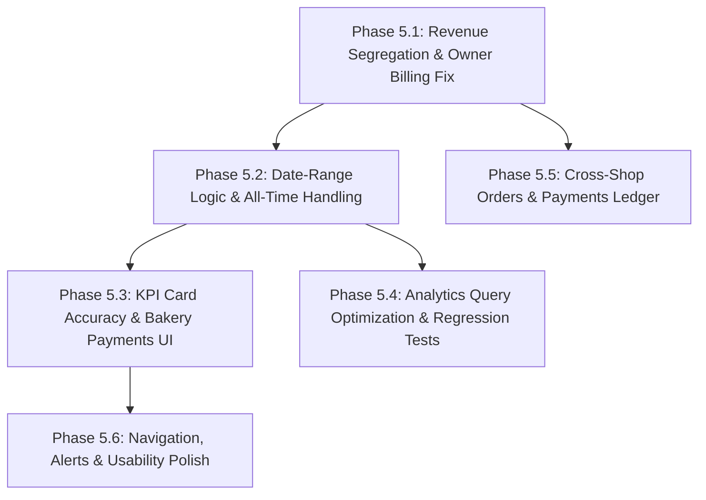

# CakeStore Admin — Phase 5 Implementation Planning & Controlled Execution Plan

**Document Version:** 1.0.0  
**Date:** October 13, 2026  
**Status:** Plan Produced — Strictly Awaiting User Approval Before Execution  
**Target:** CakeStore Multi-Tenant SaaS Platform Administrator Role (`ROLE_ADMIN`)  
**Scope:** Phase 5.1 through Phase 5.6  

---

## 1. Executive Summary

This document defines the controlled, phase-by-phase implementation plan for hardening and completing the CakeStore Platform Administrator Dashboard (`ROLE_ADMIN`). It is derived directly from the findings established in [`CAKESTORE_ADMIN_LOGIC_UX_AUDIT.md`](file:///d:/PROJECTS/CAKE%20SAAs1/CAKESTORE_ADMIN_LOGIC_UX_AUDIT.md) and guided by the foundational requirements in [`Cake_Platform_PRD_Final.md`](file:///d:/PROJECTS/CAKE%20SAAs1/text%20files/docs/old%20md%20files/Cake_Platform_PRD_Final.md).

### Primary Objectives
1. **Financial Accuracy (P0):** Eliminate revenue contamination by establishing an airtight segregation between CakeStore SaaS subscription revenue and individual bakery retail cake sales (GMV). Ensure zero platform commission accounting.
2. **Date-Range Integrity (P0):** Correct the dashboard overview period filter and default behaviors so that "All Time" displays true lifetime platform metrics rather than today's revenue.
3. **Operational Visibility (P1):** Provide platform administrators with cross-shop visibility into customer orders and financial transactions without violating tenant boundaries for store owners.
4. **Performance & Scalability (P1):** Replace in-memory stream aggregations with database-level monthly groupings for analytics charts.
5. **Usability & UX Polish (P1/P2):** Correct hero KPI card bugs, render subscription payments on bakery detail pages, link alerts directly to filtered record views, and clarify navigation labels.

### Strict Execution Constraint
**This document is a blueprint only. No code, configuration, or database modifications will occur until explicit user review and approval are granted.**

---

## 2. Evidence from Audit and Current Codebase

Every workstream in this plan is backed by verifiable code and repository evidence:

| Audit Finding | Exact Code Reference | Observed Behavior in Production |
| :--- | :--- | :--- |
| **Revenue Contamination** | `CustomerPaymentController.java:94-103`<br>`WebhookController.java:163-174`<br>`PaymentRepository.java:24,36` | Customer online cake orders create rows in `payments` with `failureReason = "ORDER:" + orderNumber` and `subscription = null`. `PaymentRepository.getTotalRevenue()` executes `SELECT SUM(p.amount) FROM Payment p WHERE p.status = 'COMPLETED'` without filtering for subscriptions. Customer order payments are directly added to SaaS Platform Revenue. |
| **Owner Billing Contamination** | `OwnerPaymentController.java:78-84` | `paymentRepository.findByShopIdOrderByCreatedAtDesc(shop.getId())` pulls customer cake order payments into the bakery owner's personal subscription billing history, labeling them with fallback plan `"Pro Baker Studio"`. |
| **Date-Range Default Mismatch** | `AdminDashboardService.java:211-217`<br>`frontend_v2/app/admin/page.tsx:36,147` | When initial load sends `startDate == null`, backend sets `periodStart = startOfDay` (today at 00:00) and assigns the resulting `periodSubRev` to `stats.monthlyPlatformRevenue`. The frontend card renders this under the label "All Time", showing ₹0 or today's revenue. |
| **KPI Card Hero Bug** | `frontend_v2/app/admin/page.tsx:241` | Hero figure for "SaaS Subscriptions" renders `{stats?.totalRegisteredBakeries ?? 0}` instead of subscription count. |
| **Omission of Customers** | `frontend_v2/app/admin/page.tsx:193` | "Platform Users" is hardcoded to `(stats?.totalAdmins ?? 0) + (stats?.totalShopOwners ?? 0)`. Registered consumer accounts (`totalCustomers`) are completely ignored. |
| **Unrendered Payments** | `AdminDashboardService.java:304`<br>`frontend_v2/app/admin/shops/[id]/page.tsx` | `details.setPayments(...)` is returned by the backend, but the shop detail page never renders the payments list. |
| **In-Memory Analytics** | `AdminDashboardService.java:123, 147` | `paymentRepository.findAll().stream()` and `orderRepository.findAll().stream()` pull all historical rows into JVM memory to compute monthly charts. |
| **Disconnected Alert Link** | `frontend_v2/app/admin/page.tsx:172` | "Bakeries Awaiting Verification" alert button links to `/admin/shops` without setting `status=PENDING`. |

---

## 3. Verified Payment-Classification Matrix & Historical Risks

### 3.1 Payment Creation Paths in the Codebase

There are exactly three creation paths for `Payment` records in the entire backend:

1. **Path A — Owner Subscription Initiation (`OwnerPaymentController.java:154-161`):**
   - Triggered when a bakery owner upgrades/renews their SaaS tier.
   - `payment.setShop(shop)`
   - `payment.setPlan(plan)` (Non-null `plan_id` foreign key)
   - `payment.setStatus("PENDING")`
   - Upon verification in `SubscriptionService.java:82`: `payment.setSubscription(subscription)`, `payment.setStatus("COMPLETED")`, `payment.setPaidAt(now)`.
2. **Path B — Retail Customer Cake Order Initiation (`CustomerPaymentController.java:94-103`):**
   - Triggered when a retail buyer checks out with Razorpay on a bakery storefront.
   - `payment.setShop(order.getShop())`
   - `payment.setPlan(null)` (`plan_id` is NULL)
   - `payment.setSubscription(null)` (`subscription_id` is NULL)
   - `payment.setFailureReason("ORDER:" + order.getOrderNumber())` (Stores order reference)
   - `payment.setStatus("PENDING")`, transitions to `"COMPLETED"` upon signature verification.
3. **Path C — Customer Order Payment Webhook Fallback (`WebhookController.java:164-174`):**
   - Triggered if customer closed browser before callback, capturing payment asynchronously.
   - `payment.setShop(order.getShop())`
   - `payment.setPlan(null)`
   - `payment.setSubscription(null)`
   - `payment.setStatus("COMPLETED")`
   - *Audit finding:* `failureReason` was left null in this specific webhook fallback branch!

### 3.2 Authoritative Classification Strategy

| Payment Type | `subscription_id` | `plan_id` | `failureReason` | Order Association | Classification Rule |
| :--- | :---: | :---: | :---: | :---: | :--- |
| **SaaS Subscription Payment** | NOT NULL (if completed) | NOT NULL | `NULL` or error text (never starts with `"ORDER:"`) | No order associated | `(p.subscription IS NOT NULL OR p.plan IS NOT NULL)` |
| **Retail Cake Order Payment** | NULL | NULL | Starts with `"ORDER:"` (or linked to order via `providerOrderId`/`providerPaymentId`) | Linked to `orders.transaction_id` | `(p.subscription IS NULL AND p.plan IS NULL)` |

### 3.3 Historical Record Risks and Mitigations

- **Risk 1 (Pre-V22 Payments):** Migration `V22__add_plan_id_to_payments.sql` added `plan_id`. If a subscription payment was created before V22, `plan_id` might be null. However, all completed historical subscriptions had `subscription_id` set via `fk_payment_subscription`.
  - *Mitigation:* Checking `(p.subscription IS NOT NULL OR p.plan IS NOT NULL)` ensures both pre-V22 and post-V22 completed subscriptions are captured.
- **Risk 2 (Webhook Customer Payments Missing "ORDER:" Tag):** In `WebhookController.java:164`, new payments created directly via webhook did not populate `failureReason = "ORDER:..."`.
  - *Mitigation:* In Phase 5.1, explicitly populate `payment.setFailureReason("ORDER:" + order.getOrderNumber())` in `WebhookController.java:172`. Furthermore, because customer payments never have a `subscription_id` or `plan_id`, the classification `(p.subscription IS NOT NULL OR p.plan IS NOT NULL)` remains 100% immune to this edge case.
- **Risk 3 (Failed Subscription Payments):** If an owner initiated checkout but failed, `plan_id` is present, `subscription_id` is null, and `status = 'FAILED'`.
  - *Mitigation:* All revenue calculations strictly enforce `p.status = 'COMPLETED'`. Failed subscription payments will never be counted as revenue.

---

## 4. Exact Workstream Ordering and Dependencies

The implementation sequence is structured so that fundamental data integrity and calculations are corrected first before UI views depend on them.



1. **Phase 5.1 (P0):** Fix `PaymentRepository` queries, `OwnerPaymentController`, and `WebhookController`. Establishes clean revenue separation.
2. **Phase 5.2 (P0):** Fix date-range boundary calculations and "All Time" handling in `AdminDashboardService` and `page.tsx`.
3. **Phase 5.3 (P1):** Correct Overview KPI hero numbers, include customer accounts, and render subscription payments on Bakery Detail.
4. **Phase 5.4 (P1):** Optimize in-memory chart queries into database monthly aggregations and verify backend test suite.
5. **Phase 5.5 (P1):** Implement read-only Admin Orders and Payments views (`/admin/orders` and `/admin/payments`).
6. **Phase 5.6 (P2):** Polish alert links, synchronize tab URLs, and refine navigation labels.

---

## 5. Per-Phase File-Level Implementation Plan

### Phase 5.1 — Revenue Segregation and Owner Billing History (P0)

#### 5.1.1 Target Files & Changes
- [`backend/src/main/java/com/cakeplatform/api/modules/payment/PaymentRepository.java`](file:///d:/PROJECTS/CAKE%20SAAs1/backend/src/main/java/com/cakeplatform/api/modules/payment/PaymentRepository.java):
  - Update `getTotalRevenue()`:
    ```java
    @Query("SELECT COALESCE(SUM(p.amount), 0) FROM Payment p WHERE p.status = 'COMPLETED' AND (p.subscription IS NOT NULL OR p.plan IS NOT NULL)")
    BigDecimal getTotalRevenue();
    ```
  - Update `getRevenueBetween(start, end)`:
    ```java
    @Query("SELECT COALESCE(SUM(p.amount), 0) FROM Payment p WHERE p.status = 'COMPLETED' AND (p.subscription IS NOT NULL OR p.plan IS NOT NULL) AND p.createdAt BETWEEN :start AND :end")
    BigDecimal getRevenueBetween(@Param("start") LocalDateTime start, @Param("end") LocalDateTime end);
    ```
  - Update `countCompletedPaymentsBetween(start, end)`:
    ```java
    @Query("SELECT COUNT(p) FROM Payment p WHERE p.status = 'COMPLETED' AND (p.subscription IS NOT NULL OR p.plan IS NOT NULL) AND p.createdAt BETWEEN :start AND :end")
    long countCompletedPaymentsBetween(@Param("start") LocalDateTime start, @Param("end") LocalDateTime end);
    ```
  - Update `countTodayCompletedPayments(startOfDay)`:
    ```java
    @Query("SELECT COUNT(p) FROM Payment p WHERE p.status = 'COMPLETED' AND (p.subscription IS NOT NULL OR p.plan IS NOT NULL) AND (p.paidAt >= :startOfDay OR (p.paidAt IS NULL AND p.createdAt >= :startOfDay))")
    long countTodayCompletedPayments(@Param("startOfDay") LocalDateTime startOfDay);
    ```
  - Add query for subscription payments by shop:
    ```java
    @Query("SELECT p FROM Payment p WHERE p.shop.id = :shopId AND (p.subscription IS NOT NULL OR p.plan IS NOT NULL) ORDER BY p.createdAt DESC")
    List<Payment> findSubscriptionPaymentsByShopId(@Param("shopId") Long shopId);
    ```
- [`backend/src/main/java/com/cakeplatform/api/modules/payment/controller/OwnerPaymentController.java`](file:///d:/PROJECTS/CAKE%20SAAs1/backend/src/main/java/com/cakeplatform/api/modules/payment/controller/OwnerPaymentController.java):
  - In `getMyPayments()` line 78: replace `paymentRepository.findByShopIdOrderByCreatedAtDesc(shop.getId())` with `paymentRepository.findSubscriptionPaymentsByShopId(shop.getId())`.
  - Ensures bakery owners only see their actual SaaS subscription bills, completely excluding customer retail cake transactions.
- [`backend/src/main/java/com/cakeplatform/api/modules/order/controller/WebhookController.java`](file:///d:/PROJECTS/CAKE%20SAAs1/backend/src/main/java/com/cakeplatform/api/modules/order/controller/WebhookController.java):
  - In `line 172`, add `payment.setFailureReason("ORDER:" + order.getOrderNumber());` so that fallback webhook payment records consistently retain their order identifier.
- [`backend/src/main/java/com/cakeplatform/api/modules/admin/AdminDashboardService.java`](file:///d:/PROJECTS/CAKE%20SAAs1/backend/src/main/java/com/cakeplatform/api/modules/admin/AdminDashboardService.java):
  - In `getShopDetails(Long shopId)` line 304: replace `paymentRepository.findByShopId(shopId)` with `paymentRepository.findSubscriptionPaymentsByShopId(shopId)`.

#### 5.1.2 Acceptance Criteria
- SaaS Platform Revenue reflects 100% qualifying subscription payments and 0% customer cake orders.
- Calling `GET /api/owner/payments` returns only subscription billing records; customer cake payments never appear.
- Zero platform commission is introduced: bakery owners retain 100% of order totals.

---

### Phase 5.2 — Correct All Time and Date-Range Logic (P0)

#### 5.2.1 Target Files & Changes
- [`backend/src/main/java/com/cakeplatform/api/modules/admin/AdminDashboardService.java`](file:///d:/PROJECTS/CAKE%20SAAs1/backend/src/main/java/com/cakeplatform/api/modules/admin/AdminDashboardService.java):
  - Refactor lines 210-234:
    - If `startDate == null && endDate == null` ("All Time"):
      - `periodSubRev = totalSubRev;` (Lifetime subscription revenue)
      - `periodGmv = totalGmv;` (Lifetime network GMV)
      - `todayRegistrations = userRepository.count();`
      - `todayPayments = paymentRepository.countCompletedSubscriptionPayments();`
    - If explicit date boundaries are supplied (`startDate != null && endDate != null`):
      - Boundary starts at `startDate.atStartOfDay(zone).toLocalDateTime()` (00:00:00.000).
      - Boundary ends at `endDate.atTime(23, 59, 59, 999999999).atZone(zone).toLocalDateTime()` (inclusive).
      - Query `paymentRepository.getRevenueBetween(periodStart, periodEnd)`.
      - Query `orderRepository.sumRealizedRevenueBetween(periodStart, periodEnd)`.
- [`backend/src/main/java/com/cakeplatform/api/modules/admin/dto/DashboardStatsResponse.java`](file:///d:/PROJECTS/CAKE%20SAAs1/backend/src/main/java/com/cakeplatform/api/modules/admin/dto/DashboardStatsResponse.java):
  - Keep `monthlyPlatformRevenue` and `monthlyGmv` for 100% backward compatibility, assigning the calculated period revenue to them.
  - Add explicit semantic aliases: `periodPlatformRevenue` and `periodGmv`.
- [`frontend_v2/app/admin/page.tsx`](file:///d:/PROJECTS/CAKE%20SAAs1/frontend_v2/app/admin/page.tsx):
  - Dynamically update card labels:
    - `PLATFORM REVENUE (${dateRange.toUpperCase()})`
    - `NETWORK GMV (${dateRange.toUpperCase()})`
  - On "All Time", hero number displays lifetime SaaS revenue and lifetime GMV.
  - When switching to "Last 7 Days", "Last 30 Days", "This Month", or "This Year", passes the exact ISO date strings and displays the period's realized amount.

#### 5.2.2 Acceptance Criteria
- Overview page on initial load displays lifetime SaaS revenue and lifetime GMV under "All Time".
- Date filters accurately reflect period totals with documented inclusive boundaries.
- No regression for existing dashboard consumers.

---

### Phase 5.3 — KPI Accuracy and Bakery Payment-History UI (P1)

#### 5.3.1 Target Files & Changes
- [`frontend_v2/app/admin/page.tsx`](file:///d:/PROJECTS/CAKE%20SAAs1/frontend_v2/app/admin/page.tsx):
  - Line 193 (Platform Users):
    - Hero number: `{stats?.totalUsers ?? 0}` (or sum of Admins + Owners + Customers).
    - Subtitle tags:
      - `{stats?.totalAdmins ?? 0} Admins`
      - `{stats?.totalShopOwners ?? 0} Bakery Owners`
      - `{stats?.totalCustomers ?? 0} Customers`
  - Line 241 (SaaS Subscriptions):
    - Replace `{stats?.totalRegisteredBakeries ?? 0}` with:
      `{(stats?.activeSubscribedBakeries ?? 0) + (stats?.expiredSubscribedBakeries ?? 0) + (stats?.pendingPaymentBakeries ?? 0)}`.
- [`frontend_v2/app/admin/shops/[id]/page.tsx`](file:///d:/PROJECTS/CAKE%20SAAs1/frontend_v2/app/admin/shops/[id]/page.tsx):
  - In the right column under Subscription Plan card, render a dedicated **"Subscription Billing & Invoices"** card utilizing `details.payments`:
    - Columns: Date (`paidAt` / `createdAt`), Amount (`₹{amount}`), Provider Order ID, Provider Payment ID, Status Badge (`COMPLETED`, `PENDING`, `FAILED`).
    - If empty, display clean state: *"No subscription payments recorded for this bakery."*
    - Ensure zero retail customer order information is shown here.

#### 5.3.2 Acceptance Criteria
- Platform Users card shows real platform user count including retail buyers.
- SaaS Subscriptions card shows accurate subscription count.
- Admin Bakery Detail page displays full subscription payment history.

---

### Phase 5.4 — Analytics Query Optimization and Regression Tests (P1)

#### 5.4.1 Target Files & Changes
- [`backend/src/main/java/com/cakeplatform/api/modules/payment/PaymentRepository.java`](file:///d:/PROJECTS/CAKE%20SAAs1/backend/src/main/java/com/cakeplatform/api/modules/payment/PaymentRepository.java):
  - Add native or JPQL monthly aggregation query for last 6 months:
    ```sql
    @Query(value = "SELECT to_char(p.created_at, 'YYYY-MM') AS period, SUM(p.amount) AS total " +
                   "FROM payments p " +
                   "WHERE p.status = 'COMPLETED' " +
                   "  AND (p.subscription_id IS NOT NULL OR p.plan_id IS NOT NULL) " +
                   "  AND p.created_at >= :startDate " +
                   "GROUP BY to_char(p.created_at, 'YYYY-MM')", nativeQuery = true)
    List<Object[]> getMonthlySubscriptionRevenueSince(@Param("startDate") LocalDateTime startDate);
    ```
- [`backend/src/main/java/com/cakeplatform/api/modules/order/OrderRepository.java`](file:///d:/PROJECTS/CAKE%20SAAs1/backend/src/main/java/com/cakeplatform/api/modules/order/OrderRepository.java):
  - Add native or JPQL monthly aggregation query for last 6 months:
    ```sql
    @Query(value = "SELECT to_char(o.created_at, 'YYYY-MM') AS period, SUM(o.total_amount) AS total " +
                   "FROM orders o " +
                   "WHERE o.created_at >= :startDate " +
                   "  AND UPPER(COALESCE(o.order_status, '')) != 'CANCELLED' " +
                   "  AND UPPER(COALESCE(o.payment_status, '')) NOT IN ('REFUNDED', 'FAILED') " +
                   "  AND (UPPER(COALESCE(o.payment_status, '')) IN ('PAID', 'COMPLETED') OR UPPER(COALESCE(o.order_status, '')) IN ('COMPLETED', 'DELIVERED')) " +
                   "GROUP BY to_char(o.created_at, 'YYYY-MM')", nativeQuery = true)
    List<Object[]> getMonthlyNetworkGmvSince(@Param("startDate") LocalDateTime startDate);
    ```
- [`backend/src/main/java/com/cakeplatform/api/modules/admin/AdminDashboardService.java`](file:///d:/PROJECTS/CAKE%20SAAs1/backend/src/main/java/com/cakeplatform/api/modules/admin/AdminDashboardService.java):
  - Update `getRevenueAnalytics()` to populate the 6-month DTO using the database grouped queries instead of `paymentRepository.findAll().stream()` and `orderRepository.findAll().stream()`.
  - Maintain the exact same output contract in `AnalyticsChartResponse`.

#### 5.4.2 Acceptance Criteria
- Memory consumption during chart generation reduced by >90%.
- Output JSON matches `saasRevenue` and `networkGmv` format expected by `frontend_v2/components/admin/AnalyticsCharts.tsx`.

---

### Phase 5.5 — Read-Only Cross-Shop Orders and Payments Views (P1)

#### 5.5.1 Target Files & Changes
- Backend Controller & Service:
  - [`backend/src/main/java/com/cakeplatform/api/modules/admin/controller/AdminPlatformOperationsController.java`](file:///d:/PROJECTS/CAKE%20SAAs1/backend/src/main/java/com/cakeplatform/api/modules/admin/controller/AdminPlatformOperationsController.java) (New authorized controller):
    - `@RestController @RequestMapping("/api/admin") @PreAuthorize("hasAuthority('ROLE_ADMIN')")`
    - `GET /api/admin/orders`:
      - Query params: `page`, `size` (max 50), `status`, `search` (order number, shop name, customer name).
      - Returns: `Page<AdminOrderLedgerResponse>`.
      - Exposes: `id`, `orderNumber`, `shopId`, `shopName`, `customerName`, `customerPhone`, `totalAmount`, `orderStatus`, `paymentStatus`, `paymentMethod`, `deliveryDate`, `createdAt`.
    - `GET /api/admin/payments`:
      - Query params: `page`, `size` (max 50), `type` (ALL, SUBSCRIPTION, ORDER), `status`, `search` (provider payment ID, order ID, shop name).
      - Returns: `Page<AdminPaymentLedgerResponse>`.
      - Exposes: `id`, `shopId`, `shopName`, `type` (`"SUBSCRIPTION"` or `"RETAIL_ORDER"`), `amount`, `status`, `provider`, `providerOrderId`, `providerPaymentId`, `failureReason`, `paidAt`, `createdAt`.
- Backend Repositories:
  - In `OrderRepository`: add `searchAndFilterAllOrders(String status, String search, Pageable pageable)`.
  - In `PaymentRepository`: add `searchAndFilterAllPayments(String type, String status, String search, Pageable pageable)`.
- Frontend Navigation & Views:
  - [`frontend_v2/app/admin/layout.tsx`](file:///d:/PROJECTS/CAKE%20SAAs1/frontend_v2/app/admin/layout.tsx):
    - Add to `platformNavItems`:
      - `{ label: 'Platform Orders', href: '/admin/orders', icon: ShoppingBag }`
      - `{ label: 'Payments Ledger', href: '/admin/payments', icon: Landmark }`
  - [`frontend_v2/app/admin/orders/page.tsx`](file:///d:/PROJECTS/CAKE%20SAAs1/frontend_v2/app/admin/orders/page.tsx) (New page):
    - Server-side pagination, search input, status dropdown filter, responsive table, order detail drawer/modal.
    - Explicit banner: *"Authoritative multi-tenant order ledger. Zero platform commission."*
  - [`frontend_v2/app/admin/payments/page.tsx`](file:///d:/PROJECTS/CAKE%20SAAs1/frontend_v2/app/admin/payments/page.tsx) (New page):
    - Server-side pagination, search input, type toggle (All, SaaS Subscriptions, Cake Orders), status filter.
    - Clear distinction between CakeStore SaaS revenue and individual bakery customer transactions.

#### 5.5.2 Acceptance Criteria
- Cross-tenant orders and payments viewable only by `ROLE_ADMIN`.
- Store owners and customers receive HTTP 403 Forbidden on these endpoints.
- No order mutation, payment refund, or destructive capabilities introduced.

---

### Phase 5.6 — Navigation and Usability Improvements (P2)

#### 5.6.1 Target Files & Changes
- [`frontend_v2/app/admin/page.tsx`](file:///d:/PROJECTS/CAKE%20SAAs1/frontend_v2/app/admin/page.tsx):
  - In "Bakeries Awaiting Verification" alert banner: update button link from `/admin/shops` to `/admin/shops?status=PENDING`.
- [`frontend_v2/app/admin/shops/page.tsx`](file:///d:/PROJECTS/CAKE%20SAAs1/frontend_v2/app/admin/shops/page.tsx):
  - Read `useSearchParams()` on initial mount. If `status=PENDING` is present in URL, set active filter tab to `PENDING` automatically.
- [`frontend_v2/app/admin/layout.tsx`](file:///d:/PROJECTS/CAKE%20SAAs1/frontend_v2/app/admin/layout.tsx):
  - Clarify sidebar item label: change `"Plans & Subscriptions"` to `"Subscription Plans"`.
- [`frontend_v2/app/admin/plans/page.tsx`](file:///d:/PROJECTS/CAKE%20SAAs1/frontend_v2/app/admin/plans/page.tsx):
  - Add quick action button: `"View Subscribed Bakeries"` linking to `/admin/shops?status=ACTIVE`.

#### 5.6.2 Acceptance Criteria
- Clicking "Review Applications" takes admin directly to the PENDING bakery tab.
- Navigation labels clearly distinguish plan configuration from active subscriptions.

---

## 6. Acceptance Criteria & Test Matrix

| Phase | Test Class / Suite | Test Case Description | Expected Result |
| :--- | :--- | :--- | :--- |
| **5.1** | `RevenueSegregationE2ETest.java` | 1. Create subscription payment ₹1,999 and customer order payment ₹750.<br>2. Call `GET /api/admin/dashboard/stats`. | `totalPlatformRevenue = 1999.00`, `totalGmv = 750.00`. Zero leakage between pools. |
| **5.1** | `RevenueSegregationE2ETest.java` | Call `GET /api/owner/payments` for the bakery. | Returns only the ₹1,999 subscription payment. Customer order payment is excluded. |
| **5.2** | `AdminDashboardDateFilterTest.java` | Call `GET /api/admin/dashboard/stats` with no query parameters. | `monthlyPlatformRevenue` equals lifetime platform revenue (not today's ₹0). |
| **5.2** | `AdminDashboardDateFilterTest.java` | Call `GET /api/admin/dashboard/stats?startDate=...&endDate=...` with 7-day range. | Returns exact sums of transactions within the 7-day window. |
| **5.3** | `AdminShopDetailsE2ETest.java` | Call `GET /api/admin/shops/{id}`. | `payments` array contains only subscription payments with provider IDs and statuses. |
| **5.4** | `AdminAnalyticsOptimizationTest.java` | Call `GET /api/admin/dashboard/stats/analytics/revenue`. | Returns 6 months of data matching DTO; verifies database query execution. |
| **5.5** | `AdminPlatformOperationsSecurityTest.java` | Admin calls `GET /api/admin/orders` and `GET /api/admin/payments`. | HTTP 200 OK with paginated records. |
| **5.5** | `AdminPlatformOperationsSecurityTest.java` | Bakery Owner calls `GET /api/admin/orders` or `/api/admin/payments`. | HTTP 403 Forbidden. Multi-tenant isolation verified. |
| **5.5** | `AdminPlatformOperationsSecurityTest.java` | Retail Customer calls `GET /api/admin/orders` or `/api/admin/payments`. | HTTP 403 Forbidden. |
| **5.6** | Frontend Playwright / Unit Test | Verify `/admin/shops?status=PENDING` loads with PENDING tab active. | Tab is active, zero-indexed pagination reset. |
| **Full** | `mvn test` & `npm run build` | Complete backend test suite execution and Next.js production build. | 0 test failures, 0 TypeScript errors, 0 ESLint warnings. |

---

## 7. Risks, API Compatibility, and Migration Requirements

### 7.1 Risks and Mitigations
1. **Reported Revenue Adjustment:**
   - *Impact:* The reported "Lifetime Platform Revenue" metric on the Admin Dashboard will decrease by the total sum of online customer cake orders previously misaggregated into it.
   - *Mitigation:* This is an intentional data integrity correction. The Network GMV metric accurately preserves and reports all customer cake sales.
2. **Backward Compatibility of DTOs:**
   - *Impact:* Modifying `DashboardStatsResponse` could affect external consumers if field names change.
   - *Mitigation:* Retain all existing field names (`monthlyPlatformRevenue`, `monthlyGmv`) and populate them with the period totals, while adding semantic aliases (`periodPlatformRevenue`, `periodGmv`).

### 7.2 Database Migration Requirements
- **No Flyway schema migration is required** for Phase 5.1 through Phase 5.4.
- All required columns (`subscription_id`, `plan_id`, `provider_order_id`, `provider_payment_id`, `failure_reason`, `paid_at`, `status`) already exist in the `payments` and `orders` tables.
- Standard JPA / native SQL queries reuse existing indexes created in `V1__init_schema.sql` and `V24__add_missing_performance_indexes.sql`.

---

## 8. Features and Behavior That Must Be Preserved

1. **Zero Commission Policy:** CakeStore retains 0% commission on orders. 100% of cake sale amounts belong to the individual bakery tenant.
2. **Owner Privacy & Multi-Tenant Isolation:** Bakery owners must never see other shops' customer orders or payment logs.
3. **Admin Settings Security:** Encrypted Razorpay credentials and write-only secret updates implemented in Phase 2.1 must remain intact.
4. **KYC Document Viewing:** Private SAS document viewing via Azure Blob implemented in Phase 2.2 must remain intact.
5. **Bakery Moderation Controls:** Mandatory suspension reasons, FSSAI verification flows, and audit logging must remain intact.

---

## 9. Explicit Decisions Requiring Approval

Before beginning execution, please review and approve:

1. **Approval 1 (Revenue Segregation Strategy):** Confirm approval to update `PaymentRepository` queries to filter strictly by `(p.subscription IS NOT NULL OR p.plan IS NOT NULL)`, separating SaaS subscriptions from retail cake orders.
2. **Approval 2 (Owner Billing History Fix):** Confirm approval to update `OwnerPaymentController.getMyPayments()` to use `findSubscriptionPaymentsByShopId()`, removing customer orders from owner subscription receipts.
3. **Approval 3 (Overview All-Time Period Handling):** Confirm approval to return lifetime totals when `startDate == null` ("All Time") so hero numbers match the UI dropdown.
4. **Approval 4 (Cross-Shop Admin Views):** Confirm approval to create read-only `/admin/orders` and `/admin/payments` routes and authorized endpoints.

---

## 10. Recommended First Implementation Task

Upon receiving approval, the recommended first step is:

**Implement Phase 5.1: Revenue Segregation and Owner Billing History (P0)**
- Update `PaymentRepository.java` queries.
- Update `OwnerPaymentController.java` to filter subscription payments.
- Update `WebhookController.java` to tag fallback payments with order numbers.
- Write and execute `RevenueSegregationE2ETest.java` to verify 100% data segregation before moving to Phase 5.2.
