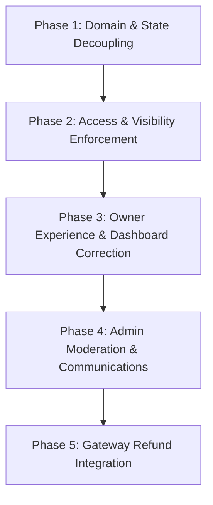

# CakeStore — Bakery Lifecycle & Marketplace Visibility Audit

**Audit Date:** October 14, 2026  
**Auditor:** Antigravity AI Pair Programmer (DeepMind Advanced Agentic Coding)  
**Status:** Complete Read-Only Investigation  
**Target Document:** `CAKESTORE_BAKERY_LIFECYCLE_AUDIT.md`  

---

## 1. Executive Summary & Readiness Assessment

CakeStore has established foundational separation between **SaaS Subscription lifecycle** and **Bakery KYC / FSSAI Document Verification**. The codebase contains comprehensive logic for server-authoritative Razorpay order creation, signature verification, webhook processing, tenant isolation, and automated daily expiration scheduling.

However, an in-depth code-level audit against the authoritative business rules reveals **critical structural gaps and edge-case conflicts** that prevent production readiness under the target specification:

1. **Owner-Disabled Preference Destruction (Critical Defect):**  
   When a shop owner disables their shop (`ShopStatus.INACTIVE`), a subsequent subscription renewal payment unconditionally overwrites the shop status to `ShopStatus.ACTIVE` via `SubscriptionService.processSuccessfulPayment(...)` -> `ShopStatusManager.activateShop(...)`. Furthermore, daily subscription expiration unconditionally overwrites an `INACTIVE` shop status to `ShopStatus.EXPIRED`. This erases the owner's operational preference.
2. **Owner-Disabled Shop Locks Owner Dashboard (Critical Defect):**  
   In `ShopAccessValidator.getValidShopForOwner(...)`, line 70 strictly requires `shop.getStatus() == ShopStatus.ACTIVE`. If an owner intentionally sets their shop to `INACTIVE` (e.g. vacation, seasonal break), all operational owner endpoints (products, orders, custom cakes, slots, analytics) throw `SubscriptionExpiredException` (HTTP 403 Forbidden). The system treats an owner-disabled shop as if its subscription were expired.
3. **Admin Suspension vs. Temporary Marketplace Restriction (High Architecture Conflict):**  
   The platform only possesses a single `ShopStatus.SUSPENDED` state. This state completely severs owner dashboard access via `ShopAccessValidator` (throwing HTTP 403). The target business rules require a **temporary marketplace restriction** where the storefront is hidden, but the owner **retains dashboard access** with an explicit reason to correct issues.
4. **Complete Absence of Real Payment Gateway Refunds (High Finding):**  
   There is **no programmatic refund integration** with Razorpay. `RazorpayService` contains zero refund methods (no `client.payments.refund(...)`). In `OrderService`, marking an order `REFUNDED` only updates the database column and sends an email/SMS notification without initiating a monetary transaction. For SaaS subscriptions, there is no refund workflow whatsoever.
5. **Dead-Code Subscription Enums & Missing Cancellation Lifecycle (Medium Finding):**  
   The enum values `SubscriptionStatus.GRACE_PERIOD`, `EXPIRING_SOON`, and `CANCELLED` exist in the domain model but are never transitioned or scheduled in runtime code. `SubscriptionScheduler` moves subscriptions directly from `ACTIVE` to `EXPIRED` at midnight on day 0, bypassing grace periods. No endpoint or service method exists to cancel a subscription while retaining paid entitlement.
6. **Regulatory / Compliance Exposure (FSSAI Food Safety):**  
   While the platform deliberately permits shops with `VerificationStatus.PROCESSING` to sell upon paying a subscription, Indian food safety regulations (FSSAI Act, 2006) legally require valid registration/licensing before food business operations commence.

### Platform Readiness Rating: **NOT PRODUCTION READY FOR TARGET LIFECYCLE (REQUIRES PHASED REFACTORING)**

---

## 2. Actual Current Lifecycle Model & Status Definitions

### 2.1 Entities & Enums

#### A. `ShopStatus` (`com.cakeplatform.api.modules.shop.ShopStatus`)
- **`PENDING`**: Initial state assigned upon bakery owner registration (`AuthService.java:231`). Storefront invisible; operational owner dashboard blocked.
- **`ACTIVE`**: Fully operational and visible state. Assigned upon successful subscription payment verification (`SubscriptionService.java:96`).
- **`INACTIVE`**: Shop disabled. Can be set by admin (`ShopStatusManager.markShopInactive`) or owner (`ShopService.updateShopStatusAndReason`). **Currently locks owner dashboard**.
- **`SUSPENDED`**: Admin disciplinary state (`ShopStatusManager.suspendShop`). Storefront hidden and owner dashboard completely blocked.
- **`EXPIRED`**: Subscription lapse state (`SubscriptionService.expireSubscription`). Storefront hidden and owner dashboard blocked.

#### B. `VerificationStatus` (`com.cakeplatform.api.modules.shop.VerificationStatus`)
- **`PROCESSING`**: Initial state upon registration document submission (`AuthService.java:232`).
- **`VERIFIED`**: Admin approved (`AdminDashboardService.reviewShopVerification`). Grants storefront verified badge.
- **`ACTION_REQUIRED`**: Enum declared; **never assigned in backend code**.
- **`REJECTED`**: Admin rejected document with mandatory reason (`AdminDashboardService.reviewShopVerification:485`).

#### C. `SubscriptionStatus` (`com.cakeplatform.api.modules.subscription.SubscriptionStatus`)
- **`PENDING`**: Enum declared. Local `Payment` records are created in `PENDING` state, but `Subscription` records are only created upon successful capture directly into `ACTIVE`.
- **`ACTIVE`**: Active paid entitlement with future `expiryDate`.
- **`EXPIRING_SOON`**: Enum declared; **never persisted in database**. `SubscriptionScheduler` dispatches notification warnings at 7, 5, 3, 1 days, but leaves `sub.status = ACTIVE`.
- **`EXPIRED`**: Set by `SubscriptionScheduler` daily cron when `daysUntilExpiry <= 0`.
- **`GRACE_PERIOD`**: Enum declared; **dead code** (never assigned).
- **`SUSPENDED`**: Enum declared; checked in `ShopAccessValidator`, but never set by any service.
- **`CANCELLED`**: Enum declared; checked in `ShopAccessValidator` and `CustomerStorefrontService`, but **no cancellation endpoint or service logic exists**.

#### D. Soft-Deletion Model (`@SQLDelete` & `@SQLRestriction`)
- **`Shop.java`**: Annotated with `@SQLDelete(sql = "UPDATE shops SET is_deleted = true WHERE id=?")` and `@SQLRestriction("is_deleted=false")`.
- **`User.java`**: Annotated with `@SQLDelete(sql = "UPDATE users SET is_deleted = true WHERE id=?")` and `@SQLRestriction("is_deleted=false")`.
- **`OwnerAccountDeletionService.java`**:
  - Validates zero active customer orders.
  - Deletes physical media, interaction records, coupons, delivery slots, and products.
  - **Preserves** historical `Order`, `Payment`, and `Subscription` records for audit/reporting.
  - Calls `shopRepository.delete(shop)` (triggers SQL soft delete).
  - Anonymizes owner email (`deleted_<timestamp>_<id>@deleted.cakeplatform.com`), clears password hash, sets `UserStatus.DISABLED`, and calls `userRepository.delete(user)` (triggers SQL soft delete).

---

## 3. Current-Versus-Intended Visibility Matrix

| Scenario # | Scenario Description | Expected Storefront Visibility | Expected Verified Badge | Expected Owner Dashboard Access | Expected Order Placement | Current Actual Implementation & Code Reference | Automated Test Coverage |
| :--- | :--- | :--- | :--- | :--- | :--- | :--- | :--- |
| **1** | Newly registered; subscription pending | **Hidden** | **None** | **Billing / Setup only** (Operational blocked) | **Blocked** | `ShopStatus.PENDING`, `verificationStatus.PROCESSING`. Storefront filters out non-`ACTIVE` (`ShopSpecification.java:52`). Dashboard operational APIs throw `SubscriptionExpiredException` (`ShopAccessValidator.java:71`). | Covered (`BakeryLifecyclePhase1Test.testRegistrationCreatesPendingShop`, `SubscriptionDecouplingTest.testPendingShop_CustomerBlocked`) |
| **2** | Subscription active; document verification pending | **Visible** | **None** | **Full Access** (Shows pending verification banner) | **Allowed** | `shop.status == ACTIVE`, `sub.status == ACTIVE`, `verificationStatus == PROCESSING`. Storefront queries only require `ACTIVE` status and valid subscription (`CustomerStorefrontService.java:151,163`). Verified badge is strictly `verificationStatus == VERIFIED` (`CustomerStorefrontService.java:539`). | Covered (`BakeryLifecyclePhase1Test.testPaidUnverified_ShopActiveVerificationProcessing`) |
| **3** | Subscription active; document verified | **Visible** | **Visible** (Verified Badge) | **Full Access** | **Allowed** | `shop.status == ACTIVE`, `verificationStatus == VERIFIED`. Storefront displays badge (`frontend_v2/components/storefront/ShopHeader.tsx`). | Covered (`BakeryLifecyclePhase1Test.testVerifiedBadge_StrictlyChecksVerificationStatus`) |
| **4** | Subscription active; document rejected / action required | **Visible** (or restricted if admin chooses) | **None** | **Full Access** (Shows rejection reason & upload prompt) | **Allowed** | `verificationStatus == REJECTED`. Admin rejection (`AdminDashboardService.java:485`) does NOT alter `shop.status`. Bakery remains `ACTIVE` and visible on storefront; customers can still place orders. | **Partially Covered** (Admin approval/rejection verified, but storefront order placement during rejection is not explicitly asserted) |
| **5** | Subscription expired | **Hidden** | **None** (Shop inaccessible) | **Billing / Renewal only** | **Blocked** | `SubscriptionScheduler.java:53` runs daily; calls `subscriptionService.expireSubscription(id)`: sets `sub.status = EXPIRED`, `shop.status = EXPIRED`. `ShopSpecification.java:52` and `CustomerStorefrontService.java:163` block storefront and orders (`RuntimeException: Storefront unavailable due to expired subscription`). `ShopAccessValidator.java:62` blocks owner. | Covered (`BakeryLifecyclePhase1Test.testSubscriptionExpiry_SetsShopAndSubscriptionExpired`, `testExpiredBakery_CustomerStorefrontIsBlocked`) |
| **6** | Subscription renewed successfully | **Visible** (if not otherwise restricted) | **Preserved** (Unchanged from pre-renewal) | **Full Access** | **Allowed** | `SubscriptionService.java:96` calls `shopStatusManager.activateShop(shopId, userId)`, setting `shop.status = ACTIVE`. `verificationStatus` is untouched (`BakeryLifecyclePhase1Test:338`). Storefront cache evicted. | Covered (`BakeryLifecyclePhase1Test.testSuccessfulRenewal_ActivatesShopAndSubscription`) |
| **7** | Owner-disabled shop with active subscription | **Hidden** | **None** (Storefront hidden) | **Full Access** (Owner can manage shop and re-enable) | **Blocked** | **DEFECT**: Owner sets `shop.status = INACTIVE` via `ShopService.java:53`. Storefront correctly hides shop (`ShopSpecification.java:52`). **However**, `ShopAccessValidator.java:70` throws `SubscriptionExpiredException`, **locking the owner out of their own dashboard**! Furthermore, renewing subscription or expiry overwrites `INACTIVE` to `ACTIVE` or `EXPIRED`. | **NOT COVERED / CONFLICTS WITH INTENDED BEHAVIOR** |
| **8** | Admin-restricted shop with active subscription | **Hidden** | **None** (Storefront hidden) | **Full Access** (With admin restriction notice & reason) | **Blocked** | **DEFECT**: Platform uses `ShopStatus.SUSPENDED` (`ShopStatusManager.java:49`). Storefront is hidden, but `ShopAccessValidator.java:54` **blocks the owner completely** (`SubscriptionExpiredException: Shop is suspended by administration`). Owner has no dashboard access to resolve issues. | Covered for current lock-out behavior (`SubscriptionDecouplingTest.testAdminSuspended_OwnerBlocked`), but **fails target specification** |
| **9** | Admin-restricted shop after subscription renewal | **Hidden** | **None** | **Full Access** (Restriction remains, renewal paid) | **Blocked** | `SubscriptionService.java:93`: `if (shop.getStatus() == ShopStatus.SUSPENDED) { log.info("...shop remains SUSPENDED"); } else { activateShop(); }`. Renewal preserves `SUSPENDED` status, but owner remains completely locked out of dashboard. | Covered (`BakeryLifecyclePhase1Test`) |
| **10** | Cancelled subscription | **Hidden** (after period end) or immediate if non-renewing | **None** | **Grace/Read-only or Billing only** | **Blocked** | **DEFECT**: `SubscriptionStatus.CANCELLED` exists in enum and `ShopAccessValidator:64`, but there is **no cancellation API or workflow** in `SubscriptionService`. Subscription cannot be cancelled. | **NOT COVERED** (Enum exists, no workflow implemented) |
| **11** | Soft-deleted shop or owner | **Hidden** | **None** | **Blocked** (Account deleted) | **Blocked** | Hibernate `@SQLRestriction("is_deleted=false")` automatically filters out deleted records from all standard JPA queries (`findById`, `findAll`). `OwnerAccountDeletionService.java:209` marks owner user `DISABLED` and anonymized. | Covered in unit tests (`OwnerAccountDeletionServiceTest.java`) |
| **12** | Failed, pending, duplicated, or delayed payment/webhook | **Hidden** (until confirmed) | **None** | **Pending Payment screen** | **Blocked** | `OwnerPaymentController.verifySubscriptionPayment` and `WebhookController.handleRazorpayWebhook` use pessimistic DB row locking (`findByIdWithLock`), idempotency checks (`COMPLETED` check), and transaction signature verification. Failed payment marks `Payment.status = FAILED` and leaves `ShopStatus.PENDING` or `EXPIRED`. | Covered (`BakeryLifecyclePhase1Test.testFailedPayment_ShopRemainsPending`, `WebhookControllerTest`) |

---

## 4. Exact Backend & Frontend Code Locations

### 4.1 Backend Architecture Map

| Functionality | File Path | Line Range | Key Logic / Responsibilities |
| :--- | :--- | :--- | :--- |
| **Bakery Registration & Initial State** | `backend/src/main/java/com/cakeplatform/api/modules/auth/service/AuthService.java` | L193–L235 | Instantiates `Shop`, sets `status = PENDING`, `verificationStatus = PROCESSING`. Dispatches admin notifications. |
| **Owner Dashboard Access Gating** | `backend/src/main/java/com/cakeplatform/api/modules/security/ShopAccessValidator.java` | L41–L76 | `getValidShopForOwner(Long ownerId)`: Throws 403 if `SUSPENDED`, subscription not active/expired, or `shop.status != ACTIVE`. |
| **Subscription Payment Verification** | `backend/src/main/java/com/cakeplatform/api/modules/payment/controller/OwnerPaymentController.java` | L201–L285 | `verifySubscriptionPayment`: Validates Razorpay HMAC signature, amount, currency, and forwards to `SubscriptionService`. |
| **Subscription Activation & Renewal** | `backend/src/main/java/com/cakeplatform/api/modules/subscription/SubscriptionService.java` | L52–L131 | `processSuccessfulPayment`: Pessimistic lock, creates `Subscription(ACTIVE)`, activates shop (unless `SUSPENDED`). |
| **Subscription Expiration Scheduler** | `backend/src/main/java/com/cakeplatform/api/modules/subscription/SubscriptionScheduler.java` | L28–L65 | Cron `0 0 0 * * ?`: Warns at 7, 5, 3, 1 days; calls `expireSubscription` when days <= 0. |
| **Subscription Expiration Execution** | `backend/src/main/java/com/cakeplatform/api/modules/subscription/SubscriptionService.java` | L135–L192 | `expireSubscription`: Sets `sub.status = EXPIRED`, sets `shop.status = EXPIRED` (unless `SUSPENDED`), evicts cache. |
| **Shop Status Transitions** | `backend/src/main/java/com/cakeplatform/api/modules/shop/ShopStatusManager.java` | L33–L103 | `activateShop`, `markShopInactive`, `suspendShop`. Enforces active subscription check before activating. |
| **Owner Shop Status Updates** | `backend/src/main/java/com/cakeplatform/api/modules/shop/service/ShopService.java` | L48–L72 | `updateShopStatusAndReason`: Allows owner to set `INACTIVE` or `ACTIVE` (unless `SUSPENDED`). Missing sub check on re-activation! |
| **Admin Moderation & KYC Review** | `backend/src/main/java/com/cakeplatform/api/modules/admin/AdminDashboardService.java` | L394–L520 | `updateShopStatus` (handles `SUSPENDED`, `ACTIVE`, `INACTIVE`) and `reviewShopVerification` (`APPROVE` -> `VERIFIED`, `REJECT` -> `REJECTED`). |
| **Marketplace Search Filter** | `backend/src/main/java/com/cakeplatform/api/modules/shop/ShopSpecification.java` | L48–L53 | `cb.equal(root.get("status"), ShopStatus.ACTIVE)`. Strictly filters out all non-ACTIVE shops from discovery. |
| **Storefront Direct Shop Access** | `backend/src/main/java/com/cakeplatform/api/modules/storefront/CustomerStorefrontService.java` | L147–L198 | `getActiveShop`: Requires `shop.status == ACTIVE` AND `isShopSubscriptionValid(shopId)`. |
| **Storefront Order Placement** | `backend/src/main/java/com/cakeplatform/api/modules/storefront/CustomerStorefrontService.java` | L662–L715 | `placeGuestOrder`: Calls `getActiveShop(shopId)`. Enforces delivery slot capacity and payment method. |
| **Payment Gateway Integration** | `backend/src/main/java/com/cakeplatform/api/modules/payment/RazorpayService.java` | L1–L238 | `createSubscriptionOrder`, `createCustomerOrder`, `verifyPaymentSignature`, `verifyWebhookSignature`. Zero refund logic. |
| **Razorpay Webhooks** | `backend/src/main/java/com/cakeplatform/api/modules/order/controller/WebhookController.java` | L54–L337 | Validates webhook signature and event ID idempotency. Handles `payment.captured` and `payment.failed`. |
| **Account Soft-Deletion** | `backend/src/main/java/com/cakeplatform/api/modules/user/service/OwnerAccountDeletionService.java` | L71–L215 | `deleteOwnerAccount`: Verifies password & phrase, checks active orders, deletes media/interactions, preserves orders/subs/payments, soft-deletes shop & owner. |

### 4.2 Frontend Architecture Map

| Functionality | File Path | Key Logic / Presentation |
| :--- | :--- | :--- |
| **Owner Subscription Header** | `frontend_v2/lib/utils/subscription.ts` | `getSubscriptionHeaderInfo`: Calculates days remaining; maps `ACTIVE`, `EXPIRING_SOON`, `GRACE_PERIOD`, `EXPIRED`, `SUSPENDED`, `PENDING` to badges. |
| **Owner Dashboard Layout** | `frontend_v2/app/dashboard/owner/layout.tsx` | Displays subscription badge, shop business name, verified badge (`shop.verificationStatus === 'VERIFIED'`). |
| **Owner Setup Checklist** | `frontend_v2/components/owner/SetupChecklist.tsx` | Checks whether shop is activated or subscription is active. |
| **Owner Subscription Management** | `frontend_v2/app/dashboard/owner/subscription/page.tsx` | Displays current plan, billing history, invoice download, and triggers Razorpay modal for renewals. |
| **Storefront Shop Page** | `frontend_v2/components/storefront/ShopHeader.tsx` | Renders verified badge if `shop.verificationStatus === 'VERIFIED'`. Shows closed/inactive message if shop unavailable. |
| **Admin Bakery Details** | `frontend_v2/app/admin/shops/[id]/page.tsx` | Admin controls for KYC approval/rejection (with reason) and bakery status change (`ACTIVE`, `INACTIVE`, `SUSPENDED`). |

---

## 5. Payment, Renewal, Expiry, Cancellation & Refund Findings

### 5.1 Registration & Payment Initiation
- Upon registration in `AuthService.java`, a `Shop` is created with `status = PENDING` and `verificationStatus = PROCESSING`. No `Subscription` record is created initially (returns `subscriptionStatus: "NONE"`).
- The owner calls `POST /api/owner/payments/initiate-subscription` with `planId`. Server fetches `SubscriptionPlan` authoritatively, creates a local `Payment` in `PENDING` status, and calls `RazorpayService.createSubscriptionOrder(...)`.

### 5.2 Payment Verification & Webhook Handling
- Client-side checkout completes and calls `POST /api/owner/payments/verify-subscription`.
- Signature is verified via HMAC-SHA256 (`orderId + "|" + paymentId`, `keySecret`). Amount and currency are double-checked against Razorpay API (`verifyOrderDetails`).
- `SubscriptionService.processSuccessfulPayment(...)` locks the `Payment` row using `findByIdWithLock(paymentId)`.
- If Razorpay webhook fires (`payment.captured`), `WebhookController.java` checks `WebhookEventRepository.existsByEventId(...)`. If already completed, it returns HTTP 200 idempotently.

### 5.3 Expiry & Renewal
- `SubscriptionScheduler.java` runs daily at 00:00:00. It queries `findExpiringSubscriptions(now)` and `findExpiringWithinDays(...)`.
- Warnings are dispatched at 7, 5, 3, and 1 days.
- When `daysRemaining <= 0`, it invokes `SubscriptionService.expireSubscription(id)`.
- **Expiry Behavior**: Sets `subscription.status = EXPIRED`. If `shop.status != SUSPENDED`, it sets `shop.status = EXPIRED`.
- **Renewal Behavior**: If an expired shop renews, `processSuccessfulPayment` creates a new `ACTIVE` subscription and calls `shopStatusManager.activateShop(shopId, userId)`, restoring `shop.status = ACTIVE`.

### 5.4 Grace Period & Status Enum Realities
- `SubscriptionStatus.GRACE_PERIOD` is **never utilized**. The system expires subscriptions instantly upon reaching expiry date without entering a grace period.
- `SubscriptionStatus.EXPIRING_SOON` is **never saved to the database**.

### 5.5 Cancellation Semantics
- `SubscriptionStatus.CANCELLED` is referenced in checks, but **no cancellation flow exists**.
- There is no mechanism for an owner or admin to cancel an ongoing subscription, nor is there logic to specify whether cancellation takes effect immediately or at the end of the paid billing cycle.

### 5.6 Detailed Refund Investigation

Audit of `RazorpayService.java`, `PaymentRepository.java`, `OrderService.java`, and `AdminDashboardService.java` regarding refund capabilities:

1. **Current Refund APIs & Provider Calls:**
   - **Result: ZERO PROVIDER CALLS.**
   - `RazorpayService.java` does NOT import or call `com.razorpay.Refund` or `client.payments.refund(...)`.
   - Searching the entire backend codebase for Razorpay refund operations yields **0 occurrences**.
2. **Order "Refund" in `OrderService.java`:**
   - `OrderService.updateOrderPaymentStatus(orderId, "REFUNDED", note, userId)` (lines 185–216):
     - Sets `order.paymentStatus = "REFUNDED"`.
     - Sets `order.transactionId = note != null ? note : "REFUND_ISSUED"`.
     - Sends customer email and SMS stating: *"A refund of ₹... has been processed successfully."*
     - **Critical Risk:** This is a **simulated/manual database flag only**. No money is refunded to the customer's bank or card via Razorpay!
3. **SaaS Subscription Refunds:**
   - When an admin suspends a bakery (`ShopStatusManager.suspendShop`) or marks it inactive, **no refund calculation, API call, or credit record is created**.
   - If a bakery paid ₹350 or ₹999 for 30 or 365 days and is suspended on Day 2, their money remains fully captured with no platform refund mechanism.
4. **Duplicate-Refund Safeguards & Retry Behavior:**
   - None exist because refund requests cannot be submitted through the system.
5. **Webhook Gaps:**
   - `WebhookController.java` only processes `payment.captured` and `payment.failed`. Webhooks for `refund.created`, `refund.processed`, or `refund.failed` are ignored with `200 OK (no entity)`.

---

## 6. Security & Tenant-Isolation Concerns

1. **Tenant Isolation Enforcement:**
   - Operational endpoints consistently use `ShopAccessValidator.getShopByOwnerId(userDetails.getId())` or `getValidShopForOwner(userDetails.getId())`.
   - `PaymentRepository.findByIdAndShopId(paymentId, shop.getId())` prevents cross-tenant invoice downloads.
   - Storefront guest order checkout uses pessimistic locks on delivery slots scoped to `shopId` (`findByIdAndShopIdWithLock`).
2. **Missing Sub Check on Owner Re-Activation (`ShopService.java:48`):**
   - In `ShopService.updateShopStatusAndReason(...)`, an owner can call `updateShopStatusAndReason(ownerId, ShopStatus.ACTIVE, null)`.
   - While `shopStatusManager.activateShop(...)` checks `hasActiveSubscription`, `ShopService.updateShopStatusAndReason(...)` directly assigns `shop.setStatus(status)` **without verifying if the subscription is active**!
   - Although `ShopAccessValidator` would still block them from products/orders, `Shop.status` in the database erroneously becomes `ACTIVE`.
3. **Storefront `isShopSubscriptionValid` Fallback Bug:**
   - In `CustomerStorefrontService.java:184`:
     ```java
     switch (latest.getStatus()) {
         case EXPIRED:
         case SUSPENDED:
         case CANCELLED:
             return false;
         default:
             break;
     }
     ```
   - If a subscription has `status == PENDING` and `expiryDate == null`, it reaches `return true;`. It relies entirely on `shop.status == ACTIVE` to prevent unauthorized storefront display.
4. **Unauthenticated Order Status Information:**
   - `CustomerStorefrontController.getGuestOrderDetails` requires phone number matching for unauthenticated users, safely guarding customer PII.

---

## 7. Existing Test Coverage & Missing Test Cases

### 7.1 Existing Automated Tests

The test suite contains dedicated unit and mock-based lifecycle tests in `backend/src/test/java/com/cakeplatform/api/modules/subscription/`:

1. **`BakeryLifecyclePhase1Test.java` (17 Tests):**
   - Req 1: Registration creates `PENDING` shop with `PROCESSING` verification.
   - Req 2: Successful payment activates subscription and shop.
   - Req 3: Failed payment leaves shop `PENDING`.
   - Req 4: Paid unverified shop has `ACTIVE` status and `PROCESSING` verification.
   - Req 5: Admin approval sets `VERIFIED` while shop remains `ACTIVE`.
   - Req 6: Verified badge strictly checks `verificationStatus == VERIFIED`.
   - Req 7: Subscription expiry sets shop and subscription `EXPIRED`.
   - Req 8: Expired owner operational APIs blocked with 403.
   - Req 9: Expired owner billing lookup accessible.
   - Req 10: Successful renewal activates shop and subscription.
   - Req 11: `VERIFIED` status preserved after renewal.
   - Req 12 & 13: Expired bakery customer storefront and orders blocked.
   - Req 14: Admin `SUSPENDED` shop blocks customer storefront and orders.
   - Req 15: Multi-tenant payment isolation.
   - Req 16: Subscription expiration idempotency.
   - Req 17: Early renewal prevents shop expiration when old subscription expires.

2. **`SubscriptionDecouplingTest.java` (11 Tests):**
   - Validates decoupling of expiration, access gating, customer blocking, and multi-tenant isolation.

3. **`SubscriptionSchedulerTest.java` (2 Tests):**
   - Validates scheduled daily execution and expiration calls.

### 7.2 Critical Missing Test Cases

The following essential business scenarios have **zero automated test coverage**:

- [ ] **Owner-disabled shop preservation on renewal:** Test that renewing a subscription while `shop.status == INACTIVE` keeps `shop.status == INACTIVE`. *(Currently would FAIL if tested!)*
- [ ] **Owner-disabled shop preservation on expiry:** Test that subscription expiry preserves the owner-disabled preference rather than wiping it. *(Currently would FAIL if tested!)*
- [ ] **Owner dashboard access when shop is `INACTIVE`:** Test that an owner with an active subscription can manage products and view orders while the shop is closed to the public. *(Currently would FAIL if tested!)*
- [ ] **Admin temporary marketplace restriction with retained dashboard access:** Test that restricting a shop hides it from customers but allows the owner to log in and see the restriction notice. *(Currently impossible under existing code!)*
- [ ] **Subscription cancellation lifecycle:** Test that cancelling a subscription sets status to `CANCELLED` and defines whether access ends immediately or at period end.
- [ ] **Payment webhook signature tampering & replay:** End-to-end webhook controller test verifying rejected HMAC signatures.
- [ ] **Simulated refund status in order management:** Verifying that setting an order to `REFUNDED` does not make illegal gateway assumptions.

---

## 8. Prioritized Gaps: Critical, High, Medium, Low

### Critical (Must Fix Before Business Rules Can Be Satisfied)
1. **CRIT-1: Renewal Overwrites Owner-Disabled Shop State**  
   `SubscriptionService.processSuccessfulPayment(...)` line 96 calls `shopStatusManager.activateShop(...)` unconditionally for non-suspended shops. If an owner set `shop.status = INACTIVE`, renewal forces it to `ACTIVE`.
2. **CRIT-2: Expiry Overwrites Owner-Disabled Shop State**  
   `SubscriptionService.expireSubscription(...)` line 154 unconditionally sets `shop.setStatus(ShopStatus.EXPIRED)` if `shop.status != SUSPENDED`, erasing the owner's `INACTIVE` setting.
3. **CRIT-3: Owner-Disabled Shop Locks Owner Out of Dashboard**  
   `ShopAccessValidator.getValidShopForOwner(...)` line 70 throws `SubscriptionExpiredException` if `shop.getStatus() != ShopStatus.ACTIVE`. An owner who disables their shop cannot access products, orders, slots, or dashboard stats.

### High (Architectural & Functional Conflicts)
4. **HIGH-1: Admin Suspension Lacks "Temporary Restriction with Owner Access"**  
   Business Rule E requires temporary marketplace restriction where the storefront is hidden, the admin records a reason, but the **owner retains dashboard access to resolve the issue**. Currently, `ShopStatus.SUSPENDED` throws HTTP 403 on all owner operational APIs.
5. **HIGH-2: No Real Razorpay Refund Implementation**  
   No API calls to Razorpay refunds exist anywhere. Customer order "refunds" and potential subscription refunds are entirely simulated/unsupported at the gateway level.
6. **HIGH-3: Missing Subscription Check in Owner Shop Status Update**  
   `ShopService.updateShopStatusAndReason(...)` does not check for an active subscription when an owner changes status from `INACTIVE` to `ACTIVE`.

### Medium (Lifecycle & Code Cleanliness Gaps)
7. **MED-1: Subscription Cancellation Workflow Missing**  
   `SubscriptionStatus.CANCELLED` is never set. There is no cancellation endpoint or service logic.
8. **MED-2: Dead Enum Values (`GRACE_PERIOD` & `EXPIRING_SOON`)**  
   These statuses exist in the enum but are never persisted or executed in `SubscriptionScheduler`.
9. **MED-3: Storefront `isShopSubscriptionValid` Edge Case**  
   Subscriptions with `status == PENDING` and `expiryDate == null` slip through the switch statement and return `true`.

### Low (Documentation & UI Clarifications)
10. **LOW-1: Misleading Test Display Names**  
    In `BakeryLifecyclePhase1Test.java`, tests 12 and 13 display names state *"Expired bakery customer storefront details remain accessible"*, but the assertion tests that an exception is thrown.
11. **LOW-2: Missing In-App Correction Workflow for Rejected Documents**  
    When an admin rejects KYC (`reviewShopVerification`), a notification is generated, but the owner UI lacks a dedicated, prominent "Action Required" remediation panel with rejection reason display.

---

## 9. Phased Implementation Plan (With Strict Preservation Requirements)

> [!IMPORTANT]
> This audit is strictly read-only. No code modifications have been made. The plan below outlines the exact steps required for future implementation phases.



### Phase 1: Domain & State Decoupling (Preserve Existing Enums & Tables)
- **Goal:** Disentangle shop operational status (`isOwnerEnabled` / `isMarketplaceRestricted`) from subscription status.
- **Preservation Requirement:** Do NOT rename or remove `ShopStatus.SUSPENDED`, `INACTIVE`, `ACTIVE`, `EXPIRED`, `PENDING`. Preserve all database columns.
- **Implementation:**
  - Add explicit boolean flags or clean state mapping on `Shop`: `isMarketplaceRestricted` (Boolean, default false) and `restrictionReason` (VARCHAR 500).
  - Alternatively, distinguish `ShopStatus.INACTIVE` (owner closed) from subscription/admin restrictions.

### Phase 2: Access & Visibility Enforcement
- **Goal:** Fix `ShopAccessValidator` and `SubscriptionService`.
- **Changes:**
  - Update `ShopAccessValidator.getValidShopForOwner(...)`: Allow dashboard access if shop has an active subscription, even if `shop.status == INACTIVE` or `isMarketplaceRestricted == true`. Only block if subscription itself is expired or if the user account is disabled.
  - In `SubscriptionService.processSuccessfulPayment(...)`: If `shop.status == INACTIVE`, do NOT overwrite with `ACTIVE`. Retain the owner's closed status while activating the subscription.
  - In `SubscriptionService.expireSubscription(...)`: Preserve `INACTIVE` state (e.g. record previous state or evaluate subscription validity dynamically without corrupting shop state).
  - In `ShopService.updateShopStatusAndReason(...)`: Verify `hasActiveSubscription` before allowing owner to transition back to `ACTIVE`.

### Phase 3: Owner Experience & Correction Workflow
- **Goal:** Give owner visibility into restrictions and rejection reasons.
- **Changes:**
  - In Owner Dashboard layout and overview, add a persistent banner:
    - If `verificationStatus == REJECTED`: Show rejection reason and direct link to re-upload documents.
    - If restricted by admin: Show temporary restriction notice, reason, and support contact details.
    - If owner-disabled: Show "Storefront is currently closed to customers (Vacation Mode)" toggle.

### Phase 4: Admin Moderation & Reason Recording
- **Goal:** Controlled marketplace restriction distinct from complete account suspension.
- **Changes:**
  - Enhance `AdminDashboardService.updateShopStatus`: Provide an action to "Restrict from Marketplace" that sets `isMarketplaceRestricted = true` with mandatory reason and sends an in-app + email notification, without terminating owner dashboard access.
  - Retain "Suspend Account" as a severe disciplinary action for fraudulent/malicious accounts.

### Phase 5: Payment Gateway Refund & Cancellation Integration
- **Goal:** Implement genuine Razorpay refund workflows.
- **Changes:**
  - Add `refundPayment(String paymentId, BigDecimal amount, String reason)` to `RazorpayService` using official Razorpay client SDK.
  - Implement idempotency and store refund IDs in `Payment` / `RefundRecord`.
  - Handle webhook events: `refund.created`, `refund.processed`, `refund.failed`.
  - Define cancellation semantics: immediate termination vs. cancel-at-period-end.

---

## 10. Open Business & Compliance Questions Requiring Decisions

Before implementing changes, the project stakeholders must formally decide on the following open policy questions:

1. **FSSAI Food Safety Compliance vs. Platform Visibility Policy:**
   - *Current Code Behavior:* Bakeries with an active subscription can be visible and sell food on the storefront immediately while FSSAI verification is `PROCESSING`.
   - *Legal Consideration:* Under the Food Safety and Standards Act (FSSAI), operating a food business without valid registration/license is punishable. Does CakeStore wish to allow sales during verification at the platform's regulatory risk, or should marketplace visibility remain restricted until FSSAI verification is `VERIFIED`?
2. **Suspension vs. Temporary Restriction Terminology & Action:**
   - Does admin moderation require two distinct actions:
     - (a) **Marketplace Restriction** (storefront hidden, owner can log in, view reason, and update documents/settings)?
     - (b) **Account Suspension** (fraud/abuse, owner completely locked out of portal)?
3. **Subscription Cancellation Policy:**
   - When an owner cancels their subscription, should their marketplace visibility and dashboard access continue until the end of the paid duration (`expiryDate`), or should access terminate immediately with a prorated refund?
4. **Subscription Refund Policy:**
   - Under what circumstances (if any) are subscription payments refundable? If an admin restricts or suspends a bakery for policy violations, is the remaining subscription period forfeited, or is a refund legally required?
5. **Grace Period Specification:**
   - Does CakeStore intend to offer an active grace period (e.g. 3 or 7 days post-expiry where storefront remains visible or dashboard access is preserved), or should the direct expiration model (`daysRemaining <= 0 -> EXPIRED`) be retained and the `GRACE_PERIOD` enum removed?

---

*End of Audit Report `CAKESTORE_BAKERY_LIFECYCLE_AUDIT.md`.*
