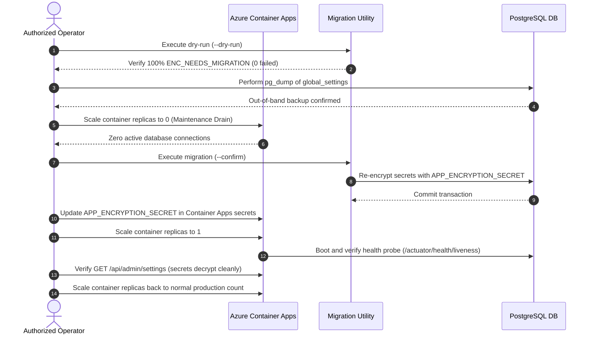

# CakeStore — Encryption Remediation Phase 2: Production Safety Readiness Report

**Document Version:** 1.0  
**Date:** October 2026  
**Auditor:** Antigravity AI Pair Programmer (DeepMind Advanced Agentic Coding)  
**Target Focus:** `EncryptionConverter.java`, `GlobalSettingsEncryptionMigrationUtility.java`, Production Database Safety & Backup Readiness  
**Safety Classification:** Strictly Read-Only Inspection (Zero database writes, zero cloud changes, zero key rotations, zero deployments)

---

## 1. Executive Summary

This report delivers a verified, evidence-backed evaluation of the production safety readiness for migrating encrypted secrets in the `global_settings` table (`razorpay_key_secret` and `razorpay_webhook_secret`) from the insecure 16-space fallback key to the production AES-128 key (`APP_ENCRYPTION_SECRET`).

### Key Findings
1. **Migration Utility Verification (`GlobalSettingsEncryptionMigrationUtility.java`):**
   - **Dry-run safety verified:** In `--dry-run` mode, the utility executes strictly in-memory evaluation and produces an inspection report with **zero database writes** or update queries.
   - **Failure abort verified:** If any field encounters unknown or corrupt ciphertext (`Status.MIGRATION_FAILED`), the utility sets `canMigrate = false` and aborts before write execution.
   - **CLI Entry-Point Discrepancy Identified:** The utility documentation suggests `java -jar backend/target/cake-platform-api.jar ...`. This command will fail because the artifact name is `api-0.0.1-SNAPSHOT.jar`, and Maven's `<start-class>` is hardcoded to `CakePlatformApplication`. A specific Maven or `PropertiesLauncher` command must be used to invoke the utility main class.
2. **Production Backup & PITR Verification:**
   - **Status: UNVERIFIED in repository.** There is zero repository-level evidence, ARM/Bicep template, or recorded backup drill establishing Azure PostgreSQL automated backup retention, Point-in-Time Recovery (PITR) windows, or independent out-of-band backups. Portal/CLI verification and an out-of-band `pg_dump` are mandatory operator prerequisites prior to any write action.
3. **Deployment & Replica Concurrency Risks:**
   - **Single-Key Architecture:** `EncryptionConverter.java` currently uses a single active key and does **not** support dual-key concurrent reads.
   - **Split-Brain Risk:** Running multiple backend replicas with different keys during a rolling deployment will immediately cause `BadPaddingException` / `RuntimeException: Failed to decrypt database column` on mismatched replicas.
   - **Rollout Sequence Required:** A maintenance window with container scaling / traffic drain is strictly required for the eventual write migration.

### Final Verdict
**STATUS: GO FOR CONTROLLED DRY-RUN ONLY**
- A controlled dry-run (`--dry-run`) is authorized because it is strictly read-only and will provide definitive evidence of current ciphertext status without modifying data.
- **NO-GO FOR PRODUCTION WRITES OR LIVE MIGRATION** until all backup verification, operator prerequisites, and maintenance window sequencing steps are completed.

---

## 2. Evidence-Backed Findings: Migration Utility Inspection

### 2.1 Utility Source Code & Evaluation Logic
- **File:** [`backend/src/main/java/com/cakeplatform/api/modules/settings/migration/GlobalSettingsEncryptionMigrationUtility.java`](file:///d:/PROJECTS/CAKE%20SAAs1/backend/src/main/java/com/cakeplatform/api/modules/settings/migration/GlobalSettingsEncryptionMigrationUtility.java)

#### Conditions Recognized by `evaluate()` (Lines 159–199)
| Data State | Condition Evaluated | Assigned Status | Can Migrate? | Utility Action in Write Mode |
| :--- | :--- | :--- | :--- | :--- |
| **Null Value** | `value == null` | `Status.NULL` | `true` | Skipped. Stored value remains `null`. |
| **Blank Value** | `value.isBlank()` (empty string or spaces) | `Status.BLANK` | `true` | Skipped. Stored value remains blank. |
| **Plaintext Value** | `!value.startsWith("ENC:")` | `Status.PLAINTEXT` (Note: "Manual review required") | `true` | Skipped. `migrateField()` ignores values without `ENC:`. No automated re-encryption. |
| **New-Key Ciphertext** | `value.startsWith("ENC:")` AND `newConv.convertToEntityAttribute(value)` succeeds | `Status.ENC_ALREADY_MIGRATED` | `true` | Skipped. Idempotent; already encrypted with `APP_ENCRYPTION_SECRET`. |
| **Old-Key Ciphertext** | `value.startsWith("ENC:")` AND new key fails AND `oldConv.convertToEntityAttribute(value)` succeeds | `Status.ENC_NEEDS_MIGRATION` | `true` | **Migrated.** Decrypted with 16-space fallback key and re-encrypted with `APP_ENCRYPTION_SECRET`. |
| **Malformed / Unknown** | `value.startsWith("ENC:")` AND new key fails AND old key fails (exception thrown) | `Status.MIGRATION_FAILED` (Note: "Unable to decrypt with old key") | `false` (`canMigrate = false`) | **ABORTS.** Write phase is blocked entirely; transaction rolled back. |

### 2.2 Dry-Run Safety & Zero-Write Behavior
- In lines 87–93:
  ```java
  MigrationResult result = evaluate(settingsList, oldConverter, newConverter);
  result.printReport(dryRun);

  if (dryRun) {
      System.out.println("Dry‑run complete – no database modifications performed.");
      return;
  }
  ```
  When `--dry-run` is supplied, the method prints the evaluation report and returns immediately. `performMigration()` and `repository.saveAll()` are never called.

### 2.3 Abort-Before-Write Behavior
- In lines 95–103:
  ```java
  if (!confirm) {
      System.out.println("Write mode requires explicit '--confirm' flag. Aborting.");
      return;
  }

  if (!result.canMigrate) {
      System.out.println("Migration aborted due to previous errors. No changes applied.");
      return;
  }
  ```
  If any field produces `Status.MIGRATION_FAILED`, `canMigrate` is set to `false`. The utility halts immediately before any transactional write method is invoked.

### 2.4 Existing Automated Test Coverage
- **Test File:** [`backend/src/test/java/com/cakeplatform/api/modules/settings/migration/GlobalSettingsEncryptionMigrationUtilityTest.java`](file:///d:/PROJECTS/CAKE%20SAAs1/backend/src/test/java/com/cakeplatform/api/modules/settings/migration/GlobalSettingsEncryptionMigrationUtilityTest.java)
- **Execution Evidence:** `mvn test -Dtest=GlobalSettingsEncryptionMigrationUtilityTest` passed 6 of 6 tests cleanly (0 failures, 0 errors).

| Test Method | Scenario Verified | Outcome |
| :--- | :--- | :--- |
| `testOldKeyEncryptedValueMigratesSuccessfully` | Old-key ciphertext is recognized as `ENC_NEEDS_MIGRATION` and properly re-encrypted | PASS |
| `testAlreadyNewKeyEncryptedValueIsSkipped` | Values already encrypted with new key are marked `ENC_ALREADY_MIGRATED` and not rewritten | PASS |
| `testNullAndBlankValuesAreSkipped` | Null and blank fields are recognized and skipped | PASS |
| `testPlaintextValueIsFlaggedAndNotMigrated` | Plaintext values without `ENC:` are flagged `PLAINTEXT` and not altered | PASS |
| `testMalformedEncValueCausesFailureAndRollback` | Corrupt base64 (`ENC:@@@notbase64@@@`) results in `MIGRATION_FAILED`, sets `canMigrate=false`, and invokes `verify(repo, never()).saveAll(...)` | PASS |
| `testIdempotentRunDoesNotReencrypt` | Successive runs over previously migrated entities preserve ciphertext without double-encryption | PASS |

*Coverage Note*: The unit tests test `evaluate()` and `performMigration()` in isolation with a mock repository. CLI argument parsing (`--dry-run` vs `--confirm`) and environment variable validation are not covered in the unit test suite.

---

## 3. Exact Dry-Run Invocation and Prerequisites

### 3.1 Entry Point & Packaging Analysis
The utility docstring references `java -jar backend/target/cake-platform-api.jar ...`. This command fails in the actual CakeStore repository for two confirmed reasons:
1. **Artifact Filename:** As defined in [`backend/pom.xml#L11-13`](file:///d:/PROJECTS/CAKE%20SAAs1/backend/pom.xml#L11-13), the artifact is `api-0.0.1-SNAPSHOT.jar`, not `cake-platform-api.jar`.
2. **Hardcoded Start-Class:** In [`backend/pom.xml#L25`](file:///d:/PROJECTS/CAKE%20SAAs1/backend/pom.xml#L25), `<start-class>com.cakeplatform.api.CakePlatformApplication</start-class>` is explicitly configured. Executing `java -jar` directly boots the web application, bypassing the migration utility.
3. **Guard Property:** `GlobalSettingsEncryptionMigrationUtility.java:L53` requires `System.getProperty("migration.utility.active")` to be `"true"`, which is set exclusively inside `GlobalSettingsEncryptionMigrationUtility.main()`.

### 3.2 Exact Project-Compatible Dry-Run Commands

#### Option A: Running via Maven (Recommended for Staging / Controlled Environments)
From the repository root:
```bash
# Set required environment variables in current shell (example placeholder format)
export APP_ENCRYPTION_SECRET="<exact-16-byte-new-key>"
export DB_URL="jdbc:postgresql://<db-host>:5432/cake_platform"
export DB_USERNAME="<db-user>"
export DB_PASSWORD="<db-password>"

# Launch the migration utility explicitly in dry-run mode
mvn -f backend/pom.xml spring-boot:run \
  -Dspring-boot.run.main-class=com.cakeplatform.api.modules.settings.migration.GlobalSettingsEncryptionMigrationUtility \
  -Dspring-boot.run.arguments="--dry-run"
```

#### Option B: Running in a Packaged Container / Headless Production Environment
From the container root (where `app.jar` is located):
```bash
java -cp app.jar \
  -Dloader.main=com.cakeplatform.api.modules.settings.migration.GlobalSettingsEncryptionMigrationUtility \
  org.springframework.boot.loader.launch.PropertiesLauncher \
  --dry-run
```

### 3.3 Required Environment Variables & Configuration
| Variable / Setting | Requirement | Sensitivity Note |
| :--- | :--- | :--- |
| `APP_ENCRYPTION_SECRET` | Must be non-empty and **exactly 16 bytes UTF-8** (AES-128). | Sensitive key. Never echo or log. |
| `DB_URL` | Valid PostgreSQL JDBC URL pointing to target database. | Connection string. |
| `DB_USERNAME` | Database username with `SELECT` permissions (for dry-run) and `UPDATE` permissions (for migration). | Non-sensitive identifier. |
| `DB_PASSWORD` | Database user password. | Sensitive credential. |
| `SPRING_PROFILES_ACTIVE` | Set to `prod` (or target profile). | Configuration profile. |
| Argument `--dry-run` | **Mandatory** for read-only inspection. | CLI argument. |

---

## 4. Production Database Backup & PITR Verification

### 4.1 Unverified Backup Aspects in Repository
Repository evidence reveals:
1. **Automated Backup Configuration:** **UNVERIFIED.** No infrastructure-as-code files (Terraform, Bicep, ARM) exist in the repository to establish automated backup schedules for Azure PostgreSQL.
2. **Backup Retention Window:** **UNVERIFIED.** Standard Azure retention ranges from 7 to 35 days, but the active setting is not documented.
3. **Point-In-Time Recovery (PITR) Availability:** **UNVERIFIED.** The active `earliestRestoreDate` cannot be verified from codebase artifacts.
4. **Independent Recoverable Backup:** **UNVERIFIED.** No cold backup or standalone export exists. In-database snapshot tables (`CREATE TABLE ... AS SELECT`) are **not** independent backups, as database corruption or instance deletion would destroy them simultaneously.
5. **Documented Restore Procedure:** **UNVERIFIED.** No recovery drill or documented restore procedure exists in the documentation directory.

### 4.2 Operator Checklist: Read-Only Verification Steps

The authorized operator must execute the following read-only checks before scheduling any write operations:

#### 1. Azure CLI Read-Only Inspection
```bash
# 1. Verify Flexible Server details, backup retention, and earliest restore point
az postgres flexible-server show \
  --resource-group <resource-group-name> \
  --name <server-name> \
  --query "{name:name, state:state, version:version, backupRetentionDays:backup.backupRetentionDays, earliestRestoreDate:backup.earliestRestoreDate, geoRedundantBackup:backup.geoRedundantBackup}" \
  --output table
```
*Verification Criteria:*
- `state` must be `Ready`.
- `backupRetentionDays` must be >= 7.
- `earliestRestoreDate` must reflect continuous restore capability covering the current date.

#### 2. Azure Portal Read-Only Verification
1. Log in to the Azure Portal and navigate to **Azure Database for PostgreSQL flexible servers**.
2. Select the production server instance.
3. In the left navigation menu under **Settings**, select **Backup and Restore**.
4. Confirm:
   - Automated backups status is active.
   - Point-in-time restore is available.
   - Earliest restore point is within expected SLA.

#### 3. Mandatory Independent Snapshot Creation (Pre-Write Requirement)
Prior to running any migration with `--confirm`, the operator must extract an out-of-band logical backup:
```bash
pg_dump \
  -h <production-db-host> \
  -U <username> \
  -d cake_platform \
  -t global_settings \
  --data-only \
  -f global_settings_backup_$(date +%Y%m%d_%H%M%S).sql
```
Verify the generated SQL file contains the expected singleton row and store it in secure, encrypted storage.

---

## 5. Deployment and Replica Risks

### 5.1 Architecture & Encryption Key Delivery
- **Hosting Architecture:** Confirmed by [`.github/workflows/ci.yml`](file:///d:/PROJECTS/CAKE%20SAAs1/.github/workflows/ci.yml) and [`audits/CAKESTORE_FINAL_DEPLOYMENT_READINESS_REPORT.md`](file:///d:/PROJECTS/CAKE%20SAAs1/audits/CAKESTORE_FINAL_DEPLOYMENT_READINESS_REPORT.md). Backend runs as a container image (`crcakestoreprod.azurecr.io/cakestore-api`) deployed to Azure Container Apps.
- **Key Injection:** Supplied via the container environment variable `APP_ENCRYPTION_SECRET` pulled from Azure Container Apps secrets.
- **Startup Enforcement:** Confirmed by [`backend/src/main/java/com/cakeplatform/api/config/StartupValidator.java:L55-58`](file:///d:/PROJECTS/CAKE%20SAAs1/backend/src/main/java/com/cakeplatform/api/config/StartupValidator.java#L55-58). In `prod` profile, missing `APP_ENCRYPTION_SECRET` causes immediate JVM shutdown (`System.exit(1)`).

### 5.2 Split-Brain & Replica Desynchronization Risk
- **Confirmed Fact:** [`EncryptionConverter.java`](file:///d:/PROJECTS/CAKE%20SAAs1/backend/src/main/java/com/cakeplatform/api/modules/settings/EncryptionConverter.java) is a single-key converter. It reads secrets using ONLY its active `KEY`. It does NOT implement fallback decryption across multiple candidate keys.
- **Identified Failure Mode:**
  If a standard rolling deployment is used to introduce `APP_ENCRYPTION_SECRET`:
  1. *Scenario A (Database migrated first):* Replicas running the old revision attempt to decrypt secrets with the 16-space fallback key. Decryption fails with `BadPaddingException` / `RuntimeException`. Payment processing and admin settings crash.
  2. *Scenario B (New replicas deployed before DB migration):* New replicas attempt to decrypt 16-space fallback ciphertext with the new 16-byte key. Decryption fails immediately on every request touching `global_settings`.

### 5.3 Mandatory Zero-Downtime / Maintenance Sequence
To eliminate replica desynchronization risks, the live migration must follow this exact sequence:



---

## 6. Checklist of Unresolved Blockers for Live Migration

Before any write-mode migration (`--confirm`) can be scheduled or executed, the following blockers must be resolved:

- [ ] **BLOCKER-1 (Backup Evidence):** Operator has verified Azure PostgreSQL backup retention (>= 7 days) and valid PITR window.
- [ ] **BLOCKER-2 (Independent Dump):** Operator has executed `pg_dump` of `global_settings` table and verified the backup file integrity.
- [ ] **BLOCKER-3 (Dry-Run Verification):** A controlled dry-run has been executed against the target database, confirming `Status.ENC_NEEDS_MIGRATION` and 0 failures.
- [ ] **BLOCKER-4 (Production Key Availability):** The official 16-byte `APP_ENCRYPTION_SECRET` is available in the deployment secrets manager.
- [ ] **BLOCKER-5 (Maintenance Window Approval):** A scheduled maintenance window with approval for container replica draining has been established.

---

## 7. Final Status & Go/No-Go Decision

### **FINAL DECISION:** **GO FOR CONTROLLED DRY-RUN ONLY**

| Operation | Authorization Status | Conditions / Constraints |
| :--- | :--- | :--- |
| **Controlled Dry-Run (`--dry-run`)** | **AUTHORIZED (GO)** | Must use `--dry-run` flag with valid `APP_ENCRYPTION_SECRET`. Zero database writes will occur. |
| **Production Write Migration (`--confirm`)** | **UNAUTHORIZED (NO-GO)** | Blocked until Blockers 1–5 are formally satisfied. |
| **Production Key Rotation** | **UNAUTHORIZED (NO-GO)** | Prohibited in this phase. |
| **Application Deployment** | **UNAUTHORIZED (NO-GO)** | Prohibited in this phase. |

This decision enables the team to obtain empirical, non-destructive evidence of the production ciphertext state while strictly protecting production data and application uptime.
