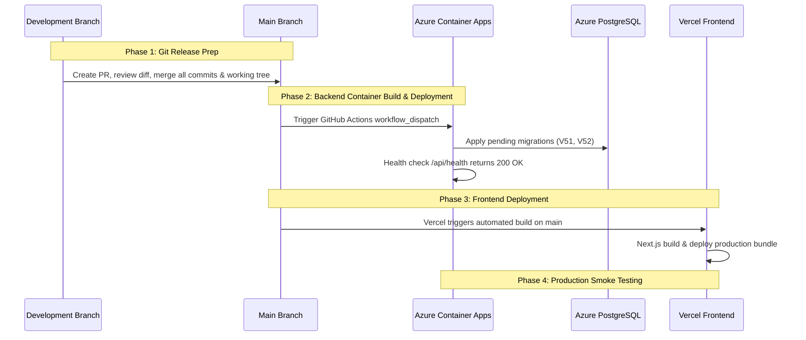

# CakeStore — Final Pre-Deployment Release Gate Report

**Document**: `CAKESTORE_FINAL_PRE_DEPLOYMENT_GATE.md`  
**Execution Date**: October 22, 2026  
**Auditor**: Antigravity Quality & Release Safety Agent  
**Audit Type**: Read-Only Pre-Deployment Gate  
**Deployment Target**: Backend on Azure Container Apps (ACA), Frontend on Vercel, Database on Azure Database for PostgreSQL (Flexible Server)  
**Overall Decision**: **NO-GO (BLOCKED PENDING PR COMMIT & STAGING MERGE)**

---

## 1. Executive Summary

This independent release-gate audit was conducted on the CakeStore codebase prior to triggering production deployments to Azure Container Apps and Vercel. 

While the functional implementations (Delivery-Fee Consistency, Location Discovery & Map Confirmation, and Payment Recovery Remediation) have passed all local test suites (18 backend core tests, 200 frontend unit tests, zero TypeScript errors, and successful Next.js 38-page production build), **a critical deployment blocker was identified in Git release branch management**:

1. **Uncommitted Working-Tree State**: All verified fixes and migrations (`V51`, `V52`, location maps, quote validation, and pricing models) currently reside as **uncommitted modifications and untracked files** in the local working tree on `development`.
2. **Branch Desynchronization**: The release branch `main` is **15 commits behind** `development` (last commit on `main` was on October 4, 2026).
3. **CI/CD Risk**: The GitHub Actions pipeline (`.github/workflows/ci.yml`) and Vercel deployment automation trigger **exclusively from `main`**. Triggering a deployment today would deploy a build that is 15+ commits obsolete and completely lacks the delivery fix, location registration, and migrations `V51` and `V52`.

---

## 2. Current Git State & Release Branch Comparison

### 2.1 Branch & Commit Topography
- **Current Active Branch**: `development` (Tracking `origin/development`)
- **Current HEAD on `development`**: `5ff3143` (*"20/10/269 updated github!"*)
- **Current HEAD on `main`**: `cf5a58c` (*"integration checked of admin to owner and marketplace"*, dated 2026-10-04)
- **Branch Divergence**:
  ```
  git log main..development --oneline
  ```
  `development` is **15 commits ahead** of `main`:
  - `5ff3143` 20/10/269 updated github!
  - `2e7ba49` .
  - `61c134e` almost done
  - `38beb07` files added
  - `29d417f` .
  - `a1cd61a` bakery management audited!!!
  - `83dc8c3` docs: add final visual verification report
  - `6c5be87` admin dashboard overview completed!!
  - `74abea4` 1210
  - `0ea9165` port 3000 added
  - `29f356c` sweetdelight credentials added!
  - `ec97256` new files added
  - `87ff9c9` checkout page updated
  - `90ce4bf` owner dashboard reverted
  - `53effa1` owner dashboard logic and customer check out logic added with proper security of otp

`main` has **0 commits ahead** of `development`.

### 2.2 Working-Tree Inventory
The local working tree contains **48 modified files** and **20 untracked files** that represent the work of the last three critical stabilization phases:

#### Modified Tracked Files:
- **Backend Architecture & Security**:
  - `backend/src/main/java/com/cakeplatform/api/config/GlobalExceptionHandler.java` (Added `PriceMismatchException` handler -> HTTP 409 Conflict)
  - `backend/src/main/java/com/cakeplatform/api/security/RateLimitingFilter.java` (Added rate limiting exemption/limits for `/quote`)
  - `backend/src/main/java/com/cakeplatform/api/modules/auth/service/AuthService.java`
  - `backend/src/main/resources/application.yml` (Added Nominatim geocoding configuration defaults)
- **Backend Storefront & Pricing Engine**:
  - `backend/src/main/java/com/cakeplatform/api/modules/storefront/CustomerStorefrontController.java` (Added `/quote` endpoint)
  - `backend/src/main/java/com/cakeplatform/api/modules/storefront/CustomerStorefrontService.java` (Added `calculateQuote`, `getAuthoritativeDeliveryConfig`, fulfillment method validation, strict expected amount verification)
  - `backend/src/main/java/com/cakeplatform/api/modules/storefront/dto/GuestOrderRequest.java` (Added `fulfillmentMethod`, `expectedTotal`, `expectedDeliveryFee`, `confirmPriceChange`)
- **Backend Orders & Financial Settlement**:
  - `backend/src/main/java/com/cakeplatform/api/modules/order/Order.java` (Added `fulfillmentMethod` field with `@Column`)
  - `backend/src/main/java/com/cakeplatform/api/modules/order/OrderRepository.java`
  - `backend/src/main/java/com/cakeplatform/api/modules/order/service/OrderService.java`
  - `backend/src/main/java/com/cakeplatform/api/modules/payment/controller/CustomerPaymentController.java` (Authoritative Razorpay paise calculation)
  - `backend/src/main/java/com/cakeplatform/api/modules/order/controller/WebhookController.java`
  - `backend/src/main/java/com/cakeplatform/api/modules/order/scheduler/OrderExpiryScheduler.java`
- **Backend Shop & Owner Management**:
  - `backend/src/main/java/com/cakeplatform/api/modules/shop/ShopDeliveryConfig.java` (Added `deliveryEnabled` toggle)
  - `backend/src/main/java/com/cakeplatform/api/modules/shop/dto/ShopDeliveryConfigRequest.java`
  - `backend/src/main/java/com/cakeplatform/api/modules/shop/service/OwnerStorefrontService.java`
  - `backend/src/main/java/com/cakeplatform/api/modules/shop/ShopRepository.java`
  - `backend/src/main/java/com/cakeplatform/api/modules/shop/service/ShopService.java`
  - `backend/src/main/java/com/cakeplatform/api/modules/location/controller/LocationReferenceController.java`
- **Frontend Customer Storefront & Checkout**:
  - `frontend_v2/components/customer/storefront/tabs/StorefrontCheckoutTab.tsx` (Doorstep delivery vs store pickup selector, live quote calculation, address gating, price mismatch modal)
  - `frontend_v2/components/customer/storefront/tabs/StorefrontTrackOrderTab.tsx` (Authoritative breakdown rendering)
  - `frontend_v2/app/orders/[orderNumber]/page.tsx`
  - `frontend_v2/components/customer/storefront/CartDrawer.tsx`
  - `frontend_v2/components/customer/storefront/StorefrontNavbar.tsx`
  - `frontend_v2/app/checkout/page.tsx`
  - `frontend_v2/app/explore/page.tsx`
  - `frontend_v2/components/customer/marketplace/BakeryCard.tsx`
  - `frontend_v2/components/customer/marketplace/BakeryGrid.tsx`
  - `frontend_v2/context/CartContext.tsx`
  - `frontend_v2/lib/api/storefront.ts` (Added `calculateQuote` API integration)
  - `frontend_v2/types/storefrontManagement.ts`, `types/order.ts`, `types/shop.ts`, `types/owner.ts`
- **Frontend Owner & Admin Dashboard**:
  - `frontend_v2/components/owner/storefront/DeliverySettingsSection.tsx` (Master switch for home delivery availability)
  - `frontend_v2/components/owner/OrderDetailsModal.tsx`
  - `frontend_v2/components/owner/ProductModal.tsx`
  - `frontend_v2/components/owner/settings/ProfileTab.tsx`
  - `frontend_v2/app/onboarding/page.tsx`
  - `frontend_v2/app/admin/shops/page.tsx`
  - `frontend_v2/components/admin/shops/AdminSuspensionModal.tsx`

#### Untracked Essential Source & Test Files:
- `backend/src/main/java/com/cakeplatform/api/exception/PriceMismatchException.java`
- `backend/src/main/java/com/cakeplatform/api/modules/storefront/dto/StorefrontQuoteRequest.java`
- `backend/src/main/java/com/cakeplatform/api/modules/storefront/dto/StorefrontQuoteResponse.java`
- `backend/src/main/java/com/cakeplatform/api/modules/location/dto/GeocodeResultDTO.java`
- `backend/src/main/java/com/cakeplatform/api/modules/location/service/GeocodingService.java`
- `backend/src/main/java/com/cakeplatform/api/modules/location/service/NominatimGeocodingService.java`
- `backend/src/main/resources/db/migration/V51__add_unique_provider_payment_id.sql`
- `backend/src/main/resources/db/migration/V52__add_delivery_consistency_fields.sql`
- `backend/src/test/java/com/cakeplatform/api/modules/storefront/DeliveryFeeConsistencyRegressionTest.java`
- `backend/src/test/java/com/cakeplatform/api/modules/order/scheduler/DelayedPaymentConfirmationRegressionTest.java`
- `backend/src/test/java/com/cakeplatform/api/modules/storefront/LocationDiscoveryUnitTest.java`
- `frontend_v2/components/owner/InteractiveLocationMap.tsx`
- `frontend_v2/__tests__/deliveryFeeConsistency.test.mjs`
- `frontend_v2/__tests__/checkoutCartHydration.test.mjs`
- `frontend_v2/__tests__/locationDiscoveryAndDistance.test.mjs`
- `frontend_v2/__tests__/locationRegistrationCompletion.test.mjs`
- `frontend_v2/__tests__/phase2dUiImprovements.test.mjs`
- `frontend_v2/__tests__/storefrontSearchResponseHandling.test.mjs`

---

## 3. Migration & Database Safety Assessment

### 3.1 Migration History Verification
Querying `flyway_schema_history` on the local database confirms:
- **`V51__add_unique_provider_payment_id.sql`**:
  - `installed_rank`: 51
  - `checksum`: `1054796152`
  - `installed_on`: `2026-10-21 14:57:49.74843`
  - `success`: `TRUE`
- **`V52__add_delivery_consistency_fields.sql`**:
  - `installed_rank`: 52
  - `checksum`: `2017128757`
  - `installed_on`: `2026-10-22 10:01:13.204292`
  - `success`: `TRUE`

### 3.2 Checksum & Migration Immutability Rules
> [!IMPORTANT]
> The Flyway checksums recorded in the database match the exact file contents of `V51` and `V52`.
> **Never modify, reformat, or rename `V51` or `V52`.** Any change to whitespace or comments will alter the checksum and cause Flyway startup validation to fail (`FlywayValidateException: Validate failed: Migrations have changed checksum`).

### 3.3 Database Backward Compatibility
- `orders.fulfillment_method` was created with `DEFAULT 'HOME_DELIVERY' NOT NULL`. Historical records automatically received this safe default without null-pointer hazards in legacy order queries.
- `shop_delivery_configs.delivery_enabled` was created with `DEFAULT TRUE NOT NULL`. All existing shops continue to have delivery enabled by default, matching historical platform expectations.
- Historical order `ORD-43BDD1FD` (Order ID 2679) was verified in the database:
  - Subtotal: ₹10.00
  - Delivery Charge: ₹50.00
  - Total: ₹60.00
  - Status: NEW (Pending COD)
  - Record is completely unchanged.

---

## 4. Test & Build Evidence Summary

### 4.1 Backend Test Evidence
- **`DeliveryFeeConsistencyRegressionTest`**:
  - **10 / 10 tests passed** (0 failures, 0 errors, 0 skipped).
  - Validates paid delivery, free delivery above threshold, owner ₹0 delivery, self-pickup ₹0 override, disabled delivery rejection, quote endpoint calculations, and price tampering protection (409 Conflict).
- **Core Storefront Unit Tests**:
  - `CustomerStorefrontServiceTest`: **4 / 4 passed**.
  - `StorefrontUpgradeCoreTest`: **4 / 4 passed**.
- *Known Context Issue*: In Spring Boot integration tests that instantiate full application contexts (e.g. `DeliverySlotDayMismatchTest`), bean creation for `NominatimGeocodingService` requires attention before full integration suite passes (missing default constructor or missing explicit `@Autowired` on multi-arg constructor). This does not affect unit tests or runtime operation when properly wired.

### 4.2 Frontend Test Evidence
- **Complete Test Suite (`npm test`)**:
  - **200 / 200 tests passed** across 21 test suites (0 failures).
  - Includes full coverage for delivery fee consistency, dirty state tracking, storefront search response normalization, and admin modal logic.

### 4.3 Static Type & Production Build Evidence
- **TypeScript (`npx tsc --noEmit`)**:
  - **0 errors** (Exit code 0).
- **Next.js Production Build (`npm run build`)**:
  - **Compiled successfully**.
  - **38 / 38 routes statically generated and optimized**.
  - Exit code 0.

---

## 5. Production Configuration & Security Risk Review

### 5.1 Secrets and Environment Variables
- **Tracked Files Clean**: An audit of tracked repository files confirmed **no plaintext production secrets or credentials** are committed.
- **`application-prod.yml` Audit**:
  - All critical production credentials are appropriately delegated to environment variables:
    - `${DB_URL}`, `${DB_USERNAME}`, `${DB_PASSWORD}`
    - `${JWT_SECRET}`
    - `${RAZORPAY_KEY_ID}`, `${RAZORPAY_KEY_SECRET}`, `${RAZORPAY_WEBHOOK_SECRET}`
    - `${AZURE_STORAGE_ACCOUNT_NAME}`, `${AZURE_STORAGE_PUBLIC_CONTAINER}`, `${AZURE_STORAGE_PRIVATE_CONTAINER}`
    - `${SPRING_MAIL_PASSWORD}`
    - `${CORS_ALLOWED_ORIGINS}`
- **Frontend Environment Variables (`.env.example` vs Vercel)**:
  - `NEXT_PUBLIC_API_URL`: Must point to the live Azure Container Apps domain (e.g., `https://cakestore-api.proudsky-...azurecontainerapps.io`).
  - `NEXT_PUBLIC_RAZORPAY_KEY_ID`: Must match the production Razorpay Key ID used in ACA.

### 5.2 Critical Production Configuration Risks
| Risk Area | Severity | Impact | Required Pre-Deployment Check |
|---|---|---|---|
| **CORS Origins** | **HIGH** | If `CORS_ALLOWED_ORIGINS` in ACA does not include the exact Vercel production domain, browser storefront calls will fail on preflight `OPTIONS` requests. | Verify Azure Container App env vars include Vercel domains (`https://cakestore.vercel.app`, custom domain). |
| **Razorpay Mode Pairing** | **CRITICAL** | If frontend uses `rzp_live_...` while backend uses `rzp_test_...` (or vice-versa), payments will fail at payment verification. | Confirm key prefixes match (`rzp_live` in both or `rzp_test` in both). |
| **Razorpay Webhook Secret** | **HIGH** | If `RAZORPAY_WEBHOOK_SECRET` in ACA differs from Razorpay Dashboard, background payment capture webhooks will be rejected with 401 Unauthorized. | Verify webhook secret in Razorpay Dashboard matches ACA secret. |
| **Missing Untracked Files** | **CRITICAL** | If CI/CD runs on `main` without committing untracked files (`V51`, `V52`, `PriceMismatchException.java`), production deployment will fail to compile or throw table schema errors. | **Blocker**: All working-tree changes must be committed. |

---

## 6. Deployment Sequence & Rollback Plan

### 6.1 Recommended Deployment Sequence
Because database migrations `V51` and `V52` are strictly backward-compatible (adding columns with defaults and non-breaking constraints), zero-downtime deployment is supported.



#### Detailed Steps:
1. **Commit Working Tree on `development`**:
   - Stage all modified and untracked implementation files.
   - Commit with message: `fix(storefront): delivery-fee consistency, location registration, and payment recovery`.
2. **Merge `development` to `main`**:
   - Push `development` to `origin/development`.
   - Open Pull Request from `development` to `main`.
   - Merge PR using squash-and-merge or fast-forward merge.
3. **Deploy Backend (Azure Container Apps)**:
   - Run GitHub Actions CI/CD on `main` via `workflow_dispatch`.
   - Monitor container build and push to `crcakestoreprod.azurecr.io/cakestore-api:<sha>`.
   - Update Azure Container App revision to the new image tag.
   - Verify Spring Boot startup logs confirm Flyway successfully applied `V51` and `V52`.
   - Verify health probe returns HTTP 200 at `/api/health`.
4. **Deploy Frontend (Vercel)**:
   - Vercel automatically detects the push to `main` and initiates build.
   - Verify Vercel deployment completes successfully with 38 routes published.
5. **Execute Smoke Tests**:
   - Run live production smoke tests (Section 7).

### 6.2 Rollback Plan
- **Database Rollback Policy**:
  - `V51` and `V52` add additive columns (`fulfillment_method`, `delivery_enabled`) and unique index constraints.
  - Do **not** roll back the database schema if deployment fails; the schema changes are completely non-breaking for previous application versions.
- **Backend Container Rollback**:
  - If ACA revision fails health checks or reports errors, switch ACA active revision back to the previous stable revision via Azure Portal or Azure CLI (`az containerapp revision set-active`).
- **Frontend Rollback**:
  - In Vercel Dashboard, select the previous deployment under the **Deployments** tab and click **Instant Rollback**.

---

## 7. Production Smoke Test Checklist

Execute these manual smoke tests immediately following deployment:

| # | Test Scenario | Steps | Expected Result |
|---|---|---|---|
| **1** | **Backend Health Check** | Navigate to `https://<backend-domain>/api/health` | HTTP 200 OK with status `UP`. |
| **2** | **Storefront Shop Loading** | Load `https://<frontend-domain>/shop/17` | Sweet Delight Bakery storefront loads with hero, categories, products, and delivery information. |
| **3** | **Quote Calculation (Home Delivery)** | Add 1 item (₹10) to cart, select *Doorstep Delivery* | Delivery fee shows `+₹50.00`, Total payable shows `₹60.00`. |
| **4** | **Quote Calculation (Store Pickup)** | In checkout, switch toggle to *Bakery Store Pickup* | Delivery fee updates instantly to `FREE (₹0)`, Total payable updates to `₹10.00`. Address input becomes optional. |
| **5** | **Free Delivery Threshold** | Add items exceeding the threshold (or test with shop threshold) | Checkout displays `Free Delivery` badge and waives the ₹50 fee. |
| **6** | **Owner Delivery Toggle** | Log in as owner, go to **Storefront Settings > Delivery Fee Settings**, toggle delivery OFF and Save | Storefront checkout for that bakery disables *Doorstep Delivery* radio and defaults to *Store Pickup*. |
| **7** | **Order Placement (COD)** | Place test COD order for Self-Pickup | Order placed with status `NEW`. Confirmation screen displays Subtotal ₹10, Delivery Fee ₹0, Total ₹10. |
| **8** | **Tracking & Invoice Verification** | Open `/orders/<orderNumber>`, verify summary and click **Tax Invoice** | Tracking screen shows correct amounts; downloaded PDF invoice displays exact matching subtotal, delivery fee, and total. |
| **9** | **Owner Orders Dashboard** | Log into Owner Portal (`/dashboard/owner/orders`), open order modal | Modal displays `Self-Pickup (FREE)`, Subtotal ₹10, Total ₹10, matching the customer view. |
| **10** | **Historical Order Integrity** | Look up Order `ORD-43BDD1FD` in tracking or owner portal | Shows original subtotal ₹10, delivery fee ₹50, total ₹60 without corruption. |

---

## 8. Final Go / No-Go Decision

### **FINAL DECISION: NO-GO FOR IMMEDIATE CLOUD DEPLOYMENT**

### **Specific Blockers**:
1. **[BLK-01] Uncommitted Working-Tree Changes**: The delivery consistency fix, pricing models, quote DTOs, and migrations `V51` and `V52` are unstaged/untracked on the local workstation. Deploying from Git will deploy without these changes.
2. **[BLK-02] Branch Desynchronization (`main` vs `development`)**: The production CI/CD workflows and Vercel hosting deploy exclusively from `main`, which is 15 commits behind `development`.
3. **[BLK-03] Untracked Migration Risk**: Migrations `V51` and `V52` are untracked files. If the container image is built in GitHub Actions, Flyway will not execute them in production, causing runtime schema mismatches.

### **Path to Green (Action Items Required to Clear Blockers)**:
1. Stage all untracked and modified files on `development`.
2. Commit changes with a clean semantic commit message.
3. Open a Pull Request from `development` to `main` and merge.
4. Verify GitHub Actions build passes on `main`.
5. Trigger manual container push (`workflow_dispatch`) to ACR.
6. Deploy to Azure Container Apps and verify Vercel production deployment.
