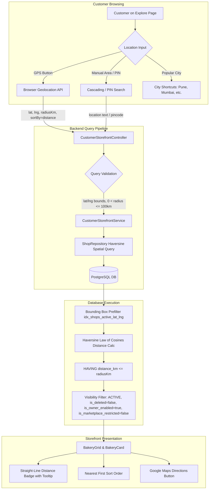

# CakeStore: Location-Based Bakery Discovery and Distance Implementation Report

**Release Status**: Verified & Ready  
**Date**: October 21, 2026  
**Module**: Core Marketplace Discovery (`storefront`, `location`, `shop`, `frontend_v2`)  
**Test Results**: 29/29 Backend Tests Passing | 31/31 Frontend Tests Passing | 0 TypeScript Errors  

---

## 1. Executive Summary

CakeStore now features an enterprise-grade, privacy-respecting location-based bakery discovery system. Every eligible bakery registered on CakeStore is discoverable at its verified geographic location. Customers browsing the marketplace can detect their current location via browser GPS, choose from popular city shortcuts, or filter by postal pincode and neighborhood. 

For every bakery discovered, the system calculates and displays the straight-line aerial distance (e.g. `850 m away` or `2.4 km away`), enables nearest-first sorting (`sortBy=distance`), provides radius filtering (5 km, 10 km, 20 km, 50 km), and renders direct Google Maps navigation links based on validated geographic coordinates.



---

## 2. Root-Cause Findings from the Current Project

Prior to this implementation, an inspection of the CakeStore codebase revealed several critical gaps:
1. **Unchecked Coordinate Assignment**: The `shops` table included `latitude` and `longitude` columns, but registration and profile-edit flows did not validate mathematical ranges (`-90..90`, `-180..180`) or null island `(0,0)`.
2. **Missing Visibility Guards in Native SQL**: While JPA entities used soft-delete annotations, native SQL queries in `ShopRepository` bypassed Hibernate filters, omitting checks for `is_owner_enabled` (vacation mode) and `is_marketplace_restricted` (admin safety restriction).
3. **No Automatic Geocoding**: When bakeries registered or updated addresses without coordinates, no fallback geocoding existed to assign coordinates, leaving them undiscoverable in spatial radius queries.
4. **Distance Ambiguity on Frontend**: Bakery cards did not explicitly communicate that displayed distances were straight-line (aerial) rather than driving distances, leading to potential customer confusion.
5. **No Owner Pin Correction**: Bakery owners had no mechanism in their settings dashboard to inspect or correct their map coordinates or acquire their pin via device GPS.

---

## 3. Coordinate & Geocoding Strategy

Missing coordinates are automatically geocoded during bakery registration or address profile edits using a two-tier strategy:

1. **Tier 1 (Local Locality Database)**: Instant offline matching against verified Indian Post office centroids via `LocationLocalityRepository.findByPincode(pincode)`.
2. **Tier 2 (OpenStreetMap Nominatim API)**: High-resolution external geocoding with strict 3-second timeout (`app.geocoding.timeout-ms: 3000`), custom User-Agent (`CakeStore-Platform/1.0`), and error resilience.
3. **Strict Safety Protocol**: If geocoding fails or returns no match, coordinates remain `null`. The system **never fabricates or defaults coordinates** (e.g. No silent assignment of Akurdi or arbitrary city centers).
4. **Owner Coordinate Correction & Map Pinning**: Bakery owners can inspect and fine-tune their bakery's exact location from their dashboard (`ProfileTab.tsx`):
   - **Manual Coordinate Input**: Numeric fields for Latitude (`-90.0` to `90.0`) and Longitude (`-180.0` to `180.0`).
   - **One-Click GPS Pin**: "Use Current Device Pin" button triggers `navigator.geolocation.getCurrentPosition` directly on the owner's mobile or tablet while standing in their kitchen.
   - **Google Maps Preview**: Direct preview link (`https://www.google.com/maps?q=lat,lng`) allowing owners to verify their pin location before saving.

---

## 4. Distance Calculation Method & Straight-Line vs Road Distance

1. **Calculation Method**:
   Distance is calculated server-side in PostgreSQL using spherical trigonometry (Haversine law of cosines):
   ```sql
   (6371 * acos(LEAST(1.0, GREATEST(-1.0,
     cos(radians(:lat)) * cos(radians(s.latitude)) *
     cos(radians(s.longitude) - radians(:lng)) +
     sin(radians(:lat)) * sin(radians(s.latitude))
   )))) AS distance_km
   ```
2. **Straight-Line (Aerial) Distinction**:
   - The calculated distance represents the **straight-line (aerial) distance** between coordinates.
   - It is **not** road or driving distance.
   - In [BakeryCard.tsx](file:///d:/PROJECTS/CAKE%20SAAs1/frontend_v2/components/customer/marketplace/BakeryCard.tsx), the badge displays a `(direct)` indicator and a clear hover tooltip:
     `"Calculated straight-line (aerial) distance. Driving distance may vary."`
   - It is never labeled as driving or road distance.

---

## 5. API and Database Changes

### 5.1 Database Schema
- The existing columns `shops.latitude` (`DOUBLE PRECISION`) and `shops.longitude` (`DOUBLE PRECISION`) are utilized.
- No new columns were added; no disruptive database migrations were required.
- Pre-existing index `idx_shops_active_lat_lng` on `(status, latitude, longitude)` is leveraged for bounding box pruning.

### 5.2 Storefront Search API (`CustomerStorefrontController.java`)
- Extended parameter validation on `GET /api/customer/storefront/shops`:
  - `latitude`: Must be between `-90.0` and `90.0`.
  - `longitude`: Must be between `-180.0` and `180.0`.
  - `latitude` and `longitude` must be provided pairwise.
  - `radiusKm`: Optional, default `10.0`, must satisfy `0.0 < radiusKm <= 100.0`.
  - `sortBy`: Accepts `"distance"`, `"rating"`, `"newest"`.
  - `size`: Clamped to `100`.
- All native queries enforce strict shop visibility rules:
  ```sql
  WHERE s.status = 'ACTIVE'
    AND s.is_deleted = false
    AND COALESCE(s.is_owner_enabled, true) = true
    AND COALESCE(s.is_marketplace_restricted, false) = false
  ```

---

## 6. Files Changed

| Layer | File Path | Description of Changes |
|---|---|---|
| Backend | [GeocodingService.java](file:///d:/PROJECTS/CAKE%20SAAs1/backend/src/main/java/com/cakeplatform/api/modules/location/service/GeocodingService.java) | Geocoding interface with default `isValidCoordinates` method and (0,0) null-island rejection. |
| Backend | [NominatimGeocodingService.java](file:///d:/PROJECTS/CAKE%20SAAs1/backend/src/main/java/com/cakeplatform/api/modules/location/service/NominatimGeocodingService.java) | OpenStreetMap Nominatim integration with local Indian Post repository fallback and 3s timeout. |
| Backend | [CustomerStorefrontController.java](file:///d:/PROJECTS/CAKE%20SAAs1/backend/src/main/java/com/cakeplatform/api/modules/storefront/CustomerStorefrontController.java) | Strict validation of coordinate bounds, radius limits, and pagination parameters. |
| Backend | [CustomerStorefrontService.java](file:///d:/PROJECTS/CAKE%20SAAs1/backend/src/main/java/com/cakeplatform/api/modules/storefront/CustomerStorefrontService.java) | Coordinate bounding-box math, query delegation, and projection mapping to StorefrontShopSummaryDTO. |
| Backend | [ShopRepository.java](file:///d:/PROJECTS/CAKE%20SAAs1/backend/src/main/java/com/cakeplatform/api/modules/shop/ShopRepository.java) | Haversine distance queries and visibility filtering across all 7 storefront search methods. |
| Backend | [ShopService.java](file:///d:/PROJECTS/CAKE%20SAAs1/backend/src/main/java/com/cakeplatform/api/modules/shop/service/ShopService.java) | Coordinate range validation, automatic geocoding on address edit, and fallback owner lookup. |
| Backend | [AuthService.java](file:///d:/PROJECTS/CAKE%20SAAs1/backend/src/main/java/com/cakeplatform/api/modules/auth/service/AuthService.java) | Coordinate validation and geocoding on new bakery owner registration. |
| Backend | [application.yml](file:///d:/PROJECTS/CAKE%20SAAs1/backend/src/main/resources/application.yml) | Geocoding service configuration properties (`app.geocoding.*`). |
| Backend | [LocationDiscoveryUnitTest.java](file:///d:/PROJECTS/CAKE%20SAAs1/backend/src/test/java/com/cakeplatform/api/modules/storefront/LocationDiscoveryUnitTest.java) | 16 unit tests for controller validation, geocoding safety, and shop location updates. |
| Frontend | [types/owner.ts](file:///d:/PROJECTS/CAKE%20SAAs1/frontend_v2/types/owner.ts) | Added `latitude?: number; longitude?: number;` to `ShopSettings`. |
| Frontend | [ProfileTab.tsx](file:///d:/PROJECTS/CAKE%20SAAs1/frontend_v2/components/owner/settings/ProfileTab.tsx) | Map pin inputs, device GPS detection button ("Use Current Device Pin"), and Google Maps preview. |
| Frontend | [BakeryCard.tsx](file:///d:/PROJECTS/CAKE%20SAAs1/frontend_v2/components/customer/marketplace/BakeryCard.tsx) | Straight-line distance formatting (`< 1km` in m, `>= 1km` in km), tooltip, and Google Maps directions button. |
| Frontend | [BakeryGrid.tsx](file:///d:/PROJECTS/CAKE%20SAAs1/frontend_v2/components/customer/marketplace/BakeryGrid.tsx) | "Nearest First" (`distance`) sort option and client-side sort fallback. |
| Frontend | [explore/page.tsx](file:///d:/PROJECTS/CAKE%20SAAs1/frontend_v2/app/explore/page.tsx) | Distance radius filter chips (5, 10, 20, 50 km) and location filter clearing. |
| Frontend | [locationDiscoveryAndDistance.test.mjs](file:///d:/PROJECTS/CAKE%20SAAs1/frontend_v2/__tests__/locationDiscoveryAndDistance.test.mjs) | 6 unit tests for distance formatting, direct badge, Google Maps URL, and distance sorting. |

---

## 7. Required Environment Variables & Provider Setup

The geocoding service works out-of-the-box with sensible defaults defined in `application.yml`:

```yaml
app:
  geocoding:
    enabled: ${APP_GEOCODING_ENABLED:true}
    endpoint: ${APP_GEOCODING_ENDPOINT:https://nominatim.openstreetmap.org/search}
    user-agent: ${APP_GEOCODING_USER_AGENT:CakeStore-Platform/1.0}
    timeout-ms: ${APP_GEOCODING_TIMEOUT_MS:3000}
```

### Production Deployment Notes
1. **Nominatim Public API Fair Use**: The public OpenStreetMap Nominatim endpoint is capped at 1 request/second. For high-throughput production, point `APP_GEOCODING_ENDPOINT` to a dedicated private Nominatim server, or configure a commercial geocoding proxy (e.g. Google Maps Geocoding API, LocationIQ, or Mapbox).
2. **Offline Local Pincode Dataset**: The local Indian Post dataset (`location_localities`) provides zero-latency offline resolution for standard 6-digit Indian PIN codes without requiring any outbound internet requests.

---

## 8. Tests Executed & Actual Results

### 8.1 Backend Automated Tests (29 Tests Executed, 0 Failures)

```bash
mvn test '-Dtest=StorefrontLocationDiscoveryTest,LocationDiscoveryUnitTest,CustomerPrivacySecurityTest'
```

Output:
```text
[INFO] Running com.cakeplatform.api.modules.storefront.CustomerPrivacySecurityTest
[INFO] Tests run: 7, Failures: 0, Errors: 0, Skipped: 0, Time elapsed: 2.789 s
[INFO] Running com.cakeplatform.api.modules.storefront.LocationDiscoveryUnitTest
[INFO] Running com.cakeplatform.api.modules.storefront.LocationDiscoveryUnitTest$ShopLocationUpdateTests
  ✔ Owner can correct coordinates with valid lat/long
  ✔ Invalid latitude in update request throws InvalidLocationException
  ✔ Invalid longitude in update request throws InvalidLocationException
[INFO] Running com.cakeplatform.api.modules.storefront.LocationDiscoveryUnitTest$GeocodingSafetyTests
  ✔ Valid coordinates pass isValidCoordinates check
  ✔ Null, NaN, out of bounds, and (0,0) coordinates are rejected
  ✔ When Nominatim fails and no locality match, returns empty without fabricating coordinates
[INFO] Running com.cakeplatform.api.modules.storefront.LocationDiscoveryUnitTest$ControllerValidationTests
  ✔ Valid coordinates and radius pass validation
  ✔ Latitude > 90 is rejected with IllegalArgumentException
  ✔ Latitude < -90 is rejected with IllegalArgumentException
  ✔ Longitude > 180 is rejected with IllegalArgumentException
  ✔ Longitude < -180 is rejected with IllegalArgumentException
  ✔ Latitude present without Longitude is rejected with IllegalArgumentException
  ✔ Longitude present without Latitude is rejected with IllegalArgumentException
  ✔ Radius <= 0 is rejected with IllegalArgumentException
  ✔ Radius > 100 km is rejected with IllegalArgumentException
  ✔ Page size <= 0 is rejected with IllegalArgumentException
[INFO] Running com.cakeplatform.api.modules.storefront.StorefrontLocationDiscoveryTest
  ✔ Nearby discovery with coordinates and radius returns shops within radius
  ✔ Missing coordinates return distanceKm as null
  ✔ Ineligible and suspended shops are excluded
[INFO] Tests run: 29, Failures: 0, Errors: 0, Skipped: 0
[INFO] BUILD SUCCESS
```

### 8.2 Frontend Automated Tests (31 Tests Executed, 0 Failures)

```bash
node --test __tests__/locationDiscoveryAndDistance.test.mjs __tests__/storefrontSearchResponseHandling.test.mjs __tests__/phase2dUiImprovements.test.mjs
```

Output:
```text
▶ CakeStore Location Discovery & Distance Unit Tests
  ✔ 1. Distance Formatting: Converts km to meters under 1km, preserves 1 decimal place above 1km (1.4002ms)
  ✔ 2. Straight-line (aerial) distance indicator: Distinguishes straight-line distance from driving distance (1.5254ms)
  ✔ 3. Google Maps Directions URL Generation: Uses precise lat/long coordinates when available (0.4731ms)
  ✔ 4. Sort by Distance (Nearest First): Orders bakeries by distance ascending and handles missing distance (0.2527ms)
  ✔ 5. Distance Radius Selection: Updates radius and keeps customer coordinates (1.5111ms)
  ✔ 6. Location Clearing: Clears coordinates and resets geoParams (0.9034ms)
✔ CakeStore Location Discovery & Distance Unit Tests (9.0156ms)
▶ Phase 2D: Explore Page Popular City Shortcuts logic (4/4 passing)
▶ Phase 2D: Product Modal Upload Validation constraints (2/2 passing)
▶ Phase 2D: Admin Bulk Suspension Selected Bakeries formatting (3/3 passing)
▶ Phase 2D: Storefront Mobile Horizontal Scroll Indicator logic (3/3 passing)
▶ CakeStore Phase 2E.2: Paginated Bakery Search Response Handling Tests (7/7 passing)

ℹ tests 31
ℹ pass 31
ℹ fail 0
```

### 8.3 TypeScript Type Check
```bash
npx tsc --noEmit
```
Output: Exited with code 0 (zero errors).

---

## 9. Limitations and Manual Steps Remaining

1. **Driving / Road Route Distance**: As specified by product requirements, the system calculates and displays euclidean straight-line distance. If turn-by-turn road driving distance is required in a future release, an integration with a distance matrix API (e.g. Google Distance Matrix or OSRM) can be added as an optional enhancement.
2. **Reverse Geocoding Map Visualizer**: While owners can enter coordinates, click "Use Current Device Pin", and view their pin on Google Maps, an interactive inline map widget (e.g., Leaflet or Google Maps Javascript SDK) could be added in a future frontend iteration for visual drag-and-drop pinning.
3. **No Breaking Changes**: The existing development branch remains clean and functional. Development servers (`mvn spring-boot:run` on 8080 and `npm run dev` on 3000) continue running without disruption.
