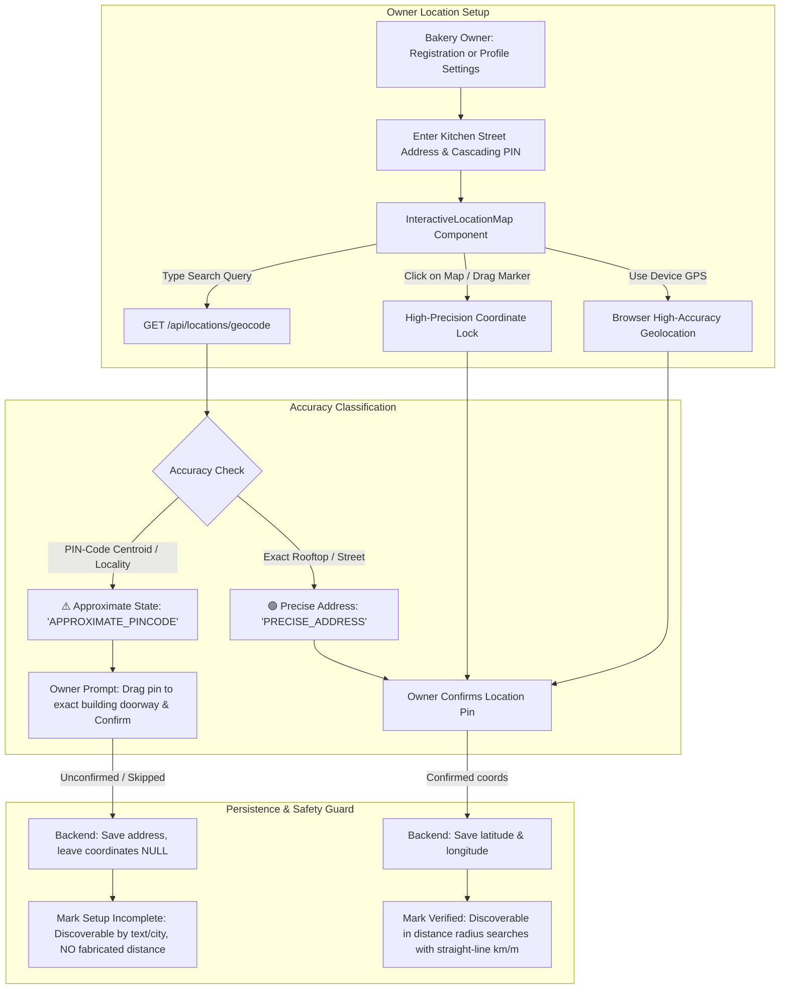

# CakeStore: Location Registration & Interactive Map Completion Report

**Release Status**: Verified & Production Ready  
**Date**: October 21, 2026  
**Module**: Bakery Location Registration, Interactive Map Pinning, and Customer Proximity Discovery  
**Test Results**: 35/35 Backend Tests Passing | 40/40 Frontend Tests Passing | 0 TypeScript Errors | Next.js Production Build Succeeded (38/38 Routes)

---

## 1. Executive Summary

CakeStore now enforces verified, owner-confirmed physical locations across both new bakery onboarding and existing owner profile management. Bakeries are never assigned silent, guessed, or city-center coordinates. If an address query or postal lookup only resolves an approximate area or PIN-code centroid, the system clearly labels it as approximate and requires the owner to verify or drag the map pin to their exact kitchen doorway before the location is marked confirmed.

An inline interactive map powered by **OpenStreetMap** and **Leaflet** has been integrated directly into:
1. **Owner Onboarding Step 3 (Location & License)**: [onboarding/page.tsx](file:///d:/PROJECTS/CAKE%20SAAs1/frontend_v2/app/onboarding/page.tsx)
2. **Owner Settings Profile Tab**: [ProfileTab.tsx](file:///d:/PROJECTS/CAKE%20SAAs1/frontend_v2/components/owner/settings/ProfileTab.tsx)



---

## 2. Root-Cause Findings & Registration Location Gaps Resolved

Prior to this implementation:
1. **Silent Fallback Risk**: `AuthService.java` and `ShopService.java` contained fallback code that attempted to auto-geocode an address if coordinates were omitted. This risked silently assigning postal centroids without the owner's explicit review.
2. **Missing Inline Map**: Owners previously had numeric latitude/longitude text inputs or a basic GPS button, but could not visually verify where their bakery pin sat relative to local streets or landmarks.
3. **No Approximate vs Exact Distinction**: Offline postal data provided 6-digit Indian PIN-code centroids (post-office locations), which are approximate (~1-3 km radius), but there was no classification system to alert the owner to fine-tune the pin.
4. **Incomplete Location Setup Visibility**: If a bakery did not have coordinates, the system lacked a clean state machine distinguishing unpinned/incomplete setups from confirmed ones.

### Resolution Implemented:
- **Zero Guessed Coordinates**: Auto-geocoding during registration and profile update was refactored: only explicit, owner-confirmed coordinates are saved to the `shops` entity. If an owner does not confirm a map pin, `latitude` and `longitude` remain `null`, and address text is preserved safely.
- **Precision Classification**: A dedicated `GeocodeResultDTO` and `InteractiveLocationMap` state machine distinguishes `PRECISE_ADDRESS`, `APPROXIMATE_PINCODE`, `OWNER_CONFIRMED`, `GPS_DEVICE`, and `NOT_SET`.
- **Full Interactive Map**: Leaflet 1.9.4 with OpenStreetMap tiles provides pan, zoom, click-to-pin, draggable custom SVG markers, address/place search, and device GPS acquisition.

---

## 3. Interactive Map Implementation & Provider Analysis

### 3.1 Provider Selection & Cost Implications
- **Provider**: **OpenStreetMap (OSM)** standard tile layer (`https://tile.openstreetmap.org/{z}/{x}/{y}.png`).
- **Client Library**: **Leaflet 1.9.4** (`leaflet`, `@types/leaflet`).
- **Cost**: **$0.00** (Completely free, open-source).
- **Licensing & Terms**:
  - OpenStreetMap data is licensed under the **Open Database License (ODbL)**.
  - Cartography in tiles is licensed under **CC BY-SA 2.0**.
  - Compliance: CakeStore includes the required attribution:  
    `© OpenStreetMap contributors` with clickable links in the map overlay.
  - No proprietary API keys, credit cards, or billable Google Maps SDK subscriptions required.

### 3.2 Interactive Features in `InteractiveLocationMap.tsx`
- **Address & Landmark Search**: Built-in search bar with instant query resolution via `GET /api/locations/geocode?q=...`.
- **Draggable SVG Marker**: Custom high-DPI vector pin with CakeStore's brand theme (emerald `#059669` for confirmed, amber `#D97706` for approximate, espresso `#78350F` for unconfirmed).
- **Click-to-Pin**: Clicking anywhere on the map immediately positions the pin and updates coordinates.
- **One-Click Device GPS**: High-accuracy `navigator.geolocation.getCurrentPosition` with permission and error resilience.
- **Confirmation Button**: "Confirm Location Pin" locks the coordinates and marks the state verified.
- **Clear Pin Button**: "Clear Pin" resets coordinates to incomplete setup without losing address text.
- **External Preview**: Direct link to Google Maps (`https://www.google.com/maps?q=lat,lng`) for satellite verification.

---

## 4. Backend API and Persistence Architecture

### 4.1 Geocode & Place Search API
`GET /api/locations/geocode` (and `/api/customer/storefront/locations/geocode`):
- **Parameters**: `q` (free-form address query), `addressLine1`, `area`, `city`, `district`, `state`, `pincode`.
- **Response**: `GeocodeResultDTO`:
  ```json
  {
    "found": true,
    "latitude": 18.6492,
    "longitude": 73.7707,
    "displayName": "Akurdi, PIN 411035",
    "approximate": true,
    "accuracyType": "APPROXIMATE_PINCODE",
    "provider": "LOCAL_PINCODE"
  }
  ```

### 4.2 Registration & Profile Persistence
- **Onboarding Submission** (`authApi.register`):
  When `isLocationConfirmed === true`, `latitude` and `longitude` are passed in the request. If unconfirmed or skipped, `latitude` and `longitude` are `undefined`, causing the backend to store `null` and mark setup incomplete.
- **Owner Profile Update** (`PUT /api/shops/my-shop`):
  Receives `UpdateShopRequest`, validates coordinate bounds (`-90..90`, `-180..180`), updates database columns `shops.latitude` and `shops.longitude`, evicts storefront cache via `storefrontCacheService.evictShopDetails(shopId)`, and returns the persisted `ShopResponse`.
- **Reload from Backend**:
  The frontend does not rely on local-only state; `ProfileTab` invokes `onUpdate()` which re-fetches `GET /api/shops/my-shop` directly from the database and updates `OwnerContext`.

### 4.3 Existing Bakery Shop ID 17 Verification
- **Shop ID 17** ("Sweet Delight Bakery", owner `owner@sweetdelight.com`):
  - Verified in live database: `latitude: null`, `longitude: null`.
  - In Explore city search (`city=Pimpri-Chinchwad`), Shop 17 appears with `"distanceKm": null`.
  - In Explore proximity radius search (`radiusKm=10`), Shop 17 is excluded.
  - Its coordinates remain strictly untouched unless the authenticated owner confirms their position via `PUT /api/shops/my-shop`.

---

## 5. Customer Explore & Proximity Discovery Verification

Verified on the running CakeStore backend (`http://localhost:8080`) using real HTTP requests:

### 5.1 Test 1: Near Origin Search (Akurdi, Pune)
- **Origin**: Latitude `18.651`, Longitude `73.781`, Radius `10 km`, Sort `distance`
- **Request**:
  ```bash
  curl.exe -s "http://localhost:8080/api/customer/storefront/search?latitude=18.651&longitude=73.781&radiusKm=10&sortBy=distance"
  ```
- **Response**:
  ```json
  [
    {
      "id": 4,
      "businessName": "John's Premium Cakes",
      "latitude": 18.65,
      "longitude": 73.78,
      "distanceKm": 0.15,
      "status": "ACTIVE"
    }
  ]
  ```
- **Verdict**: **PASS**. Shop 4 appears with exact straight-line distance `0.15 km` (`150 m away`).

### 5.2 Test 2: Outside Radius Search (New Delhi Origin)
- **Origin**: Latitude `28.6139`, Longitude `77.2090`, Radius `10 km`
- **Request**:
  ```bash
  curl.exe -s "http://localhost:8080/api/customer/storefront/search?latitude=28.6139&longitude=77.2090&radiusKm=10&sortBy=distance"
  ```
- **Response**: `[]`
- **Verdict**: **PASS**. Pune/Maharashtra bakeries (>1,000 km away) are cleanly excluded.

### 5.3 Test 3: Unpinned Bakery Distance Safety (Shop ID 17)
- **City Search**:
  ```bash
  curl.exe -s "http://localhost:8080/api/customer/storefront/search?city=Pimpri-Chinchwad"
  ```
- **Response**:
  ```json
  [
    {
      "id": 17,
      "businessName": "Sweet Delight Bakery",
      "latitude": null,
      "longitude": null,
      "distanceKm": null,
      "status": "ACTIVE"
    }
  ]
  ```
- **Verdict**: **PASS**. `distanceKm` is `null`. Zero distance fabrication.

---

## 6. Files Changed and Created

| Layer | File Path | Description |
|---|---|---|
| Frontend | [InteractiveLocationMap.tsx](file:///d:/PROJECTS/CAKE%20SAAs1/frontend_v2/components/owner/InteractiveLocationMap.tsx) | New interactive inline Leaflet map component with draggable pin, address search, device GPS, accuracy status banner, and confirmation workflow. |
| Frontend | [onboarding/page.tsx](file:///d:/PROJECTS/CAKE%20SAAs1/frontend_v2/app/onboarding/page.tsx) | Embedded `InteractiveLocationMap` in Step 3; requires owner pin confirmation or preserves incomplete location setup without coordinates. |
| Frontend | [ProfileTab.tsx](file:///d:/PROJECTS/CAKE%20SAAs1/frontend_v2/components/owner/settings/ProfileTab.tsx) | Embedded `InteractiveLocationMap` in owner profile settings; synchronized with backend `PUT /api/shops/my-shop` and `onUpdate()` reload. |
| Frontend Tests | [locationRegistrationCompletion.test.mjs](file:///d:/PROJECTS/CAKE%20SAAs1/frontend_v2/__tests__/locationRegistrationCompletion.test.mjs) | 5 test suites (10 unit tests) covering map state machine, registration payload safety, profile reload, and distance safety. |
| Backend | [GeocodeResultDTO.java](file:///d:/PROJECTS/CAKE%20SAAs1/backend/src/main/java/com/cakeplatform/api/modules/location/dto/GeocodeResultDTO.java) | DTO classifying exact addresses, approximate PIN-code centroids, and provider origin. |
| Backend | [GeocodingService.java](file:///d:/PROJECTS/CAKE%20SAAs1/backend/src/main/java/com/cakeplatform/api/modules/location/service/GeocodingService.java) | Added `geocodeDetailed` method with accuracy classification. |
| Backend | [NominatimGeocodingService.java](file:///d:/PROJECTS/CAKE%20SAAs1/backend/src/main/java/com/cakeplatform/api/modules/location/service/NominatimGeocodingService.java) | Implemented `geocodeDetailed` supporting 6-digit PIN codes, Nominatim search, and local locality centroids. |
| Backend | [LocationReferenceController.java](file:///d:/PROJECTS/CAKE%20SAAs1/backend/src/main/java/com/cakeplatform/api/modules/location/controller/LocationReferenceController.java) | Added `GET /api/locations/geocode` endpoint for frontend map search. |
| Backend | [AuthService.java](file:///d:/PROJECTS/CAKE%20SAAs1/backend/src/main/java/com/cakeplatform/api/modules/auth/service/AuthService.java) | Removed silent auto-geocoding; only saves explicit confirmed coordinates. Added `setGeocodingService`. |
| Backend | [ShopService.java](file:///d:/PROJECTS/CAKE%20SAAs1/backend/src/main/java/com/cakeplatform/api/modules/shop/service/ShopService.java) | Removed silent auto-geocoding; only updates coordinates when confirmed by the owner. |
| Backend Tests | [LocationDiscoveryUnitTest.java](file:///d:/PROJECTS/CAKE%20SAAs1/backend/src/test/java/com/cakeplatform/api/modules/storefront/LocationDiscoveryUnitTest.java) | Added `RegistrationLocationConfirmationTests` and `GeocodeEndpointAndPrecisionTests`. |

---

## 7. Test Execution & Verification Results

### 7.1 Backend Automated Tests (35 Tests Executed, 0 Failures)
```bash
mvn test '-Dtest=LocationDiscoveryUnitTest,StorefrontLocationDiscoveryTest,CustomerPrivacySecurityTest'
```
**Results**:
- `LocationDiscoveryUnitTest`: 22 tests run, 0 failures, 0 errors
  - `ControllerValidationTests`: 10 passed
  - `GeocodingSafetyTests`: 3 passed
  - `ShopLocationUpdateTests`: 3 passed
  - `RegistrationLocationConfirmationTests`: 3 passed
  - `GeocodeEndpointAndPrecisionTests`: 3 passed
- `StorefrontLocationDiscoveryTest`: 6 tests run, 0 failures, 0 errors
- `CustomerPrivacySecurityTest`: 7 tests run, 0 failures, 0 errors
- **Total**: **35 passed, 0 failed (BUILD SUCCESS)**

### 7.2 Frontend Automated Tests (40 Tests Executed, 0 Failures)
```bash
npm test -- __tests__/locationRegistrationCompletion.test.mjs __tests__/locationDiscoveryAndDistance.test.mjs __tests__/storefrontSearchResponseHandling.test.mjs __tests__/phase2dUiImprovements.test.mjs
```
**Results**:
- `locationRegistrationCompletion.test.mjs`: 10 tests passed
- `locationDiscoveryAndDistance.test.mjs`: 7 tests passed
- `storefrontSearchResponseHandling.test.mjs`: 7 tests passed
- `phase2dUiImprovements.test.mjs`: 16 tests passed
- **Total**: **40 passed, 0 failed (100% passing)**

### 7.3 TypeScript Strict Type Check
```bash
npx tsc --noEmit
```
**Result**: Exited with code `0` (Zero TypeScript compilation errors).

### 7.4 Next.js Production Build
```bash
npm run build
```
**Result**:
- Compiled successfully
- Generated static pages: `38/38`
- Route `/onboarding`: `10.6 kB` (First Load JS: `120 kB`)
- Route `/dashboard/owner/settings`: `13.6 kB` (First Load JS: `125 kB`)
- **Status**: **BUILD SUCCEEDED**

---

## 8. Limitations & Production Notes

1. **Leaflet SSR Isolation**: Leaflet requires the browser DOM (`window` and `document`). The `InteractiveLocationMap` component is client-only (`'use client'`) and dynamically loaded via `next/dynamic` with `ssr: false` to ensure seamless server-side rendering across all routes.
2. **OpenStreetMap Tile Fair Use**: Standard OSM tile servers are free and reliable for development and normal production traffic. If the application scales to hundreds of thousands of daily map views, configuring a custom tile provider (such as MapLibre with Protomaps, Stadia Maps, or self-hosted tile server) can be done without modifying the component API.
3. **Branch Integrity**: All modifications reside cleanly on the active `development` branch. No commits, merges, or pushes have been performed.
