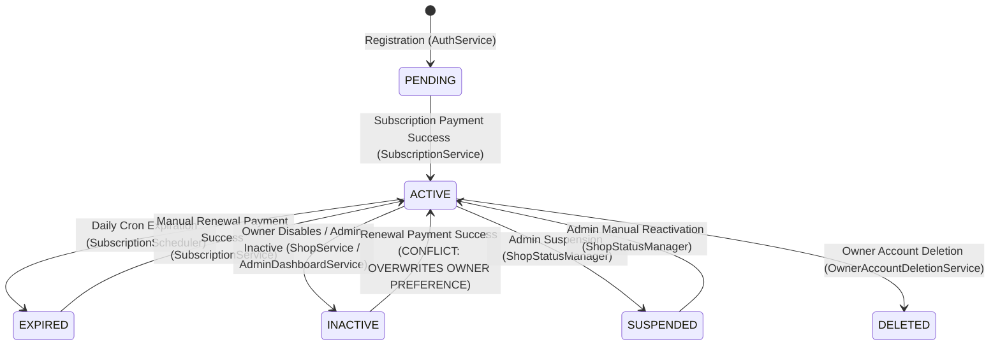
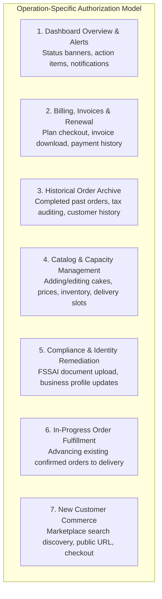

# CakeStore Phase 1 — Bakery Lifecycle Safety Implementation Plan (Final Reconciled Revision)

**Document:** `CAKESTORE_PHASE1_LIFECYCLE_IMPLEMENTATION_PLAN.md`  
**Status:** REVISED PROPOSAL / AWAITING USER APPROVAL (Strictly Read-Only Planning Phase)  
**Author:** Antigravity AI Pair Programmer  
**Date:** October 14, 2026 (Final Reconciled Revision)  

---

## 1. Executive Summary & Objective

This revised document establishes a minimal, safe, backward-compatible implementation plan to resolve the architectural and lifecycle defects identified in [`CAKESTORE_BAKERY_LIFECYCLE_AUDIT.md`](file:///d:/PROJECTS/CAKE%20SAAs1/CAKESTORE_BAKERY_LIFECYCLE_AUDIT.md).

All safety findings and review corrections have been thoroughly resolved:
1. **Unfiltered V47 DML Backfill (No Stale-Event Misclassification):** Fixed the migration DML in Section 6.4 so that `ROW_NUMBER()` is computed across **all** shop activity logs without premature action filtering. A newer unsupported or contradictory shop event (e.g. `SHOP_ACTIVATED`, `SHOP_SUSPENDED`, or manual DB adjustment) will never be skipped in favor of an older log entry. Any unconfirmed, missing, or contradictory history strictly defaults to the conservative fallback (`is_owner_enabled = false`, `is_marketplace_restricted = false`) and is flagged for manual review.
2. **Operation-Specific Owner Authorization Model:** Replaced the blunt single-rule approach with granular, operation-specific authorization rules across all 7 operational domains: (1) Dashboard overview & alerts, (2) Billing & renewal, (3) Historical order archive, (4) Catalog & slot editing, (5) Compliance/FSSAI remediation, (6) Fulfillment of in-progress orders, and (7) New customer commerce. Expired owners retain dashboard, billing, compliance, and archive access and can fulfill legitimate existing orders under strict tenant isolation, while blocking new customer commerce and live catalog mutations.
3. **Server-Side Subscription Entitlement Enforced for Public Visibility:** Section 3.7, Section 4, and Section 6.6 explicitly enforce that public storefront visibility (marketplace search discovery and direct storefront view) and new customer order placement require an active, unexpired subscription entitlement in addition to `status == ACTIVE`, `is_owner_enabled == true`, `is_marketplace_restricted == false`, and `!is_deleted`. The platform never relies solely on `ShopStatus.ACTIVE` or asynchronous cron scheduler execution.
4. **Precise Renewal Restoration Transitions:** Section 2.3 and Section 6.6 formally define the exact state transitions for all shop states upon verified successful renewal payment:
   - *Enabled + unrestricted + valid renewal:* An eligible shop previously hidden solely because its subscription expired returns to `ACTIVE` and becomes immediately eligible for public storefront visibility and new orders.
   - *Owner-disabled:* The owner's disabled preference (`is_owner_enabled = false`) is preserved; the shop remains hidden from the marketplace until the owner explicitly reopens it.
   - *Admin-restricted:* The restriction (`is_marketplace_restricted = true`) and mandatory reason are preserved; the shop remains hidden until an authorized administrator explicitly lifts it.
   - *Suspended:* Renewal payment activates subscription entitlement dates but **never removes suspension or restores operational access**.
   - *Soft-deleted:* Renewal is blocked and never reactivates the account or storefront.
   - *Legacy INACTIVE:* Renewal extends paid entitlement dates but **never silently mutates status to ACTIVE or overwrites owner/admin flags**.
5. **Legacy `INACTIVE` Status Compatibility:** Formally documented how legacy shops whose `status` remains `INACTIVE` after the `V47` backfill are handled. Authoritative flags (`is_owner_enabled` and `is_marketplace_restricted`) govern visibility without silently rewriting historical enum values. Added focused tests for legacy `INACTIVE` states.
6. **Correct Audit Diagnostic SQL:** Corrected the `audit_review_status` diagnostic query to detect missing logs, missing actors/roles, owner mismatches, administrative actor mismatches, and unsupported latest status-changing events without pre-filtering. Handled SQL `NULL` and string comparisons safely with `IS NULL` and `IS DISTINCT FROM`.
7. **Cancellation Reminder Scope:** Explicitly defined that subscription cancellation suppresses **subscription renewal reminder notifications only**. All critical operational communications—order lifecycle notifications, payment receipts, security alerts, and administrative restriction notices—remain 100% active and unsuppressed.
8. **Refund Truth & Contract Preservation:** Preserved existing persisted database enums, columns, routes, and response contracts (`payment_status = 'REFUNDED'`). Clarified that `MANUAL_REFUND_RECORDED` is a display/communication label. Guaranteed that the system never claims a refund was electronically settled without gateway confirmation. Kept automated Razorpay refund integration strictly out of scope.

> [!IMPORTANT]
> **Strict Non-Negotiable Preservation Guarantees:**
> - Strictly read-only planning revision. No application source code, schemas, migrations, or database records are modified.
> - Preserves all existing enums (`ShopStatus`, `SubscriptionStatus`, `VerificationStatus`), routes, database tables, and historical audit/payment data.
> - No destructive database commands, table dropping, column dropping, or Git operations.

---

## 2. Current Lifecycle Mapping & Confirmed Rule Conflicts

### 2.1 Current State Transitions



### 2.2 Direct Conflicts with Confirmed Business Rules

| Rule # | Confirmed Business Rule | Current Code Reference | Failure Mechanism | Required Fix in Phase 1 |
| :--- | :--- | :--- | :--- | :--- |
| **Rule 4** | Owner-disabled bakery is hidden from marketplace; **owner retains dashboard access**. | [`ShopAccessValidator.java:70`](file:///d:/PROJECTS/CAKE%20SAAs1/backend/src/main/java/com/cakeplatform/api/modules/security/ShopAccessValidator.java#L70) | `if (shop.getStatus() != ShopStatus.ACTIVE) throw new SubscriptionExpiredException(...)`. Setting `shop.status = INACTIVE` throws HTTP 403 on **all** owner operational endpoints. | Allow owner dashboard access when `isOwnerEnabled == false` as long as subscription entitlement is active. |
| **Rule 5** | Admin temporary marketplace restriction hides storefront and gives reason; **must not lock owner out of dashboard**. | [`ShopStatusManager.java:49`](file:///d:/PROJECTS/CAKE%20SAAs1/backend/src/main/java/com/cakeplatform/api/modules/shop/ShopStatusManager.java#L49), [`ShopAccessValidator.java:54`](file:///d:/PROJECTS/CAKE%20SAAs1/backend/src/main/java/com/cakeplatform/api/modules/security/ShopAccessValidator.java#L54) | Admin uses `SUSPENDED` status. `ShopAccessValidator` completely locks out the owner, preventing issue resolution. | Introduce `isMarketplaceRestricted` (Boolean) & `marketplaceRestrictionReason`. Owner retains dashboard access with alert banner. |
| **Rule 6** | Subscription renewal **must not automatically remove owner-disabled state or admin restriction**. | [`SubscriptionService.java:93-97`](file:///d:/PROJECTS/CAKE%20SAAs1/backend/src/main/java/com/cakeplatform/api/modules/subscription/SubscriptionService.java#L93-L97) | Renewal executes `shopStatusManager.activateShop(shop.getId(), userId)`. If shop was `INACTIVE`, renewal forces it to `ACTIVE`. | Renewal must activate the subscription entitlement without overwriting `isOwnerEnabled` or `isMarketplaceRestricted`. |
| **Rule 7** | Subscription expiry hides storefront but preserves owner billing/renewal; preserves owner-disabled preference. | [`SubscriptionService.java:154`](file:///d:/PROJECTS/CAKE%20SAAs1/backend/src/main/java/com/cakeplatform/api/modules/subscription/SubscriptionService.java#L154) | `expireSubscription` sets `shop.setStatus(ShopStatus.EXPIRED)`. Overwrites and erases previous `INACTIVE` state. | Preserve `isOwnerEnabled` so that when the owner later renews, their vacation/closed preference is retained. |
| **Rule 8** | Cancellation stops renewal immediately; paid access continues until current paid period ends. | [`SubscriptionStatus.java:10`](file:///d:/PROJECTS/CAKE%20SAAs1/backend/src/main/java/com/cakeplatform/api/modules/subscription/SubscriptionStatus.java#L10) | `CANCELLED` enum exists but has no cancellation endpoint, service logic, or scheduler check. | Implement cancellation: record `cancelled_at` and `cancellation_reason`. Paid entitlement persists until `expiryDate`. |
| **Rule 10** | Never claim a refund was completed unless the payment gateway confirms it. | [`OrderService.java:185-225`](file:///d:/PROJECTS/CAKE%20SAAs1/backend/src/main/java/com/cakeplatform/api/modules/order/service/OrderService.java#L185-L225) | Setting `order.paymentStatus = 'REFUNDED'` sends email/SMS stating: *"A refund of ₹... has been processed successfully"* with **zero Razorpay API calls**. | Preserve persisted `REFUNDED` status; use display label `Manual Refund Recorded`; correct notification templates. |

### 2.3 Precise State Transitions Upon Verified Successful Renewal Payment

Upon verified payment capture in [`SubscriptionService.processSuccessfulPayment(...)`](file:///d:/PROJECTS/CAKE%20SAAs1/backend/src/main/java/com/cakeplatform/api/modules/subscription/SubscriptionService.java#L80), the system extends the subscription dates (`status = ACTIVE`, `expiryDate = now() + days`), records payment completion, and transitions shop states strictly according to the following rules:

1. **Eligible Normal Shop (Enabled + Unrestricted + Previously Hidden Solely Due to Expiry):**
   - **Initial State:** `shop.status = EXPIRED`, `is_owner_enabled = TRUE`, `is_marketplace_restricted = FALSE`, `is_deleted = FALSE`.
   - **Renewal Effect:** System sets `shop.status = ACTIVE`. Because all 5 visibility conditions are satisfied, the shop **becomes immediately eligible for marketplace discovery, storefront view, and new customer order placement**.
2. **Owner-Disabled Shop (Vacation / Closed):**
   - **Initial State:** `shop.status = EXPIRED` or `ACTIVE`, `is_owner_enabled = FALSE`, `is_marketplace_restricted = FALSE`.
   - **Renewal Effect:** Paid entitlement is renewed (`sub.status = ACTIVE`), but `shop.is_owner_enabled` **remains FALSE**. If `shop.status` was `EXPIRED`, it transitions to `ACTIVE` (or preserves state), but the storefront **remains strictly hidden from the public marketplace**. No new customer orders are accepted until the owner explicitly reopens the bakery via dashboard toggle.
3. **Admin-Restricted Shop (Temporary Administrative Action):**
   - **Initial State:** `shop.status = EXPIRED` or `ACTIVE`, `is_marketplace_restricted = TRUE`, `marketplace_restriction_reason` populated.
   - **Renewal Effect:** Paid entitlement is renewed (`sub.status = ACTIVE`), but `shop.is_marketplace_restricted` **remains TRUE** and the restriction reason is intact. The storefront **remains strictly hidden from the public marketplace**. No new customer orders are accepted until an authorized administrator explicitly lifts the restriction via admin dashboard.
4. **Suspended Account (Severe Fraud / Abuse Lockout):**
   - **Initial State:** `shop.status = SUSPENDED`.
   - **Renewal Effect:** If payment is captured, the subscription dates are extended for billing/accounting purposes, but **`shop.status` remains strictly `SUSPENDED`**. Renewal **never** removes suspension, never restores owner operational access, and never exposes the shop publicly. Operational recovery requires manual administrative review through customer support.
5. **Soft-Deleted Account (`is_deleted = TRUE`):**
   - **Initial State:** `shop.is_deleted = TRUE` or `user.is_deleted = TRUE`.
   - **Renewal Effect:** Blocked at controller/service level. Renewal checkout cannot be initiated, and webhook processing never un-deletes or reactivates a deleted account, shop, or storefront.
6. **Legacy `INACTIVE` Shop:**
   - **Initial State:** `shop.status = INACTIVE`.
   - **Renewal Effect:** Subscription entitlement is activated (`sub.status = ACTIVE`), but the shop's persisted `status = INACTIVE` **is never silently mutated to `ACTIVE`**, and its `is_owner_enabled` or `is_marketplace_restricted` flags are not overwritten. Storefront remains hidden until explicit owner reopening.

---

## 3. Operation-Specific Authorization & Operational Domain Architecture

Rather than a single monolithic rule in `ShopAccessValidator` that treats all operations identically, the platform defines **seven distinct, operation-specific authorization policies**. This ensures that expired or paused owners are not unnecessarily locked out of business-critical administrative workflows:



### 3.1 Operation-Specific Authorization Rules

#### 1. Dashboard Overview & Alerts (`GET /api/shops/my-shop`, `GET /api/owner/dashboard/overview`)
- **Required Authorization:**
  - Owner must be authenticated (`ROLE_SHOP_OWNER`).
  - Shop must not be soft-deleted (`is_deleted == false`).
  - Shop must not be suspended (`status != ShopStatus.SUSPENDED`).
- **Subscription Entitlement:** **NOT required to be active.**
  - Expired owners can view their overview with a prominent expiration banner and quick-renewal button.
  - Paused (owner-disabled) owners can view their dashboard with a vacation mode banner and toggle.
  - Admin-restricted owners can view their dashboard with an administrative notice explaining the restriction reason.
- **Suspended / Deleted:** Blocked (403 for Suspended with contact support instructions; 404/403 for Deleted).

#### 2. Billing, Invoices, Payment History & Renewal (`/api/owner/payments/**`, `/api/subscriptions/**`)
- **Required Authorization:**
  - Authenticated owner (`ROLE_SHOP_OWNER`).
  - Shop not soft-deleted.
- **Allowed States:**
  - **Active, Expired, Owner-Disabled, Admin-Restricted, Legacy INACTIVE:** **FULLY ALLOWED.** Owners can view historical subscription receipts, download tax invoices, select subscription plans, initiate on-demand renewal checkout, and declare cancellation.
  - **Suspended:** Invoices viewable for accounting/tax compliance; self-service checkout/renewal is blocked (requires contacting support).
  - **Deleted:** Blocked.

#### 3. Historical Order Archive (`GET /api/owner/orders` for completed orders)
- **Required Authorization:**
  - Authenticated owner (`ROLE_SHOP_OWNER`).
  - Strict tenant isolation: `order.getShop().getId().equals(shop.getId())`.
  - Shop not suspended and not deleted.
- **Allowed States:**
  - **Active, Expired, Owner-Disabled, Admin-Restricted, Legacy INACTIVE:** **ALLOWED.** Expired owners retain read-only access to historical sales records and past customer orders for accounting and tax compliance.
  - **Suspended:** Blocked from owner dashboard.

#### 4. Catalog & Slot Editing (`/api/products/**`, `/api/delivery-slots/**`, `/api/coupons/**`)
- **Required Authorization:**
  - Authenticated owner (`ROLE_SHOP_OWNER`).
  - Active subscription entitlement required: `latestSub.status == ACTIVE && latestSub.expiryDate > now()`.
  - Shop not suspended and not deleted.
- **Allowed States:**
  - **Active & Normal:** Allowed. Full create, edit, delete access.
  - **Active & Owner-Disabled (Vacation Mode):** **ALLOWED.** While closed for holidays, owners can update menus, adjust prices, and configure future slots.
  - **Active & Admin-Restricted:** **ALLOWED.** Owners can edit product descriptions or inventory to resolve admin concerns.
  - **Expired:** **BLOCKED (HTTP 403 `SubscriptionExpiredException`).** Editing catalog items or modifying active slots requires an active subscription entitlement. Read-only viewing of existing catalog is permitted.
  - **Suspended / Deleted:** Blocked.

#### 5. Compliance & Identity Remediation (`PUT /api/shops/my-shop/profile`, `/api/compliance/**`)
- **Required Authorization:**
  - Authenticated owner (`ROLE_SHOP_OWNER`).
  - Shop not suspended and not deleted.
- **Subscription Entitlement:** **NOT required to be active.**
  - **Active, Owner-Disabled, Admin-Restricted, Legacy INACTIVE:** **ALLOWED.** Crucial for admin-restricted owners to upload corrected FSSAI certificates or update contact details to get restrictions lifted.
  - **Expired:** **ALLOWED.** Owners can update profile information and submit compliance documents prior to or during renewal.
  - **Suspended:** Blocked (requires contacting support).

#### 6. In-Progress Order Fulfillment (`PATCH /api/owner/orders/{id}/status`, `PATCH /api/owner/orders/{id}/payment-status`)
- **Required Authorization:**
  - Authenticated owner (`ROLE_SHOP_OWNER`).
  - **Strict Tenant Isolation:** Verified in [`OrderService.java:68`](file:///d:/PROJECTS/CAKE%20SAAs1/backend/src/main/java/com/cakeplatform/api/modules/order/service/OrderService.java#L68) via `orderRepository.findByIdAndShopId(orderId, shop.getId())`. Owners cannot view or modify orders belonging to another bakery.
  - Order must not be in terminal state (`COMPLETED`, `CANCELLED`).
  - Shop not suspended and not deleted.
- **Subscription Entitlement:** **Preserved for In-Progress Fulfillment.**
  - **Active, Owner-Disabled, Admin-Restricted, Legacy INACTIVE:** **ALLOWED.** Committed orders must be fulfilled.
  - **Expired / Cancelled (Past Expiry):** **ALLOWED.** If a subscription lapses while legitimate customer orders are in-flight, the owner **must retain the ability to advance order stages** (`CONFIRMED` -> `PREPARING` -> `READY` -> `DELIVERED`) so customers receive their cakes and financial disputes are avoided.
  - **Missing / Pending Subscription:** **ALLOWED (if legitimate non-terminal orders exist).** While a newly registered bakery cannot receive customer orders prior to subscription activation, if an existing operational shop experiences an entitlement desynchronization, missing subscription record, or pending renewal payment while pre-existing orders remain in-flight, the owner **retains the right to fulfill those existing orders**. Strict tenant isolation and non-terminal checks apply. **Under no circumstances does this exception enable new customer orders or storefront visibility.**
  - **Suspended / Deleted:** Blocked (managed administratively).

#### 7. New Customer Commerce & Public Storefront Visibility (`/api/storefront/**`, guest checkout)
- **Authoritative Server-Side Predicate:**
  Enforced across all customer discovery and checkout endpoints:
  - Marketplace search discovery ([`CustomerStorefrontService.searchShops`](file:///d:/PROJECTS/CAKE%20SAAs1/backend/src/main/java/com/cakeplatform/api/modules/storefront/CustomerStorefrontService.java#L206), [`ShopSpecification.filterShops`](file:///d:/PROJECTS/CAKE%20SAAs1/backend/src/main/java/com/cakeplatform/api/modules/shop/ShopSpecification.java#L48))
  - Direct storefront view ([`CustomerStorefrontService.getShopDetails`](file:///d:/PROJECTS/CAKE%20SAAs1/backend/src/main/java/com/cakeplatform/api/modules/storefront/CustomerStorefrontService.java#L201), [`getActiveShop`](file:///d:/PROJECTS/CAKE%20SAAs1/backend/src/main/java/com/cakeplatform/api/modules/storefront/CustomerStorefrontService.java#L147))
  - Delivery slot listing ([`CustomerStorefrontService.getShopDeliverySlots`](file:///d:/PROJECTS/CAKE%20SAAs1/backend/src/main/java/com/cakeplatform/api/modules/storefront/CustomerStorefrontService.java#L590))
  - Product catalog listing ([`CustomerStorefrontService.getShopProducts`](file:///d:/PROJECTS/CAKE%20SAAs1/backend/src/main/java/com/cakeplatform/api/modules/storefront/CustomerStorefrontService.java#L630))
  - Guest and customer order placement ([`CustomerStorefrontService.placeGuestOrder`](file:///d:/PROJECTS/CAKE%20SAAs1/backend/src/main/java/com/cakeplatform/api/modules/storefront/CustomerStorefrontService.java#L663))
- **Strict Composite Requirements (ALL 5 MUST HOLD):**
  ```java
  // Authoritative composite check for public visibility & commerce
  shop.getStatus() == ShopStatus.ACTIVE
  && Boolean.TRUE.equals(shop.getIsOwnerEnabled())
  && Boolean.FALSE.equals(shop.getIsMarketplaceRestricted())
  && !shop.isDeleted()
  && isShopSubscriptionValid(shop.getId()) // ACTIVE status and expiryDate > now()
  ```
- **Entitlement Invalidation Guarantee:**
  If an `ACTIVE` shop's subscription is missing, pending, expired, suspended, or cancelled beyond its paid term, `isShopSubscriptionValid(shopId)` evaluates to `false`. The shop is **immediately omitted from search, returns 404/unavailable on direct URL, and strictly rejects new order placement**. The platform never relies solely on `ShopStatus.ACTIVE` or asynchronous scheduler runs.
- **FSSAI Verification Boundary:**
  Document verification remains independent of storefront visibility. An active, subscribed bakery with pending FSSAI verification remains publicly visible and can accept orders; FSSAI verification controls the customer-facing verification badge only.

---

## 4. Reconciled Authoritative Visibility & Access Decision Table

This matrix formally consolidates all written rules, access tiers, and operational permissions without contradiction. Every row contains exactly 13 columns matching the 13 headers:

| # | Subscription Entitlement | Owner State (`isOwnerEnabled`) | Admin State (`isMarketplaceRestricted`) | Shop Status Enum | Customer Storefront (Search/Direct) | Customer New Order Placement | In-Progress Order Fulfillment | Catalog & Slot Editing | Compliance / FSSAI Upload | Dashboard Overview & Alerts | Billing, Invoices & Renewal | Historical Orders Archive |
| :---: | :---: | :---: | :---: | :---: | :---: | :---: | :---: | :---: | :---: | :---: | :---: | :---: |
| **1** | None / Pending (`PENDING`) | Enabled | False | `PENDING` | **NO** | **NO** | **YES** (Existing in-flight orders, if any) | **NO** (Prompt sub) | **YES** (Upload FSSAI) | **YES** (Setup checklist) | **YES** (Plans & Checkout) | **YES** (Historical, if any) |
| **2** | Active (`ACTIVE`) | Enabled | False | `ACTIVE` | **YES** | **YES** | **YES** | **YES** | **YES** | **YES** | **YES** | **YES** |
| **3** | Active (`ACTIVE`) | Enabled | False | `ACTIVE` (Verified) | **YES** (Badge) | **YES** | **YES** | **YES** | **YES** | **YES** | **YES** | **YES** |
| **4** | Active (`ACTIVE`) | Enabled | False | `ACTIVE` (Rejected KYC) | **YES** | **YES** | **YES** | **YES** | **YES** (Re-upload alert) | **YES** (Rejection note) | **YES** | **YES** |
| **5** | Expired (`EXPIRED`) | Enabled | False | `EXPIRED` | **NO** | **NO** | **YES** (Fulfill existing) | **NO** (403 Blocked) | **YES** (Profile/Docs) | **YES** (Renewal banner) | **YES** (Invoices & Renew) | **YES** (Read-only) |
| **6** | Active (`ACTIVE`) | **Disabled** (Vacation) | False | `ACTIVE` | **NO** | **NO** | **YES** (Fulfill existing) | **YES** (Manage catalog) | **YES** | **YES** (Vacation banner) | **YES** | **YES** |
| **7** | Active (`ACTIVE`) | Enabled | **Restricted** | `ACTIVE` | **NO** | **NO** | **YES** (Fulfill existing) | **YES** (Correct issues) | **YES** (Compliance fix) | **YES** (Admin note banner) | **YES** | **YES** |
| **8** | Active (`ACTIVE`) | **Disabled** | **Restricted** | `ACTIVE` | **NO** | **NO** | **YES** (Fulfill existing) | **YES** (Manage catalog) | **YES** (Compliance fix) | **YES** (Both banners) | **YES** | **YES** |
| **9** | Expired (`EXPIRED`) | **Disabled** | False | `EXPIRED` | **NO** | **NO** | **YES** (Fulfill existing) | **NO** (403 Blocked) | **YES** (Profile/Docs) | **YES** (Renewal banner) | **YES** (Invoices & Renew) | **YES** (Read-only) |
| **10** | Suspended | Any | Any | `SUSPENDED` | **NO** (Unavailable) | **NO** | **NO** (Admin Managed) | **NO** (403 Blocked) | **NO** (403 Blocked - Support) | **NO** (403 Locked - Support) | Invoices Viewable Only (Renewals Require Support) | **NO** (Blocked - Support) |
| **11** | Cancelled (In Period) | Enabled | False | `ACTIVE` | **YES** | **YES** | **YES** | **YES** | **YES** | **YES** (Expiry date notice) | **YES** | **YES** |
| **12** | Any | Any | Any | Soft-Deleted (`is_deleted`) | **NO** (404) | **NO** | **NO** | **NO** | **NO** | **NO** (Account deleted) | **NO** | **NO** |
| **13** | Active (`ACTIVE`) | **Disabled** | False | `INACTIVE` (Legacy) | **NO** | **NO** | **YES** (Fulfill existing) | **YES** (Manage catalog) | **YES** | **YES** (Vacation banner) | **YES** | **YES** |
| **14** | Active (`ACTIVE`) | Enabled | **Restricted** | `INACTIVE` (Legacy) | **NO** | **NO** | **YES** (Fulfill existing) | **YES** (Correct issues) | **YES** (Compliance fix) | **YES** (Admin note banner) | **YES** | **YES** |
| **15** | Expired (`EXPIRED`) | **Disabled** | False | `INACTIVE` (Legacy) | **NO** | **NO** | **YES** (Fulfill existing) | **NO** (403 Blocked) | **YES** (Profile/Docs) | **YES** (Renewal banner) | **YES** (Invoices & Renew) | **YES** (Read-only) |
| **16** | Expired / Invalid | Enabled | False | `ACTIVE` (Desynced) | **NO** | **NO** | **YES** (Fulfill existing) | **NO** (403 Blocked) | **YES** (Profile/Docs) | **YES** (Renewal banner) | **YES** (Invoices & Renew) | **YES** (Read-only) |
| **17** | Missing / None | Enabled | False | `ACTIVE` (Desynced) | **NO** | **NO** | **YES** (Fulfill existing) | **NO** (403 Blocked) | **YES** (Profile/Docs) | **YES** (Prompt sub banner) | **YES** (Plans & Checkout) | **YES** (Historical, if any) |

---

## 5. Subscription Payment & Cancellation Reality Verification

### 5.1 Verification of Current Payment Architecture
Detailed inspection of [`OwnerPaymentController.java`](file:///d:/PROJECTS/CAKE%20SAAs1/backend/src/main/java/com/cakeplatform/api/modules/payment/controller/OwnerPaymentController.java), [`RazorpayService.java`](file:///d:/PROJECTS/CAKE%20SAAs1/backend/src/main/java/com/cakeplatform/api/modules/payment/RazorpayService.java), and frontend [`subscription/page.tsx`](file:///d:/PROJECTS/CAKE%20SAAs1/frontend_v2/app/dashboard/owner/subscription/page.tsx) confirms:

1. **One-Time On-Demand Orders Only:**
   - In [`RazorpayService.java:147`](file:///d:/PROJECTS/CAKE%20SAAs1/backend/src/main/java/com/cakeplatform/api/modules/payment/RazorpayService.java#L147), subscription orders are generated using standard one-time orders:
     ```java
     Order order = razorpayClient.orders.create(orderRequest);
     ```
   - The platform does not use Razorpay Subscriptions API (`razorpayClient.subscriptions.create`).
2. **Zero Auto-Debit / Zero Mandates:**
   - The platform possesses **no recurring payment authorization, no UPI AutoPay mandates, no e-NACH tokens, and no stored card credentials**.
   - Every renewal is an **on-demand manual checkout** initiated explicitly by the bakery owner via the client checkout modal.
3. **No Automatic Renewal To Stop:**
   - Because no auto-charging mechanism exists, introducing an `auto_renew` column would misrepresent the platform's capabilities.
   - All references to `auto_renew` / `autoRenew` are removed from the migration, entity models, endpoints, and tests.

### 5.2 Accurate Cancellation Semantics for Fixed-Term Prepaid Plans
Under the confirmed business rules:
- **What "Cancellation" Means:**
  - The owner records their declaration that they do **not** intend to renew when their current paid entitlement expires.
  - The system records `cancelled_at` (timestamp) and `cancellation_reason` (varchar 500).
  - The owner dashboard displays: *"Subscription set to expire on {expiryDate}. Will not renew."*
- **Entitlement Preservation:**
  - The paid entitlement remains **100% active** until `expiryDate`.
  - The bakery remains visible on the marketplace, and customer orders proceed normally.
- **Terminal Expiration:**
  - When `expiryDate` arrives, [`SubscriptionScheduler.java`](file:///d:/PROJECTS/CAKE%20SAAs1/backend/src/main/java/com/cakeplatform/api/modules/subscription/SubscriptionScheduler.java) transitions the record to `EXPIRED`.
  - No pro-rated refund is calculated or simulated.

### 5.3 Cancellation Reminder Scope & Operational Communications Preservation
- **Strict Scope of Suppression:** Cancellation suppresses **subscription-renewal reminder notifications only** (e.g., pre-expiry renewal prompt emails/SMS scheduled at 7 days, 3 days, or 1 day prior to expiration).
- **Preserved Operational Communications (Strictly NOT Suppressed):**
  - **Customer & Order Lifecycle Notifications:** New order placed, order confirmed, order preparing, ready for pickup, out for delivery, order delivered, order cancelled.
  - **Financial & Transactional Receipts:** Order payment receipts, invoice PDF downloads, refund record notifications.
  - **Account & Security Alerts:** Password resets, security login alerts, FSSAI verification approval/rejection notices.
  - **Administrative Notices:** Marketplace restriction alert banners, restriction reason notifications, suspension notices.
  These communications are critical for ongoing business operations and legal compliance and must never be blocked by non-renewal intent.

---

## 6. Safe Database Migration (`V47`), Backfill & Legacy Compatibility

### 6.1 Migration Lineage
- **Existing Migrations:** `V1` through `V46` located in [`backend/src/main/resources/db/migration`](file:///d:/PROJECTS/CAKE%20SAAs1/backend/src/main/resources/db/migration).
- **Target Migration:** `V47__add_marketplace_restriction_and_operational_status.sql`.

### 6.2 Proposed Schema DDL

```sql
-- Migration: V47__add_marketplace_restriction_and_operational_status.sql
-- Description: Disentangle owner operational state, admin restrictions, and subscription non-renewal intent

-- 1. Owner operational toggle (default TRUE)
ALTER TABLE shops 
    ADD COLUMN is_owner_enabled BOOLEAN NOT NULL DEFAULT TRUE;

-- 2. Admin temporary marketplace restriction (default FALSE)
ALTER TABLE shops 
    ADD COLUMN is_marketplace_restricted BOOLEAN NOT NULL DEFAULT FALSE,
    ADD COLUMN marketplace_restriction_reason VARCHAR(500);

-- 3. Subscription cancellation timestamp and non-renewal intent
ALTER TABLE subscriptions 
    ADD COLUMN cancelled_at TIMESTAMP,
    ADD COLUMN cancellation_reason VARCHAR(500);

-- 4. Compound index for optimized storefront visibility queries
CREATE INDEX idx_shops_marketplace_visibility 
    ON shops (status, is_owner_enabled, is_marketplace_restricted, is_deleted);
```

### 6.3 Code-Path Inspection & Actor/Action Verification

Inspection of the actual backend source code confirms how status changes are logged in [`ActivityLog.java`](file:///d:/PROJECTS/CAKE%20SAAs1/backend/src/main/java/com/cakeplatform/api/modules/audit/ActivityLog.java):

1. **`SHOP_BECAME_INACTIVE`:**
   - **Source:** [`ShopStatusManager.java:45`](file:///d:/PROJECTS/CAKE%20SAAs1/backend/src/main/java/com/cakeplatform/api/modules/shop/ShopStatusManager.java#L45) -> `changeShopStatus(shopId, ShopStatus.INACTIVE, actorUserId, "SHOP_BECAME_INACTIVE")`.
   - **Caller:** Invoked exclusively from [`AdminDashboardService.java:405`](file:///d:/PROJECTS/CAKE%20SAAs1/backend/src/main/java/com/cakeplatform/api/modules/admin/AdminDashboardService.java#L405) when an administrator manually sets shop status to "INACTIVE".
   - **Confirmed Semantics:** Administrative deactivation.
   - **Reliable Condition:** `action = 'SHOP_BECAME_INACTIVE'` AND `u.role = 'ADMIN'`.

2. **`STATUS_CHANGE`:**
   - **Source:** [`ShopService.java:67`](file:///d:/PROJECTS/CAKE%20SAAs1/backend/src/main/java/com/cakeplatform/api/modules/shop/service/ShopService.java#L67) -> `activityLogger.logActivity(ownerId, shop.getId(), "STATUS_CHANGE", "SHOP", shop.getId(), "Shop set to inactive. Reason: " + reason)`.
   - **Caller:** Invoked exclusively from [`ShopController.java:27`](file:///d:/PROJECTS/CAKE%20SAAs1/backend/src/main/java/com/cakeplatform/api/modules/shop/controller/ShopController.java#L27) when a bakery owner updates their own shop status to "INACTIVE" (vacation mode).
   - **Confirmed Semantics:** Owner-initiated operational pause.
   - **Reliable Condition:** `action = 'STATUS_CHANGE'` AND (`u.role = 'SHOP_OWNER'` OR `al.actor_user_id = s.owner_id`).

3. **`SHOP_ACTIVATED`:**
   - **Source:** [`ShopStatusManager.java:40`](file:///d:/PROJECTS/CAKE%20SAAs1/backend/src/main/java/com/cakeplatform/api/modules/shop/ShopStatusManager.java#L40).
   - **Caller:** Invoked by [`SubscriptionService.java:96`](file:///d:/PROJECTS/CAKE%20SAAs1/backend/src/main/java/com/cakeplatform/api/modules/subscription/SubscriptionService.java#L96) upon successful subscription payment, or by [`AdminDashboardService.java:403`](file:///d:/PROJECTS/CAKE%20SAAs1/backend/src/main/java/com/cakeplatform/api/modules/admin/AdminDashboardService.java#L403) for admin activation.

4. **`SHOP_SUSPENDED`:**
   - **Source:** [`ShopStatusManager.java:53`](file:///d:/PROJECTS/CAKE%20SAAs1/backend/src/main/java/com/cakeplatform/api/modules/shop/ShopStatusManager.java#L53).
   - **Caller:** Invoked exclusively by [`AdminDashboardService.java:400`](file:///d:/PROJECTS/CAKE%20SAAs1/backend/src/main/java/com/cakeplatform/api/modules/admin/AdminDashboardService.java#L400) for severe compliance/fraud lockout.

### 6.4 Safe Historical Backfill Algorithm (Resolving `INACTIVE` Shops Without Stale Events)

> [!CRITICAL]
> **No Classification From Stale Events:**
> To guarantee that a newer unsupported, contradictory, or unconfirmed event is not skipped in favor of an older log entry, the backfill CTE **does not pre-filter action codes**. It partitions by `shop_id` across **all** shop activity logs and computes `ROW_NUMBER() OVER (ORDER BY timestamp DESC, id DESC)`.
> Only if `rn = 1` matches the confirmed actor/action criteria is the shop auto-classified. Otherwise, it falls through to the conservative fallback.

```sql
-- DML Step 1: Default all non-inactive shops to normal enabled & unrestricted
UPDATE shops 
SET is_owner_enabled = TRUE, 
    is_marketplace_restricted = FALSE,
    marketplace_restriction_reason = NULL
WHERE status != 'INACTIVE';

-- DML Step 2: Classify INACTIVE shops where the ABSOLUTE LATEST event is a CONFIRMED administrative restriction
WITH all_latest_shop_logs AS (
    SELECT 
        al.shop_id,
        al.action,
        al.actor_user_id,
        u.role AS actor_role,
        ROW_NUMBER() OVER (
            PARTITION BY al.shop_id 
            ORDER BY al.timestamp DESC, al.id DESC
        ) AS rn
    FROM activity_logs al
    LEFT JOIN users u ON al.actor_user_id = u.id
    WHERE al.entity_type = 'SHOP'
)
UPDATE shops s
SET is_marketplace_restricted = TRUE,
    marketplace_restriction_reason = 'Administrative temporary restriction (migrated from legacy inactive status)',
    is_owner_enabled = TRUE
FROM all_latest_shop_logs lsl
WHERE s.id = lsl.shop_id
  AND lsl.rn = 1
  AND s.status = 'INACTIVE'
  AND lsl.action = 'SHOP_BECAME_INACTIVE'
  AND lsl.actor_role = 'ADMIN';

-- DML Step 3: Classify INACTIVE shops where the ABSOLUTE LATEST event is a CONFIRMED owner action
WITH all_latest_shop_logs AS (
    SELECT 
        al.shop_id,
        al.action,
        al.actor_user_id,
        u.role AS actor_role,
        ROW_NUMBER() OVER (
            PARTITION BY al.shop_id 
            ORDER BY al.timestamp DESC, al.id DESC
        ) AS rn
    FROM activity_logs al
    LEFT JOIN users u ON al.actor_user_id = u.id
    WHERE al.entity_type = 'SHOP'
)
UPDATE shops s
SET is_owner_enabled = FALSE,
    is_marketplace_restricted = FALSE,
    marketplace_restriction_reason = NULL
FROM all_latest_shop_logs lsl
WHERE s.id = lsl.shop_id
  AND lsl.rn = 1
  AND s.status = 'INACTIVE'
  AND s.is_marketplace_restricted = FALSE
  AND lsl.action = 'STATUS_CHANGE'
  AND (lsl.actor_role = 'SHOP_OWNER' OR lsl.actor_user_id = s.owner_id);

-- DML Step 4: Conservative Fallback for All Remaining Legacy INACTIVE Shops
-- (Catches shops with no logs, null actors, role mismatches, or where latest event was NOT a confirmed action)
UPDATE shops s
SET is_owner_enabled = FALSE,
    is_marketplace_restricted = FALSE,
    marketplace_restriction_reason = NULL
WHERE s.status = 'INACTIVE'
  AND s.is_marketplace_restricted = FALSE;
```

### 6.5 Alignment Between Migration DML & Audit Diagnostic Query

The migration classification rules in Section 6.4 and the diagnostic query in Section 6.7 are intentionally and strictly aligned:
- **Same CTE Structure:** Both evaluate `rn = 1` across **all** activity logs for a shop without pre-filtering actions.
- **Exact Same Matching Rules:**
  - Confirmed Admin: `action = 'SHOP_BECAME_INACTIVE' AND actor_role = 'ADMIN'`
  - Confirmed Owner: `action = 'STATUS_CHANGE' AND (actor_role = 'SHOP_OWNER' OR actor_user_id = s.owner_id)`
- **Intentional Differences Explained:**
  - **DML (Section 6.4):** Mutates the new flags (`is_marketplace_restricted`, `is_owner_enabled`) while preserving existing `status = 'INACTIVE'`. Ambiguous records receive the conservative fallback (`is_owner_enabled = false`, `is_marketplace_restricted = false`).
  - **Diagnostic Query (Section 6.7):** A read-only analytical query that does not modify data. It categorizes the exact reason for manual review (`MANUAL_REVIEW_NO_ACTIVITY_LOGS`, `MANUAL_REVIEW_UNCONFIRMED_ADMIN_ACTOR`, `MANUAL_REVIEW_UNCONFIRMED_OWNER_ACTOR`, `MANUAL_REVIEW_CONTRADICTORY_LATEST_ACTION`, `MANUAL_REVIEW_UNSUPPORTED_ACTION`) so administrators can audit and take explicit action.

### 6.6 Legacy `INACTIVE` Status Compatibility & Renewal Restoration Behavior

The migration **does not silently rewrite** `shops.status = 'INACTIVE'` to `'ACTIVE'`. The historical enum value is preserved. How legacy inactive shops interact across the entire application is strictly defined as follows:

1. **`ShopAccessValidator` Operational Access:**
   - Under the decoupled operation-specific model (Section 3), `ShopAccessValidator` allows dashboard overview, billing, compliance remediation, historical records, and in-progress order fulfillment for legacy `INACTIVE` shops.
   - Catalog editing is permitted only if subscription entitlement is active; blocked if expired.
2. **Authoritative Visibility & Order Protection (No Accidental Public Exposure):**
   - Public marketplace search ([`CustomerStorefrontService.searchShops`](file:///d:/PROJECTS/CAKE%20SAAs1/backend/src/main/java/com/cakeplatform/api/modules/storefront/CustomerStorefrontService.java#L206)), direct details endpoint ([`CustomerStorefrontService.getShopDetails`](file:///d:/PROJECTS/CAKE%20SAAs1/backend/src/main/java/com/cakeplatform/api/modules/storefront/CustomerStorefrontService.java#L201)), and guest order placement ([`CustomerStorefrontService.placeGuestOrder`](file:///d:/PROJECTS/CAKE%20SAAs1/backend/src/main/java/com/cakeplatform/api/modules/storefront/CustomerStorefrontService.java#L663)) strictly enforce the full 5-part predicate:
     ```java
     shop.getStatus() == ShopStatus.ACTIVE 
     && Boolean.TRUE.equals(shop.getIsOwnerEnabled()) 
     && Boolean.FALSE.equals(shop.getIsMarketplaceRestricted()) 
     && !shop.isDeleted()
     && isShopSubscriptionValid(shop.getId())
     ```
   - **Fail-Safe Guarantee:** Because public visibility and new orders require `status == ACTIVE`, any shop whose persisted status is still `INACTIVE` is **never displayed publicly and cannot accept new orders**, even if `is_marketplace_restricted == false`. Restricted shops are double-guarded by `is_marketplace_restricted == true`.
3. **Owner Dashboard Re-Opening Flow (Explicit Transition):**
   - When a legacy owner logs in, their dashboard displays a banner: *"Bakery is paused (Vacation mode)."*
   - When the owner clicks "Open Bakery" (`PUT /api/shops/my-shop/operational-status` with `enabled = true`):
     - The service sets `is_owner_enabled = TRUE`.
     - Because the bakery is now actively resuming commerce, the service updates `shop.setStatus(ShopStatus.ACTIVE)` (provided an active subscription entitlement exists).
     - This is an **explicit, user-initiated status transition**, accompanied by an audit log entry.
4. **Admin Restriction Flow on Legacy `INACTIVE` Shops:**
   - If an admin places a restriction on a legacy inactive shop (`PATCH /api/admin/shops/{id}/marketplace-restriction` with `restricted = true`), the system sets `is_marketplace_restricted = TRUE` and stores the mandatory reason.
   - If an admin lifts a restriction (`restricted = false`), `is_marketplace_restricted` becomes `FALSE`. The shop status becomes eligible for storefront visibility once `status == ACTIVE`, `is_owner_enabled == TRUE`, and a valid subscription exists.
5. **Subscription Renewal Precise Restoration Rules:**
   - When an owner of a legacy `INACTIVE` shop pays for subscription renewal:
     - [`SubscriptionService.processSuccessfulPayment`](file:///d:/PROJECTS/CAKE%20SAAs1/backend/src/main/java/com/cakeplatform/api/modules/subscription/SubscriptionService.java#L80) activates the subscription entitlement (`sub.status = ACTIVE`, extending `expiryDate`).
     - It **preserves** the shop's persisted `status = INACTIVE`.
     - It does **not** force `is_owner_enabled` to `true` and does **not** clear `is_marketplace_restricted`.
     - The shop remains strictly hidden from public search and direct access until the owner explicitly reopens it.
   - When an eligible normal shop (hidden solely due to subscription expiration) renews:
     - The system sets `shop.status = ACTIVE`.
     - Because `is_owner_enabled == true`, `is_marketplace_restricted == false`, `!is_deleted`, and subscription is now valid, the shop **immediately returns to the marketplace and accepts new orders**.
   - When an owner-disabled shop renews:
     - `is_owner_enabled` remains `false`. Storefront remains hidden; no new orders permitted until explicit owner reopening.
   - When an admin-restricted shop renews:
     - `is_marketplace_restricted` remains `true`. Storefront remains hidden; no new orders permitted until admin lifts restriction.
   - When a suspended shop renews:
     - `shop.status` remains `SUSPENDED`. Operational access and storefront remain blocked.
   - When a soft-deleted shop attempts renewal:
     - Blocked; account and storefront remain deleted.

### 6.7 Corrected Audit Diagnostic SQL (No Pre-Filtering)

```sql
-- Read-Only Audit Diagnostic Query: Review all legacy INACTIVE shops
-- Computes latest event across ALL shop activity logs without premature filtering
WITH all_latest_shop_logs AS (
    SELECT 
        al.shop_id,
        al.action,
        al.actor_user_id,
        u.role AS actor_role,
        al.timestamp,
        ROW_NUMBER() OVER (
            PARTITION BY al.shop_id 
            ORDER BY al.timestamp DESC, al.id DESC
        ) AS rn
    FROM activity_logs al
    LEFT JOIN users u ON al.actor_user_id = u.id
    WHERE al.entity_type = 'SHOP'
)
SELECT 
    s.id AS shop_id,
    s.business_name,
    s.owner_id,
    u_owner.email AS owner_email,
    s.status,
    s.inactive_reason,
    s.is_owner_enabled,
    s.is_marketplace_restricted,
    lsl.action AS latest_action,
    lsl.actor_user_id,
    lsl.actor_role,
    lsl.timestamp AS latest_log_time,
    CASE 
        -- Auto-Classified: Confirmed Admin restriction
        WHEN lsl.action = 'SHOP_BECAME_INACTIVE' AND lsl.actor_role = 'ADMIN' 
            THEN 'AUTO_CLASSIFIED_ADMIN_RESTRICTION'
        -- Auto-Classified: Confirmed Owner pause
        WHEN lsl.action = 'STATUS_CHANGE' AND (lsl.actor_role = 'SHOP_OWNER' OR lsl.actor_user_id = s.owner_id) 
            THEN 'AUTO_CLASSIFIED_OWNER_PAUSED'
        -- Manual Review 1: No activity logs exist
        WHEN lsl.shop_id IS NULL 
            THEN 'MANUAL_REVIEW_NO_ACTIVITY_LOGS'
        -- Manual Review 2: Action was SHOP_BECAME_INACTIVE but actor role was not ADMIN (or null)
        WHEN lsl.action = 'SHOP_BECAME_INACTIVE' AND (lsl.actor_role IS NULL OR lsl.actor_role IS DISTINCT FROM 'ADMIN') 
            THEN 'MANUAL_REVIEW_UNCONFIRMED_ADMIN_ACTOR'
        -- Manual Review 3: Action was STATUS_CHANGE but actor was not owner and not SHOP_OWNER
        WHEN lsl.action = 'STATUS_CHANGE' AND (lsl.actor_role IS DISTINCT FROM 'SHOP_OWNER' AND lsl.actor_user_id IS DISTINCT FROM s.owner_id) 
            THEN 'MANUAL_REVIEW_UNCONFIRMED_OWNER_ACTOR'
        -- Manual Review 4: Latest event was an unexpected status action (e.g. SHOP_ACTIVATED or SHOP_SUSPENDED yet shop is INACTIVE)
        WHEN lsl.action IN ('SHOP_ACTIVATED', 'SHOP_SUSPENDED') 
            THEN 'MANUAL_REVIEW_CONTRADICTORY_LATEST_ACTION'
        -- Manual Review 5: Completely unsupported latest action
        ELSE 'MANUAL_REVIEW_UNSUPPORTED_ACTION'
    END AS audit_review_status
FROM shops s
JOIN users u_owner ON s.owner_id = u_owner.id
LEFT JOIN all_latest_shop_logs lsl ON s.id = lsl.shop_id AND lsl.rn = 1
WHERE s.status = 'INACTIVE'
ORDER BY s.id ASC;
```

### 6.8 Non-Destructive Rollback Strategy
- **No Column Dropping:** Dropping columns in production destroys live tenant vacation toggles and admin restriction notes.
- **Graceful Code Fallback:** Visibility and access logic can be toggled via an application property (`app.features.decoupled-lifecycle = false`). If disabled, code falls back cleanly to legacy `ShopStatus.ACTIVE` checking without altering database tables.

---

## 7. Truth in Communications & Refund Integrity

### 7.1 Existing Code Risk & Analysis
In [`OrderService.java:185-225`](file:///d:/PROJECTS/CAKE%20SAAs1/backend/src/main/java/com/cakeplatform/api/modules/order/service/OrderService.java#L185-L225), when an owner or admin updates payment status to `REFUNDED`:
```java
String body = String.format("Hello %s,\n\nA refund of ₹%s for your cancelled order #%s at %s has been processed successfully.\n\nThank you for choosing us!", ...);
```
- **The Issue:** Razorpay is never invoked. No electronic refund is triggered. The message falsely claims funds were processed and transferred, creating customer confusion and legal exposure.

### 7.2 Preservation of Existing Contracts & Scope Boundaries
To maintain complete stability and backward compatibility:
1. **Preserve Existing Persisted DB Contracts:**
   - The persisted column `orders.payment_status` strictly retains its existing string value `"REFUNDED"`.
   - The route `PATCH /api/owner/orders/{id}/payment-status` and response contracts remain completely unchanged.
   - No new database columns, tables, or database enums are introduced for refunds in Phase 1.
2. **Clarification of Status Labels (Display / Communication Concepts Only):**
   - `MANUAL_REFUND_RECORDED` and `GATEWAY_REFUND_PROCESSED` are **display and communication concepts only**, NOT persisted database enum values.
   - When `order.paymentStatus == "REFUNDED"`, the owner dashboard, admin overview, and customer order history display the label: **"Manual Refund Recorded"** (or "Offline Refund Logged").
   - `GATEWAY_REFUND_PROCESSED` is neither displayed nor stored because CakeStore does not possess automated gateway refund processing.
3. **Settlement Truth: Manual Record Is Not Proof of Settlement:**
   - A manual refund record logged by an owner or admin is an **internal bookkeeping record of intent**, NOT proof of financial settlement.
   - The system must **never claim** that a refund was successfully paid, transferred, or completed without gateway confirmation.
4. **Correct Customer Notification Content:**
   - In [`OrderService.notifyCustomerRefundProcessed(...)`](file:///d:/PROJECTS/CAKE%20SAAs1/backend/src/main/java/com/cakeplatform/api/modules/order/service/OrderService.java#L221), update the email and SMS templates:
     - **Email Body:**
       > *"Hello {customerName},\n\nA refund record of ₹{amount} for your cancelled order #{orderNumber} has been logged by {shopName}. Please note that this is a manual record logged by the bakery and does not represent an automated electronic payment settlement. If an offline cash or direct settlement has not yet been completed, please contact the bakery directly.\n\nThank you for choosing us!"*
     - **SMS Body:**
       > *"Refund recorded: A manual refund record of ₹{amount} for order #{orderNumber} has been logged by {shopName}. If not yet received offline, please contact the bakery."*
5. **Out-of-Scope Boundary:**
   - Real Razorpay programmatic refunds (`razorpayClient.payments.refund(...)`) remain strictly **out of scope** for Phase 1 and require a separate proposal and approval.

---

## 8. Comprehensive Test Matrix

### 8.1 Comprehensive Lifecycle & Operational Test Matrix

| Test ID | Category | Scenario | Initial State | Trigger / Action | Expected Result |
| :--- | :--- | :--- | :--- | :--- | :--- |
| `TC-LIFECYCLE-01` | Renewal | Renewal of eligible expired normal shop | `isOwnerEnabled = true`, `isMarketplaceRestricted = false`, `status = EXPIRED` | `SubscriptionService.processSuccessfulPayment(...)` | `sub.status == ACTIVE`, `shop.status == ACTIVE`. Storefront **immediately visible**; new customer orders accepted. |
| `TC-LIFECYCLE-02` | Renewal | Renewal while owner-disabled | `isOwnerEnabled = false`, `status = EXPIRED` | `SubscriptionService.processSuccessfulPayment(...)` | `sub.status == ACTIVE`, `shop.isOwnerEnabled == false`. Storefront **remains hidden**. Catalog editing enabled; new orders blocked. |
| `TC-LIFECYCLE-03` | Renewal | Renewal while admin-restricted | `isMarketplaceRestricted = true`, `status = EXPIRED` | `SubscriptionService.processSuccessfulPayment(...)` | `sub.status == ACTIVE`, `shop.isMarketplaceRestricted == true`. Storefront **remains hidden**. Restriction reason displayed; new orders blocked. |
| `TC-LIFECYCLE-04` | Renewal | Renewal while account is suspended | `status = SUSPENDED`, sub `EXPIRED` | `SubscriptionService.processSuccessfulPayment(...)` | `sub.status == ACTIVE`, but `shop.status` **strictly remains SUSPENDED**. Dashboard and storefront remain blocked. |
| `TC-LIFECYCLE-05` | Renewal | Renewal attempted on soft-deleted account | `is_deleted = true` | Attempt renewal checkout or webhook | Request blocked; account, shop, and storefront **remain deleted**. |
| `TC-LIFECYCLE-06` | Renewal | Renewal of legacy `INACTIVE` shop | `status = INACTIVE`, `isOwnerEnabled = false`, sub `EXPIRED` | `SubscriptionService.processSuccessfulPayment(...)` | `sub.status == ACTIVE`, but `shop.status` **remains INACTIVE**. Storefront remains hidden; no silent activation. |
| `TC-LIFECYCLE-07` | Expiry | Expiry while owner-disabled | `isOwnerEnabled = false`, `status = ACTIVE` | `SubscriptionService.expireSubscription(...)` | `sub.status == EXPIRED`, `shop.isOwnerEnabled == false`. Storefront is hidden. Existing in-progress orders can be fulfilled. |
| `TC-LIFECYCLE-08` | Access | Owner access when owner-disabled | `isOwnerEnabled = false`, `status = ACTIVE` | `ShopAccessValidator.getValidShopForOwner(...)` | **200 OK (Allowed)**. Owner can view dashboard and modify products. |
| `TC-LIFECYCLE-09` | Access | Owner access when admin-restricted | `isMarketplaceRestricted = true`, `status = ACTIVE` | `ShopAccessValidator.getValidShopForOwner(...)` | **200 OK (Allowed)**. Owner can log in, view restriction note, and upload FSSAI. |
| `TC-LIFECYCLE-10` | Access | Expired owner operational block | `status = EXPIRED`, `latestSub.status = EXPIRED` | Attempt to add product / modify delivery slot | Throws **403 SubscriptionExpiredException**. |
| `TC-LIFECYCLE-11` | Fulfillment | Expired owner fulfills pending order | `status = EXPIRED`, order is `CONFIRMED` | `OrderService.updateOrderStatus(orderId, "DELIVERED")` | **200 OK (Allowed)**. Existing legitimate order fulfillment succeeds under tenant isolation check. |
| `TC-LIFECYCLE-12` | Fulfillment Preservation | Order fulfillment with invalid/expired entitlement under strict tenant check | `latestSub.status = EXPIRED`, order is `PREPARING` | `PATCH /api/owner/orders/{id}/status` | **200 OK**. Non-terminal order advances; tenant check `order.shop.id == owner.shop.id` enforced; new orders strictly rejected. |
| `TC-LIFECYCLE-13` | Fulfillment Security | Cross-tenant order fulfillment block | `status = EXPIRED`, order belongs to another shop | `PATCH /api/owner/orders/{id}/status` | Throws **404 / 403**. Tenant boundary strictly enforced via `orderRepository.findByIdAndShopId`. |
| `TC-LIFECYCLE-14` | Fulfillment Lockout | Suspended owner order fulfillment blocked | `status = SUSPENDED`, order is `CONFIRMED` | `PATCH /api/owner/orders/{id}/status` | Throws **403 Forbidden**. Suspended owners cannot fulfill orders; managed administratively. |
| `TC-LIFECYCLE-15` | Fulfillment Terminal | Completed order status modification blocked | `status = ACTIVE` or `EXPIRED`, order is `COMPLETED` | `PATCH /api/owner/orders/{id}/status` | Throws **IllegalStateException**. Terminal orders cannot be modified. |
| `TC-LIFECYCLE-16` | Access | Expired owner billing access | `status = EXPIRED`, `latestSub.status = EXPIRED` | `ShopAccessValidator.getShopByOwnerId(...)` | **200 OK (Allowed)**. Plan checkout and invoices accessible. |
| `TC-LIFECYCLE-17` | Access | Expired owner historical archive | `status = EXPIRED`, `latestSub.status = EXPIRED` | Query completed historical orders | **200 OK (Allowed)**. Past records viewable. |
| `TC-LIFECYCLE-18` | Storefront | Search filters owner-disabled | `isOwnerEnabled = false`, `status = ACTIVE` | `CustomerStorefrontService.searchShops(...)` | Shop is **omitted** from public marketplace results. |
| `TC-LIFECYCLE-19` | Storefront | Direct URL blocks owner-disabled | `isOwnerEnabled = false`, `status = ACTIVE` | `CustomerStorefrontService.getShopDetails(...)` | Throws `RuntimeException` ("Bakery is currently closed"). |
| `TC-LIFECYCLE-20` | Storefront | Direct URL blocks admin-restricted | `isMarketplaceRestricted = true`, `status = ACTIVE` | `CustomerStorefrontService.getShopDetails(...)` | Throws `RuntimeException` ("Bakery is temporarily unavailable"). |
| `TC-LIFECYCLE-21` | Storefront | FSSAI unverified badge independence | `status = ACTIVE`, sub `ACTIVE`, FSSAI `PENDING` | `CustomerStorefrontService.getShopDetails(...)` | **200 OK (Visible)**. Storefront renders without verified badge. Commerce operates normally. |
| `TC-LIFECYCLE-22` | Webhooks | Duplicate payment webhook | `Payment.status = COMPLETED` | Webhook `payment.captured` re-delivered | Returns **200 OK**; idempotency check skips duplicate subscription creation. |
| `TC-LIFECYCLE-23` | Access | Suspended account access block | `status = SUSPENDED` | `ShopAccessValidator.getValidShopForOwner(...)` | Throws **403 Forbidden**. Dashboard, catalog, compliance, and orders blocked. Invoices accessible. |
| `TC-LIFECYCLE-24` | Cancellation | In-period subscription cancellation | `status = ACTIVE`, expires in 15 days | `POST /api/owner/payments/subscription/cancel` | `cancelledAt != null`. Storefront **remains visible** for 15 days. Non-renewal intent recorded. |
| `TC-LIFECYCLE-25` | Deletion | Data preservation on account deletion | Owner deletes account | `deleteOwnerAccount(...)` | `Shop.is_deleted == true`, `User.is_deleted == true`. Orders, payments, subscriptions, and invoices **remain intact**. |
| `TC-LIFECYCLE-26` | Legacy Compatibility | Legacy `INACTIVE` shop owner-disabled | `status = INACTIVE`, `isOwnerEnabled = false`, sub `ACTIVE` | Owner visits dashboard & catalog | **200 OK (Allowed)**. Dashboard accessible; vacation banner shown; storefront hidden. |
| `TC-LIFECYCLE-27` | Legacy Compatibility | Legacy `INACTIVE` shop admin-restricted | `status = INACTIVE`, `isMarketplaceRestricted = true`, sub `ACTIVE` | Owner visits dashboard & compliance | **200 OK (Allowed)**. Dashboard accessible; restriction banner shown; storefront hidden. |
| `TC-LIFECYCLE-28` | Legacy Compatibility | Legacy `INACTIVE` shop ambiguous fallback | `status = INACTIVE`, `isOwnerEnabled = false`, `isMarketplaceRestricted = false` | Customer searches storefront & visits direct URL | Storefront **omitted** from search; direct URL returns 404/unavailable. Public exposure impossible. |
| `TC-LIFECYCLE-29` | Notifications | Cancelled subscription notification scope | `cancelledAt != null`, order placed & delivery ready | Order event triggered | Renewal reminder **suppressed**; order status email/SMS and invoice receipts **sent successfully**. |
| `TC-LIFECYCLE-30` | Authorization | Expired owner compliance remediation | `status = EXPIRED`, `latestSub.status = EXPIRED` | `PUT /api/shops/my-shop/profile` (upload FSSAI) | **200 OK (Allowed)**. Expired owner can remediate compliance documents. |
| `TC-LIFECYCLE-31` | Authorization | Expired owner dashboard access | `status = EXPIRED`, `latestSub.status = EXPIRED` | `GET /api/shops/my-shop` | **200 OK (Allowed)**. Dashboard overview renders with expiration alert banner and renewal CTA. |
| `TC-LIFECYCLE-32` | Backfill Safety | Stale event ignored when newer log exists | Shop has older `SHOP_BECAME_INACTIVE` by admin, but newer `STATUS_CHANGE` by owner | Execute `V47` backfill DML | Shop classified based on **absolute latest** event (`STATUS_CHANGE`); older admin log is NOT used. |

### 8.2 Dedicated Subscription Entitlement Test Matrix

This matrix explicitly tests the core subscription entitlement states across all three public entry points:
1. **Marketplace Search** (`GET /api/storefront/shops/search`)
2. **Direct Storefront URL** (`GET /api/storefront/shops/{id}`)
3. **New Customer / Guest Order Placement** (`POST /api/storefront/shops/{id}/orders/guest`)
4. **Existing In-Progress Order Fulfillment Exception** (`PATCH /api/owner/orders/{id}/status` under strict tenant isolation)

| Test ID | Subscription State Under Test | Shop Base State | Marketplace Search | Direct Storefront URL | New Guest Order Placement | In-Progress Order Fulfillment Exception |
| :--- | :--- | :--- | :---: | :---: | :---: | :---: |
| `TC-SUB-ENT-01A` | **Missing Subscription — Un-onboarded Shop** (fresh registration, no orders exist) | `status = ACTIVE` (desynced) or `PENDING` | **OMITTED** (Filtered out) | **BLOCKED** (Throws 404/unavailable) | **REJECTED** (Throws 404/unavailable) | **N/A** (No orders exist for un-onboarded shop) |
| `TC-SUB-ENT-01B` | **Missing Subscription — Existing Shop with In-Flight Order** (entitlement desync, pre-existing orders exist) | `status = ACTIVE` (desynced) | **OMITTED** (Filtered out) | **BLOCKED** (Throws 404/unavailable) | **REJECTED** (Throws 404/unavailable) | **ALLOWED** (Strict tenant check `order.shop.id == owner.shop.id`; non-terminal orders only) |
| `TC-SUB-ENT-02A` | **Pending Subscription — Fresh Registration** (new shop, zero historical commerce) | `status = PENDING` | **OMITTED** (Filtered out) | **BLOCKED** (Throws "Shop is pending approval") | **REJECTED** (Order placement blocked) | **N/A** (No pre-existing orders exist) |
| `TC-SUB-ENT-02B` | **Pending Subscription — Existing Operational Shop** (renewal payment initiated/pending while in-flight orders exist) | `status = ACTIVE` or `EXPIRED`, sub `PENDING` | **OMITTED** (Filtered out) | **BLOCKED** (Throws "Storefront unavailable") | **REJECTED** (Order placement blocked) | **ALLOWED** (Owner can advance in-progress orders; strict tenant check enforced) |
| `TC-SUB-ENT-03` | **Expired Subscription** (`status = EXPIRED`) | `status = ACTIVE` (desynced) or `EXPIRED` | **OMITTED** (Filtered out) | **BLOCKED** (Throws "Storefront unavailable: expired") | **REJECTED** (Throws "Storefront unavailable: expired") | **ALLOWED** (Strict tenant check, non-terminal orders only) |
| `TC-SUB-ENT-04` | **Active with Past Expiry Date** (`status = ACTIVE`, `expiryDate <= now()`) | `status = ACTIVE` (scheduler desync) | **OMITTED** (Filtered out) | **BLOCKED** (Throws "Storefront unavailable: expired") | **REJECTED** (Throws "Storefront unavailable: expired") | **ALLOWED** (Strict tenant check, non-terminal orders only) |
| `TC-SUB-ENT-05` | **Suspended Subscription** (`status = SUSPENDED`) | `status = ACTIVE` or `SUSPENDED` | **OMITTED** (Filtered out) | **BLOCKED** (Throws 404/unavailable) | **REJECTED** (Order placement blocked) | **BLOCKED** (Suspended accounts cannot fulfill orders) |
| `TC-SUB-ENT-06` | **Cancelled Subscription — Within Paid Period** (`cancelled_at != null`, `expiryDate > now()`) | `status = ACTIVE`, enabled, unrestricted | **VISIBLE** (Included in results) | **ALLOWED** (200 OK Storefront renders) | **ALLOWED** (Order placed successfully) | **ALLOWED** (Normal fulfillment) |
| `TC-SUB-ENT-07` | **Cancelled Subscription — Beyond Paid Period** (`cancelled_at != null`, `expiryDate <= now()`) | `status = ACTIVE` or `EXPIRED` | **OMITTED** (Filtered out) | **BLOCKED** (Throws "Storefront unavailable: expired") | **REJECTED** (Order placement blocked) | **ALLOWED** (Strict tenant check for in-flight orders) |
| `TC-SUB-ENT-08` | **Active Subscription with Future Expiry Date** (`status = ACTIVE`, `expiryDate > now()`) | `status = ACTIVE`, enabled, unrestricted | **VISIBLE** (Included in results) | **ALLOWED** (200 OK Storefront renders) | **ALLOWED** (Order placed successfully) | **ALLOWED** (Normal fulfillment) |

> [!NOTE]
> **Pending Subscription Lifecycle Scenario Analysis (`TC-SUB-ENT-02B`):**
> Under CakeStore's architecture, a shop typically reaches `PENDING` during initial onboarding. However, an existing operational shop with committed in-flight orders can experience a pending subscription state if a renewal checkout order is created (creating or updating a `PENDING` subscription record) while previous orders remain in-flight, or if an administrative rollback occurs. In all such scenarios, `TC-SUB-ENT-02B` guarantees that public commerce remains strictly shut down, while the owner's legal obligation to advance and fulfill legitimate in-flight orders is fully preserved.

---

## 9. Phased Implementation Roadmap & Verification Status

```
Step 1: Database Migration (Flyway V47) [IMPLEMENTED & VERIFIED]
   ├── Add columns `is_owner_enabled`, `is_marketplace_restricted`, `marketplace_restriction_reason`, `cancelled_at`, `cancellation_reason`
   └── Safe window-function DML backfill for `INACTIVE` shops using unfiltered `activity_logs` CTE & conservative fallback

Step 2: Entity & Specification Updates [IMPLEMENTED & VERIFIED]
   ├── `Shop.java`: Add `isOwnerEnabled`, `isMarketplaceRestricted`, `marketplaceRestrictionReason`
   ├── `Subscription.java`: Add `cancelledAt`, `cancellationReason`
   └── `ShopSpecification.java`: Require `status == ACTIVE`, `isOwnerEnabled == true`, and `isMarketplaceRestricted == false` for marketplace discovery

Step 3: Lifecycle Implementation [IMPLEMENTED & VERIFIED - 90/90 TESTS PASSING]
   ├── Increment 1: Renewal Restoration & State Preservation [VERIFIED]
   │   ├── `SubscriptionService.java`: Guard `processSuccessfulPayment` against overwriting `isOwnerEnabled` or `isMarketplaceRestricted`.
   │   └── Precise renewal transitions: eligible EXPIRED -> ACTIVE; owner-disabled, admin-restricted, suspended, legacy INACTIVE preserved.
   ├── Increment 2: Operational Toggle & Admin Restriction [VERIFIED]
   │   ├── `ShopController.java`: `PUT /api/shops/my-shop/operational-status` (owner toggle; explicit transition to ACTIVE when eligible)
   │   ├── `AdminDashboardController.java`: `PATCH /api/admin/shops/{id}/marketplace-restriction` (mandatory reason)
   │   └── Preserved soft-deleted / suspended guards; admin retains inspection of deleted shop history.
   ├── Increment 3.1: Subscription Cancellation Flow [VERIFIED]
   │   ├── `OwnerSubscriptionController.java`: `POST /api/owner/subscriptions/cancel` (principal-derived owner identity)
   │   └── `SubscriptionService.java`: Records `cancelled_at` & `cancellation_reason`; entitlement preserved until expiry; 0% refund/charge impact.
   └── Increment 3.2: Expiration Automation & Soft-Delete Hardening [VERIFIED]
       ├── `SubscriptionScheduler.java`: Per-subscription try-catch exception isolation.
       ├── `SubscriptionService.java`: Soft-deleted shops protected from lifecycle status overwriting.
       └── Comprehensive 6-suite regression suite verified: 90 tests passed, 0 failures, 0 errors, 0 skipped.

Step 4: Controller & Integration Verification [BACKEND FOUNDATION COMPLETED IN INCREMENTS 2 & 3.1]
   ├── `ShopController.java`: `PUT /api/shops/my-shop/operational-status` (implemented & verified)
   ├── `AdminDashboardController.java`: `PATCH /api/admin/shops/{id}/marketplace-restriction` (implemented & verified)
   └── `OwnerSubscriptionController.java`: `POST /api/owner/subscriptions/cancel` (implemented & verified)

Step 5: Frontend Experience Updates & Integration [NEXT PHASE - PENDING SCOPE REVIEW & APPROVAL]
   ├── Owner Dashboard: Add Open/Paused vacation toggle in header, restriction alert banner, cancellation countdown notice, "Manual Refund Recorded" label
   └── Admin Dashboard: Add Marketplace Restriction action modal with mandatory reason input, lift restriction action, soft-deleted shop list filtering

Step 6: Automated Test Verification [CONTINUOUS - 90 REGRESSION TESTS PASSING]
   └── Full lifecycle suite verified: TC-LIFECYCLE-01..32 and TC-SUB-ENT-01A..08
```

---

## 10. Approval Checklist

Before implementing code modifications, please review and approve the following design decisions:

- [ ] **Approval 1: Database Schema Addition (`Flyway V47`)**  
  Approve adding `is_owner_enabled` (boolean, default true), `is_marketplace_restricted` (boolean, default false), `marketplace_restriction_reason` (varchar 500) to `shops` table, and `cancelled_at` (timestamp), `cancellation_reason` (varchar 500) to `subscriptions` table, using the verified, unfiltered `activity_logs` window-function backfill with conservative fallback and admin review flagging.
- [ ] **Approval 2: Operation-Specific Authorization & Public Storefront Entitlement Gating**  
  Approve replacing the monolithic subscription check in [`ShopAccessValidator.java`](file:///d:/PROJECTS/CAKE%20SAAs1/backend/src/main/java/com/cakeplatform/api/modules/security/ShopAccessValidator.java) with operation-specific authorization rules (permitting expired dashboard, billing, compliance, and in-progress fulfillment under tenant isolation), while strictly enforcing the 5-part composite predicate (including active unexpired subscription entitlement) across public marketplace search, direct storefront views, and new customer order placement.
- [ ] **Approval 3: Precise Renewal Restoration & State Preservation**  
  Approve modifying [`SubscriptionService.java`](file:///d:/PROJECTS/CAKE%20SAAs1/backend/src/main/java/com/cakeplatform/api/modules/subscription/SubscriptionService.java) so that renewing a subscription immediately restores eligible expired shops to `ACTIVE`, preserves owner-disabled and admin-restricted flags, leaves suspended accounts in `SUSPENDED`, never reactivates soft-deleted entities, and avoids silently activating legacy `INACTIVE` shops.
- [ ] **Approval 4: Distinguishing Temporary Restriction from Account Suspension**  
  Approve introducing a distinct "Temporary Marketplace Restriction" (owner retains dashboard access to resolve issues with administrative reason) while keeping `SUSPENDED` reserved for severe fraud/abuse lockouts.
- [ ] **Approval 5: Order Refund Truth-in-Communications & Cancellation Reminder Scope**  
  Approve preserving the existing persisted `"REFUNDED"` database contract, clarifying `MANUAL_REFUND_RECORDED` as a display/communication label, updating [`OrderService.java`](file:///d:/PROJECTS/CAKE%20SAAs1/backend/src/main/java/com/cakeplatform/api/modules/order/service/OrderService.java) messaging so the platform never claims funds were electronically settled without gateway confirmation, and ensuring subscription cancellation suppresses renewal reminders only while preserving all operational communications.

---

*Awaiting your review and explicit approval on the checklist above before proceeding to code implementation.*
