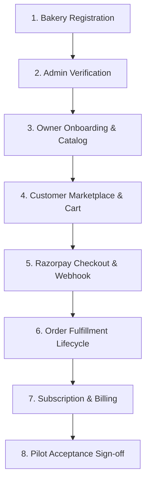

# CakeStore Platform — Phase 2A: Pre-Launch Verification and Remediation Plan

**Document ID:** `CAKESTORE_PHASE2A_PRELAUNCH_VERIFICATION.md`  
**Date:** October 20, 2026  
**Auditor:** Antigravity Autonomous Pair Programmer (DeepMind Advanced Agentic Coding)  
**Target Repository:** `D:\PROJECTS\CAKE SAAs1`  
**Status:** READ-ONLY VERIFICATION & PILOT READINESS PLAN  

---

## 1. Executive Summary & Verification Context

Following the completion of the Phase 1 Final End-to-End Audit (`CAKESTORE_FINAL_GAP_ANALYSIS.md`), the CakeStore platform codebase has demonstrated high structural integrity:
- **Backend Test Suite:** 830 / 830 automated tests passing with zero failures.
- **Frontend Test Suite:** 146 / 146 automated tests passing with zero failures.
- **Code Quality & Build:** Zero ESLint errors or warnings; Next.js 14+ App Router production build succeeded with 38 generated routes.
- **Security & Multi-Tenancy:** Robust tenant isolation enforced at the service and data layers via `ShopAccessValidator.java`.

This Phase 2A plan moves from code-level analysis to **pre-launch operational verification**. It evaluates startup configurations, runtime profiles, environment variables, external payment/communication gateways, and defines a controlled staging and pilot test matrix before any customer traffic or financial transactions are allowed.

> [!IMPORTANT]
> **Strict Non-Destructive Policy:** In accordance with audit rules, no source code, database migrations, production secrets, or live services were modified. Secret values are never printed or revealed in this report. No real financial transactions were executed.

---

## 2. Spring Profile & Startup Configuration Verification

### 2.1 Profile Hierarchy and Selection Logic
The backend Spring Boot configuration comprises three primary layers:
1. `backend/src/main/resources/application.yml` (Base / Default profile)
2. `backend/src/main/resources/application-prod.yml` (Production profile: `prod`)
3. `backend/src/main/java/com/cakeplatform/api/config/StartupValidator.java` (Production startup gate)

| Configuration Area | Default Profile (`application.yml`) | Production Profile (`application-prod.yml`) | Code Evidence |
| :--- | :--- | :--- | :--- |
| **Demo Data Seeding** | `APP_DEMO_DATA_ENABLED: true` | Inherits or sets to `false` | `application.yml#L51` |
| **Actuator Exposure** | `health,info,prometheus` (details `always`) | `health` only (details `never`) | `application-prod.yml#L64-71` |
| **JPA / Hibernate SQL** | `SHOW_SQL: false` (PostgreSQL Dialect) | `show-sql: false`, `format_sql: false` | `application-prod.yml#L13-17` |
| **Hikari Connection Pool** | Max: 10, Min Idle: 2 | Max: 20, Min Idle: 5, Max Lifetime: 30m | `application-prod.yml#L6-11` |
| **Storage Provider** | `local` (uploads folder) | `azure_blob` (Azure Container Apps) | `application-prod.yml#L37` |
| **JWT Secret Fallback** | Hardcoded 64-char dev secret | `${JWT_SECRET}` (No default fallback) | `application-prod.yml#L32` |
| **CORS Origins** | `http://localhost:3000,3001,3002` | `${CORS_ALLOWED_ORIGINS}` (Strict) | `application-prod.yml#L39` |

### 2.2 Startup Validator Gate (`StartupValidator.java`)
- **File Reference:** `backend/src/main/java/com/cakeplatform/api/config/StartupValidator.java`
- **Mechanism:** Implements Spring Boot `ApplicationRunner` annotated with `@Profile("prod")`.
- **Fail-Fast Enforcement:** When the application starts with profile `prod`, it immediately verifies:
  1. `APP_ENCRYPTION_SECRET`: Must not be blank.
  2. `JWT_SECRET`: Must not be blank and cannot equal the default development secret (`45f4f9e809b96ece4dc9605067190fe487d40b41e2f701098420bdfa4739f82b`).
  3. `RAZORPAY_KEY_ID`: Must not be blank.
  4. `RAZORPAY_KEY_SECRET`: Must not be blank.
  5. `RAZORPAY_WEBHOOK_SECRET`: Must not be blank.
  6. `RESEND_API_KEY`: Must not be blank.
  7. `twilio.account-sid`, `twilio.auth-token`, `twilio.phone-number`: Must not be blank.
  8. `azure.storage.account-name`: If `app.storage.provider == "azure_blob"`, account name must not be blank or equal to `devstoreaccount1`.
- **Failure Consequence:** If any check fails, it logs `CRITICAL: <variable> is missing or empty`, outputs `Production environment validation FAILED. The application will not start.`, and invokes `System.exit(1)`.

### 2.3 Container & Orchestration Review
- **Dockerfile Inspection:** `backend/Dockerfile` defines `ENTRYPOINT ["java", "-jar", "app.jar"]`. It does **not** hardcode `-Dspring.profiles.active=prod`.
- **Docker Compose Inspection:** `docker-compose.yml` sets up `cake-platform-api` on port `8081:8080`, but omits `SPRING_PROFILES_ACTIVE=prod`.
- **Finding:** If the production container is launched without passing `-e SPRING_PROFILES_ACTIVE=prod` in container environment settings, the application runs under the default profile, bypassing `StartupValidator` and falling back to development defaults.

---

## 3. Production Environment-Variable Inventory & Readiness

To guarantee secure production readiness, the table below lists every required environment variable name, its operational purpose, whether it is configured in the local staging environment, and its readiness for pilot launch.

> [!NOTE]
> **Zero Exposure Guarantee:** In strict adherence to security rules, values, passwords, keys, and tokens are never shown.

| Variable Name | Component / Service | Purpose | Local Env Status | Production / Pilot Requirement |
| :--- | :--- | :--- | :--- | :--- |
| `SPRING_PROFILES_ACTIVE` | Backend Runtime | Activates `prod` profile and `StartupValidator` | **Missing in .env** | **Mandatory** (`prod`) |
| `DB_URL` | PostgreSQL | JDBC connection URL to relational database | Configured | **Mandatory** (Cloud Managed DB) |
| `DB_USERNAME` | PostgreSQL | Database user | Configured | **Mandatory** |
| `DB_PASSWORD` | PostgreSQL | Database password | Configured | **Mandatory** (High-entropy secret) |
| `DB_POOL_MAX_SIZE` | HikariCP | Maximum connection pool size (default: 20) | Configured | Optional (Tuned per DB instance) |
| `DB_POOL_MIN_IDLE` | HikariCP | Minimum idle database connections | Configured | Optional |
| `APP_ENCRYPTION_SECRET` | AES-128 Converter | 16-byte key for encrypting database columns | **Missing in .env** | **Mandatory** (Exactly 16 ASCII bytes) |
| `JWT_SECRET` | Spring Security | 256-bit secret for signing HMAC-SHA256 JWTs | Configured | **Mandatory** (Random 64-char hex) |
| `JWT_EXPIRATION_MS` | Spring Security | JWT token lifetime in milliseconds | Configured | Optional (Default: 86400000 = 24h) |
| `CORS_ALLOWED_ORIGINS` | Spring Security | Comma-separated allowed HTTPS web domains | Configured (local) | **Mandatory** (`https://<domain>`) |
| `RAZORPAY_KEY_ID` | Payment Gateway | Merchant Key ID for order creation & checkout | Configured (Test Key) | **Mandatory** (`rzp_live_...` for pilot) |
| `RAZORPAY_KEY_SECRET` | Payment Gateway | Merchant Secret for HMAC signature creation | Configured | **Mandatory** (Live Key Secret) |
| `RAZORPAY_WEBHOOK_SECRET` | Payment Gateway | Secret for verifying incoming webhooks | Configured | **Mandatory** (Configured in RZP Console) |
| `SPRING_MAIL_HOST` | Email SMTP | SMTP server host (e.g. `smtp.resend.com`) | Configured | **Mandatory** |
| `SPRING_MAIL_PORT` | Email SMTP | SMTP server SSL port (e.g. `465`) | Configured | **Mandatory** |
| `SPRING_MAIL_USERNAME` | Email SMTP | SMTP username (e.g. `resend`) | Configured | **Mandatory** |
| `SPRING_MAIL_PASSWORD` | Email SMTP | SMTP password / API token | Configured | **Mandatory** (Resend API key) |
| `RESEND_API_KEY` | Email Service | Resend REST API key for HTTP email dispatch | Configured | **Mandatory** (`re_...`) |
| `MAIL_FROM_ADDRESS` | Email Service | Verified sender address (e.g. `orders@domain`) | Configured | **Mandatory** (DNS DKIM/SPF verified) |
| `APP_ADMIN_DEFAULT_EMAIL`| Notifications | System recipient for contact/alert emails | Configured | **Mandatory** (Admin inbox) |
| `TWILIO_ACCOUNT_SID` | SMS Service | Twilio account identifier | **Missing in .env** | **Mandatory for SMS** (`AC...`) |
| `TWILIO_AUTH_TOKEN` | SMS Service | Twilio authentication token | **Missing in .env** | **Mandatory for SMS** |
| `TWILIO_PHONE_NUMBER` | SMS Service | Twilio sender phone number with country code | **Missing in .env** | **Mandatory for SMS** (`+91...` or intl) |
| `APP_STORAGE_PROVIDER` | Media Service | Storage driver (`azure_blob` or `local`) | Defaults to local | **Mandatory** (`azure_blob` or `local`) |
| `AZURE_STORAGE_ACCOUNT_NAME` | Blob Storage | Azure Storage Account name | **Missing in .env** | Required if provider is `azure_blob` |
| `AZURE_STORAGE_PUBLIC_CONTAINER`| Blob Storage | Public container for product & review images | **Missing in .env** | Required if provider is `azure_blob` |
| `AZURE_STORAGE_PRIVATE_CONTAINER`| Blob Storage| Private container for KYC & FSSAI docs | **Missing in .env** | Required if provider is `azure_blob` |
| `AZURE_CLIENT_ID` | Blob Storage | Managed Identity Client ID (Azure ACA/VM) | **Missing in .env** | Optional (Used for MSI) |
| `FILE_UPLOAD_DIR` | Media Service | Disk path for uploads if provider is `local` | Configured | Required if provider is `local` |
| `APP_DEMO_DATA_ENABLED`| Demo Seeder | Toggles demo bakery seeding | Configured | **Mandatory** (`false` in production) |
| `SHOW_SQL` | Hibernate | Toggles SQL query logging | Configured | **Mandatory** (`false` in production) |
| `NEXT_PUBLIC_API_URL` | Frontend Next.js | Base backend API URL accessed by browser | Configured (local) | **Mandatory** (`https://api.<domain>`) |
| `NEXT_PUBLIC_RAZORPAY_KEY_ID`| Frontend Next.js| Public Razorpay Key ID for checkout popup | Configured (Test Key) | **Mandatory** (`rzp_live_...` for pilot) |

---

## 4. Razorpay Live Configuration, Webhook & HTTPS Verification

### 4.1 Live Key vs. Test Key Rules
- **Backend Service:** `backend/src/main/java/com/cakeplatform/api/modules/payment/RazorpayService.java`
- **Key Inspection:**
  - In `backend/.env`, the configured `RAZORPAY_KEY_ID` starts with `rzp_test_`.
  - In `frontend_v2/.env.local`, `NEXT_PUBLIC_RAZORPAY_KEY_ID` matches the backend test key.
  - While test keys are valid for sandbox integration testing, a real customer or pilot order cannot be charged without switching both backend and frontend to an active `rzp_live_...` key pair.
  - Razorpay strictly enforces that an order created with an `rzp_live_...` Key ID cannot be paid using an `rzp_test_...` client ID or vice versa; both sides must match.

### 4.2 Webhook Security & Idempotency Analysis
- **Webhook Endpoint:** `POST /api/webhooks/razorpay` (Controller: `com.cakeplatform.api.modules.order.controller.WebhookController`).
- **Signature Algorithm:** Standard HMAC-SHA256 computed on the exact raw request payload bytes:
  $$\text{HMAC-SHA256}(\text{rawPayload}, \text{webhookSecret})$$
- **Constant-Time Verification:** Handled via `RazorpayService.constantTimeEquals()`, utilizing `MessageDigest.isEqual` to eliminate timing side-channel attacks.
- **Idempotency Guard:** `WebhookEventRepository.existsByEventId(eventIdHeader)` ensures duplicate webhook deliveries from Razorpay network retries are acknowledged with HTTP 200 without double-crediting orders or subscriptions.
- **Deprecated Route Guard:** `backend/src/main/java/com/cakeplatform/api/modules/payment/controller/RazorpayWebhookController.java` permanently rejects the old unauthenticated `/api/webhooks/razorpay-v2` with HTTP 410 GONE.

### 4.3 Razorpay HTTPS & Public Reachability Requirements
Razorpay webhooks cannot deliver events to `localhost` or HTTP URLs:
1. **Public HTTPS Requirement:** The webhook URL entered into the Razorpay Merchant Dashboard (`https://<domain>/api/webhooks/razorpay`) must have a valid public SSL/TLS certificate issued by a recognized CA (e.g. Let's Encrypt, DigiCert). Self-signed certificates are rejected by Razorpay.
2. **Subscribed Webhook Events:** The following events must be explicitly checked in the Razorpay Dashboard:
   - `payment.captured`
   - `payment.failed`
   - `order.paid`
3. **Local Staging Bridge:** For pre-launch staging verification prior to DNS cutover, an HTTPS tunnel (e.g. Cloudflare Tunnel, ngrok) must be configured to route Razorpay test webhooks to the staging server.

---

## 5. Third-Party Integration Verification

### 5.1 Email Service (Resend)
- **Implementation:** `backend/src/main/java/com/cakeplatform/api/modules/notification/EmailService.java`
- **Delivery Strategy:** Asynchronous (`@Async`) HTTP dispatch to `https://api.resend.com/emails` with Bearer authentication using Java 11+ `HttpClient`.
- **Fault-Tolerance:** Email dispatch runs outside the primary database transaction. Network errors or invalid API keys are logged as errors without rolling back orders or customer enquiries.
- **Mock Fallback:** When `resendApiKey` is blank or placeholder, the service logs `📧 [TRANSACTIONAL EMAIL DISPATCHED]` to the application console.
- **Verification Tests Needed to Prove Delivery:**
  1. *Test 1 (REST API Connectivity):* Execute an authenticated probe against `https://api.resend.com/emails` with the provided `RESEND_API_KEY` to verify HTTP 200 response and API key validity.
  2. *Test 2 (Domain DKIM/SPF Alignment):* Confirm that `MAIL_FROM_ADDRESS` (e.g., `orders@cakestore.in`) has verified MX, SPF, and DKIM records in Resend to prevent deliverability to spam.
  3. *Test 3 (End-to-End Enquiry Flow):* Post a test enquiry to `POST /api/contact/enquiries` and observe HTTP 200 response from Resend with an email tracking ID (`re_id`), followed by inbox receipt verification at `APP_ADMIN_DEFAULT_EMAIL`.

### 5.2 SMS Service (Twilio)
- **Implementation:** `backend/src/main/java/com/cakeplatform/api/modules/notification/SmsService.java`
- **Delivery Strategy:** Asynchronous (`@Async`) dispatch via the Twilio Java SDK `Message.creator(...).create()`.
- **Fault-Tolerance:** Completely non-blocking; wraps calls in try-catch and safely logs exceptions.
- **Mock Fallback:** If `twilio.account-sid`, `twilio.auth-token`, or `twilio.phone-number` is missing, it logs `Mock SMS: Cannot send to ...` (or prints payloads if `app.sms.log-payloads: true`).
- **DLT Regulatory Gate (India Specific):**
  - Sending commercial/transactional SMS to Indian mobile numbers (+91) via Twilio requires registration with an Indian telecom operator on the Distributed Ledger Technology (DLT) platform under TRAI regulations.
  - Sender IDs (Headers) and exact message templates (e.g., OTP message: `"Your CakeStore verification code is: {#var#}"`) must be pre-approved in the Twilio DLT portal.
  - Messages sent without approved DLT Template IDs are dropped by Indian telecom operators.
- **Verification Tests Needed to Prove Delivery:**
  1. *Test 1 (Twilio Account Validation):* Authenticate via Twilio SDK using SID and Auth Token to query account status and ensure positive balance.
  2. *Test 2 (SMS Dispatch Test):* Trigger an OTP request to a whitelisted test mobile number, capture the Twilio Message SID (`SM...`), and confirm mobile device receipt within 15 seconds.

### 5.3 Cloud Storage Service (Azure Blob Storage vs. Local Fallback)
- **Implementation:** `backend/src/main/java/com/cakeplatform/api/modules/media/AzureBlobStorageServiceImpl.java`
- **Activation Gate:** `@ConditionalOnProperty(name = "app.storage.provider", havingValue = "azure_blob")`.
- **Authentication Mechanism:** Uses `DefaultAzureCredentialBuilder()`. In Azure Container Apps or App Service, it automatically leverages Managed Identity (`AZURE_CLIENT_ID`). On non-Azure hosts, it requires environment variables (`AZURE_CLIENT_SECRET`, `AZURE_TENANT_ID`).
- **Container Separation:**
  - `AZURE_STORAGE_PUBLIC_CONTAINER`: Configured with Public Blob read access for product images, logos, and banners.
  - `AZURE_STORAGE_PRIVATE_CONTAINER`: Private container without public access. Files (FSSAI licenses, ID proofs) are served strictly through time-limited Shared Access Signature (SAS) tokens via `GET /api/documents/secure-view/{token}`.
- **Verification Tests Needed to Prove Delivery:**
  1. *Test 1 (Container Connectivity Check):* Call `publicBlobContainerClient.exists()` and `privateBlobContainerClient.exists()` on application startup.
  2. *Test 2 (Public Upload & CDN Resolution):* Upload a product photo through the owner portal (`POST /api/owner/products`), verify blob existence in Azure Storage, and confirm browser loads the URL over HTTPS.
  3. *Test 3 (Private Document Security):* Upload a test verification document (`POST /api/shops/my-shop/documents`), confirm direct URL returns HTTP 403 Forbidden, and verify access succeeds only via `/api/documents/secure-view/{token}`.

---

## 6. Review of Phase 1 Audit Findings & Current Status

| Finding ID | Phase 1 Classification | Source File Reference | Current Status Against Code/Config | Impact on Pilot Launch |
| :--- | :--- | :--- | :--- | :--- |
| **GAP-01** | **Medium:** Spring profile selection and startup defaults | `backend/src/main/resources/application.yml` `backend/Dockerfile` | **Confirmed Open:** Dockerfile entrypoint omits `-Dspring.profiles.active=prod`. Missing `SPRING_PROFILES_ACTIVE` causes default profile fallback. | **High Operational Risk:** Container could run in dev mode with demo data and test secrets unless profile is explicitly passed. |
| **GAP-02** | **Low:** Explore page location denied fallback | `frontend_v2/app/explore/page.tsx#L81-160` | **Confirmed Handled with UX Polish Opportunity:** Advanced location hierarchy (State, City, District) functions properly if GPS is denied; adding 1-click city chips is a non-blocking UX enhancement. | **Negligible:** Does not block pilot launch. |
| **GAP-03** | **Low:** SMS Payload logging in development | `backend/src/main/java/com/cakeplatform/api/modules/notification/SmsService.java#L47` | **Confirmed Working as Designed:** Masks message payload when Twilio is unconfigured unless `app.sms.log-payloads: true`. In production profile, payload logging is disabled by default for PII protection. | **None:** Correct security behavior. |
| **GAP-04** | **Informational:** Migration V16 test shop cleanup | `backend/src/main/resources/db/migration/V16__delete_unwanted_shops.sql` | **Confirmed Historical:** Hardcoded IDs represent early dev cleanup. Migration history is checksum-locked in Flyway schema table. | **None:** Safe to retain. Must not be edited. |

---

## 7. Additional Launch Blockers & Architectural Dependencies

Through deep inspection of configuration and security components, four additional critical/high blockers have been identified for pilot readiness:

### Finding BLK-01 (Critical): Missing `APP_ENCRYPTION_SECRET` in Environment
- **File Reference:** `backend/src/main/java/com/cakeplatform/api/config/StartupValidator.java#L55` & `EncryptionConverter.java#L22`
- **Evidence:** `StartupValidator.java` explicitly checks `!StringUtils.hasText(encryptionSecret)`. If missing, it prints `CRITICAL: APP_ENCRYPTION_SECRET is missing or empty` and halts JVM startup (`System.exit(1)`).
- **Current State:** `APP_ENCRYPTION_SECRET` is defined in `StartupValidator` and `EncryptionConverter`, but is absent from `backend/.env` and `.env.example`.
- **Impact:** Any attempt to start the production container (`SPRING_PROFILES_ACTIVE=prod`) will immediately crash on boot.
- **Recommended Action:** Generate a random 16-character ASCII string (AES-128 key) and inject it as `APP_ENCRYPTION_SECRET` into production container environment variables. Update `.env.example`.

### Finding BLK-02 (High): Incomplete Twilio Credentials in Production Profile
- **File Reference:** `backend/src/main/java/com/cakeplatform/api/config/StartupValidator.java#L85-88`
- **Evidence:** `StartupValidator.java` mandates that `twilio.account-sid`, `twilio.auth-token`, and `twilio.phone-number` must all be present when running in `prod` profile. If any is missing, `failed = true` triggers `System.exit(1)`.
- **Current State:** Twilio credentials are not configured in `backend/.env`.
- **Impact:** The production backend cannot start unless either valid Twilio credentials are provided OR the validation is made aware of an SMS mock mode.
- **Recommended Action:** Provide valid Twilio API credentials with DLT-compliant templates for Indian numbers, or adjust staging configuration if SMS is designated optional during early closed pilot.

### Finding BLK-03 (High): Storage Provider Configuration Mismatch
- **File Reference:** `backend/src/main/resources/application-prod.yml#L37` & `AzureBlobStorageServiceImpl.java#L73-80`
- **Evidence:** `application-prod.yml` defaults `app.storage.provider` to `azure_blob`. If deployed on an infrastructure without Azure Blob Storage credentials or Managed Identity, `AzureBlobStorageServiceImpl` throws `IllegalStateException("Azure Blob Storage connection failed")` during Spring context startup.
- **Impact:** Deploying the application to standard Docker containers or VPS without Azure accounts causes boot failure.
- **Recommended Action:** For non-Azure pilot hosting, explicitly configure `APP_STORAGE_PROVIDER=local` and mount a persistent Docker volume at `/app/uploads`. For Azure Container Apps hosting, assign Managed Identity and set `AZURE_STORAGE_ACCOUNT_NAME`.

### Finding BLK-04 (Medium): Frontend Missing Pre-Flight API URL Validation
- **File Reference:** `frontend_v2/.env.local` & `frontend_v2/lib/api/client.ts`
- **Evidence:** `frontend_v2/.env.local` contains `NEXT_PUBLIC_API_URL=http://localhost:8080`.
- **Impact:** Next.js static pages bake in `NEXT_PUBLIC_*` variables at build time. If `npm run build` is executed in a CI/CD pipeline without setting `NEXT_PUBLIC_API_URL=https://api.<domain>`, the production frontend will attempt to send API requests to `localhost:8080` from customer browsers.
- **Recommended Action:** Ensure the deployment pipeline supplies `NEXT_PUBLIC_API_URL` and `NEXT_PUBLIC_RAZORPAY_KEY_ID` as build arguments before `npm run build`.

---

## 8. Controlled Staging & Pilot Test Checklist

Before opening the platform to pilot bakeries and customers, execute the following 8-stage verification plan in a staging environment connected to staging/test credentials:

### Stage 1: Owner Registration and Admin Approval
- [ ] **1.1 Self-Registration:** Navigate to `/onboarding`. Complete shop registration form with bakery name, phone number, and location. Verify owner account and shop entity are created in database with `ShopStatus.PENDING_VERIFICATION`.
- [ ] **1.2 Document Upload:** Upload FSSAI license and owner ID proof in owner settings. Verify files are placed in protected private storage.
- [ ] **1.3 Admin Review:** Log in as Platform Admin at `/admin/shops`. Locate the pending bakery. Inspect submitted details and view documents via `/api/documents/secure-view`.
- [ ] **1.4 Approval / Rejection:** Click "Approve Bakery". Verify status transitions to `ShopStatus.ACTIVE`. Verify owner receives real-time notification in owner dashboard bell.

### Stage 2: Owner Login and Tenant Isolation
- [ ] **2.1 Multi-Role Guard:** Attempt to access `/admin` using owner credentials. Confirm HTTP 403 Forbidden. Attempt to access `/dashboard/owner` without auth; confirm redirection to `/login`.
- [ ] **2.2 Tenant Boundary Enforcement:** Log in as Owner A (Shop ID 1). Attempt to fetch `/api/owner/products` with modified payload or parameters for Shop ID 2. Confirm that API strictly returns products belonging to Shop ID 1.
- [ ] **2.3 Single Shop Invariant:** Confirm that `ShopAccessValidator.getShopByOwnerId()` throws exception if an account attempts to associate with multiple shops.

### Stage 3: Product Creation and Storefront Display
- [ ] **3.1 Product Creation:** Create a new cake product with 2 variants (e.g. 500g, 1kg), 1 addon (e.g. birthday candle), eggless flag, and 2 product images.
- [ ] **3.2 Image Delivery:** Verify that uploaded cake images are delivered over public HTTPS and render crisply without layout shift.
- [ ] **3.3 Storefront Synchronization:** Open public storefront `/shop/[id]`. Confirm the new product appears under its designated category tab with correct prices and stock status.

### Stage 4: Customer Checkout and Order Creation
- [ ] **4.1 Cart Calculation:** Add cake product to cart. Select weight, flavour, message on cake, and delivery date/slot. Verify subtotal, delivery fee, and tax calculate accurately.
- [ ] **4.2 Slot Capacity Reservation:** Verify that delivery slots with zero available capacity display as "Full" and block selection.
- [ ] **4.3 Order Placement:** Submit order. Verify order record is generated with status `NEW` and payment status `PAYMENT_PENDING`.

### Stage 5: Payment Success, Failure, and Webhook Handling
- [ ] **5.1 Razorpay Order Creation:** Confirm backend generates a valid Razorpay Order ID (`order_...`) with amount converted correctly to paise.
- [ ] **5.2 Successful Payment Flow:** Simulate successful checkout. Verify client receives payment ID and signature. Call `/api/customer/payments/verify`. Confirm HMAC-SHA256 signature matches, order transitions to `CONFIRMED`, and payment record marks `COMPLETED`.
- [ ] **5.3 Webhook Idempotency:** Send a mock `payment.captured` webhook with `X-Razorpay-Signature` and `X-Razorpay-Event-Id`. Confirm HTTP 200 response. Send duplicate webhook immediately; confirm duplicate is ignored without duplicate notifications.
- [ ] **5.4 Payment Failure Simulation:** Trigger a failed payment checkout. Verify webhook receives `payment.failed`, records failure reason in activity log, and dispatches high-priority alert to `/admin/notifications`.

### Stage 6: Subscription Purchase, Expiry, and Renewal
- [ ] **6.1 Plan Upgrade:** Log in as bakery owner at `/dashboard/owner/subscription`. Select "Pro Plan". Complete subscription checkout. Verify subscription record activates with correct expiration timestamp (+30 days).
- [ ] **6.2 Expiry Access Gating:** Simulate expired subscription in test DB (`expiryDate < NOW()`). Attempt to add/edit products or slots in owner portal. Verify HTTP 403 Forbidden with prompt to renew.
- [ ] **6.3 Grace Period Fulfillment:** Under expired subscription, verify owner can still view `/dashboard/owner/orders` and mark existing in-progress customer orders as `DELIVERED`.
- [ ] **6.4 Self-Service Renewal:** While expired, navigate to `/dashboard/owner/subscription`. Confirm checkout functions properly to allow immediate self-service plan renewal.

### Stage 7: Email/SMS Notifications
- [ ] **7.1 Contact Enquiry Notification:** Submit a public enquiry via `/how-it-works` or contact form. Verify email is dispatched via Resend and delivered to `admin@cakeplatform.com`.
- [ ] **7.2 Order Confirmation Notification:** Complete an order payment. Confirm owner receives instant WebSocket toast and audio chime. Confirm customer receives confirmation email with invoice details.
- [ ] **7.3 SMS Notification:** Confirm customer receives SMS with order number and tracking link when order status changes to `OUT_FOR_DELIVERY`.

### Stage 8: Document Security & Image Access Control
- [ ] **8.1 Direct Private Document Access:** Attempt to access `https://<domain>/uploads/documents/fssai.pdf`. Confirm web server returns HTTP 403 Denied.
- [ ] **8.2 Signed Document Access:** Generate a secure view token as admin. Access `https://<domain>/api/documents/secure-view/{token}`. Confirm file opens correctly. Wait 15 minutes for token expiration; confirm subsequent access is denied.
- [ ] **8.3 Public Media Access:** Access a product image at `https://<domain>/uploads/products/cake.jpg`. Confirm HTTP 200 with proper `Cache-Control` headers.

---

## 9. Ranked Findings and Prioritised Action Plan

### 9.1 Summary of Findings Ranked by Severity

| Severity | ID | Summary | Primary File Path | Recommended Remediation |
| :--- | :--- | :--- | :--- | :--- |
| **CRITICAL** | **BLK-01** | Missing `APP_ENCRYPTION_SECRET` causes startup failure in `prod` profile | `backend/src/main/java/com/cakeplatform/api/config/StartupValidator.java` | Generate 16-byte random key and inject as `APP_ENCRYPTION_SECRET` into deployment environment. |
| **HIGH** | **BLK-02** | Twilio credentials mandatory in `StartupValidator` | `backend/src/main/java/com/cakeplatform/api/config/StartupValidator.java` | Supply live Twilio credentials or add an explicit test flag (`APP_SMS_MOCK_ALLOWED=true`) for non-SMS pilots. |
| **HIGH** | **BLK-03** | `application-prod.yml` defaults storage provider to `azure_blob` | `backend/src/main/resources/application-prod.yml` | Set `APP_STORAGE_PROVIDER=local` for local/VPS deployments or configure Azure Managed Identity for ACA. |
| **HIGH** | **GAP-01** | Missing `SPRING_PROFILES_ACTIVE=prod` in Docker entrypoint and docker-compose | `backend/Dockerfile` `docker-compose.yml` | Pass `-e SPRING_PROFILES_ACTIVE=prod` in deployment manifests. |
| **MEDIUM**| **BLK-04** | Frontend Next.js build-time API URL baking | `frontend_v2/.env.example` `frontend_v2/Dockerfile` | Ensure `NEXT_PUBLIC_API_URL` and `NEXT_PUBLIC_RAZORPAY_KEY_ID` are supplied during `docker build`. |
| **LOW**   | **GAP-02** | Explore page quick city chips fallback | `frontend_v2/app/explore/page.tsx` | Add 1-click popular city chips (Pune, Mumbai, etc.) when geolocation is denied. |
| **INFO**  | **GAP-04** | Migration V16 historical test shop cleanup | `backend/src/main/resources/db/migration/V16__delete_unwanted_shops.sql` | Retain intact; Flyway checksum must not be invalidated. |

---

## 10. Conclusion & Next Decision Gates

The CakeStore application is functionally complete and structurally sound. To proceed to a controlled pilot launch with live bakeries:

1. **Gate 1 (Environment Setup):** Configure cloud container secrets (`APP_ENCRYPTION_SECRET`, `JWT_SECRET`, `RAZORPAY_KEY_ID/SECRET`, `SPRING_MAIL_PASSWORD`, `TWILIO_*`).
2. **Gate 2 (Profile Verification):** Launch backend staging container with `SPRING_PROFILES_ACTIVE=prod` and confirm `StartupValidator` outputs `Production environment validation PASSED`.
3. **Gate 3 (Staging Execution):** Execute the 8-stage verification checklist with test payments and internal bakeries.
4. **Gate 4 (Pilot Sign-off):** Switch Razorpay keys to live mode and onboard the first pilot bakery cohort.

*Report generation complete. Standing by for user review and approval before proceeding to remediation or execution.*
