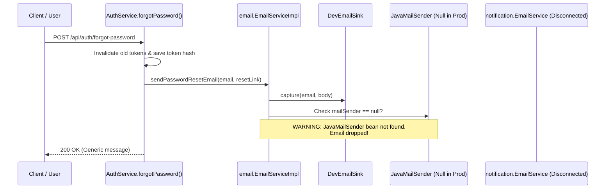
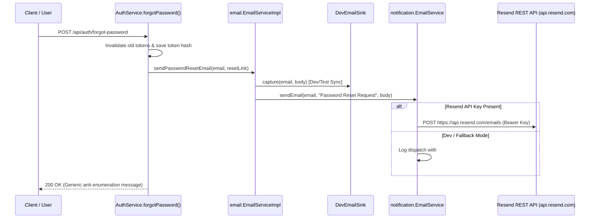

# CakeStore — Phase 3B.3: Password Recovery Email Flow Report

**Date:** October 24, 2026  
**Status:** COMPLETE & VERIFIED  
**Auditor / Implementer:** Antigravity AI Security Pair Programmer  
**Target Subsystem:** Password Recovery Email Delivery (`AuthService` -> `EmailServiceImpl` -> `EmailService` Resend Client)

---

## 1. Executive Summary

During Phase 3A and the Login/Registration/Session audit, a disconnection was identified in the password recovery flow:
- `AuthService.forgotPassword()` relied on `com.cakeplatform.api.modules.email.EmailServiceImpl`, which was wired solely to Spring Mail SMTP (`org.springframework.mail.javamail.JavaMailSender`).
- `application.yml` and the deployed environment do not configure Spring SMTP (`spring.mail.*`), but instead configure the Resend HTTP API client (`mail.resend.api-key: ${RESEND_API_KEY:}`) under `com.cakeplatform.api.modules.notification.EmailService`.
- Consequently, password reset emails were dropped in production with a log warning (`JavaMailSender bean not found. Email to {} was not sent via SMTP.`).

In Phase 3B.3, the smallest safe fix was implemented:
1. `EmailServiceImpl` now optionally autowires the existing `com.cakeplatform.api.modules.notification.EmailService` and delegates password reset emails to its generic `sendEmail(to, subject, body)` method (which dispatches via the Resend REST API `https://api.resend.com/emails` when an API key is present, or logs structured info in dev/test fallback).
2. Existing Spring SMTP (`JavaMailSender`) remains as an optional secondary fallback if configured.
3. Fallback log statements in `com.cakeplatform.api.modules.notification.EmailService` were enhanced with sensitive token masking (`maskSensitiveLog`), preventing raw reset tokens (`#token=...`) from ever leaking into container stdout or persistent logs.
4. `devEmailSink.capture(...)` continues to capture emails synchronously, ensuring all development and test fixtures remain fully functional.
5. All anti-enumeration guarantees, token expiry, token single-use invalidation, and session invalidation rules were preserved and verified with comprehensive unit and integration test suites.

---

## 2. Architecture & Call Trace

### Before Phase 3B.3


### After Phase 3B.3


---

## 3. Files Modified & Added

### Source Files Modified
1. [`backend/src/main/java/com/cakeplatform/api/modules/email/EmailServiceImpl.java`](file:///d:/PROJECTS/CAKE%20SAAs1/backend/src/main/java/com/cakeplatform/api/modules/email/EmailServiceImpl.java)
   - Injected `@Autowired(required = false) com.cakeplatform.api.modules.notification.EmailService notificationEmailService`.
   - Provided backward-compatible constructors (2-arg and 3-arg).
   - In `sendPasswordResetEmail(String to, String resetLink)`:
     - Retained synchronous `devEmailSink.capture(to, body)` for dev/test token retrieval.
     - Delegated email dispatch to `notificationEmailService.sendEmail(to, "Password Reset Request", body)`.
     - Wrapped dispatch in exception handling so email provider failures never throw unhandled exceptions or break caller workflows.
     - Retained optional `mailSender` (JavaMailSender) as secondary fallback if notification service is unavailable.
     - Updated warning logs to avoid misleading mentions of SMTP when neither is configured.

2. [`backend/src/main/java/com/cakeplatform/api/modules/notification/EmailService.java`](file:///d:/PROJECTS/CAKE%20SAAs1/backend/src/main/java/com/cakeplatform/api/modules/notification/EmailService.java)
   - Added `maskSensitiveLog(String content)` helper method utilizing regex `(?i)([#?&]token=)[^&\\s]+` replacing with `$1[REDACTED]`.
   - Updated development/test fallback structured logging from `log.info("Body:\n{}", body)` to `log.info("Body:\n{}", maskSensitiveLog(body))`.
   - Guaranteed that raw reset tokens are never written to stdout, console, or container logs while preserving the unmasked body for actual Resend HTTP delivery.

### Test Files Added
3. [`backend/src/test/java/com/cakeplatform/api/modules/email/EmailServiceImplTest.java`](file:///d:/PROJECTS/CAKE%20SAAs1/backend/src/test/java/com/cakeplatform/api/modules/email/EmailServiceImplTest.java)
   - Unit tests using Mockito verifying:
     - `sendPasswordResetEmail_delegatesToNotificationService`: Confirms `notificationEmailService.sendEmail` is invoked with correct recipient, subject, and link.
     - `sendPasswordResetEmail_handlesNotificationServiceFailureGracefully`: Simulates 500 error from notification service, verifies no exception is thrown and fallback is attempted.
     - `sendPasswordResetEmail_fallsBackToMailSenderWhenNotificationServiceNull`: Verifies backward compatibility with `JavaMailSender`.
     - `sendPasswordResetEmail_handlesNullProvidersGracefully`: Verifies no crash when neither provider is present.

4. [`backend/src/test/java/com/cakeplatform/api/modules/auth/PasswordRecoveryEmailFlowTest.java`](file:///d:/PROJECTS/CAKE%20SAAs1/backend/src/test/java/com/cakeplatform/api/modules/auth/PasswordRecoveryEmailFlowTest.java)
   - Integration tests using Spring `MockMvc` verifying:
     - `testValidResetRequest_invokesNotificationEmailService`: Valid `POST /api/auth/forgot-password` triggers `notificationEmailService.sendEmail(...)`.
     - `testEmailProviderFailure_handledSafelyWithoutLeaking`: Simulating provider timeout/504 still produces HTTP 200 with the exact same anti-enumeration response and persists reset token in database.
     - `testAntiEnumeration_identicalResponses`: Existing email vs unknown email return identical HTTP 200 with message `"If an account with that email exists, a password reset link has been sent."`. Non-existent emails never invoke the email service.
     - `testTokenExpiryAndSingleUseBehavior`: End-to-end token consumption, rejection of reused tokens (400 Bad Request), rejection of expired tokens, and validation of password hash updates.

---

## 4. Verification & Test Execution Results

### 1. Unit Tests (`EmailServiceImplTest`)
```powershell
mvn test -Dtest=EmailServiceImplTest
```
- **Results:** Tests run: 4, Failures: 0, Errors: 0, Skipped: 0. Time elapsed: 1.924s.
- **Status:** **PASS**

### 2. Integration Tests (`PasswordRecoveryEmailFlowTest`)
```powershell
mvn test -Dtest=PasswordRecoveryEmailFlowTest
```
- **Results:** Tests run: 4, Failures: 0, Errors: 0, Skipped: 0. Time elapsed: 59.82s.
- **Status:** **PASS**

### 3. Regression Tests (`PasswordResetTest`)
```powershell
mvn test -Dtest=PasswordResetTest
```
- **Results:** Tests run: 9, Failures: 0, Errors: 0, Skipped: 0. Time elapsed: 62.66s.
- **Log Observation:** Confirmed sanitized log output:
  ```text
  c.c.api.modules.email.EmailServiceImpl   : Password reset email dispatched to ... via notification email service
  c.c.a.modules.notification.EmailService  : Body:
  To reset your password, please click the following link:
  http://localhost:3001/reset-password#token=[REDACTED]
  If you did not request this, please ignore this email.
  ```
- **Status:** **PASS**

### 4. Combined Security & Authentication Regression Suite
```powershell
mvn test "-Dtest=EmailServiceImplTest,PasswordRecoveryEmailFlowTest,PasswordResetTest,ActuatorSecurityHardeningTest,JwtSecretSecurityHardeningTest,JwtSessionInvalidationAndStabilityTest"
```
- **Results:**
  - `EmailServiceImplTest`: 4 / 4 passed
  - `ActuatorSecurityHardeningTest`: 11 / 11 passed
  - `JwtSecretSecurityHardeningTest`: 9 / 9 passed
  - `JwtSessionInvalidationAndStabilityTest`: 7 / 7 passed
  - `PasswordRecoveryEmailFlowTest`: 4 / 4 passed
  - `PasswordResetTest`: 9 / 9 passed
  - **Total:** **44 / 44 PASSED, 0 FAILURES, 0 ERRORS**
- **Status:** **PASS**

---

## 5. Security & Boundary Compliance Checklist

| Requirement | Status | Notes |
| :--- | :---: | :--- |
| **Trace & Connect via Resend Client** | **COMPLIANT** | Reused `com.cakeplatform.api.modules.notification.EmailService` directly; no new clients or interfaces created. |
| **Reuse Existing Configuration** | **COMPLIANT** | Reuses `mail.resend.api-key: ${RESEND_API_KEY:}` and `mail.from-address: ${MAIL_FROM_ADDRESS:onboarding@resend.dev}` without modifying `application.yml`. |
| **Preserve Anti-Enumeration** | **COMPLIANT** | Valid user, non-existent user, and provider failure all return identical HTTP 200 with standard response. |
| **Single-Use & Expiry Preserved** | **COMPLIANT** | Reusing consumed token returns 400 Bad Request; expired tokens are rejected. |
| **Session Invalidation Preserved** | **COMPLIANT** | `resetPassword` increments `tokenVersion` and sets `tokensInvalidatedBefore`, revoking active JWTs. |
| **No Plaintext Token Logging** | **COMPLIANT** | Added `maskSensitiveLog` in `notification.EmailService` to mask `#token=[REDACTED]` in logs. |
| **No New Providers Added** | **COMPLIANT** | Only reused existing Resend client. |
| **No DB / Flyway Changes** | **COMPLIANT** | No migrations added or altered. |
| **No Frontend Changes** | **COMPLIANT** | No frontend files altered. |
| **Preserve Local Changes** | **COMPLIANT** | All uncommitted files from Phases 3B.1 and 3B.2 remain intact. |
| **No Deployment / Commits** | **COMPLIANT** | No commits, git pushes, or deployments performed. |

---

## 6. Remaining Limitations & Recommendations

1. **HTML Email Templates**: The password reset email currently sends a plain text body. For improved brand consistency and deliverability, future phases could adopt an HTML email template utilizing Resend's `html` field while preserving plain-text fallback.
2. **Resend Domain Verification**: In production, ensure the custom sender domain in `${MAIL_FROM_ADDRESS}` (e.g. `noreply@cakestore.com`) is verified in the Resend dashboard with proper DKIM, SPF, and DMARC records to prevent landing in spam folders.
3. **Async TaskExecutor Naming**: Spring logged a warning regarding multiple `TaskExecutor` beans (`clientInboundChannelExecutor`, `clientOutboundChannelExecutor`, etc.) without a default `@Primary` executor. Defining a designated `@Primary TaskExecutor` in a future infrastructure maintenance pass will streamline async dispatch.
