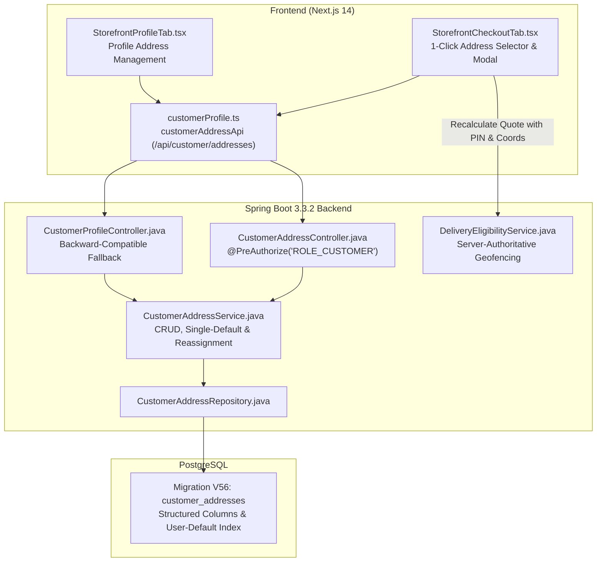

# CakeStore — Phase 2.3: Saved Customer Addresses & Checkout Integration Report

**Date:** November 2, 2026  
**Status:** COMPLETE & VERIFIED  
**Phase:** 2.3 — Customer Saved Addresses & Checkout Integration  
**Backend Test Suite:** 72 / 72 PASS (100%)  
**Frontend Test Suite:** 294 / 294 PASS (100%)  

---

## Executive Summary

Phase 2.3 delivers a production-grade, multi-tenant saved address management system for CakeStore customers, seamlessly integrated into the storefront checkout flow. Authenticated customers can save, edit, delete, and set default addresses with structured fields formatted for Indian logistics, while guest checkout is preserved with zero friction.

Crucially, saved addresses connect directly to the server-authoritative delivery geofencing and fee calculation engine established in Phase 2.1 and 2.1.1 (`DeliveryEligibilityService.java`). When a customer selects or adds a saved address in checkout, real-time quote validation confirms whether the bakery services the destination PIN code or radial delivery boundary, displaying actionable feedback without mutating the cart or changing the bakery owner's configured delivery pricing.

---

## Key Achievements & Technical Architecture



---

## 1. Database Schema & Migration (Flyway V56)

**File:** `backend/src/main/resources/db/migration/V56__enhance_customer_addresses_schema.sql`

The `customer_addresses` table (originally introduced in V43) was upgraded with structured address columns without dropping existing data:

```sql
ALTER TABLE customer_addresses
    ADD COLUMN IF NOT EXISTS address_line_1 VARCHAR(255),
    ADD COLUMN IF NOT EXISTS address_line_2 VARCHAR(255),
    ADD COLUMN IF NOT EXISTS landmark VARCHAR(255),
    ADD COLUMN IF NOT EXISTS city VARCHAR(100),
    ADD COLUMN IF NOT EXISTS state VARCHAR(100),
    ADD COLUMN IF NOT EXISTS pincode VARCHAR(10),
    ADD COLUMN IF NOT EXISTS address_type VARCHAR(20) DEFAULT 'HOME',
    ADD COLUMN IF NOT EXISTS latitude NUMERIC(10, 7),
    ADD COLUMN IF NOT EXISTS longitude NUMERIC(10, 7);

-- Backfill legacy records
UPDATE customer_addresses
SET address_line_1 = COALESCE(address_line_1, delivery_address),
    address_type = CASE 
        WHEN UPPER(label) = 'WORK' THEN 'WORK'
        WHEN UPPER(label) = 'OTHER' THEN 'OTHER'
        ELSE 'HOME'
    END
WHERE address_line_1 IS NULL;

-- Index for high-performance default lookup
CREATE INDEX IF NOT EXISTS idx_customer_addresses_user_default 
ON customer_addresses(user_id, is_default);
```

---

## 2. Backend Domain Model, DTOs & Validation

### Address Type Enum
- `AddressType.java`: Enum with values `HOME`, `WORK`, `OTHER`.

### Domain Entity
- `CustomerAddress.java`:
  - Structured fields: `addressLine1`, `addressLine2`, `landmark`, `city`, `state`, `pincode`, `addressType`, `latitude`, `longitude`.
  - Legacy compatibility aliases: `fullName` (maps to `recipientName`), `mobileNumber` (maps to `recipientPhone`), `deliveryAddress` (formatted automatically via `syncFormattedAddress()`).
  - Helper `getFormattedAddress()` neatly formats all address components: `Flat 402, 7th Cross, Near Sony Signal, Bengaluru, Karnataka, 560038`.

### Request & Response DTOs
- `CustomerAddressRequest.java`:
  - PIN code validation: `@Pattern(regexp = "^[1-9][0-9]{5}$", message = "PIN code must be a valid 6-digit Indian postal code")`.
  - Phone validation: Minimum 10 digits.
  - Required fields: `recipientName` / `fullName`, `recipientPhone` / `mobileNumber`, `addressLine1`, `city`, `pincode`.
  - Jackson aliases: `@JsonProperty("default")` and `isDefault` for bidirectional JSON compatibility.
- `CustomerAddressResponse.java`:
  - Returns complete structured entity data + auto-composed `formattedAddress`.

---

## 3. Business Logic & Security Guarantees

Implemented in `CustomerAddressService.java`:

1. **Strict Tenant & Ownership Isolation:**
   - Every read, update, delete, and set-default operation scopes by `customerId` extracted directly from the authenticated JWT `UserPrincipal`.
   - Accessing an address belonging to another user raises a `ResourceNotFoundException("Address not found")` without leaking existence.
2. **Single-Default Address Invariant:**
   - When a new or existing address is set as default (`isDefault: true`), all other addresses for that customer are updated in bulk to `isDefault: false`.
   - The first address created by a customer automatically becomes default.
3. **Safe Default Deletion Promotion:**
   - If an authenticated customer deletes their active default address and still has other addresses on file, the service automatically selects the oldest remaining address and promotes it to default. Customers are never left with an orphaned address state.

---

## 4. API Specification

| Method | Endpoint | Description | Auth Required |
|---|---|---|---|
| `GET` | `/api/customer/addresses` | List all saved addresses for current customer | `ROLE_CUSTOMER` |
| `GET` | `/api/customer/addresses/{id}` | Get address by ID | `ROLE_CUSTOMER` |
| `POST` | `/api/customer/addresses` | Create new address | `ROLE_CUSTOMER` |
| `PUT` | `/api/customer/addresses/{id}` | Update existing address | `ROLE_CUSTOMER` |
| `DELETE` | `/api/customer/addresses/{id}` | Delete address (promotes next if default) | `ROLE_CUSTOMER` |
| `PATCH` | `/api/customer/addresses/{id}/default` | Set address as default | `ROLE_CUSTOMER` |
| `PUT` | `/api/customer/addresses/{id}/default` | Set address as default (PUT alias) | `ROLE_CUSTOMER` |
| `GET` | `/api/customer/profile/addresses` | Legacy list endpoint (backward-compatible) | `ROLE_CUSTOMER` |
| `POST` | `/api/customer/profile/addresses` | Legacy add endpoint (backward-compatible) | `ROLE_CUSTOMER` |
| `PATCH` | `/api/customer/profile/addresses/{id}/default` | Legacy default endpoint | `ROLE_CUSTOMER` |

---

## 5. Frontend & Checkout Integration

### Client API Layer
- `frontend_v2/lib/api/customerProfile.ts`:
  - Implemented `customerAddressApi` mapped to `/api/customer/addresses`.
  - Retained `customerProfileApi` wrapping `customerAddressApi` for full backward compatibility.

### Checkout Tab Enhancement
- `frontend_v2/components/customer/storefront/tabs/StorefrontCheckoutTab.tsx`:
  - **Saved Address Selector:** Visual cards with `HOME`, `WORK`, `OTHER` badges, `Default` tag, multi-line structured address, and radio highlight.
  - **1-Click Selection:** Auto-populates recipient name, mobile number, street address, and `deliveryPincode`.
  - **Add New Address Modal:** Allows creating structured addresses directly within the checkout flow without losing basket contents or state. Includes options to save to profile and set as default.
  - **Real-Time Geofencing Verification:** Upon selecting or entering an address with a PIN code, the storefront triggers an authoritative `calculateQuote` request to `DeliveryEligibilityService`.
  - **Delivery Feedback Banner:** If the bakery does not service the address, an alert banner explains the exact rejection reason and offers a 1-click switch to Bakery Store Pickup.
  - **Order Summary Destination Card:** Clearly displays delivery destination, recipient name, phone, and PIN code in the checkout sidebar prior to payment.
  - **Guest Checkout Intact:** Unauthenticated users can freely enter their street address and PIN code without requiring login or saving to profile.

### Profile Tab Enhancement
- `frontend_v2/components/customer/storefront/tabs/StorefrontProfileTab.tsx`:
  - Full CRUD interface for customer addresses.
  - Structured fields: Line 1, Line 2, Landmark, City, State, 6-digit PIN code, and Type selector.

---

## 6. Test Verification Matrix

### Backend Tests: 72 / 72 PASS (100%)
Executed via Maven Surefire:
- `CustomerAddressServiceTest` (11/11 tests PASS):
  - Initial creation defaults to default.
  - Multiple address creation and explicit default assignment.
  - Single-default invariant guarantee.
  - Safe default deletion promotion.
  - Cross-customer tenant isolation.
  - PIN code pattern validation (`^[1-9][0-9]{5}$`).
- `CustomerAddressControllerTest` (7/7 tests PASS):
  - All REST endpoints verified with mock MVC security tokens.
- `DeliveryEligibilityServiceTest` (22/22 tests PASS):
  - Server-authoritative geofencing and coordinate spoofing rejection.
- `CustomerStorefrontDeliveryGeofencingTest` (9/9 tests PASS).
- `OperatingHoursServiceTest` (13/13 tests PASS).
- `CustomerStorefrontOpenNowAndMapTest` (5/5 tests PASS).
- `OwnerStorefrontDeliveryZoneSecurityTest` (3/3 tests PASS).
- `GeocodingLoggingSecurityTest` (2/2 tests PASS).

### Frontend Tests: 294 / 294 PASS (100%)
- **Dedicated Suite:** `frontend_v2/__tests__/customerSavedAddresses.test.mjs` (8/8 PASS):
  1. Indian PIN code regex validation.
  2. Mobile number validation.
  3. Structured address composition.
  4. Single-default constraint logic.
  5. Safe default deletion reassignment.
  6. Checkout delivery eligibility & rejection feedback.
  7. Guest checkout flow preservation.
- **Full Suite:** 294 tests across 21 test suites passing in 5.7s.

---

## 7. Business Model & Invariant Protections

- **Zero Changes to Owner Delivery Pricing:** Bakers retain 100% control over their delivery fees, free delivery thresholds, serviceable PIN codes, and radial boundaries.
- **Zero Commission Model Preserved:** CakeStore maintains its 0% commission SaaS platform pricing structure.
- **Server Authoritative:** Client-side address selections cannot circumvent backend delivery zone restrictions.
