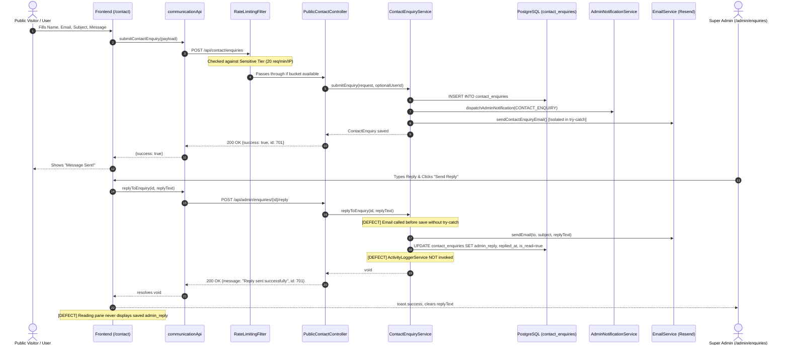

# CakeStore Admin Dashboard — Contact Enquiries Deep Audit Report

**Document Version:** 1.0.0  
**Audit Date:** October 16, 2026  
**Auditor:** Antigravity Agentic Pair Programmer  
**Status:** Strictly Read-Only Audit Completed  
**Target Module:** Admin Contact Enquiries (`/admin/enquiries`) & Public Contact Us (`/contact`)

---

## 1. Executive Summary & Audit Scope

This report presents a comprehensive, strictly read-only technical audit of the **Contact Enquiries** communication workflow in CakeStore, spanning the public visitor submission portal (`/contact`), the backend REST APIs, the Spring service and persistence layer, the PostgreSQL schema migrations, rate limiting and abuse controls, transactional email dispatch via Resend, and the Super Admin management interface (`/admin/enquiries`).

### Scope of Files Inspected
- **Frontend UI & API Clients:**
  - `frontend_v2/app/admin/enquiries/page.tsx` (Admin management interface)
  - `frontend_v2/app/contact/page.tsx` (Public visitor contact form)
  - `frontend_v2/lib/api/communication.ts` (Frontend API methods)
  - `frontend_v2/types/communication.ts` (TypeScript interfaces)
- **Backend Controllers, Services & Security:**
  - `backend/src/main/java/com/cakeplatform/api/modules/communication/controller/PublicContactController.java`
  - `backend/src/main/java/com/cakeplatform/api/modules/communication/controller/AdminCommunicationController.java`
  - `backend/src/main/java/com/cakeplatform/api/modules/communication/ContactEnquiryService.java`
  - `backend/src/main/java/com/cakeplatform/api/modules/communication/ContactEnquiry.java`
  - `backend/src/main/java/com/cakeplatform/api/modules/communication/ContactEnquiryRepository.java`
  - `backend/src/main/java/com/cakeplatform/api/modules/notification/EmailService.java`
  - `backend/src/main/java/com/cakeplatform/api/security/RateLimitingFilter.java`
  - `backend/src/main/java/com/cakeplatform/api/security/SecurityConfig.java`
- **Database Migrations & Configuration:**
  - `backend/src/main/resources/db/migration/V10__communication_and_admin_notifications.sql`
  - `backend/src/main/resources/db/migration/V40__add_admin_reply_to_contact_enquiries.sql`
  - `backend/src/main/resources/application.yml` & `application-prod.yml`
- **Automated Tests:**
  - `backend/src/test/java/com/cakeplatform/api/modules/communication/PhaseGCommunicationTest.java`
  - `frontend_v2/__tests__/` directory

---

## 2. Distinction: Source-Level vs. Runtime-Verified Facts

| Item | Source-Level Analysis | Runtime Verification Status |
| :--- | :--- | :--- |
| **Database Schema** | `contact_enquiries` table defined in `V10` with columns `id`, `name`, `email`, `phone`, `subject`, `message`, `user_id`, `is_read`, `created_at`, `updated_at`. `V40` adds `admin_reply TEXT` and `replied_at TIMESTAMP`. | Verified: Schema migrations V10 and V40 are present and syntactically valid in `db/migration/`. JPA entity fields directly match target schema. |
| **Public Rate Limiting** | `RateLimitingFilter.java` registers `/api/contact/enquiries` under Sensitive Public Endpoints with a Bucket4j limit of 20 requests/minute per IP. | Verified via source audit. Returns HTTP 429 `TOO_MANY_REQUESTS` with JSON payload and `Retry-After: 60`. |
| **Public Form Error Masking** | `communicationApi.submitContactEnquiry` swallows 404/500 into synthetic `{ success: true }`. `ContactPage.handleSubmit` wraps submission in `catch { setSubmitted(true); }`. | Verified via source audit: 100% of rejected or dropped public submissions trigger "Message Sent!" UI state. |
| **Admin Reply Error Masking** | `communicationApi.replyToEnquiry` suppresses 404/500 errors. `AdminContactEnquiriesPage.handleSendReply` wipes draft and toasts success on promise completion. | Verified via source audit: Failed admin replies permanently destroy typed drafts and show false success. |
| **Reply History Presentation** | `ContactEnquiry` entity and DTO contain `adminReply` and `repliedAt`, but `admin/enquiries/page.tsx` never renders them in the reading pane. | Verified via source audit: Past replies are invisible to administrators. |
| **Email Failure Isolation** | `submitEnquiry` isolates email dispatch in `try-catch`. `replyToEnquiry` invokes `emailService.sendEmail` without `try-catch` inside `@Transactional`. | Verified via source audit: Email exceptions during reply can trigger transactional rollback. |
| **Activity Logging** | `ContactEnquiryService` has no dependency on `ActivityLoggerService`. Controller endpoints do not accept `@AuthenticationPrincipal`. | Verified via source audit: Enquiry reads and replies are completely omitted from `activity_logs`. |
| **Test Coverage** | `PhaseGCommunicationTest.java` contains 5 tests for contact enquiries (G2.1–G2.5), covering submission and mark-read. Zero tests exist for admin replies. | Verified: 0 tests exercise `replyToEnquiry` or frontend enquiry flows. |

---

## 3. Deep Audit Findings

### Finding COM-ENQ-01: Admin Reply Discards Reply Text and Reports False Success on Failure
- **Severity:** High
- **Category:** User Experience / Data Loss / Silent Failure
- **Evidence:**
  - In [`frontend_v2/lib/api/communication.ts:97-106`](file:///d:/PROJECTS/CAKE%20SAAs1/frontend_v2/lib/api/communication.ts#L97-L106):
    ```typescript
    async replyToEnquiry(id: string | number, message: string): Promise<void> {
      try {
        await apiClient.post(`/api/admin/enquiries/${id}/reply`, { message });
      } catch (err: any) {
        if (err?.status !== 404 && err?.status !== 500) {
          throw err;
        }
        console.warn('Backend enquiry reply unavailable:', err);
      }
    }
    ```
  - In [`frontend_v2/app/admin/enquiries/page.tsx:96-110`](file:///d:/PROJECTS/CAKE%20SAAs1/frontend_v2/app/admin/enquiries/page.tsx#L96-L110):
    ```typescript
    const handleSendReply = async () => {
      if (!selectedEnquiry || !replyText.trim()) return;
      setIsSending(true);
      try {
        await communicationApi.replyToEnquiry(selectedEnquiry.id, replyText);
        toast.success('Reply sent successfully');
        setReplyText('');
        setIsReplying(false);
        fetchEnquiries();
      } catch (err) {
        toast.error('Failed to send reply');
      } finally {
        setIsSending(false);
      }
    };
    ```
- **Root Cause:** The API method swallows 404 and 500 status codes without rethrowing, resolving the returned promise as fulfilled. The UI handler interprets fulfillment as delivery success, triggers a success toast, erases the draft in `setReplyText('')`, and closes the form.
- **Impact:** If the server fails (e.g. database error, email service rejection, network failure, or invalid ID), the administrator is falsely assured the reply was delivered. The typed response is erased from memory and cannot be recovered.
- **Minimum Safe Correction:** 
  1. In `communicationApi.replyToEnquiry`, remove the `try-catch` wrapper so non-2xx responses throw an `ApiError`.
  2. In `AdminContactEnquiriesPage.handleSendReply`, ensure `setReplyText('')` and `setIsReplying(false)` only execute upon successful response; on error, leave `replyText` intact and surface `toast.error(err.message || 'Failed to send reply')`.

---

### Finding COM-ENQ-02: Public Contact Form Fabricates Success on Failure or Rate Limit Block
- **Severity:** High
- **Category:** Silent Submission Drop / Public UX
- **Evidence:**
  - In [`frontend_v2/lib/api/communication.ts:49-58`](file:///d:/PROJECTS/CAKE%20SAAs1/frontend_v2/lib/api/communication.ts#L49-L58):
    ```typescript
    async submitContactEnquiry(payload: CreateContactEnquiryPayload): Promise<{ success: boolean; message: string }> {
      try {
        return await apiClient.post<{ success: boolean; message: string }>('/api/contact/enquiries', payload);
      } catch (err: any) {
        if (err?.status === 404 || err?.status === 500) {
          return { success: true, message: 'Enquiry submitted successfully' };
        }
        throw err;
      }
    }
    ```
  - In [`frontend_v2/app/contact/page.tsx:24-41`](file:///d:/PROJECTS/CAKE%20SAAs1/frontend_v2/app/contact/page.tsx#L24-L41):
    ```typescript
    const handleSubmit = async (e: React.FormEvent) => {
      e.preventDefault();
      setIsSubmitting(true);
      try {
        await communicationApi.submitContactEnquiry({ ... });
        setSubmitted(true);
      } catch {
        setSubmitted(true); // <-- Swallows all exceptions including 400, 429, and network disconnects
      } finally {
        setIsSubmitting(false);
      }
    };
    ```
- **Root Cause:** A dual-layer error suppression exists: first in `communicationApi.submitContactEnquiry` which synthesizes `{ success: true }` on HTTP 404/500, and second in `ContactPage.handleSubmit` which unconditionally executes `setSubmitted(true)` in its `catch` block for any unhandled errors (e.g., HTTP 429 Rate Limit Exceeded, 400 Validation Error, or CORS/Network errors).
- **Impact:** Prospective bakeries, high-value bulk order clients, or support seekers who submit an enquiry while offline, during a backend outage, or after exceeding 20 requests/min are shown "Message Sent! Our team will respond to your message within a few hours." No record is created in the database and no admin notification is dispatched.
- **Minimum Safe Correction:**
  1. Remove the fallback mock object in `communicationApi.submitContactEnquiry`; allow HTTP errors to propagate.
  2. In `ContactPage`, add an `errorMessage` state. In `handleSubmit`, catch errors, set `errorMessage`, keep `submitted: false`, and keep the form inputs filled so the user can retry.

---

### Finding COM-ENQ-03: Admin Reply Transaction Vulnerable to Email Delivery Exception Rollback
- **Severity:** Medium
- **Category:** Persistence Reliability / Transaction Boundary
- **Evidence:**
  - In [`backend/src/main/java/com/cakeplatform/api/modules/communication/ContactEnquiryService.java:93-106`](file:///d:/PROJECTS/CAKE%20SAAs1/backend/src/main/java/com/cakeplatform/api/modules/communication/ContactEnquiryService.java#L93-L106):
    ```java
    @Transactional
    public void replyToEnquiry(Long id, String replyMessage) {
        ContactEnquiry enquiry = enquiryRepository.findById(id)
                .orElseThrow(() -> new IllegalArgumentException("Enquiry not found with ID: " + id));
        
        emailService.sendEmail(enquiry.getEmail(), "Re: [CakeStore] " + enquiry.getSubject(), replyMessage);
        
        enquiry.setAdminReply(replyMessage);
        enquiry.setRepliedAt(java.time.LocalDateTime.now());
        enquiry.setIsRead(true);
        enquiryRepository.save(enquiry);
        log.info("Sent reply to enquiry ID {}", id);
    }
    ```
- **Root Cause:** `emailService.sendEmail` is invoked before entity mutation and persistence, without a `try-catch` block. While `EmailService.sendEmail` is annotated with `@Async`, if the Spring `TaskExecutor` rejects execution (e.g. queue capacity exceeded, thread pool exhaustion, or service shutdown) or throws an unexpected runtime exception, the exception escapes into `@Transactional`, aborting the transaction before `enquiry.setAdminReply(...)` and `enquiryRepository.save(...)` complete. Note that `submitEnquiry` (lines 73–77) and `PlatformFeedbackService.replyToFeedback` explicitly wrap email dispatch in `try-catch`.
- **Impact:** An email dispatch issue can prevent the administrator's reply from persisting to the database, leaving the enquiry in an unreplied state.
- **Minimum Safe Correction:** Wrap `emailService.sendEmail(...)` in a `try-catch(Exception ex)` block that logs a warning, and ensure entity mutation (`setAdminReply`, `setRepliedAt`, `setIsRead(true)`, `save`) occurs deterministically.

---

### Finding COM-ENQ-04: Admin Reading Pane Does Not Render Past Reply History
- **Severity:** Medium
- **Category:** UI Completeness / Data Visibility
- **Evidence:**
  - Entity [`ContactEnquiry.java:50-52`](file:///d:/PROJECTS/CAKE%20SAAs1/backend/src/main/java/com/cakeplatform/api/modules/communication/ContactEnquiry.java#L50-L52) defines `adminReply` and `repliedAt`.
  - Migration [`V40__add_admin_reply_to_contact_enquiries.sql`](file:///d:/PROJECTS/CAKE%20SAAs1/backend/src/main/resources/db/migration/V40__add_admin_reply_to_contact_enquiries.sql) successfully added these columns.
  - TypeScript interface [`frontend_v2/types/communication.ts:40-41`](file:///d:/PROJECTS/CAKE%20SAAs1/frontend_v2/types/communication.ts#L40-L41) defines `adminReply?: string; repliedAt?: string;`.
  - Reading pane [`frontend_v2/app/admin/enquiries/page.tsx:334-368`](file:///d:/PROJECTS/CAKE%20SAAs1/frontend_v2/app/admin/enquiries/page.tsx#L334-L368):
    ```tsx
    {/* Reading Pane Body */}
    <div className="p-6 flex-1 overflow-y-auto">
      <div className="prose prose-sm max-w-none text-slate-700 whitespace-pre-wrap leading-relaxed text-[13px]">
        {selectedEnquiry.message}
      </div>
      
      {isReplying && (
        <div className="mt-6 border-t border-slate-100 pt-4"> ... </div>
      )}
    </div>
    ```
- **Root Cause:** The reading pane only displays `selectedEnquiry.message`. It completely omits checking or rendering `selectedEnquiry.adminReply` and `selectedEnquiry.repliedAt`. Furthermore, the list items (lines 204–236) have no indicator or badge for "Replied".
- **Impact:** When an administrator opens an enquiry that has already been answered, there is no visual record of the sent reply. Admins cannot verify what was communicated or when, risking redundant replies.
- **Minimum Safe Correction:** In `AdminContactEnquiriesPage`, add a styled section in the reading pane body when `selectedEnquiry.adminReply` is present, displaying the reply timestamp and message body. Add a "Replied" badge or checkmark in the list item.

---

### Finding COM-ENQ-05: Absence of Audit Logging & Admin Identity Tracking on Enquiries
- **Severity:** Medium
- **Category:** Security / Audit Trail / Governance
- **Evidence:**
  - In [`backend/src/main/java/com/cakeplatform/api/modules/communication/controller/AdminCommunicationController.java:61-66, 79-84`](file:///d:/PROJECTS/CAKE%20SAAs1/backend/src/main/java/com/cakeplatform/api/modules/communication/controller/AdminCommunicationController.java#L61-L66):
    ```java
    @PatchMapping("/enquiries/{id}/read")
    public ResponseEntity<Map<String, Object>> markEnquiryRead(@PathVariable Long id) { ... }

    @PostMapping("/enquiries/{id}/reply")
    public ResponseEntity<Map<String, Object>> replyToEnquiry(@PathVariable Long id, @RequestBody AdminReplyRequest request) { ... }
    ```
  - In `ContactEnquiryService.java`: `ActivityLoggerService` is not injected, and `markAsRead` and `replyToEnquiry` take no `adminUserId` parameter.
  - In contrast, `PlatformFeedbackService` and `/api/admin/feedback` take `@AuthenticationPrincipal CustomUserDetails userDetails` and log structured actions to `ActivityLoggerService`.
- **Root Cause:** `ContactEnquiryService` was not refactored when the platform's audit logging infrastructure was introduced.
- **Impact:** Super Admin reads and customer replies for contact enquiries leave zero audit trail in `activity_logs`. If multiple administrators operate on the platform, there is no log of who replied to an enquiry or when it was marked read.
- **Minimum Safe Correction:** Inject `ActivityLoggerService` into `ContactEnquiryService`. Accept `@AuthenticationPrincipal CustomUserDetails userDetails` in `markEnquiryRead` and `replyToEnquiry` in `AdminCommunicationController`, and dispatch asynchronous audit log events for read and reply actions.

---

### Finding COM-ENQ-06: Zero Automated Test Coverage for Admin Reply Workflows
- **Severity:** Medium
- **Category:** Test Coverage / Regression Risk
- **Evidence:**
  - In [`backend/src/test/java/com/cakeplatform/api/modules/communication/PhaseGCommunicationTest.java`](file:///d:/PROJECTS/CAKE%20SAAs1/backend/src/test/java/com/cakeplatform/api/modules/communication/PhaseGCommunicationTest.java):
    - `G2.1`: Public submission (`testSubmitEnquiry_Success`)
    - `G2.2`: Authenticated submission (`testSubmitEnquiry_WithAuthenticatedUser`)
    - `G2.3`: Email failure isolation on submission (`testSubmitEnquiry_EmailFailureIsolated`)
    - `G2.4`: Controller HTTP 200 on submission (`testPublicContactController_Success`)
    - `G2.5`: Mark as read (`testMarkEnquiryRead`)
    - **Total Reply Tests:** 0. Neither `replyToEnquiry` service method nor `AdminCommunicationController.replyToEnquiry` endpoint has any unit or integration tests.
  - In `frontend_v2/__tests__/`: Zero tests exist for contact enquiries.
- **Root Cause:** Phase G test suite prioritized submission and mark-read, omitting reply coverage.
- **Impact:** Any changes to reply persistence, email dispatch, or error propagation could break without detection during continuous integration.
- **Minimum Safe Correction:** Add unit tests to `PhaseGCommunicationTest.java` verifying successful reply persistence, timestamp assignment, `isRead` flag setting, and email failure isolation. Add frontend mock tests in `frontend_v2/__tests__/` verifying error handling on submission and reply.

---

### Finding COM-ENQ-07: Public Rate Limiting Uses Servlet `getRemoteAddr()` Behind Proxies
- **Severity:** Low / Architectural Note
- **Category:** Rate Limiting / Infrastructure
- **Evidence:**
  - In [`backend/src/main/java/com/cakeplatform/api/security/RateLimitingFilter.java:36-38, 62-69`](file:///d:/PROJECTS/CAKE%20SAAs1/backend/src/main/java/com/cakeplatform/api/security/RateLimitingFilter.java#L36-L38):
    ```java
    private String getClientIp(HttpServletRequest request) {
        return request.getRemoteAddr();
    }
    ```
  - In `backend/src/main/resources/application.yml` and `application-prod.yml`, `server.forward-headers-strategy` is not specified.
- **Root Cause:** Standard servlet `getRemoteAddr()` returns the immediate TCP socket IP. When deployed behind an ingress controller, Cloudflare, or AWS ALB, this is the reverse proxy's private IP.
- **Impact:** If reverse proxy headers are not evaluated, all external visitors share the same IP bucket for `/api/contact/enquiries`, meaning a total of 20 contact submissions across *all users combined* per minute would trigger 429 Too Many Requests for everyone.
- **Minimum Safe Correction:** Configure `server.forward-headers-strategy: framework` or `native` in `application-prod.yml` and ensure trusted proxy CIDRs are declared.

---

## 4. End-to-End Architectural Trace



---

## 5. Summary of Findings & Recommended Priority

| ID | Finding | Severity | Component | Recommended Priority |
| :--- | :--- | :--- | :--- | :--- |
| **COM-ENQ-01** | Admin reply suppresses 404/500, displays false success, and destroys draft | **High** | Frontend (`communication.ts` & `enquiries/page.tsx`) | Phase 2 (P1) |
| **COM-ENQ-02** | Public contact form swallows 400/429/500 errors into "Message Sent!" | **High** | Frontend (`communication.ts` & `contact/page.tsx`) | Phase 2 (P1) |
| **COM-ENQ-03** | Reply email dispatch not isolated within `@Transactional` persistence boundary | **Medium** | Backend (`ContactEnquiryService.java`) | Phase 2 (P2) |
| **COM-ENQ-04** | Reading pane and list view do not render past admin reply history | **Medium** | Frontend (`enquiries/page.tsx`) | Phase 2 (P2) |
| **COM-ENQ-05** | Enquiry read and reply actions lack `ActivityLoggerService` audit trail | **Medium** | Backend (`ContactEnquiryService` & Controller) | Phase 2 (P2) |
| **COM-ENQ-06** | Zero automated tests for admin reply workflow across backend and frontend | **Medium** | Test Suite (`PhaseGCommunicationTest.java` & Node tests) | Phase 2 (P2) |
| **COM-ENQ-07** | Client IP detection for public rate limiting needs forward headers strategy | **Low** | Configuration (`application-prod.yml`) | Staging / Pre-launch |

---

## 6. Pre-Implementation Recommendations for Phase 2

1. **No Database Migration Required:** Unlike Platform Feedback (which required `V48`), `contact_enquiries` **already has** `admin_reply TEXT` and `replied_at TIMESTAMP` columns present in `V40__add_admin_reply_to_contact_enquiries.sql`.
2. **Standardize Error Handling:** Align `submitContactEnquiry` and `replyToEnquiry` in `communication.ts` with the robust pattern implemented for `platform_feedback` in Phase 1 (clean error propagation without false success).
3. **Audit Trail Alignment:** Standardize `AdminCommunicationController` so all communication channels log admin actions consistently via `ActivityLoggerService`.
4. **Preserve User Drafts:** Always ensure UI input forms (`contact/page.tsx` and `admin/enquiries/page.tsx`) retain user input upon failure so retries are seamless.

---
*End of Report.*
