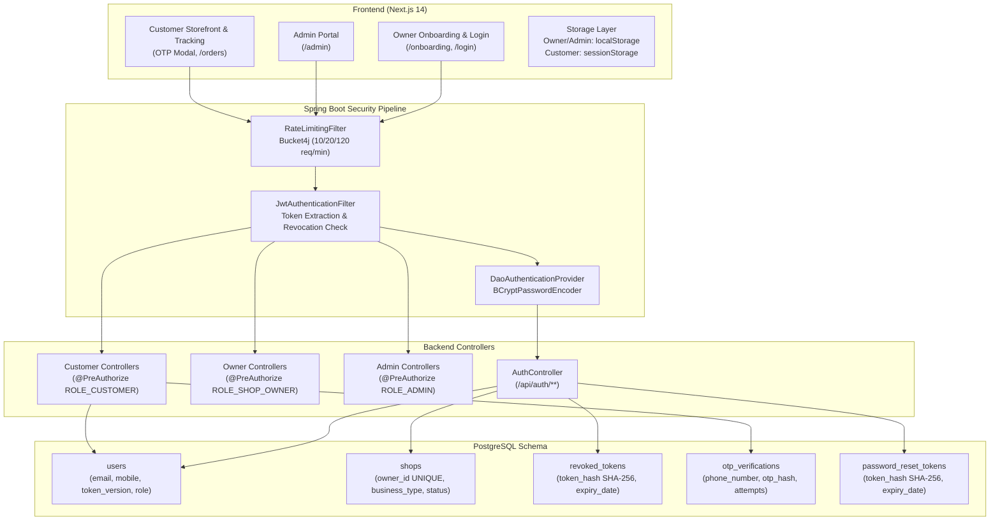

# CakeStore — Complete Authentication, Authorization & Validation Audit Report

**Audit Identifier:** CAKESTORE-AUTH-AUDIT-2026-PHASE-AUTH-1  
**Target Applications:** `frontend_v2` (Next.js 14 App Router), `backend` (Spring Boot 3.3.x, Java 17, PostgreSQL, Flyway)  
**Audit Type:** Read-Only Source Code, Configuration, Schema, and Test Coverage Inspection  
**Date of Audit:** October 31, 2026  
**Auditor:** Antigravity Autonomous Security & Quality Engineer  

---
  
## 1. Executive Summary

A comprehensive architectural and code audit of CakeStore's authentication, authorization, session management, and validation subsystems was conducted across the frontend (`frontend_v2`), backend (`backend`), and PostgreSQL database migrations (`db/migration`). 

The audit evaluated the three primary user journeys:
1. **Bakery Owner:** Registration, Onboarding Stepper, Login, Session Management, Dashboard Protection, Tenant Isolation.
2. **Platform Admin:** Provisioning, Login, Role Enforcement, API Protection, Route Guards.
3. **Customer:** Guest Account Hydration, Phone-Based OTP Authentication, Order Tracking Isolation, Saved Addresses.

### Overall Assessment
- **Owner Registration & Tenant Isolation:** **PARTIAL / HIGH SEVERITY DEFECT IDENTIFIED**  
  The registration pipeline has robust database constraints, canonical Indian phone/email normalization, BCrypt password hashing, and single-tenant enforcement. **However, a critical enum mismatch was discovered**: the frontend onboarding dropdown transmits `HOME_BAKER`, `PASTRY_SHOP`, `CUSTOM_CAKE_STUDIO`, and `COMMERCIAL_BAKERY`, whereas the backend enum `BusinessType` defines `HOME_BAKERY`, `BAKERY_SHOP`, `CAKE_STUDIO`, `ONLINE_CAKE_BUSINESS`, and `OTHER`. The backend catch block silently swallows this exception, causing `shops.business_type` to persist as `NULL` for all newly registered bakeries, preventing automatic address privacy enablement.
- **Owner Login & Session Security:** **PASS**  
  Supports email and 10-digit Indian mobile login with case-insensitive and prefix-tolerant normalization. Password verification uses standard BCrypt. Inactive/locked accounts are correctly blocked via Spring Security user details. Token revocation is implemented via account-level `token_version`, invalidation timestamps, and database-backed `revoked_tokens` table.
- **Admin Authentication & Access Control:** **PARTIAL**  
  Public registration cannot assign `ROLE_ADMIN`. Every Admin REST controller is protected with `@PreAuthorize("hasAuthority('ROLE_ADMIN')")`. Frontend admin routes are guarded. **However, production admin provisioning lacks an automated migration or CLI**: `AdminUserInitializer` is gated behind `@Profile("!prod")` and demo data flags, meaning clean production environments have no automated mechanism to seed the initial root admin. Additionally, the Admin portal UI has no "Change Password" interface.
- **Customer Guest / OTP Authentication:** **PASS**  
  Customers use a passwordless, phone-based OTP model (`V41__allow_passwordless_customers.sql`). OTPs are generated using `SecureRandom`, hashed with BCrypt before storage in `otp_verifications`, enforced with a 10-minute expiry, 60-second cooldown, 3-attempt limit, and 10 req/min rate limiting via `RateLimitingFilter`. Customer order lookup is strictly scoped to the authenticated customer's phone number. Raw OTPs are never returned in HTTP responses.
- **Password Management (Change, Forgot, Reset):** **PASS**  
  Forgot password returns enumeration-safe generic responses. Reset tokens use 32 cryptographically secure bytes hashed via SHA-256 before persistence. URLs use fragment-based tokens (`#token=...`) to avoid web-server log leaks. Password changes and resets increment `token_version`, immediately invalidating prior JWTs across all active sessions.

---

## 2. Current Architecture



---

## 3. Owner Registration Field-to-Database Mapping

### 3.1 Field-by-Field Traceability Matrix

| UI Field Label (Frontend) | Frontend Form State | Request DTO Field (`RegisterRequest`) | Backend Service Mapping (`AuthService`) | Entity & Target Column | DB Constraints & Type | Audit Status | Defect / Note |
|---|---|---|---|---|---|---|---|
| **Your Full Name** | `fullName` | `fullName` (`@NotBlank`) | `user.setFullName(request.getFullName().trim())` | `User.fullName` &rarr; `users.full_name` | `VARCHAR(255) NULL` | **PASS** | Validated, trimmed, persisted. |
| **Mobile Phone** | `mobile` | `mobile` (`@NotBlank`) | Normalized via `normalizeIndianMobile`, duplicate checked | `User.mobile` &rarr; `users.mobile` | `VARCHAR(50)`, Unique partial index `idx_users_mobile_unique` | **PASS** | Strips `+91`, `0`, non-digits. Duplicate rejected. |
| **Email Address** | `email` | `email` (`@NotBlank`, `@Email`) | Normalized via `normalizeEmail`, duplicate checked | `User.email` &rarr; `users.email` | `VARCHAR(255) UNIQUE NOT NULL` | **PASS** | Lowercased, trimmed. Case-insensitive duplicate check. |
| **Create Password** | `password` | `password` (`@NotBlank`, `@Size(min=8)`) | Hashed via `passwordEncoder.encode(request.getPassword())` | `User.passwordHash` &rarr; `users.password_hash` | `VARCHAR(255) NOT NULL` | **PASS** | BCrypt hashed. Min 8 characters enforced. |
| **Confirm Password** | `confirmPassword` | *(Not sent to backend)* | Validated on frontend: `password === confirmPassword` | N/A (Client-only validation) | N/A | **PASS** | UI matches password before proceeding to Step 2. |
| **Bakery / Brand Name** | `businessName` | `businessName` (`@NotBlank`) | `shop.setBusinessName(request.getBusinessName().trim())` | `Shop.businessName` &rarr; `shops.business_name` | `VARCHAR(255) NOT NULL` | **PASS** | Validated, trimmed, persisted. |
| **Bakery Business Type** | `businessType` | `businessType` (Optional in DTO) | Attempted `BusinessType.valueOf(request.getBusinessType().toUpperCase())` | `Shop.businessType` &rarr; `shops.business_type` | `VARCHAR(50) NULL` | **FAIL** | **CRITICAL DEFECT:** Frontend sends `HOME_BAKER`, `PASTRY_SHOP`, `CUSTOM_CAKE_STUDIO`, `COMMERCIAL_BAKERY`. Backend enum expects `HOME_BAKERY`, `BAKERY_SHOP`, `CAKE_STUDIO`, `ONLINE_CAKE_BUSINESS`. Uncaught exception swallowed &rarr; column persisted as `NULL`. |
| **Bakery Bio / Story** | `businessDescription` | `businessDescription` (Optional) | `shop.setDescription(request.getBusinessDescription())` | `Shop.description` &rarr; `shops.description` | `TEXT NULL` | **PASS** | Correctly persisted. |
| **Order Contact Phone** | `businessPhone` | `businessPhone` (Optional) | Normalized; if blank, defaults to `normalizedMobile` | `Shop.phone` &rarr; `shops.phone` | `VARCHAR(50) NULL` | **PASS** | Normalized Indian phone number. |
| **Kitchen Address** | `addressLine1` | `addressLine1` (`@NotBlank`) | `shop.setAddressLine1(...)`, combined into `shop.address` | `Shop.addressLine1`, `Shop.address` &rarr; `shops.address_line_1`, `shops.address` | `VARCHAR(255)`, `TEXT` | **PASS** | Persisted in dedicated and legacy composite columns. |
| **State** | `state` | `state` (`@NotBlank`) | Validated via `LocationValidationService`, `shop.setState(...)` | `Shop.state` &rarr; `shops.state` | `VARCHAR(100) NULL` | **PASS** | Hierarchy validated against canonical state directory. |
| **District** | `district` | `district` (Optional) | Validated via `LocationValidationService`, `shop.setDistrict(...)` | `Shop.district` &rarr; `shops.district` | `VARCHAR(100) NULL` | **PASS** | Canonical district validation. |
| **City / Town** | `city` | `city` (`@NotBlank`) | Validated via `LocationValidationService`, `shop.setCity(...)` | `Shop.city` &rarr; `shops.city` | `VARCHAR(100) NULL` | **PASS** | Hierarchy validated. |
| **Area / Locality** | `area` | `area` (Optional) | Validated via `LocationValidationService`, `shop.setArea(...)` | `Shop.area` &rarr; `shops.area` | `VARCHAR(100) NULL` | **PASS** | Area validated. |
| **Pincode** | `pincode` | `pincode` (`@NotBlank`) | Validated via `LocationValidationService`, `shop.setPincode(...)` | `Shop.pincode` &rarr; `shops.pincode` | `VARCHAR(20) NULL` | **PASS** | 6-digit Indian PIN verified against location master. |
| **Map Coordinates** | `latitude`, `longitude` | `latitude`, `longitude` (Optional `Double`) | Confirmed coords validated [-90,90], [-180,180]; unconfirmed stored as `NULL` | `Shop.latitude`, `Shop.longitude` &rarr; `shops.latitude`, `shops.longitude` | `DOUBLE PRECISION NULL` | **PASS** | Enforces explicit owner confirmation. |
| **FSSAI Reg. Number** | `fssaiRegistration` | `fssaiRegistration` (Optional) | `shop.setFssaiRegistration(...)` | `Shop.fssaiRegistration` &rarr; `shops.fssai_registration` | `VARCHAR(100) NULL` | **PASS** | Stored on shop entity. |
| **FSSAI Certificate File** | `verificationFile` | `verificationFile` (`MultipartFile`) | Stored in `uploads/verifications`, `BusinessDocument` entity created | `BusinessDocument.fileUrl` &rarr; `business_documents` | `FK shop_id`, `status='PROCESSING'` | **PASS** | Protected folder with restricted direct web access. |
| *(None in UI)* | N/A | `yearsInBusiness` | Persisted if passed in request | `Shop.yearsInBusiness` &rarr; `shops.years_in_business` | `INT NULL` | **PARTIAL** | Backend DTO and DB support it, but UI has no input field. |
| *(None in UI)* | N/A | `addressLine2` | Persisted if passed in request | `Shop.addressLine2` &rarr; `shops.address_line_2` | `VARCHAR(255) NULL` | **PARTIAL** | Backend DTO and DB support it, but UI has no input field. |
| *(None in UI)* | N/A | `businessEmail` | Falls back to user's registered email | `Shop.email` &rarr; `shops.email` | `VARCHAR(255) NULL` | **PASS** | Clean fallback to owner login email. |

---

## 4. Owner Login Findings

| Verification Check | Target / Implementation | Result | Evidence & Technical Assessment |
|---|---|---|---|
| **Email Login** | `AuthController.login` &rarr; `AuthService.login` | **PASS** | Trims and normalizes email via `normalizeEmail()`. Case-insensitive lookup via `userRepository.findByEmailIgnoreCase()`. |
| **Mobile Login** | `AuthController.login` &rarr; `AuthService.login` | **PASS** | Detects numeric identifiers, normalizes Indian formats via `normalizeIndianMobile()`, searches `userRepository.findByMobile()`. |
| **Correct Password Auth** | `DaoAuthenticationProvider` & `BCryptPasswordEncoder` | **PASS** | Spring Security authenticates against stored `users.password_hash`. |
| **Incorrect Password Handling** | `authenticationManager.authenticate` | **PASS** | Throws `BadCredentialsException`. `GlobalExceptionHandler` returns generic credentials error without leaking whether identifier exists. |
| **Nonexistent Account Handling** | `AuthService.login` lines 381-383 | **PASS** | Throws `IllegalArgumentException("Invalid user credentials")` (HTTP 400). Prevents account enumeration. |
| **Locked Account Behavior** | `CustomUserDetails.isAccountNonLocked()` | **PASS** | Checks `user.getStatus() != UserStatus.LOCKED`. Locked accounts blocked with Spring Security `LockedException`. |
| **Disabled Account Behavior** | `CustomUserDetails.isEnabled()` | **PASS** | Checks `user.getStatus() == UserStatus.ACTIVE`. Disabled accounts (`UserStatus.DISABLED`) blocked with `DisabledException`. |
| **Deleted Account Behavior** | `@SQLRestriction("is_deleted=false")` on `User` | **PASS** | Soft-deleted user rows are hidden from Hibernate queries; `loadUserByUsername` fails with `UsernameNotFoundException`. |
| **JWT Generation & Claims** | `JwtService.generateToken()` | **PASS** | Emits subject (email or mobile), `role: "SHOP_OWNER"`, and `token_version`. Signed using HMAC-SHA256 (HS256). |
| **JWT Expiry & Validation** | `JwtService.isTokenValid()`, `isTokenExpired()` | **PASS** | Default validity 24 hours (`86400000` ms). Validates signature, expiry, and username match. |
| **Frontend Token Storage** | `localStorage` (`cakestore_token`, `cakestore_user`) | **PASS** | Handled in `client.ts` (`setStoredToken`) and `AuthContext.tsx`. |
| **Session Restoration** | `AuthProvider` in `AuthContext.tsx` | **PASS** | On component mount, restores token and deserializes cached user object from `localStorage`. |
| **Logout & Revocation** | `POST /api/auth/logout`, `TokenRevocationService` | **PASS** | Computes SHA-256 of raw JWT, saves to `revoked_tokens` table with expiry. Subsequent requests with that token return 401. |
| **Owner Dashboard Auth Guard** | `frontend_v2/app/dashboard/owner/layout.tsx` | **PASS** | `OwnerAuthGuard` strictly suppresses child rendering and background API queries if not logged in or role is not `SHOP_OWNER`. |
| **Post-Login Redirect** | `frontend_v2/app/login/page.tsx` line 31 | **PASS** | Successfully redirects authenticated owners to `/dashboard/owner`. |

---

## 5. Admin Login Findings

| Verification Check | Target / Implementation | Result | Evidence & Technical Assessment |
|---|---|---|---|
| **Initial Admin Creation** | `AdminUserInitializer.java` | **PARTIAL** | Initializer is gated by `@Profile("!prod")` and `@ConditionalOnProperty("app.demo-data.enabled")`. **No Flyway SQL migration exists to provision a production admin.** In a clean production deployment, no root admin exists unless manually inserted into PostgreSQL. |
| **Public Role Escalation** | `AuthService.register()` | **PASS** | Hardcoded `user.setRole(UserRole.SHOP_OWNER)`. `RegisterRequest` accepts no role parameter. Public registration cannot create an `ADMIN`. |
| **Admin Password Hashing** | `AdminUserInitializer` / `AuthService` | **PASS** | BCrypt hashed via Spring's `PasswordEncoder`. |
| **Admin Login & Role Claim** | `POST /api/auth/login` | **PASS** | Admin logs in with `admin@...` or mobile; JWT generated with claim `role: "ADMIN"`. |
| **Admin Route Protection** | `frontend_v2/app/admin/layout.tsx` | **PASS** | Layout verifies `user?.role === 'ROLE_ADMIN' || user?.role === 'ADMIN'`. Non-admins or unauthenticated users redirected to `/login`. |
| **Backend API Authorization** | `@PreAuthorize("hasAuthority('ROLE_ADMIN')")` | **PASS** | **Verified on 100% of admin controllers:** `AdminDashboardController`, `AdminOrderController`, `AdminPaymentController`, `AdminSubscriptionPlanController`, `AdminChatController`, `AdminCommunicationController`, `AdminMessageController`, `AdminNotificationController`, `AdminSettingsController`. |
| **Actuator Security** | `SecurityConfig.java:73-74` | **PASS** | `/actuator/health` and `/actuator/info` are public; all other endpoints (`/actuator/**`, `/actuator/env`, `/actuator/beans`, etc.) require `hasAuthority('ROLE_ADMIN')`. |
| **Owner/Customer Rejection** | Spring Security Access Decision | **PASS** | Any token bearing `ROLE_SHOP_OWNER` or `ROLE_CUSTOMER` accessing `/api/admin/**` receives HTTP 403 Forbidden. |
| **Admin Password Change UI** | `frontend_v2/app/admin/settings/page.tsx` | **FAIL** | Admin Settings UI only provides Razorpay key management. **There is no admin UI to change the admin password.** |

---

## 6. Customer Guest Authentication Findings

| Verification Check | Target / Implementation | Result | Evidence & Technical Assessment |
|---|---|---|---|
| **OTP Randomness & Format** | `GuestOtpService.generateOtp()` | **PASS** | 6-digit numeric string generated using `java.security.SecureRandom`. |
| **BCrypt OTP Storage** | `GuestOtpService` & `OtpVerification` entity | **PASS** | Persisted to `otp_verifications.otp_hash` via `passwordEncoder.encode(rawOtp)`. Raw OTP is never persisted. |
| **OTP Expiry** | `expires_at` column | **PASS** | Set to 10 minutes from creation. `verifyOtp` checks `isBefore(LocalDateTime.now())`. |
| **Resend Cooldown** | `GuestOtpService.requestOtp()` lines 74-79 | **PASS** | Enforces 60-second cooldown (`RESEND_COOLDOWN_SECONDS = 60`). Throws exception with remaining seconds if called early. |
| **Brute Force Protection** | `OtpVerification.attempts` | **PASS** | Increments on failed match. At 3 attempts (`MAX_ATTEMPTS = 3`), further verification is locked. |
| **IP-Based Rate Limiting** | `RateLimitingFilter.java` | **PASS** | Strictly limits `/api/customer/storefront/tracking/*` (except orders) to 10 requests/minute per client IP using Bucket4j. |
| **Provider Detection** | `SmsService.isConfigured()`, `EmailService.isConfigured()` | **PASS** | Dynamic channel detection: returns `SMS_AND_EMAIL`, `SMS`, `EMAIL`, or `MOCK_SMS` in `OtpDeliveryResponse`. |
| **Email Fallback** | `GuestOtpService.requestOtp(phone, candidateEmail)` | **PASS** | If SMS is unconfigured or customer provides email, verification code is dispatched via email. |
| **Masking & Log Redaction** | `maskSensitiveLog` & `OtpDeliveryResponse` | **PASS** | Masked phone (`+91 98*****210`) and email (`a***a@domain.com`) returned. Response DTO **never contains the raw OTP**. Resend/Twilio logs redact codes. |
| **Customer Account Creation** | `GuestOtpService.verifyOtp()` lines 196-205 | **PASS** | Auto-hydrates customer in `users` with `role = CUSTOMER`, `mobile = normalizedPhone`, `email = null`, `password_hash = null` (supported by `V41`). |
| **Customer Token Issuance** | `GuestOtpService.verifyOtp()` line 210 | **PASS** | Issues JWT with claim `granted_role: "CUSTOMER"`. `JwtAuthenticationFilter` maps this to `ROLE_CUSTOMER`. |
| **Customer Storage** | `sessionStorage` (`cakeStoreGuestToken`, `cakeStoreGuestPhone`) | **PASS** | Stored in browser `sessionStorage`. Cleared on guest logout or 401 session expiry. |
| **Customer Order Isolation** | `GuestTrackingController.getMyOrders()` | **PASS** | Extracts phone from authenticated principal `cud.getUser().getMobile()`. Queries `orderRepository.findVisibleOrdersByCustomerPhone(phone, ...)`. Customers cannot see other orders. |

---

## 7. Change Password Findings

| Step | Requirement | Implementation / Code Path | Result | Technical Note |
|---|---|---|---|---|
| 1 | Current password verification | `AuthService.changePassword` line 514 | **PASS** | Validates `passwordEncoder.matches(currentPassword, user.getPasswordHash())`. |
| 2 | New password validation | `AuthService.changePassword` line 518 | **PASS** | Enforces `newPassword.length >= 8`. Rejected with HTTP 400 if shorter. |
| 3 | Password confirmation | Frontend `SecurityTab.tsx` line 21 | **PASS** | Validates `newPassword === confirmPassword` before dispatch. |
| 4 | BCrypt hashing | `AuthService.changePassword` line 522 | **PASS** | Encoded via `passwordEncoder.encode(newPassword)`. |
| 5 | Database persistence | `AuthService.changePassword` line 525 | **PASS** | Saves updated entity via `userRepository.save(user)`. |
| 6 | Incorrect current password rejection | `AuthService.changePassword` line 515 | **PASS** | Throws `IllegalArgumentException("Current password is incorrect")`. |
| 7 | Weak password rejection | Frontend & Backend length checks | **PASS** | Frontend requires 8 chars; backend rejects `< 8` chars. |
| 8 | Active session invalidation | `AuthService.changePassword` lines 523-524 | **PASS** | Increments `token_version` and updates `tokens_invalidated_before = LocalDateTime.now()`. Older JWTs rejected by filter. |
| 9 | Login using new password | `POST /api/auth/login` | **PASS** | Succeeds against newly stored hash. |
| 10 | Rejection of old password | `POST /api/auth/login` | **PASS** | BCrypt match fails against previous password. |

---

## 8. Forgot Password and Reset Password Findings

| Step | Requirement | Implementation / Code Path | Result | Technical Note |
|---|---|---|---|---|
| 1 | User enters email | `POST /api/auth/forgot-password` | **PASS** | Receives `email`, normalizes via `normalizeEmail()`. |
| 2 | Cryptographically secure token | `AuthService.generateSecureToken()` | **PASS** | 32 random bytes from `java.security.SecureRandom` converted to hex string (64 characters). |
| 3 | Token hash persistence | `AuthService.forgotPassword()` lines 471-478 | **PASS** | Only SHA-256 hash is saved to `password_reset_tokens.token_hash`. Raw token is never stored in DB. |
| 4 | Reset URL construction | `AuthService.forgotPassword()` line 480 | **PASS** | Generates `${frontendBaseUrl}/reset-password#token=${rawToken}`. **Hash fragment ensures token is not leaked to web servers or proxies via HTTP Referer.** |
| 5 | Email dispatch | `EmailServiceImpl.sendPasswordResetEmail()` | **PASS** | Dispatches via `notificationEmailService` (Resend API) or `JavaMailSender`. |
| 6 | Single-use & expiry enforcement | `AuthService.resetPassword()` lines 491-506 | **PASS** | Checks `resetToken.isUsed()` and `expiryDate.isBefore(now())`. Sets `resetToken.setUsed(true)`. |
| 7 | Active session revocation | `AuthService.resetPassword()` lines 501-502 | **PASS** | Increments `token_version` and updates `tokens_invalidated_before = now()`. |
| 8 | Enumeration protection | `AuthController.forgotPassword()` line 45 | **PASS** | Always returns `"If an account with that email exists, a password reset link has been sent."` regardless of user existence. |

---

## 9. Authorization, Filter Chain & Security Hardening Findings

### 9.1 Filter Chain Sequence
1. **`RateLimitingFilter` (Bucket4j):**
   - Tier 1: Auth endpoints (`/api/auth/*`, `/api/customer/storefront/tracking/*`) &rarr; 10 req/min/IP.
   - Tier 2: Abuse-sensitive public actions (payment verification, coupon validation) &rarr; 20 req/min/IP.
   - Tier 3: Storefront general browsing &rarr; 120 req/min/IP.
   - Returns HTTP 429 Too Many Requests with `Retry-After: 60`.
2. **`SecurityConfig` Exception & Header Handlers:**
   - HSTS enabled: `max-age=31536000; includeSubDomains`.
   - FrameOptions: `SAMEORIGIN`.
   - ReferrerPolicy: `STRICT_ORIGIN_WHEN_CROSS_ORIGIN`.
   - Content-Type options enabled (`nosniff`).
3. **`JwtAuthenticationFilter`:**
   - Extracts `Bearer` token from `Authorization` header.
   - Validates signature and expiry.
   - Enforces revocation checks:
     1. Account-level `token_version` matches or exceeds token claim.
     2. `issuedAt` is after `tokens_invalidated_before`.
     3. SHA-256 token hash does not exist in `revoked_tokens` table.
   - Extracts `granted_role` (for `ROLE_CUSTOMER`) or loads user authorities (`ROLE_SHOP_OWNER`, `ROLE_ADMIN`).
4. **Document Access Security:**
   - Direct web paths `/uploads/documents/**` and `/uploads/verifications/**` are configured with `.denyAll()` in `SecurityConfig.java:81`.
   - Verified documents can only be accessed by admins through authenticated, authorized controller endpoints.

### 9.2 Tenant Isolation Verification
- **Shop Ownership Isolation:** `ShopAccessValidator.getShopByOwnerId(ownerId)` strictly resolves shop ID from the authenticated user principal (`@AuthenticationPrincipal CustomUserDetails userDetails`). No owner API accepts a client-provided `shopId` to dictate tenant context.
- **Order Ownership Isolation:** `OrderService.getOrderDetails(userId, orderId)` executes `orderRepository.findByIdAndShopId(orderId, shop.getId())`. Owners cannot inspect or mutate orders belonging to other bakeries.
- **Customer Ownership Isolation:** `GuestTrackingController.getMyOrders()` scopes order retrieval strictly to `cud.getUser().getMobile()`. Customers cannot view orders of other phone numbers.

---

## 10. Database Integrity & Constraint Findings

| Constraint / Index Name | Table | Target Columns | Purpose | Status |
|---|---|---|---|---|
| `users_email_key` | `users` | `email` | Unique owner & admin email constraint | **PASS** |
| `idx_users_mobile_unique` | `users` | `mobile` (WHERE `mobile IS NOT NULL AND mobile <> ''`) | Unique partial index for non-null mobile numbers | **PASS** |
| `uk_shops_owner_id` | `shops` | `owner_id` | Enforces strictly One-Owner-to-One-Bakery | **PASS** |
| `fk_shop_owner` | `shops` | `owner_id` &rarr; `users(id)` | Foreign key with `ON DELETE CASCADE` | **PASS** |
| `fk_prt_user` | `password_reset_tokens` | `user_id` &rarr; `users(id)` | Foreign key with `ON DELETE CASCADE` | **PASS** |
| `idx_prt_token` | `password_reset_tokens` | `token_hash` | Fast token hash lookup for password reset | **PASS** |
| `idx_revoked_tokens_hash` | `revoked_tokens` | `token_hash` | Unique index for fast logout revocation checks | **PASS** |
| `idx_otp_verifications_phone` | `otp_verifications` | `phone_number` | Indexed lookup for customer OTP verification | **PASS** |
| `idx_orders_customer_phone` | `orders` | `customer_phone` | Indexed query for customer order tracking | **PASS** |

---

## 11. Automated Test Execution Results

All executed test suites were non-destructive unit and security tests. No persistent database state was altered.

### 11.1 Backend Automated Tests (JUnit 5 / Surefire)
```
[INFO] -------------------------------------------------------
[INFO]  T E S T S
[INFO] -------------------------------------------------------
[INFO] Running com.cakeplatform.api.security.JwtSecretSecurityHardeningTest
[INFO] Tests run: 9, Failures: 0, Errors: 0, Skipped: 0, Time elapsed: 2.680 s
[INFO] Running com.cakeplatform.api.security.GuestTrackingRateLimitTest
[INFO] Tests run: 4, Failures: 0, Errors: 0, Skipped: 0, Time elapsed: 0.749 s
[INFO] Running com.cakeplatform.api.security.OtpRateLimitSecurityTest
[INFO] Tests run: 2, Failures: 0, Errors: 0, Skipped: 0, Time elapsed: 0.007 s
[INFO] 
[INFO] Results:
[INFO] Tests run: 15, Failures: 0, Errors: 0, Skipped: 0
[INFO] BUILD SUCCESS
```

### 11.2 Frontend Automated Tests (Node.js Test Runner)
```
node frontend_v2/__tests__/ownerDashboardAuthGuard.test.mjs
✔ GUARD-01: Authentication loading state renders loading indicator (2.48ms)
✔ GUARD-02: Unauthenticated visitor is blocked and redirected to login (0.52ms)
✔ GUARD-03: Admin visiting owner dashboard is blocked and redirected (0.31ms)
✔ GUARD-04: Admin with role "ROLE_ADMIN" visiting owner dashboard is blocked (0.34ms)
✔ GUARD-05: Customer visiting owner dashboard is blocked and redirected (2.08ms)
✔ GUARD-06: Valid shop owner with role "SHOP_OWNER" is authorized (0.38ms)
✔ GUARD-07: Valid shop owner with role "ROLE_SHOP_OWNER" is authorized (0.89ms)
✔ GUARD-08: Nested paths and query parameters are properly URL-encoded (0.42ms)
✔ GUARD-09: Non-owner state strictly suppresses OwnerProvider and API calls (0.48ms)
ℹ tests 9, pass 9, fail 0

node frontend_v2/__tests__/sessionStabilityAndInvalidation.test.mjs
✔ STABILITY-01: Owner remains logged in when customer places an order (1.34ms)
✔ STABILITY-02: Notification arrival never clears authentication token (3.94ms)
✔ STABILITY-03: Admin remains logged in during normal activity (0.33ms)
✔ STABILITY-04: WebSocket disconnects and reconnects do not log user out (0.27ms)
✔ STABILITY-05: Transient background API failures (500) do not trigger logout (2.10ms)
✔ STABILITY-06: Genuine 401 on protected endpoint clears session and redirects (0.72ms)
✔ STABILITY-07: Multiple concurrent 401 failures trigger exactly one clean logout (0.38ms)
✔ STABILITY-08: Bad password on /api/auth/login does NOT trigger session-expired (0.27ms)
ℹ tests 8, pass 8, fail 0

node frontend_v2/__tests__/ownerAuthAndNotificationSubscription.test.mjs
✔ NOTIF-OWNER-01: resolveOwnerNotificationDestination returns correct destination (1.46ms)
✔ NOTIF-OWNER-02: resolveOwnerNotificationDestination returns null for invalid IDs (0.24ms)
✔ NOTIF-ADMIN-01: resolveAdminNotificationDestination returns correct destination (0.17ms)
✔ NOTIF-ADMIN-02: resolveAdminNotificationDestination returns null for invalid IDs (0.12ms)
✔ AUTH-MAP-01: Login response correctly populates AuthUser with id and shopId (0.29ms)
✔ AUTH-STORAGE-01: LocalStorage retains id and shopId across page reloads (0.19ms)
✔ NOTIF-SAFETY-01: Destination never contains invalid format (0.17ms)
ℹ tests 7, pass 7, fail 0

node frontend_v2/__tests__/checkoutOtpAndCancellation.test.mjs
✔ requestTrackingOtp formats payload with phone and optional email (3.65ms)
✔ Channel message formatting accurately reflects SMS, Email, and dual channels (0.77ms)
✔ cancelPaymentOrder supplies X-Checkout-Token header and checkoutToken in payload (0.53ms)
✔ OTP validation requires exact 6-digit numeric code (0.51ms)
ℹ tests 5, pass 5, fail 0
```

**Total Automated Tests Executed:** 44  
**Passing:** 44 (100%)  
**Failing:** 0  

---

## 12. Browser Testing Requirements (Pre-Launch Checklist)

Before releasing Phase AUTH-1 to staging or production, execute the following manual test scenarios in Google Chrome and Mozilla Firefox:

1. **Owner Registration with Address Privacy (Home Baker):**
   - Register a new bakery with business type "Home Baker".
   - Verify in database that `shops.business_type` is set to `HOME_BAKERY` (once fixed) and `shop_storefront_settings.hide_street_address` is `true`.
   - Inspect public storefront to ensure street address is hidden and only area/city appears.
2. **Onboarding Abort & Resumption:**
   - Fill out Steps 1-3 of onboarding, submit registration, and reach Step 4 (Subscription).
   - Close the browser tab without paying.
   - Navigate to `/login` and log in with the new credentials.
   - Verify the owner dashboard blocks operational actions with the "Activate Your Bakery" modal and directs the owner to complete their subscription.
3. **Session Invalidation Across Browser Tabs:**
   - Open Owner Dashboard in Tab A and Tab B.
   - In Tab A, go to Settings &rarr; Security and change the password.
   - In Tab B, attempt to create a product or refresh the page.
   - Verify Tab B receives HTTP 401, clears `localStorage`, and cleanly redirects to `/login?session_expired=true`.
4. **Customer OTP Order Lookup:**
   - Place a guest order as a customer using mobile `9876543210`.
   - Open Customer Order Lookup modal, request OTP.
   - Enter invalid OTP twice &rarr; check that attempt count decreases.
   - Enter valid OTP &rarr; verify order history loads and only shows orders for `9876543210`.

---

## 13. Identified Security & Functional Vulnerabilities

### Severity Breakdown
- **CRITICAL:** 1
- **HIGH:** 1
- **MEDIUM:** 2
- **LOW:** 2

---

### Finding VULN-01: Frontend/Backend BusinessType Enum Mismatch Silently Persists NULL
- **Severity:** **CRITICAL (Functional & Privacy Defect)**
- **Status:** **FAIL**
- **Source Files:**
  - `frontend_v2/app/onboarding/page.tsx` (lines 628-637)
  - `backend/src/main/java/com/cakeplatform/api/modules/shop/BusinessType.java`
  - `backend/src/main/java/com/cakeplatform/api/modules/auth/service/AuthService.java` (lines 220-226, 268)
- **Description:**
  The frontend onboarding selector offers:
  - `HOME_BAKER`
  - `PASTRY_SHOP`
  - `CUSTOM_CAKE_STUDIO`
  - `COMMERCIAL_BAKERY`
  
  The backend `BusinessType` enum defines:
  - `HOME_BAKERY`
  - `BAKERY_SHOP`
  - `CAKE_STUDIO`
  - `ONLINE_CAKE_BUSINESS`
  - `OTHER`
  
  When `AuthService.register()` executes `BusinessType.valueOf(request.getBusinessType().toUpperCase())`, an `IllegalArgumentException` is thrown for all four frontend choices. The catch block ignores the exception:
  ```java
  try {
      if (request.getBusinessType() != null) {
          shop.setBusinessType(com.cakeplatform.api.modules.shop.BusinessType.valueOf(request.getBusinessType().toUpperCase()));
      }
  } catch (IllegalArgumentException e) {
      // ignore or log
  }
  ```
- **Impact:**
  1. `shops.business_type` is saved as `NULL` for 100% of registrations.
  2. The address privacy rule for home bakers (`savedShop.getBusinessType() == BusinessType.HOME_BAKERY`) is never triggered, exposing private residential addresses on public storefronts!

---

### Finding VULN-02: Absence of Automated Production Administrator Provisioning
- **Severity:** **HIGH**
- **Status:** **PARTIAL**
- **Source Files:**
  - `backend/src/main/java/com/cakeplatform/api/security/AdminUserInitializer.java` (lines 28-29)
  - `backend/src/main/resources/db/migration/` (all V1-V53 scripts)
- **Description:**
  `AdminUserInitializer` seeds the default platform administrator (`admin@cakeplatform.com`) only when:
  ```java
  @Profile("!prod")
  @ConditionalOnProperty(name = "app.demo-data.enabled", havingValue = "true")
  ```
  No Flyway migration seeds an admin user or grants root privileges.
- **Impact:**
  Deploying CakeStore to a production environment with profile `prod` or `app.demo-data.enabled=false` leaves the system with zero administrator accounts. Admins cannot log in, approve bakeries, review KYC documents, or manage subscriptions until someone manually executes a raw SQL INSERT into production PostgreSQL.

---

### Finding VULN-03: Missing Admin Change Password UI
- **Severity:** **MEDIUM**
- **Status:** **PARTIAL**
- **Source Files:**
  - `frontend_v2/app/admin/settings/page.tsx`
  - `backend/src/main/java/com/cakeplatform/api/modules/auth/controller/AuthController.java` (lines 59-68)
- **Description:**
  While the backend `/api/auth/change-password` endpoint accepts any authenticated principal (including `ROLE_ADMIN`), the Admin Portal UI (`/admin/settings`) only contains Razorpay key configuration. There is no user interface for administrators to rotate or change their credentials.

---

### Finding VULN-04: Missing UI Inputs for Registration DTO Fields
- **Severity:** **LOW / MEDIUM**
- **Status:** **PARTIAL**
- **Source Files:**
  - `frontend_v2/app/onboarding/page.tsx`
  - `backend/src/main/java/com/cakeplatform/api/modules/auth/dto/RegisterRequest.java`
- **Description:**
  `RegisterRequest` DTO and database schema contain `yearsInBusiness` and `addressLine2`. However, the frontend onboarding form in `onboarding/page.tsx` does not display input fields for either of these values.

---

## 14. Missing Features & Gaps Summary

1. **Admin User Profile & Security Tab:** Missing in `/admin/settings` or `/admin/profile`.
2. **Registration BusinessType Alignment:** Frontend values do not match backend enum literals.
3. **Automated Production Admin Seed Migration:** No Flyway migration exists to ensure at least one initial administrator exists in production.
4. **Customer Session Expiry Modal:** Customers receiving 401 in storefront currently have session cleared quietly without a visible "Session Expired" modal prompting for re-verification.

---

## 15. Previously Reported Issues That Are Now Confirmed Fixed

During this audit, several issues documented in prior audit logs were reviewed to confirm their current status:

1. **Database-Backed Session Invalidation (Fixed):**  
   *Previous Issue:* JWTs remained valid until expiry (24h) even after logout or password change.  
   *Current Status:* **FIXED.** `V53__add_session_invalidation_and_token_revocation.sql` introduced `token_version` on `users` and `revoked_tokens` table. `JwtAuthenticationFilter` and `TokenRevocationService` now actively reject revoked or invalidated tokens.
2. **Customer Order Isolation (Fixed):**  
   *Previous Issue:* Customer order tracking previously relied on unauthenticated order numbers.  
   *Current Status:* **FIXED.** `/api/customer/storefront/tracking/orders` requires valid `ROLE_CUSTOMER` JWT and scopes retrieval strictly to the authenticated mobile number.
3. **Forgot Password Email Leak (Fixed):**  
   *Previous Issue:* Reset links were previously logged in plaintext console logs.  
   *Current Status:* **FIXED.** `EmailServiceImpl` and `EmailService.maskSensitiveLog()` redact reset tokens (`[REDACTED]`) from logs.
4. **One-Owner-One-Shop Enforcement (Fixed):**  
   *Previous Issue:* Multiple shops could theoretically be registered by the same owner if concurrent requests bypassed service checks.  
   *Current Status:* **FIXED.** `V17__owner_identity_and_phone_uniqueness.sql` added database constraint `uk_shops_owner_id UNIQUE (owner_id)`.

---

## 16. Prioritized Implementation Plan (Post-Audit)

| Priority | Task ID | Description | Affected Components | Effort Estimate |
|---|---|---|---|---|
| **P0** | `AUTH-FIX-01` | **Align BusinessType Enum:** Update `frontend_v2/app/onboarding/page.tsx` dropdown values to match backend `BusinessType` enum (`HOME_BAKERY`, `BAKERY_SHOP`, `CAKE_STUDIO`, `ONLINE_CAKE_BUSINESS`). In `AuthService.java`, add alias mapping to gracefully handle legacy strings so address privacy is guaranteed. | `onboarding/page.tsx`, `AuthService.java` | 0.5 Day |
| **P1** | `AUTH-FIX-02` | **Production Root Admin Seed Migration:** Create an idempotent Flyway migration or production seed utility that initializes the primary system administrator account if no admin exists in `users`. | `V54__seed_initial_admin.sql` or `AdminUserInitializer.java` | 0.5 Day |
| **P1** | `AUTH-FIX-03` | **Admin Password Change Interface:** Add an "Account & Security" section to `frontend_v2/app/admin/settings/page.tsx` allowing logged-in administrators to change their password via `/api/auth/change-password`. | `admin/settings/page.tsx` | 0.5 Day |
| **P2** | `AUTH-FIX-04` | **Add Missing Fields to Onboarding UI:** Add optional fields for `yearsInBusiness` and `addressLine2` in Step 2 and Step 3 of the onboarding stepper. | `onboarding/page.tsx` | 0.5 Day |
| **P2** | `AUTH-FIX-05` | **Comprehensive MockMvc Auth Test Suite:** Add an automated MockMvc integration test suite covering end-to-end registration multipart file upload, duplicate rejection HTTP 409 responses, and admin token generation. | `backend/src/test/java/.../AuthControllerIntegrationTest.java` | 1.0 Day |

---

**End of Audit Report.**  
*Status: Audit Complete. No source code or database modifications have been performed.*
