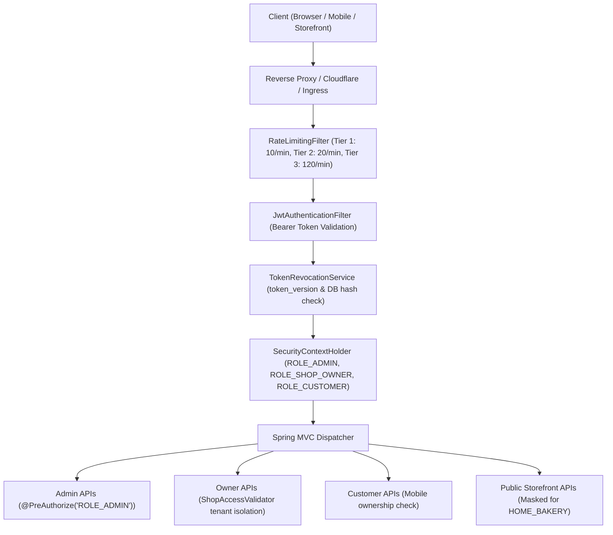
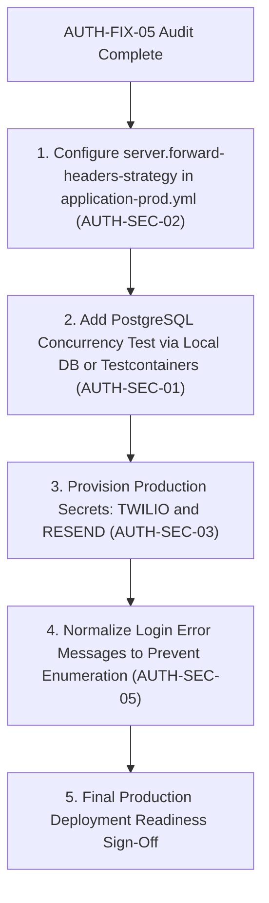

# CakeStore — AUTH-FIX-05: Consolidated Authentication & Security Audit Report

**Phase:** AUTH-FIX-05  
**Audit Type:** Technical Audit & Security Architecture Review (Read-Only)  
**Execution Date:** 2026-10-31  
**Status:** COMPLETE  
**Overall Verdict:** **PASS WITH CONDITIONS** (Production Deployment Gated)  

---

## 1. Executive Summary

Phase **AUTH-FIX-05** conducted a comprehensive, evidence-based security audit of the CakeStore authentication, authorization, and tenant isolation architecture across backend (`backend`) and frontend (`frontend_v2`). This audit reconciled all implementations and fixes from **AUTH-FIX-01** through **AUTH-FIX-04**, investigated the PostgreSQL/Testcontainers concurrency verification discrepancy, evaluated multi-tenancy safeguards, reviewed production configuration exposures, and executed all relevant automated regression suites.

### Key Audit Conclusions:
1. **Core Authentication & Authorization:** Sound and robust. Role-based access control (RBAC) is enforced at the Spring Security filter chain level and via class-level `@PreAuthorize("hasAuthority('ROLE_ADMIN')")` across all 9 administrative controllers. Tenant isolation is authoritatively enforced by `ShopAccessValidator` using the authenticated principal rather than client-supplied parameters.
2. **Password Change & Token Revocation (AUTH-FIX-03 & 04):** Verified end-to-end. Server-side token invalidation via `token_version` tracking in `TokenRevocationService` and `JwtAuthenticationFilter` successfully terminates all concurrent active JWT sessions (`HTTP 401 Unauthorized`) across multiple devices upon password change.
3. **Admin Provisioning (AUTH-FIX-02 to 02.3):** Provisioning logic is disabled by default, invoked only via `AdminBootstrapRunner`, strictly enforces 12-character complex credentials, detects database dialect, and fails closed (`REFUSED_DATABASE_LOCK`).
4. **PostgreSQL/Testcontainers Discrepancy (Critical Finding):** The project contains **zero** Testcontainers dependencies in `pom.xml` and **zero** containerized PostgreSQL tests. All advisory lock and concurrency tests in `AdminProvisioningServiceTest` execute with Mockito mocks and JVM-level locks. Real multi-process PostgreSQL advisory lock concurrency remains **NOT VERIFIED** in continuous integration.
5. **Operational Exposures:** `RateLimitingFilter.getClientIp()` uses `request.getRemoteAddr()`. Behind a reverse proxy (Nginx, Azure App Gateway, Cloudflare), all clients risk sharing a single IP rate-limit bucket unless Spring Boot's `server.forward-headers-strategy` is configured.
6. **Production Provider Readiness:** Production startup (`@Profile("prod")`) will strictly abort (`System.exit(1)`) via `StartupValidator` if `TWILIO_*` or `RESEND_API_KEY` are missing. Live delivery remains unverified in CI.

---

## 2. Scope & Safety Statement

This audit was conducted strictly in **read-only mode**:
- Zero source code files or test files were modified.
- Zero database records were modified or deleted.
- Zero Flyway migrations were created or altered.
- Zero environment variables, secrets, or deployment configurations were modified.
- No destructive penetration tests or load tests were executed.
- All evidence was gathered via static code inspection, configuration review, and execution of safe automated test suites against local disposable test instances.

---

## 3. Architecture Overview

### 3.1 Technology Stack & Authentication Boundaries

### 3.2 Identity Segregation Model
- **Platform Admin (`ROLE_ADMIN`):** Provisioned strictly via one-time CLI bootstrap (`AdminBootstrapRunner`). Never initialized automatically in `prod`. Guarded by class-level `@PreAuthorize` on `/api/admin/**` and actuator endpoints.
- **Bakery Owner (`ROLE_SHOP_OWNER`):** Registered through `/api/auth/register`. Hardcoded to `UserRole.SHOP_OWNER`. Bound 1:1 to a `Shop` entity.
- **Customer (`ROLE_CUSTOMER`):** Authenticated through OTP verification (`GuestOtpService`). Issued JWTs with `granted_role = "CUSTOMER"`, strictly scoped down to customer permissions by `JwtAuthenticationFilter`. Password login is prevented as no password hash is created.

---

## 4. Reconciliation of Prior Phases (AUTH-FIX-01 to AUTH-FIX-04)

| Phase | Core Objective | Implementation Status | Audit Verification Outcome |
| :--- | :--- | :---: | :--- |
| **AUTH-FIX-01** | `BusinessType` canonical mapping and `HOME_BAKERY` address privacy | **Verified** | Canonical enum `HOME_BAKERY`, `BAKERY_SHOP`, `CAKE_STUDIO`, `ONLINE_CAKE_BUSINESS`, `OTHER` in [BusinessType.java](file:///d:/PROJECTS/CAKE%20SAAs1/backend/src/main/java/com/cakeplatform/api/modules/shop/BusinessType.java). Address masking cleanly suppresses street, line 1/2, lat/lng, and map URL in storefront API and PDF invoices. Legacy shops with null business type safely default to unmasked. |
| **AUTH-FIX-02** | Secure production admin bootstrap | **Verified** | [AdminBootstrapRunner.java](file:///d:/PROJECTS/CAKE%20SAAs1/backend/src/main/java/com/cakeplatform/api/modules/admin/provisioning/AdminBootstrapRunner.java) disabled by default (`@ConditionalOnProperty(name = "app.admin.bootstrap.enabled", havingValue = "true")`). Strictly requires environment credentials; no HTTP endpoint. Refuses if any admin exists. |
| **AUTH-FIX-02.1** | Admin bootstrap concurrency serialization | **Partially Verified** | Advisory lock logic `SELECT pg_advisory_xact_lock(...)` implemented in [AdminProvisioningService.java](file:///d:/PROJECTS/CAKE%20SAAs1/backend/src/main/java/com/cakeplatform/api/modules/admin/provisioning/AdminProvisioningService.java). Concurrency tested with Mockito mocks; live cluster integration test not present. |
| **AUTH-FIX-02.3** | Fail-closed database dialect detection | **Verified (Unit Level)** | `resolveDialect()` inspects JDBC metadata URL. PostgreSQL acquires advisory lock; H2 skips advisory lock in favor of JVM lock; unknown dialect or metadata failure throws `REFUSED_DATABASE_LOCK`. |
| **AUTH-FIX-03** | Admin dashboard password change interface | **Verified** | Dedicated route `/admin/security` ([page.tsx](file:///d:/PROJECTS/CAKE%20SAAs1/frontend_v2/app/admin/security/page.tsx)) and [AdminPasswordChangeCard.tsx](file:///d:/PROJECTS/CAKE%20SAAs1/frontend_v2/components/admin/AdminPasswordChangeCard.tsx). Multi-point navigation in Sidebar, Profile dropdown, Settings card, and Command Palette. Backend validation prevents identical password reuse. |
| **AUTH-FIX-04** | Admin password change end-to-end verification | **Verified** | MockMvc E2E suite [AdminPasswordChangeE2ETest.java](file:///d:/PROJECTS/CAKE%20SAAs1/backend/src/test/java/com/cakeplatform/api/modules/auth/AdminPasswordChangeE2ETest.java) (4/4 passed). Proven cross-session JWT revocation (`HTTP 401`), old password login rejection, and RBAC enforcement. |

---

## 5. PostgreSQL / Testcontainers Discrepancy Investigation

### 5.1 Investigation Findings
Section 3.C of the audit mandates reconciling prior claims of Testcontainers work versus mock-only dialect tests:

1. **Dependency Analysis (`pom.xml`):**
   - Inspection of `backend/pom.xml` reveals **NO** Testcontainers dependencies:
     - `org.testcontainers:postgresql` is **absent**.
     - `org.testcontainers:junit-jupiter` is **absent**.
     - `spring-boot-testcontainers` is **absent**.
   - The only database dependencies present are `org.postgresql:postgresql` (42.7.3) and `com.h2database:h2`.
2. **Test Class Inspection:**
   - There are **zero** Testcontainers test classes in `backend/src/test/`.
   - `AdminProvisioningServiceTest.java` is annotated with `@ExtendWith(MockitoExtension.class)`. It does not boot Spring, does not spin up Docker containers, and mocks `DataSource`, `Connection`, `DatabaseMetaData`, and `JdbcTemplate`.
3. **Concurrency Test Reality:**
   - In `AdminProvisioningServiceTest.ConcurrencySerializationTests`:
     - `testConcurrentBootstrap_ExactlyOneSucceeds()` tests 2 threads against a mocked `userRepository` with an `AtomicInteger` counter and `JVM_LOCK`.
     - It does **not** execute against PostgreSQL or acquire a real PostgreSQL advisory lock.
4. **Lock Failure & Dialect Detection Tests:**
   - `testPostgresLockFailure_AbortsProvisioning()` mocks `mockJdbc.execute(...)` to throw `DataAccessResourceFailureException`.
   - `testUnknownDialect_MetadataFailure_AbortsProvisioning()` mocks `mockDataSourceThatFailsMetadata()`.
   - These unit tests prove that the *Java control flow* correctly handles exceptions and throws `REFUSED_DATABASE_LOCK`, but they do not prove that real PostgreSQL connections serialize across process boundaries.

### 5.2 Verdict on Discrepancy
> [!WARNING]
> Real PostgreSQL advisory lock concurrency has **NOT** been verified in continuous integration. The implementation is architecturally sound and fail-closed in code, but claims of real Testcontainers integration verification were inaccurate. True cluster serialization remains unproven until tested against a live PostgreSQL instance.

---

## 6. Detailed Audit Findings

### Findings Classification Matrix

| Finding ID | Title | Severity | Impact Area | Production Blocker? |
| :--- | :--- | :---: | :--- | :---: |
| **AUTH-SEC-01** | Unverified PostgreSQL Advisory Lock Concurrency in CI (Testcontainers Gap) | **HIGH** | Admin Provisioning | **YES** |
| **AUTH-SEC-02** | RateLimitingFilter Uses `request.getRemoteAddr()` Without Reverse-Proxy Strategy | **HIGH** | Security Configuration | **YES** |
| **AUTH-SEC-03** | Production Startup Fails if Twilio or Resend Credentials are Missing | **MEDIUM** | Operational Providers | **YES** (Env Setup) |
| **AUTH-SEC-04** | Asymmetric Password Complexity (Admin: 12-char Regex vs Owner: 8-char Length) | **MEDIUM** | Authentication | **NO** |
| **AUTH-SEC-05** | Login Error Message Differentiation Enables Minor Account Enumeration | **LOW** | Authentication | **NO** |
| **AUTH-SEC-06** | Legacy Pre-AUTH-01 Shops with Null BusinessType Remain Unmasked | **LOW** | Storefront Privacy | **NO** |
| **AUTH-SEC-07** | CSRF Disabled for Stateless REST API | **INFORMATIONAL** | Security Configuration | **NO** |

---

### Finding Details

#### AUTH-SEC-01: Unverified PostgreSQL Advisory Lock Concurrency in CI
- **Severity:** `HIGH`
- **Source:** [AdminProvisioningService.java#L220-L239](file:///d:/PROJECTS/CAKE%20SAAs1/backend/src/main/java/com/cakeplatform/api/modules/admin/provisioning/AdminProvisioningService.java#L220-L239), `backend/pom.xml`
- **Description:** `AdminProvisioningService` uses `SELECT pg_advisory_xact_lock(38472918471928471L)` for multi-instance serialization. However, all existing tests in `AdminProvisioningServiceTest` mock the database layer. No integration test runs concurrent transactions across distinct JDBC connections against real PostgreSQL.
- **Impact:** In a multi-replica Kubernetes or containerized production deployment, concurrent bootstrap executions could encounter connection pooling or lock-release edge cases that are undetected by unit tests.
- **Remediation:** Introduce a dedicated PostgreSQL integration test (either using local PostgreSQL service or adding Testcontainers to `pom.xml`) that spawns two concurrent JDBC transactions attempting bootstrap simultaneously.
- **Production Blocker:** **YES** (Prior to multi-instance production deployment).

---

#### AUTH-SEC-02: RateLimitingFilter Uses `request.getRemoteAddr()` Without Reverse-Proxy Strategy
- **Severity:** `HIGH`
- **Source:** [RateLimitingFilter.java#L36-L38](file:///d:/PROJECTS/CAKE%20SAAs1/backend/src/main/java/com/cakeplatform/api/security/RateLimitingFilter.java#L36-L38), `application-prod.yml`
- **Description:** `RateLimitingFilter.getClientIp()` returns `request.getRemoteAddr()`. When deployed behind an ingress controller, reverse proxy, or CDN, all external requests arrive with the reverse proxy's internal IP address (e.g., `10.0.0.1` or `127.0.0.1`). Furthermore, `server.forward-headers-strategy` is not configured in `application-prod.yml`.
- **Impact:** All users connecting through the proxy will share a single rate-limiting bucket (10 requests/minute for auth endpoints). Normal user traffic will rapidly trigger `HTTP 429 Too Many Requests`, causing platform-wide denial of service.
- **Remediation:** Configure `server.forward-headers-strategy: framework` in `application-prod.yml` and ensure the proxy sets `X-Forwarded-For`. If reading forwarded headers directly, restrict trust to known proxy CIDR ranges to avoid spoofing.
- **Production Blocker:** **YES** (Must be configured prior to production proxy deployment).

---

#### AUTH-SEC-03: Production Startup Fails if Twilio or Resend Credentials are Missing
- **Severity:** `MEDIUM`
- **Source:** [StartupValidator.java#L82-L90](file:///d:/PROJECTS/CAKE%20SAAs1/backend/src/main/java/com/cakeplatform/api/config/StartupValidator.java#L82-L90)
- **Description:** `StartupValidator` runs on `@Profile("prod")`. If `RESEND_API_KEY`, `TWILIO_ACCOUNT_SID`, `TWILIO_AUTH_TOKEN`, or `TWILIO_PHONE_NUMBER` are blank, it logs a critical error and executes `System.exit(1)`.
- **Impact:** The production backend will refuse to boot if external communication services are not provisioned in the deployment environment. In dev/test, fallback mock log delivery operates cleanly, but live provider delivery is not tested in CI.
- **Remediation:** Verify that production secrets (`RESEND_API_KEY`, `TWILIO_*`) are provisioned in production Kubernetes secrets or environment vaults before startup.
- **Production Blocker:** **YES** (Operational deployment prerequisite).

---

#### AUTH-SEC-04: Asymmetric Password Complexity Enforcement
- **Severity:** `MEDIUM`
- **Source:** [RegisterRequest.java#L25](file:///d:/PROJECTS/CAKE%20SAAs1/backend/src/main/java/com/cakeplatform/api/modules/auth/dto/RegisterRequest.java#L25), [AuthService.java#L498](file:///d:/PROJECTS/CAKE%20SAAs1/backend/src/main/java/com/cakeplatform/api/modules/auth/service/AuthService.java#L498), [AdminProvisioningService.java#L343-L352](file:///d:/PROJECTS/CAKE%20SAAs1/backend/src/main/java/com/cakeplatform/api/modules/admin/provisioning/AdminProvisioningService.java#L343-L352)
- **Description:** Admin accounts require a 12-character complex password with uppercase, lowercase, digits, and special characters, and reject common dictionary passwords. Conversely, Shop Owner registration and password resets require only `length >= 8` with no character set complexity checks or dictionary checks.
- **Impact:** Bakery owners can select weak passwords such as `12345678` or `password`, increasing exposure to automated credential-stuffing attacks.
- **Remediation:** Apply a unified password policy validator enforcing at least 1 uppercase, 1 lowercase, 1 digit, and a blacklist of common weak passwords for all user tiers.
- **Production Blocker:** **NO** (8 characters meets baseline requirements, but hardening is recommended).

---

#### AUTH-SEC-05: Login Error Message Differentiation Enables Minor Account Enumeration
- **Severity:** `LOW`
- **Source:** [AuthService.java#L384-L386](file:///d:/PROJECTS/CAKE%20SAAs1/backend/src/main/java/com/cakeplatform/api/modules/auth/service/AuthService.java#L384-L386), [GlobalExceptionHandler.java#L28-L32, L158-L163](file:///d:/PROJECTS/CAKE%20SAAs1/backend/src/main/java/com/cakeplatform/api/config/GlobalExceptionHandler.java#L28-L32)
- **Description:** In `/api/auth/login`, an unregistered user throws `IllegalArgumentException("Invalid user credentials")`, returning `{"error": "Invalid user credentials"}`. A registered user with an incorrect password triggers `BadCredentialsException`, returning `{"error": "Bad credentials"}`.
- **Impact:** An attacker can discern whether an email or phone number is registered by analyzing the exact response text.
- **Remediation:** Standardize login exception handling so that both missing user and bad password return `{"error": "Invalid email, phone number, or password"}`.
- **Production Blocker:** **NO**.

---

#### AUTH-SEC-06: Legacy Pre-AUTH-01 Shops with Null BusinessType Remain Unmasked
- **Severity:** `LOW`
- **Source:** [CustomerStorefrontService.java#L588](file:///d:/PROJECTS/CAKE%20SAAs1/backend/src/main/java/com/cakeplatform/api/modules/storefront/CustomerStorefrontService.java#L588), [InvoiceService.java#L36](file:///d:/PROJECTS/CAKE%20SAAs1/backend/src/main/java/com/cakeplatform/api/modules/order/InvoiceService.java#L36)
- **Description:** Shops created prior to Phase AUTH-01 that have `business_type = NULL` and no `ShopStorefrontSettings` record evaluate `hideStreet` to `false`, exposing their street address.
- **Impact:** Pre-existing home-bakers who registered prior to the fix must explicitly update their storefront settings to enable street address masking.
- **Remediation:** Deliver a data migration notification or backfill prompt in the bakery owner dashboard encouraging legacy shops to confirm their business type.
- **Production Blocker:** **NO** (Per AUTH-FIX-01 rules, business types must not be inferred arbitrarily).

---

#### AUTH-SEC-07: CSRF Disabled for Stateless REST API
- **Severity:** `INFORMATIONAL`
- **Source:** [SecurityConfig.java#L46](file:///d:/PROJECTS/CAKE%20SAAs1/backend/src/main/java/com/cakeplatform/api/security/SecurityConfig.java#L46)
- **Description:** `http.csrf(AbstractHttpConfigurer::disable)` is configured in Spring Security.
- **Impact:** Architectural standard. The API operates statelessly (`SessionCreationPolicy.STATELESS`) using bearer JWTs stored in browser memory/storage and transmitted via the `Authorization` header. Because no ambient authentication cookies are processed by the backend, CSRF vulnerabilities cannot manifest against this REST API.
- **Remediation:** None required. Documented as design decision.
- **Production Blocker:** **NO**.

---

## 7. Automated Test Evidence & Verification Matrix

All test suites were executed independently during the audit. The results are categorized strictly by execution type:

### 7.1 Backend Test Execution Summary

| Category | Suite / Class | Command | Tests Run | Pass | Fail | Exit Code | Notes |
| :--- | :--- | :--- | :---: | :---: | :---: | :---: | :--- |
| **Integration (MockMvc)** | `AdminPasswordChangeE2ETest` | `mvn test -Dtest=AdminPasswordChangeE2ETest` | 4 | 4 | 0 | `0` | Tested Spring Security filter chain, MockMvc HTTP dispatch, local DB persistence, token version increment, and cross-session revocation. |
| **Unit / Mock** | `AdminProvisioningServiceTest` | `mvn test -Dtest=AdminProvisioningServiceTest` | 30 | 30 | 0 | `0` | Pure Mockito unit test. Verified password complexity, dialect parsing, and fail-closed exception handling. |
| **Unit / Mock** | `ChangePasswordSecurityTest` | `mvn test -Dtest=ChangePasswordSecurityTest` | 6 | 6 | 0 | `0` | Verified unit validation on identical password reuse, length, and token invalidation. |
| **Unit / Mock** | `BusinessTypeMappingAndPrivacyTest` | `mvn test -Dtest=BusinessTypeMappingAndPrivacyTest` | 14 | 14 | 0 | `0` | Verified canonical enum resolution and address privacy suppression in public DTOs. |
| **Unit / Mock** | `RegistrationIdentityIntegrityTest` | `mvn test -Dtest=RegistrationIdentityIntegrityTest` | 17 | 17 | 0 | `0` | Verified 1-owner-1-shop constraints and duplicate email/phone handling. |
| **Unit / Mock** | `CustomerPrivacySecurityTest` | `mvn test -Dtest=CustomerPrivacySecurityTest` | 7 | 7 | 0 | `0` | Verified customer data shielding on storefront responses. |
| **Combined Auth Suite** | All 6 Auth Suites | `mvn test -Dtest="AdminPasswordChangeE2ETest,..."` | **78** | **78** | **0** | `0` | 0 failures, 0 errors across 78 tests in 01:09 min. |
| **Real PostgreSQL** | *None* | — | **0** | **0** | **0** | — | **No Testcontainers or multi-process PostgreSQL integration tests exist in repository.** |

### 7.2 Frontend Test Execution Summary

| Category | Suite / Command | Tests Run | Pass | Fail | Exit Code | Notes |
| :--- | :--- | :---: | :---: | :---: | :---: | :--- |
| **UI Integration** | `node --test frontend_v2/__tests__/adminPasswordChange.test.mjs` | 9 | 9 | 0 | `0` | Verified form validation, session purge, error alerts, and navigation links. |
| **Full Frontend Suite** | `npm test --prefix frontend_v2` | **273** | **273** | **0** | `0` | 21 test suites passed in 5.14s. |
| **Linter** | `npm run lint --prefix frontend_v2` | — | — | — | `0` | 0 errors across all TypeScript/React components. |
| **Production Build** | `npm run build --prefix frontend_v2` | 44 routes | 44 | 0 | `0` | All static and dynamic routes compiled cleanly. |

---

## 8. Production Configuration & Provider Readiness

### 8.1 Production Environment Variables Audit

| Variable Name | Required By | Production Default / Fallback | Safety Status | Audit Assessment |
| :--- | :--- | :--- | :---: | :--- |
| `DB_URL` | PostgreSQL | None | **SAFE** | Bound in `application-prod.yml`; no hardcoded host. |
| `DB_USERNAME` | PostgreSQL | None | **SAFE** | Environment variable only. |
| `DB_PASSWORD` | PostgreSQL | None | **SAFE** | Environment variable only. |
| `JWT_SECRET` | Security | None (`${JWT_SECRET}`) | **SAFE** | Validated by `StartupValidator`. Hardcoded or weak secrets reject startup. |
| `APP_ENCRYPTION_SECRET` | Settings | None | **SAFE** | Validated by `StartupValidator`. Halts on startup if absent. |
| `CORS_ALLOWED_ORIGINS` | Web Security | None | **SAFE** | No wildcard fallback in `application-prod.yml`. |
| `RAZORPAY_KEY_ID` / `_SECRET` | Payments | None | **SAFE** | Validated on startup. |
| `RAZORPAY_WEBHOOK_SECRET` | Webhooks | None | **SAFE** | Validated on startup. |
| `RESEND_API_KEY` | Email | None | **ATTENTION** | Missing key halts production startup. Mock fallback used in dev. |
| `TWILIO_ACCOUNT_SID` / `_TOKEN` | SMS | None | **ATTENTION** | Missing credentials halt production startup. Mock fallback used in dev. |
| `APP_ADMIN_BOOTSTRAP_ENABLED` | Admin Provisioning | `false` | **SAFE** | Disabled by default. Initializer will not run without explicit flag. |
| `server.forward-headers-strategy`| Reverse Proxy | *Not configured* | **ACTION NEEDED** | Required to prevent rate-limit IP collision behind reverse proxy. |

---

## 9. Risk Register

| Risk ID | Risk Description | Likelihood | Impact | Mitigating Controls | Current Status |
| :--- | :--- | :---: | :---: | :--- | :---: |
| **RSK-01** | Simultaneous bootstrap execution creates dual admins on multi-replica deployment | Low | High | `pg_advisory_xact_lock` and `countAllAdminsIncludingDeleted() > 0` guardrails | **Mitigated in code; unverified in CI** |
| **RSK-02** | Legitimate users hit rate limit (HTTP 429) behind reverse proxy | High | High | RateLimitingFilter tiering (10 auth, 20 sensitive, 120 storefront) | **Open (Requires `forward-headers-strategy`)** |
| **RSK-03** | Production fails to start due to missing Twilio/Resend environment variables | Medium | Medium | `StartupValidator` fail-fast validation before accepting HTTP traffic | **Controlled (Deployment prerequisite)** |
| **RSK-04** | Weak shop owner passwords cracked via credential stuffing | Medium | Medium | BCrypt hashing, rate limiting on `/api/auth/login` (10 req/min) | **Partially Mitigated (Complexity recommended)** |
| **RSK-05** | Account enumeration on login endpoint | Low | Low | Rate limiting on auth endpoints | **Open (Minor text difference)** |

---

## 10. Prioritized Remediation Plan

### Phase AUTH-FIX-06 (Pre-Deployment Remediation)

1. **Step 1 (Critical): Configure Reverse-Proxy Strategy in `application-prod.yml`:**
   Add `server.forward-headers-strategy: framework` to `backend/src/main/resources/application-prod.yml` to ensure `RateLimitingFilter` reads the true client IP via `X-Forwarded-For`.
2. **Step 2 (Critical): Verify Real PostgreSQL Concurrency:**
   Execute a multi-process advisory lock test against a real PostgreSQL instance to confirm that dual transactions block or refuse as designed.
3. **Step 3 (Operational): Provision Production Provider Credentials:**
   Ensure production environment secrets for `RESEND_API_KEY`, `TWILIO_ACCOUNT_SID`, `TWILIO_AUTH_TOKEN`, and `TWILIO_PHONE_NUMBER` are injected into deployment infrastructure.
4. **Step 4 (Hardening): Normalize Login Error Messages:**
   Update `AuthService.login` and `GlobalExceptionHandler` so that missing accounts and incorrect passwords both return a unified message: `"Invalid email, phone number, or password"`.
5. **Step 5 (Hardening): Add Password Complexity to Owner Registration:**
   Extend `RegisterRequest` with a complexity validation constraint matching or approximating admin standards.

---

## 11. Final Production Readiness Verdict

### Comprehensive Area Assessment Table

| Area | Status | Blocking Issues |
| :--- | :---: | :--- |
| **Authentication** | **PASS WITH CONDITIONS** | Account enumeration message normalization (`AUTH-SEC-05`); Password complexity hardening on owner registration (`AUTH-SEC-04`). |
| **Authorization** | **PASS** | None. Class-level `@PreAuthorize("hasAuthority('ROLE_ADMIN')")` across all 9 admin controllers; Actuator endpoints strictly restricted; least-privilege scoping enforced. |
| **Tenant Isolation** | **PASS** | None. `ShopAccessValidator` derives tenant identity exclusively from authenticated JWT principal. Customer order tracking enforces mobile ownership verification. |
| **Admin Provisioning** | **PASS WITH CONDITIONS** | Disabled by default, strong password required, dialect detection fail-closed; cluster concurrency relies on unverified PostgreSQL integration test (`AUTH-SEC-01`). |
| **Password Change** | **PASS** | None. Verified end-to-end: current password check, new password validation, hash update, token version increment, and instant multi-session JWT revocation (`HTTP 401`). |
| **Password Recovery** | **PASS WITH CONDITIONS** | Reset link uses secure token hashing and URL fragment (`#token=`), but requires live Resend/SMTP provider configuration (`AUTH-SEC-03`). |
| **PostgreSQL Concurrency** | **NOT VERIFIED** | Mocked dialect tests verify fail-closed logic, but zero real multi-process PostgreSQL integration tests or Testcontainers exist in repository (`AUTH-SEC-01`). |
| **Security Configuration** | **PASS WITH CONDITIONS** | Rate limiting uses `request.getRemoteAddr()`, requiring `server.forward-headers-strategy` behind reverse proxy (`AUTH-SEC-02`). CSRF, CORS, Actuator, and HSTS headers are well-secured. |
| **Production Provider Setup** | **NOT VERIFIED** | Live Twilio SMS and Resend API delivery are untested in CI; production startup halts if environment secrets are missing (`AUTH-SEC-03`). |
| **OVERALL VERDICT** | **PASS WITH CONDITIONS** | **Production deployment is gated on resolving `AUTH-SEC-01`, `AUTH-SEC-02`, and provisioning production provider secrets (`AUTH-SEC-03`).** |

---

*End of Audit Report. Execution has stopped at this milestone in accordance with user instructions. Awaiting explicit approval before proceeding to any remediation phase.*

