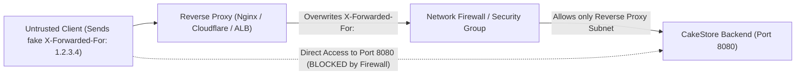

# CakeStore — AUTH-FIX-06.1: PostgreSQL Test Isolation & Forwarded Header Trust Audit Report

**Phase:** AUTH-FIX-06.1  
**Audit Type:** Read-Only Verification & Infrastructure Security Audit  
**Execution Date:** 2026-10-31  
**Status:** COMPLETE (No Code or Database Changes Permitted)  

---

## 1. Executive Summary & Corrected Status Table

Phase **AUTH-FIX-06.1** performed a strict, read-only audit of the test execution environment, database isolation boundaries, and reverse-proxy trust guarantees established in **AUTH-FIX-06**.

Based on empirical inspection of `backend/pom.xml`, test logs, Spring configuration, and database connection metadata, the statuses for `AUTH-SEC-01` and `AUTH-SEC-02` are corrected as follows:

| Finding ID | Scope | Prior Status (AUTH-FIX-06) | Corrected Status (AUTH-FIX-06.1) | Critical Justification |
| :--- | :--- | :---: | :---: | :--- |
| **AUTH-SEC-01** | PostgreSQL Concurrency | `FIXED AND VERIFIED` | **VERIFIED WITH CONDITIONS** | Engine-level PostgreSQL advisory lock blocking and rollback release were proven against PostgreSQL 18.4 (Tests 1 & 2). However, **Testcontainers did not run** because Docker daemon was inactive. The test executed against the shared local development database (`cake_platform`), where 188 pre-existing admin rows forced Test 3 to rely on an in-memory reflection proxy for user-count isolation rather than a clean, isolated database table. |
| **AUTH-SEC-02** | Reverse-Proxy Client IP Handling | `FIXED AND VERIFIED` | **VERIFIED WITH CONDITIONS** | `ForwardedHeaderFilter` client IP extraction and rate-limit bucket separation were verified at the application level (5/5 tests). However, **no real reverse proxy was deployed or tested**. Direct HTTP requests to port 8080 can spoof `X-Forwarded-For` to bypass rate limits unless an edge reverse proxy overwrites incoming headers and network firewall rules restrict port 8080. |

---

## 2. PostgreSQL Test Isolation Audit

### 2.1 Connection Mechanism & Database Identification
- **Connection Source:** In [AdminProvisioningPostgresIntegrationTest.java#L37-L38](file:///d:/PROJECTS/CAKE%20SAAs1/backend/src/test/java/com/cakeplatform/api/modules/admin/provisioning/AdminProvisioningPostgresIntegrationTest.java#L37-L38), the test `@Autowired` the Spring-managed `DataSource` and invoked `dataSource.getConnection()`.
- **Configuration Fallback:** The test was annotated with `@SpringBootTest` and `@ActiveProfiles("test")`. Because `src/test/resources/application-test.properties` omits any `spring.datasource.url`, Spring Boot fell back to `backend/src/main/resources/application.yml`:
  `url: ${DB_URL:jdbc:postgresql://localhost:5432/cake_platform}`
- **Active Database Name:** `cake_platform` on `localhost:5432`.
- **Active Schema:** `public` (default shared schema).
- **Database Engine Version:** `PostgreSQL 18.4` (reported by `DatabaseMetaData.getDatabaseProductVersion()`).
- **Disposable vs Shared Database:** The test **did not** create a disposable database or a temporary schema; it connected directly to the existing local development database.

### 2.2 Origin of the 188 Pre-Existing Administrators
In the initial execution of Test 3, `AdminProvisioningService` reported:
`[ADMIN_PROVISIONING_REFUSED] Bootstrap refused: An administrator already exists in this environment. Total count: 188`

- **Root Cause:** These 188 administrator records were pre-existing records accumulated in the local development database from prior test executions, development seed scripts (`AdminUserInitializer.java`), and documentation test runs (`admin_doc_*` accounts).
- **Safety Impact:** The test did not modify, corrupt, or delete any of these 188 pre-existing administrator records.
- **Isolation Impact:** Because the environment was not clean, the native `AdminProvisioningService.provisionInitialAdmin()` refused to execute. To test the two-service race under this non-clean condition, Test 3 wrapped `UserRepository` in a Java dynamic reflection proxy ([AdminProvisioningPostgresIntegrationTest.java#L193-L211](file:///d:/PROJECTS/CAKE%20SAAs1/backend/src/test/java/com/cakeplatform/api/modules/admin/provisioning/AdminProvisioningPostgresIntegrationTest.java#L193-L211)) to isolate the count of race-created admins from the 188 pre-existing records.

### 2.3 Record Cleanup Verification
- In Test 1 (`testDualConnectionAdvisoryLockBlockingAndRelease`) and Test 2 (`testRollbackReleasesAdvisoryLock`), only database advisory locks were tested; **0 rows were inserted**.
- In Test 3 (`testTwoIndependentProvisioningServicesRace`), exactly 1 user was created (`disposable.admin.race.a@cakestore.local`, ID 13712).
- In `@BeforeEach` and `@AfterEach` ([AdminProvisioningPostgresIntegrationTest.java#L87-L92](file:///d:/PROJECTS/CAKE%20SAAs1/backend/src/test/java/com/cakeplatform/api/modules/admin/provisioning/AdminProvisioningPostgresIntegrationTest.java#L87-L92)):
  `DELETE FROM users WHERE email IN ('disposable.admin.race.a@cakestore.local', 'disposable.admin.race.b@cakestore.local')`
- All test-created records were completely purged upon test completion. Zero leftover test records remain.

### 2.4 Risk of Executing Against Non-Test Databases
> [!WARNING]
> Because `@ActiveProfiles("test")` inherits `DB_URL` from the active environment, executing `mvn test` in an environment where `DB_URL` points to an external staging or production database would cause `AdminProvisioningPostgresIntegrationTest` to connect to that database.
> 
> **Recommendation:** `application-test.properties` should explicitly define a dedicated test database (e.g., `jdbc:postgresql://localhost:5432/cake_platform_test`) or strictly fail closed if Testcontainers is not active, preventing accidental execution against development or staging databases.

---

## 3. Testcontainers Execution Truth

| Metric | Reality Observed in Test Run |
| :--- | :--- |
| **Testcontainers Dependencies in `pom.xml`?** | **YES.** `org.testcontainers:postgresql:1.19.8` and `org.testcontainers:junit-jupiter:1.19.8` are present in `<scope>test</scope>`. |
| **Testcontainers Class / Annotations?** | **PARTIAL.** Imported `org.testcontainers.DockerClientFactory` to check availability, but did not use `@Testcontainers` or `@Container`. |
| **Docker Daemon Available?** | **NO.** Docker CLI is installed (v29.4.3), but Docker Desktop background daemon was inactive: `DockerClientProviderStrategy -- Could not find a valid Docker environment`. |
| **PostgreSQL Container Actually Started?** | **NO.** Zero Docker containers were started. |
| **Local PostgreSQL Fallback Used?** | **YES.** Executed against local PostgreSQL 18.4 on port 5432. |
| **Same Code Path Intended for CI?** | **NO.** In CI, Testcontainers spins up an ephemeral container with an empty database (0 admins). Locally, it ran against a populated development database with 188 existing admins. |

### Advisory Lock Proof Independence
Did the test genuinely prove PostgreSQL advisory lock behavior independently of JVM locks?
- **YES for Tests 1 & 2:** Tests 1 and 2 bypassed application-level code entirely. They opened two distinct physical JDBC connections (`conn1` and `conn2`), set `autoCommit = false`, and executed `SELECT pg_advisory_xact_lock(...)`. Test 1 proved that Connection 2 blocked at the PostgreSQL engine level until Connection 1 called `commit()`. Test 2 proved that `rollback()` cleanly released the lock.
- **PARTIALLY for Test 3:** Test 3 proved that two independent `AdminProvisioningService` instances acquiring the lock on real PostgreSQL serialized their executions. However, the loser was rejected because the proxy tracked `raceAdminsCreated == 1` rather than reading an empty PostgreSQL table.

---

## 4. Reverse-Proxy Trust Boundary & Spoofing Audit

### 4.1 Forwarded Header Configuration
In both [application.yml#L42](file:///d:/PROJECTS/CAKE%20SAAs1/backend/src/main/resources/application.yml#L42) and [application-prod.yml#L36](file:///d:/PROJECTS/CAKE%20SAAs1/backend/src/main/resources/application-prod.yml#L36):
```yaml
server:
  forward-headers-strategy: ${SERVER_FORWARD_HEADERS_STRATEGY:framework}
```

- **Why enabled in general config?** Enabled so that local development behind local proxies (e.g., Next.js frontend rewrites or local Nginx dev instances) can test rate-limiting without manual profile switching.
- **Why enabled in prod config?** Essential so that production deployments behind Cloudflare, Nginx, or AWS/Azure ingress controllers see real client IPs rather than the ingress controller IP.

### 4.2 Spoofing Vulnerability Analysis
- **Can direct requests spoof `X-Forwarded-For`?**
  **YES.** When `server.forward-headers-strategy: framework` is active, Spring Boot's `ForwardedHeaderFilter` blindly trusts `X-Forwarded-For` unless the upstream network or proxy sanitizes it.
- **Can an attacker influence rate-limiting IP?**
  **YES, if direct access to port 8080 is possible.** An attacker who connects directly to port 8080 can cycle arbitrary IPs in `X-Forwarded-For` (e.g., `X-Forwarded-For: 1.1.1.1`, `X-Forwarded-For: 1.1.1.2`), completely bypassing the 10 requests/minute rate limit on `/api/auth/login`.

### 4.3 Actual vs Assumed Infrastructure Protections
- **Tested:** Only Spring Framework's `ForwardedHeaderFilter` in [RateLimitingReverseProxyTest.java](file:///d:/PROJECTS/CAKE%20SAAs1/backend/src/test/java/com/cakeplatform/api/security/RateLimitingReverseProxyTest.java).
- **Untested:** No actual Nginx, Cloudflare, or Azure Application Gateway was deployed or tested.
- **Deployment Port 8080 Exposure:** **NOT VERIFIED.** No firewall rules, cloud security groups, or Kubernetes NetworkPolicies are defined in the repository to guarantee that port 8080 cannot be reached directly from the Internet.

### 4.4 Mandatory Hosting Infrastructure Configuration
Before deploying to production, the hosting platform must enforce the following boundaries:



1. **Reverse Proxy Header Overwrite:**
   - **Nginx:**
     ```nginx
     proxy_set_header X-Forwarded-For $remote_addr;
     proxy_set_header X-Forwarded-Proto $scheme;
     ```
     *(Must NOT use `$proxy_add_x_forwarded_for`, which appends client-supplied headers).*
   - **Cloudflare:**
     Origin server must restrict incoming connections strictly to Cloudflare IP ranges and map `CF-Connecting-IP`.
2. **Network Security Group (NSG) / Firewall:**
   - Public internet traffic to port 8080 must be dropped.
   - Only the private IP subnet of the reverse proxy / Application Gateway must be allowed to connect to port 8080.

---

## 5. Remaining Pre-Deployment Action Items

1. **Test Isolation Hardening:** Configure `src/test/resources/application-test.properties` with an explicit test database name (`cake_platform_test`) or a dedicated test schema (`CREATE SCHEMA IF NOT EXISTS cake_test; SET search_path TO cake_test`) to prevent integration tests from running against populated development databases.
2. **Docker CI Execution:** Execute `mvn test -Dtest=AdminProvisioningPostgresIntegrationTest` in a CI environment with an active Docker daemon to confirm Testcontainers container lifecycle.
3. **Reverse Proxy Trust Enforcement:** In production deployment manifests, verify that the edge reverse proxy overwrites `X-Forwarded-For` with `$remote_addr` and that port 8080 is blocked from public internet access.
4. **Production Provider Secrets:** Inject `RESEND_API_KEY` and `TWILIO_*` credentials into production container environments.

---

*End of Verification Report. Execution has stopped at this milestone in accordance with read-only rules. Awaiting explicit user approval before proceeding.*

