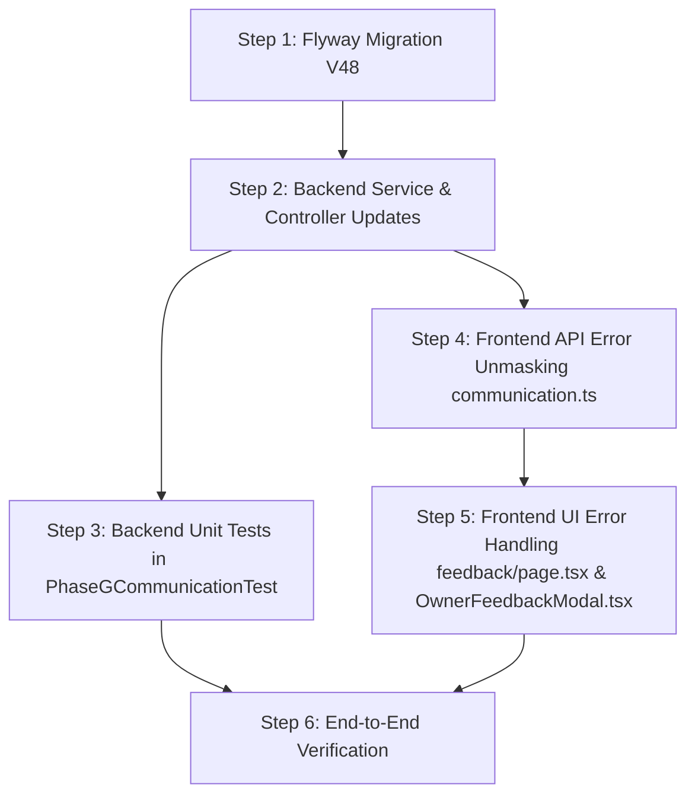

# CakeStore Communication Audit — Phase 1 Repair Plan (Platform Feedback Only)

**Date:** 2026-10-16  
**Document Type:** Pre-Implementation Repair Plan (Strictly Planning Only — No Code/Data Modifications)  
**Scope:** Platform Feedback tab (`/admin/feedback`) & Owner Feedback Modal (`OwnerFeedbackModal.tsx`)  
**Source Findings:** COM-FB-V01, COM-FB-V02, COM-FB-V03, COM-FB-V04 from `CAKESTORE_ADMIN_COMMUNICATION_GAP_VERIFICATION.md`

---

## 1. Executive Summary & Verification Matrix

| Finding ID | Title | Verified Status | Root Cause Layer | Severity |
|---|---|---|---|---|
| **COM-FB-V01** | `platform_feedback` entity/migration schema mismatch | **Confirmed Defect** | Database Flyway Migrations | **Critical** |
| **COM-FB-V02** | `replyToFeedback` error suppression and false success | **Confirmed Defect** | Frontend API Client & Backend Transaction Boundary | **High** |
| **COM-FB-V03** | `submitPlatformFeedback` fabricates success on 404/500 | **Confirmed Defect** | Frontend API Client (`communication.ts`) | **Medium** |
| **COM-FB-V04** | Communication actions omit `ActivityLoggerService` | **Confirmed Defect** | Backend Service (`PlatformFeedbackService`) | **Low** |

### Clarification of Unverified Claims vs. Confirmed Facts

1. **Database Schema Claim:**
   - *Confirmed:* Columns `admin_reply` and `replied_at` exist in entity [`PlatformFeedback.java`](file:///d:/PROJECTS/CAKE%20SAAs1/backend/src/main/java/com/cakeplatform/api/modules/communication/PlatformFeedback.java#L51-L54) but were **never created** in Flyway migrations (V1 through V47).
   - *Impact on Fresh Database:* `mvn clean test` or spinning up a fresh database with `spring.jpa.hibernate.ddl-auto: validate` fails on startup with `SchemaManagementException: Schema-validation: missing column [admin_reply] in table [platform_feedback]`.
   - *Impact on Existing Database:* Calling `replyToFeedback` fails at runtime with PostgreSQL error `column "admin_reply" of relation "platform_feedback" does not exist`.

2. **Audit Logging Claim:**
   - *Confirmed:* A global audit logging system already exists in the project ([`ActivityLoggerService.java`](file:///d:/PROJECTS/CAKE%20SAAs1/backend/src/main/java/com/cakeplatform/api/modules/audit/ActivityLoggerService.java#L9) and table `activity_logs`). There is no need to invent a new audit system or table.
   - *Action:* `PlatformFeedbackService` simply needs to inject `ActivityLoggerService` and call `activityLogger.logActivity(...)` on mark-read and reply operations.

---

## 2. Detailed Finding Analysis

### Finding COM-FB-V01: `platform_feedback` Entity / Migration Schema Mismatch

#### Affected Files
- Entity: [`backend/src/main/java/com/cakeplatform/api/modules/communication/PlatformFeedback.java`](file:///d:/PROJECTS/CAKE%20SAAs1/backend/src/main/java/com/cakeplatform/api/modules/communication/PlatformFeedback.java#L51-L54)
- Existing Migration: [`backend/src/main/resources/db/migration/V10__communication_and_admin_notifications.sql`](file:///d:/PROJECTS/CAKE%20SAAs1/backend/src/main/resources/db/migration/V10__communication_and_admin_notifications.sql#L7-L17)
- Comparison Reference: [`backend/src/main/resources/db/migration/V40__add_admin_reply_to_contact_enquiries.sql`](file:///d:/PROJECTS/CAKE%20SAAs1/backend/src/main/resources/db/migration/V40__add_admin_reply_to_contact_enquiries.sql#L1-L5)
- Configuration: [`backend/src/main/resources/application.yml`](file:///d:/PROJECTS/CAKE%20SAAs1/backend/src/main/resources/application.yml#L19) (`ddl-auto: validate`)

#### Root Cause
In `V10`, table `platform_feedback` was created with initial submission fields. Later, when admin reply capability was added to the data model, `admin_reply TEXT` and `replied_at TIMESTAMP` columns were added only to `contact_enquiries` via migration `V40`. `platform_feedback` was inadvertently missed. Because `application.yml` enforces Hibernate validation (`ddl-auto: validate`), any fresh application launch fails schema validation, and any runtime update fails in PostgreSQL.

#### Impact
- Production deployments against standard Flyway schema cannot start if `ddl-auto: validate` is enabled.
- If launched with validation bypassed, every admin reply to owner feedback throws an SQL exception upon `feedbackRepository.save(feedback)`.

---

### Finding COM-FB-V02: `replyToFeedback` Error Suppression & False Success Toast

#### Affected Files
- Frontend API Client: [`frontend_v2/lib/api/communication.ts`](file:///d:/PROJECTS/CAKE%20SAAs1/frontend_v2/lib/api/communication.ts#L119-L128)
- Frontend Admin Page: [`frontend_v2/app/admin/feedback/page.tsx`](file:///d:/PROJECTS/CAKE%20SAAs1/frontend_v2/app/admin/feedback/page.tsx#L96-L115)
- Backend Service: [`backend/src/main/java/com/cakeplatform/api/modules/communication/PlatformFeedbackService.java`](file:///d:/PROJECTS/CAKE%20SAAs1/backend/src/main/java/com/cakeplatform/api/modules/communication/PlatformFeedbackService.java#L120-L140)

#### Root Cause
Two compounding defects exist across the frontend and backend:
1. **Frontend Error Suppression:** `communicationApi.replyToFeedback` catches HTTP 404 and HTTP 500 errors and suppresses them (`if (err?.status !== 404 && err?.status !== 500) throw err;`). It logs a console warning and resolves the promise cleanly.
2. **UI Premature Success State:** `AdminPlatformFeedbackPage.handleSendReply` awaits the resolved promise, executes `toast.success('Reply sent successfully')`, clears the admin's draft from the textarea (`setReplyText('')`), and closes the reply box. When `fetchFeedback()` runs, the reply is absent and the item remains unread.
3. **Backend Transaction Fragility:** In `PlatformFeedbackService.replyToFeedback`, `emailService.sendEmail(...)` is invoked without a `try-catch` block inside an `@Transactional` method. If email dispatch throws an exception, the entire database transaction rolls back, undoing `feedback.setAdminReply(...)` and `feedback.setIsRead(true)`.

#### Impact
Administrators are misled into believing their replies were successfully sent and recorded, while drafts are wiped and responses are silently discarded.

---

### Finding COM-FB-V03: `submitPlatformFeedback` Fabricates Success on 404/500

#### Affected Files
- Frontend API Client: [`frontend_v2/lib/api/communication.ts`](file:///d:/PROJECTS/CAKE%20SAAs1/frontend_v2/lib/api/communication.ts#L15-L25)
- Frontend Modal Component: [`frontend_v2/components/owner/OwnerFeedbackModal.tsx`](file:///d:/PROJECTS/CAKE%20SAAs1/frontend_v2/components/owner/OwnerFeedbackModal.tsx#L53-L64)

#### Root Cause
In `frontend_v2/lib/api/communication.ts`:
```ts
async submitPlatformFeedback(payload: CreatePlatformFeedbackPayload): Promise<{ success: boolean; message: string }> {
  try {
    return await apiClient.post<{ success: boolean; message: string }>('/api/owner/feedback', payload);
  } catch (err: any) {
    // If backend endpoint is not yet mounted, gracefully acknowledge receipt for UI refinement
    if (err?.status === 404 || err?.status === 500) {
      return { success: true, message: 'Feedback received by CakeStore team' };
    }
    throw err;
  }
}
```
Leftover development scaffolding intercepts real server outages (500) or missing routes (404) and fabricates `{ success: true }`. `OwnerFeedbackModal` receives success, switches to `isSubmitted = true`, and presents a "Thank You for Your Feedback!" screen.

#### Impact
Bakery owners believe their operational complaints, payment issues, or bug reports were delivered, while the payload was dropped on the floor.

---

### Finding COM-FB-V04: Communication Actions Omit `ActivityLoggerService`

#### Affected Files
- Backend Controller: [`backend/src/main/java/com/cakeplatform/api/modules/communication/controller/AdminCommunicationController.java`](file:///d:/PROJECTS/CAKE%20SAAs1/backend/src/main/java/com/cakeplatform/api/modules/communication/controller/AdminCommunicationController.java#L38-L43,L63-L68)
- Backend Service: [`backend/src/main/java/com/cakeplatform/api/modules/communication/PlatformFeedbackService.java`](file:///d:/PROJECTS/CAKE%20SAAs1/backend/src/main/java/com/cakeplatform/api/modules/communication/PlatformFeedbackService.java#L120-L150)
- Existing Audit Service: [`backend/src/main/java/com/cakeplatform/api/modules/audit/ActivityLoggerService.java`](file:///d:/PROJECTS/CAKE%20SAAs1/backend/src/main/java/com/cakeplatform/api/modules/audit/ActivityLoggerService.java#L14)

#### Root Cause
`AdminCommunicationController` endpoints do not extract `@AuthenticationPrincipal CustomUserDetails userDetails`, and `PlatformFeedbackService` does not inject `ActivityLoggerService`. Consequently, admin moderation actions (`markAsRead`, `replyToFeedback`) generate no entries in `activity_logs`.

#### Impact
Admin actions cannot be audited in compliance reports or viewed in `/api/admin/dashboard/stats/activity`.

---

## 3. Minimal Safe Proposed Corrections

### Correction 1 (COM-FB-V01): Add Flyway Migration `V48`
- **New File:** `backend/src/main/resources/db/migration/V48__add_admin_reply_to_platform_feedback.sql`
- **Content:**
  ```sql
  -- Add missing columns to platform_feedback for admin reply functionality
  ALTER TABLE platform_feedback
      ADD COLUMN IF NOT EXISTS admin_reply TEXT,
      ADD COLUMN IF NOT EXISTS replied_at TIMESTAMP;
  ```
- **Rationale:** Strictly aligns the database schema with JPA entity `PlatformFeedback.java` lines 51–54. Idempotent and non-destructive.

---

### Correction 2 (COM-FB-V02): Robust Backend Reply Persistence & Frontend Error Propagation

#### Part A: Backend Service Safe Failure Isolation
- **File:** `backend/src/main/java/com/cakeplatform/api/modules/communication/PlatformFeedbackService.java`
- **Proposed Logic in `replyToFeedback(Long id, String replyMessage, Long adminUserId)`:**
  1. Look up `feedback` by ID (throws 404 if not found).
  2. Persist database updates first:
     ```java
     feedback.setAdminReply(replyMessage.trim());
     feedback.setRepliedAt(LocalDateTime.now());
     feedback.setIsRead(true);
     PlatformFeedback saved = feedbackRepository.save(feedback);
     ```
  3. Dispatch email inside safe `try-catch` isolation (matching `submitFeedback` lines 98–102):
     ```java
     try {
         String targetEmail = feedback.getOwnerEmail();
         if (targetEmail == null && feedback.getShop() != null && feedback.getShop().getOwner() != null) {
             targetEmail = feedback.getShop().getOwner().getEmail();
         }
         if (targetEmail != null && !targetEmail.trim().isEmpty()) {
             emailService.sendEmail(
                 targetEmail,
                 "Re: [CakeStore Feedback] " + feedback.getCategory(),
                 replyMessage.trim()
             );
         }
     } catch (Exception ex) {
         log.error("Failed to dispatch reply email for feedback ID {}: {}", id, ex.getMessage());
     }
     ```
  4. Write audit log (Correction 4).
  5. Return safely. Database record is guaranteed saved regardless of SMTP/network errors.

#### Part B: Frontend API Error Propagation
- **File:** `frontend_v2/lib/api/communication.ts`
- **Proposed Logic in `replyToFeedback`:**
  ```ts
  async replyToFeedback(id: string | number, message: string): Promise<void> {
    await apiClient.post(`/api/admin/feedback/${id}/reply`, { message });
  }
  ```
  *(Remove the try-catch block that swallows 404 and 500 errors. Allow true network/server errors to reject the promise.)*

#### Part C: Frontend UI Error Handling
- **File:** `frontend_v2/app/admin/feedback/page.tsx`
- **Proposed Logic in `handleSendReply`:**
  ```tsx
  try {
    setIsSending(true);
    await communicationApi.replyToFeedback(selectedFeedback.id, replyText);
    toast.success('Reply sent successfully');
    setReplyText('');
    setIsReplying(false);
    fetchFeedback();
  } catch (error: any) {
    const errorMsg = error?.response?.data?.message || error?.message || 'Failed to send reply';
    toast.error(errorMsg);
    // Do NOT wipe replyText or close reply box, allowing admin to retry
  } finally {
    setIsSending(false);
  }
  ```

---

### Correction 3 (COM-FB-V03): Remove Fake Success in `submitPlatformFeedback`
- **File:** `frontend_v2/lib/api/communication.ts`
- **Proposed Logic in `submitPlatformFeedback`:**
  ```ts
  async submitPlatformFeedback(payload: CreatePlatformFeedbackPayload): Promise<{ success: boolean; message: string }> {
    return await apiClient.post<{ success: boolean; message: string }>('/api/owner/feedback', payload);
  }
  ```
  *(Remove fallback `{ success: true, message: 'Feedback received by CakeStore team' }`. Let real errors propagate to `OwnerFeedbackModal.tsx` so `setErrorMsg(...)` is invoked and the owner is notified to retry.)*

---

### Correction 4 (COM-FB-V04): Wire `ActivityLoggerService` into Feedback Actions
- **File:** `backend/src/main/java/com/cakeplatform/api/modules/communication/controller/AdminCommunicationController.java`:
  - Add `@AuthenticationPrincipal CustomUserDetails userDetails` to `markFeedbackRead` and `replyToFeedback`.
  - Pass `userDetails.getId()` to service calls.
- **File:** `backend/src/main/java/com/cakeplatform/api/modules/communication/PlatformFeedbackService.java`:
  - Inject `private final ActivityLoggerService activityLogger;`
  - In `replyToFeedback`:
    ```java
    if (activityLogger != null && adminUserId != null) {
        activityLogger.logActivity(
            adminUserId,
            feedback.getShopId(),
            "PLATFORM_FEEDBACK_REPLIED",
            "PLATFORM_FEEDBACK",
            feedback.getId(),
            String.format("Admin replied to %s feedback (#%d)", feedback.getCategory(), feedback.getId())
        );
    }
    ```
  - In `markAsRead`:
    ```java
    if (activityLogger != null && adminUserId != null) {
        activityLogger.logActivity(
            adminUserId,
            feedback.getShopId(),
            "PLATFORM_FEEDBACK_READ",
            "PLATFORM_FEEDBACK",
            feedback.getId(),
            "Admin marked feedback as read"
        );
    }
    ```

---

## 4. Migration & Rollback Considerations

1. **Migration Safety:**
   - Migration file name: `V48__add_admin_reply_to_platform_feedback.sql`.
   - Uses `ALTER TABLE platform_feedback ADD COLUMN IF NOT EXISTS ...`.
   - Both columns (`admin_reply TEXT`, `replied_at TIMESTAMP`) are nullable. No default values or locks on large tables are required. Zero downtime.
2. **Rollback Strategy:**
   - In PostgreSQL, if rollback is needed:
     ```sql
     ALTER TABLE platform_feedback DROP COLUMN IF EXISTS admin_reply;
     ALTER TABLE platform_feedback DROP COLUMN IF EXISTS replied_at;
     DELETE FROM flyway_schema_history WHERE version = '48';
     ```
3. **Hibernate Compatibility:**
   - With `ddl-auto: validate`, applying `V48` satisfies the entity validation requirements of `PlatformFeedback.java` without requiring any Java entity modifications.

---

## 5. Required Automated Tests

### Backend Unit & Integration Tests
Target File: `backend/src/test/java/com/cakeplatform/api/modules/communication/PhaseGCommunicationTest.java`

1. **`testReplyToFeedback_Success()`:**
   - Mock `feedbackRepository.findById(101L)` returning feedback with `isRead=false`.
   - Invoke `feedbackService.replyToFeedback(101L, "Thank you for the suggestion!", 1L)`.
   - Assert `feedback.getAdminReply()` equals `"Thank you for the suggestion!"`.
   - Assert `feedback.getRepliedAt()` is not null.
   - Assert `feedback.getIsRead()` is true.
   - Verify `feedbackRepository.save(feedback)` was called.
   - Verify `activityLogger.logActivity(eq(1L), ..., eq("PLATFORM_FEEDBACK_REPLIED"), ...)` was called.
   - Verify `emailService.sendEmail(...)` was called.

2. **`testReplyToFeedback_EmailFailureIsolated()`:**
   - Configure `doThrow(new RuntimeException("Resend API down")).when(emailService).sendEmail(any(), any(), any())`.
   - Invoke `feedbackService.replyToFeedback(101L, "We deployed a fix", 1L)`.
   - Assert execution completes without throwing an exception.
   - Assert `feedback.getAdminReply()` is updated and `feedbackRepository.save(feedback)` is still executed.

3. **`testMarkFeedbackRead_AuditLogged()`:**
   - Invoke `feedbackService.markAsRead(101L, 1L)`.
   - Assert `feedback.getIsRead()` is true.
   - Verify `activityLogger.logActivity(eq(1L), ..., eq("PLATFORM_FEEDBACK_READ"), ...)` was called.

4. **`testAdminCommunicationController_ReplyEndpoint()`:**
   - Test `adminCommunicationController.replyToFeedback(101L, new AdminReplyRequest("Noted"), adminUserDetails)`.
   - Assert returns HTTP 200 with map containing `"message": "Reply sent successfully"`.

### Frontend Jest / Integration Tests
Target File: `frontend_v2/__tests__/platformFeedbackClient.test.ts` (to be created)

1. **`testSubmitPlatformFeedback_PropagatesError()`:**
   - Mock `apiClient.post` throwing HTTP 500.
   - Assert `communicationApi.submitPlatformFeedback(...)` rejects with error and does NOT return fake `{ success: true }`.

2. **`testReplyToFeedback_PropagatesError()`:**
   - Mock `apiClient.post` throwing HTTP 500.
   - Assert `communicationApi.replyToFeedback(...)` rejects with error.

3. **`testAdminFeedbackPage_PreservesDraftOnError()`:**
   - Mock reply failure in component test.
   - Verify error toast is called, reply text is not cleared, and reply form remains open.

---

## 6. Execution Order & Dependencies



1. **Phase 1.1:** Add `V48__add_admin_reply_to_platform_feedback.sql`.
2. **Phase 1.2:** Update `PlatformFeedbackService.java` (safe failure isolation for email + `ActivityLoggerService` call).
3. **Phase 1.3:** Update `AdminCommunicationController.java` to inject `@AuthenticationPrincipal CustomUserDetails`.
4. **Phase 1.4:** Update `PhaseGCommunicationTest.java` with regression tests.
5. **Phase 1.5:** Update `frontend_v2/lib/api/communication.ts` to remove 404/500 swallowing on `submitPlatformFeedback` and `replyToFeedback`.
6. **Phase 1.6:** Update `frontend_v2/app/admin/feedback/page.tsx` to handle errors properly without clearing drafts.
7. **Phase 1.7:** Update `frontend_v2/components/owner/OwnerFeedbackModal.tsx` to display true server errors.

---
*End of Phase 1 Repair Plan. Ready for review and execution approval.*
