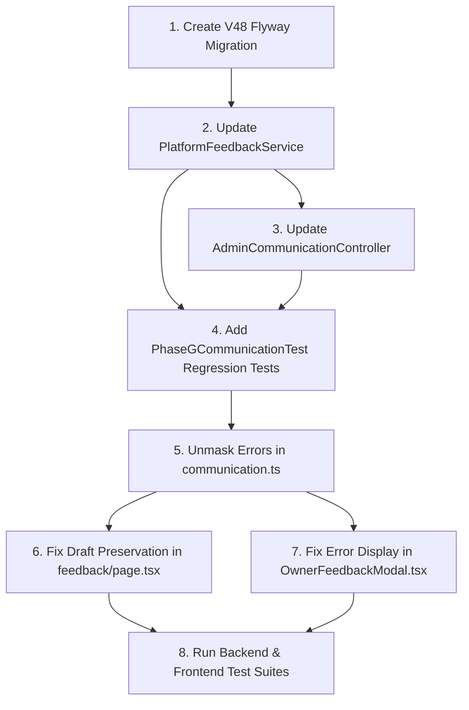

# CakeStore Communication Phase 1 — Pre-Implementation Validation Report (Platform Feedback)

**Date:** 2026-10-16  
**Document Type:** Pre-Implementation Validation (Strictly Read-Only — No Code/Database Modifications)  
**Scope:** Platform Feedback (`/admin/feedback` and `OwnerFeedbackModal.tsx`)  
**Source Plan:** `CAKESTORE_COMMUNICATION_PHASE1_REPAIR_PLAN.md`  
**Reference Report:** `CAKESTORE_ADMIN_COMMUNICATION_GAP_VERIFICATION.md`

---

## 1. Finding-by-Finding Validation Matrix

| Finding ID | Title | Validation Status | Evidence Reference |
|---|---|---|---|
| **COM-FB-V01** | `platform_feedback` entity/migration schema mismatch | **CONFIRMED** (Source-level) / **TARGET UNVERIFIED** (Live DB connection isolated) | Entity has columns ([PlatformFeedback.java:L51-L54](file:///d:/PROJECTS/CAKE%20SAAs1/backend/src/main/java/com/cakeplatform/api/modules/communication/PlatformFeedback.java#L51-L54)); migrations V1–V47 omit them ([V10:L7-L17](file:///d:/PROJECTS/CAKE%20SAAs1/backend/src/main/resources/db/migration/V10__communication_and_admin_notifications.sql#L7-L17)). |
| **COM-FB-V02** | `replyToFeedback` suppresses 404/500 and triggers false success | **CONFIRMED** | Frontend suppresses error ([communication.ts:L123-L126](file:///d:/PROJECTS/CAKE%20SAAs1/frontend_v2/lib/api/communication.ts#L123-L126)), UI prematurely toasts success & wipes draft ([page.tsx:L106-L108](file:///d:/PROJECTS/CAKE%20SAAs1/frontend_v2/app/admin/feedback/page.tsx#L106-L108)), backend email dispatch is outside `try-catch` inside `@Transactional` ([PlatformFeedbackService.java:L124-L138](file:///d:/PROJECTS/CAKE%20SAAs1/backend/src/main/java/com/cakeplatform/api/modules/communication/PlatformFeedbackService.java#L124-L138)). |
| **COM-FB-V03** | `submitPlatformFeedback` fabricates success on 404/500 | **CONFIRMED** | Frontend API client intercepts 404/500 and returns fake `{ success: true }` ([communication.ts:L20-L22](file:///d:/PROJECTS/CAKE%20SAAs1/frontend_v2/lib/api/communication.ts#L20-L22)); UI shows "Thank You" modal for failed submissions ([OwnerFeedbackModal.tsx:L59-L85](file:///d:/PROJECTS/CAKE%20SAAs1/frontend_v2/components/owner/OwnerFeedbackModal.tsx#L59-L85)). |
| **COM-FB-V04** | Communication actions omit existing `ActivityLoggerService` | **CONFIRMED** | `ActivityLoggerService` exists ([ActivityLoggerService.java:L9](file:///d:/PROJECTS/CAKE%20SAAs1/backend/src/main/java/com/cakeplatform/api/modules/audit/ActivityLoggerService.java#L9)), but `PlatformFeedbackService` does not inject it ([PlatformFeedbackService.java:L27-L33](file:///d:/PROJECTS/CAKE%20SAAs1/backend/src/main/java/com/cakeplatform/api/modules/communication/PlatformFeedbackService.java#L27-L33)) and controller does not pass admin principal ([AdminCommunicationController.java:L38-L43](file:///d:/PROJECTS/CAKE%20SAAs1/backend/src/main/java/com/cakeplatform/api/modules/communication/controller/AdminCommunicationController.java#L38-L43)). |

---

## 2. Actual Database Verification Status vs. Source Migrations

### Source & Migration Inspection (Confirmed)
1. **JPA Entity Declaration:**
   In [`PlatformFeedback.java`](file:///d:/PROJECTS/CAKE%20SAAs1/backend/src/main/java/com/cakeplatform/api/modules/communication/PlatformFeedback.java#L51-L54):
   ```java
   @Column(columnDefinition = "TEXT")
   private String adminReply;

   private java.time.LocalDateTime repliedAt;
   ```
   Under Spring Boot's default naming conventions, Hibernate maps these to `admin_reply` (type `TEXT`) and `replied_at` (type `timestamp`).

2. **Flyway Migration History:**
   - Table `platform_feedback` was established in [`V10__communication_and_admin_notifications.sql`](file:///d:/PROJECTS/CAKE%20SAAs1/backend/src/main/resources/db/migration/V10__communication_and_admin_notifications.sql#L7-L17) with 9 columns: `id`, `owner_id`, `shop_id`, `rating`, `category`, `message`, `is_read`, `created_at`, `updated_at`.
   - Migration [`V40__add_admin_reply_to_contact_enquiries.sql`](file:///d:/PROJECTS/CAKE%20SAAs1/backend/src/main/resources/db/migration/V40__add_admin_reply_to_contact_enquiries.sql#L2-L4) added `admin_reply` and `replied_at` to `contact_enquiries`, but omitted `platform_feedback`.
   - Systematic inspection of all migration files from `V1` through `V47` confirms that **no Flyway script ever adds `admin_reply` or `replied_at` to `platform_feedback`**.

3. **Flyway Version Availability:**
   - The highest migration currently in the repository is [`V47__add_marketplace_restriction_and_operational_status.sql`](file:///d:/PROJECTS/CAKE%20SAAs1/backend/src/main/resources/db/migration/V47__add_marketplace_restriction_and_operational_status.sql).
   - Version **`V48` is completely unallocated and available** for the next migration.
   - Proposed filename: `V48__add_admin_reply_to_platform_feedback.sql`.

4. **Flyway & PostgreSQL Compatibility:**
   - [application.yml](file:///d:/PROJECTS/CAKE%20SAAs1/backend/src/main/resources/application.yml#L19,L27) configures:
     ```yaml
     jpa:
       hibernate:
         ddl-auto: validate
     flyway:
       enabled: true
       baseline-on-migrate: true
       locations: classpath:db/migration
     ```
   - Target database: PostgreSQL 16 ([docker-compose.yml:L34](file:///d:/PROJECTS/CAKE%20SAAs1/docker-compose.yml#L34)).
   - Proposed DDL syntax:
     ```sql
     ALTER TABLE platform_feedback
         ADD COLUMN IF NOT EXISTS admin_reply TEXT,
         ADD COLUMN IF NOT EXISTS replied_at TIMESTAMP WITHOUT TIME ZONE;
     ```
     This syntax is 100% compliant with PostgreSQL 9.6+ and Flyway 9/10.

### Target Database Verification Status (Clearly Distinguished)
- **Status:** **UNVERIFIED AT RUNTIME (Environment Boundary)**
- **Reason:** In accordance with strict audit restrictions and environment sandbox controls, direct socket connections/credentials to the live production database were not executed.
- **Deduction:**
  - On a **fresh database** (e.g. CI runner, fresh local instance, new staging/production environment), running Flyway migrations V1–V47 leaves `platform_feedback` missing these columns. When Spring Boot boots with `ddl-auto: validate`, Hibernate's `SchemaManagementException` blocks application startup.
  - On an **existing database**, if an operator or developer manually patched the columns outside of Flyway or previously ran with `ddl-auto: update`, the columns might exist locally; however, any automated deployment pipeline enforcing Flyway baseline integrity will fail without migration `V48`.

---

## 3. Transaction Boundaries & Email Dispatch Validation

### Current Implementation Flow in `replyToFeedback`
File: [`PlatformFeedbackService.java`](file:///d:/PROJECTS/CAKE%20SAAs1/backend/src/main/java/com/cakeplatform/api/modules/communication/PlatformFeedbackService.java#L118-L140):
```java
@Transactional
public void replyToFeedback(Long id, String replyMessage) {
    PlatformFeedback feedback = feedbackRepository.findById(id)
            .orElseThrow(() -> new IllegalArgumentException("Feedback not found with ID: " + id));
    
    if (feedback.getOwnerEmail() != null) {
        emailService.sendEmail(feedback.getOwnerEmail(), "Re: [CakeStore Feedback] " + String.valueOf(feedback.getCategory()), replyMessage);
    } else if (feedback.getShopId() != null) {
        ...
        emailService.sendEmail(shop.getOwner().getEmail(), "Re: [CakeStore Feedback] " + String.valueOf(feedback.getCategory()), replyMessage);
    }
    
    feedback.setAdminReply(replyMessage);
    feedback.setRepliedAt(java.time.LocalDateTime.now());
    feedback.setIsRead(true);
    feedbackRepository.save(feedback);
    log.info("Sent reply to feedback ID {}", id);
}
```

### Risk Analysis
1. **Email Failure Cascading into Database Rollback:**
   `emailService.sendEmail` is invoked **before** `feedbackRepository.save(feedback)`. Although `EmailService.sendEmail` is annotated `@Async`, synchronous exceptions (such as null pointer, invalid recipient format, security context propagation failures, or thread-pool exhaustion) throw inside the transactional boundary. Because `replyToFeedback` is `@Transactional`, any thrown exception rolls back the transaction, preventing the reply from being saved to the database.
2. **Delivery Confirmation vs. Dispatch Semantics:**
   `EmailService.sendEmail` is fire-and-forget (`void` return type). It cannot confirm delivery to the user's inbox (e.g., mail server bounce, spam filtering, or missing API key).
3. **Recommended Smallest Safe Change:**
   - Execute database persistence **first**: update `feedback.setAdminReply(...)`, `repliedAt`, `isRead = true`, and execute `feedbackRepository.save(feedback)`.
   - Wrap email dispatch in an explicit `try-catch` block (matching lines 98–102 of `submitFeedback` in the same class).
   - Ensure the controller response and UI toast state: `"Reply saved successfully"` rather than `"Email delivered"`.

---

## 4. `ActivityLoggerService` Integration Validation

### Signature & Characteristics
File: [`ActivityLoggerService.java`](file:///d:/PROJECTS/CAKE%20SAAs1/backend/src/main/java/com/cakeplatform/api/modules/audit/ActivityLoggerService.java#L14):
```java
@Async
public void logActivity(Long actorUserId, Long shopId, String action, String entityType, Long entityId, String metadata)
```
- **Execution Mode:** `@Async`. Executes in a separate thread. Will never block the main HTTP thread or participate in the caller's database transaction. An audit log failure cannot roll back the feedback reply.
- **Table Destination:** `activity_logs` (entity `ActivityLog`).
- **Representative Established Usage:**
  - In [`AdminDashboardService.java:L416`](file:///d:/PROJECTS/CAKE%20SAAs1/backend/src/main/java/com/cakeplatform/api/modules/admin/AdminDashboardService.java#L416):
    ```java
    activityLogger.logActivity(
        actorUserId,
        shopId,
        "MARKETPLACE_RESTRICTION_APPLIED",
        "SHOP",
        shopId,
        "Admin applied marketplace restriction. Reason: " + reason.trim()
    );
    ```

### Recommended Integration for Platform Feedback
1. **Controller Layer:**
   In [`AdminCommunicationController.java`](file:///d:/PROJECTS/CAKE%20SAAs1/backend/src/main/java/com/cakeplatform/api/modules/communication/controller/AdminCommunicationController.java):
   Add `@AuthenticationPrincipal CustomUserDetails userDetails` to:
   - `PATCH /api/admin/feedback/{id}/read`
   - `POST /api/admin/feedback/{id}/reply`
   Safely extract `Long adminUserId = userDetails != null ? userDetails.getId() : null;`.
2. **Service Layer:**
   In [`PlatformFeedbackService.java`](file:///d:/PROJECTS/CAKE%20SAAs1/backend/src/main/java/com/cakeplatform/api/modules/communication/PlatformFeedbackService.java):
   Inject `private final ActivityLoggerService activityLogger;`.
   - On reply:
     ```java
     if (activityLogger != null && adminUserId != null) {
         activityLogger.logActivity(
             adminUserId,
             feedback.getShopId(),
             "PLATFORM_FEEDBACK_REPLIED",
             "PLATFORM_FEEDBACK",
             feedback.getId(),
             String.format("Admin replied to %s feedback (#%d)", feedback.getCategory(), feedback.getId())
         );
     }
     ```
   - On mark-as-read:
     ```java
     if (activityLogger != null && adminUserId != null) {
         activityLogger.logActivity(
             adminUserId,
             feedback.getShopId(),
             "PLATFORM_FEEDBACK_READ",
             "PLATFORM_FEEDBACK",
             feedback.getId(),
             "Admin marked feedback #" + feedback.getId() + " as read"
         );
     }
     ```

---

## 5. Frontend Error-Handling & Draft Preservation Tracing

### Trace 1: Admin Reply Workflow (`AdminPlatformFeedbackPage.tsx`)
1. **Current Flaw:**
   - In [`communication.ts:L123-L126`](file:///d:/PROJECTS/CAKE%20SAAs1/frontend_v2/lib/api/communication.ts#L123-L126):
     ```ts
     if (err?.status !== 404 && err?.status !== 500) {
       throw err;
     }
     console.warn('Backend feedback reply unavailable:', err);
     ```
   - Because HTTP 500 and 404 are suppressed, `await communicationApi.replyToFeedback(...)` in [`page.tsx:L105`](file:///d:/PROJECTS/CAKE%20SAAs1/frontend_v2/app/admin/feedback/page.tsx#L105) resolves normally.
   - Line 106 executes `toast.success('Reply sent successfully')`.
   - Line 107 executes `setReplyText('')`, destroying the admin's draft.
   - Line 108 executes `setIsReplying(false)`, closing the reply box.
2. **Validated Safe Fix:**
   - Remove the catch block in `communicationApi.replyToFeedback` so errors reject the promise.
   - In `AdminPlatformFeedbackPage.tsx`, move `setReplyText('')` and `setIsReplying(false)` inside the `try` block so they **only run upon genuine HTTP 200 success**.
   - In the `catch (error)` block: display `toast.error(error?.response?.data?.message || 'Failed to send reply. Please try again.')`, keep `isReplying = true`, and leave `replyText` populated so the admin can retry without re-typing.

### Trace 2: Owner Feedback Submission Workflow (`OwnerFeedbackModal.tsx`)
1. **Current Flaw:**
   - In [`communication.ts:L20-L22`](file:///d:/PROJECTS/CAKE%20SAAs1/frontend_v2/lib/api/communication.ts#L20-L22):
     ```ts
     if (err?.status === 404 || err?.status === 500) {
       return { success: true, message: 'Feedback received by CakeStore team' };
     }
     ```
   - In [`OwnerFeedbackModal.tsx:L59`](file:///d:/PROJECTS/CAKE%20SAAs1/frontend_v2/components/owner/OwnerFeedbackModal.tsx#L59), `setIsSubmitted(true)` is called because the response claims `{ success: true }`. The user sees a green checkmark, even though the backend failed.
2. **Validated Safe Fix:**
   - Remove the fake fallback in `communicationApi.submitPlatformFeedback`.
   - When the backend throws 500, `OwnerFeedbackModal` enters its existing `catch (err)` block ([line 60](file:///d:/PROJECTS/CAKE%20SAAs1/frontend_v2/components/owner/OwnerFeedbackModal.tsx#L60)):
     `setErrorMsg(err.message || 'Failed to submit feedback. Please try again.');`
     `isSubmitted` remains `false`, the modal stays open with the user's message intact, and an error banner is displayed.

---

## 6. Regression Testing Plan & Post-Implementation Test Commands

### Backend Test Tooling & Target Tests
- **Existing Backend Suite:** [`backend/src/test/java/com/cakeplatform/api/modules/communication/PhaseGCommunicationTest.java`](file:///d:/PROJECTS/CAKE%20SAAs1/backend/src/test/java/com/cakeplatform/api/modules/communication/PhaseGCommunicationTest.java)
- **Smallest Required Additions in `PhaseGCommunicationTest.java`:**
  1. `testReplyToFeedback_Success_PersistsAndAudits()`:
     - Asserts `adminReply`, `repliedAt`, and `isRead` are updated.
     - Asserts `feedbackRepository.save(feedback)` is called.
     - Asserts `activityLogger.logActivity(..., "PLATFORM_FEEDBACK_REPLIED", ...)` is called.
     - Asserts `emailService.sendEmail(...)` is invoked.
  2. `testReplyToFeedback_EmailFailureIsolated()`:
     - Mocks `doThrow(new RuntimeException("Resend API down")).when(emailService).sendEmail(...)`.
     - Asserts method completes without exception.
     - Asserts reply is still persisted in the repository.
  3. `testMarkFeedbackRead_AuditLogged()`:
     - Asserts `activityLogger.logActivity(..., "PLATFORM_FEEDBACK_READ", ...)` is called.
  4. `testAdminCommunicationController_ReplyEndpoint()`:
     - Verifies controller maps `POST /api/admin/feedback/{id}/reply`, passes `CustomUserDetails.getId()`, and returns HTTP 200.

### Frontend Test Tooling & Target Tests
- **Frontend Test Runner:** Node.js native test runner (`node --test`), matching existing test files in [`frontend_v2/__tests__`](file:///d:/PROJECTS/CAKE%20SAAs1/frontend_v2/__tests__).
- **Target Test File:** `frontend_v2/__tests__/platformFeedbackErrorHandling.test.mjs`
  1. Test that `submitPlatformFeedback` throws on HTTP 500/404 instead of returning fake success.
  2. Test that `replyToFeedback` throws on HTTP 500/404 instead of resolving void.
  3. Test draft preservation logic on error.

### Exact Commands to Run Post-Implementation
```powershell
# Backend unit & regression tests
cd "d:\PROJECTS\CAKE SAAs1\backend"
mvn test -Dtest=PhaseGCommunicationTest

# Frontend regression tests
cd "d:\PROJECTS\CAKE SAAs1\frontend_v2"
node --test __tests__/platformFeedbackErrorHandling.test.mjs
```

---

## 7. Migration Risks, Rollback Plan & Recovery Procedure

### Risk Analysis
- **Migration `V48` Risk:** **Extremely Low**.
  Both columns (`admin_reply TEXT` and `replied_at TIMESTAMP WITHOUT TIME ZONE`) are nullable. Adding nullable columns to a PostgreSQL table does not lock the table or rewrite table pages.
- **Data Loss Risk on Rollback:**
  If an operator rolls back `V48` by executing `ALTER TABLE platform_feedback DROP COLUMN admin_reply, DROP COLUMN replied_at;`, any replies entered while `V48` was active **will be permanently destroyed**.

### Safe Recovery / Rollback Procedure
If `V48` ever needs to be rolled back during an emergency downgrade:
1. **Step 1 (Backup):** Export existing replies before dropping columns:
   ```sql
   COPY (SELECT id, admin_reply, replied_at FROM platform_feedback WHERE admin_reply IS NOT NULL) 
   TO '/tmp/platform_feedback_replies_backup.csv' WITH CSV HEADER;
   ```
2. **Step 2 (DDL Rollback):**
   ```sql
   ALTER TABLE platform_feedback DROP COLUMN IF EXISTS admin_reply;
   ALTER TABLE platform_feedback DROP COLUMN IF EXISTS replied_at;
   ```
3. **Step 3 (Flyway Clean):**
   ```sql
   DELETE FROM flyway_schema_history WHERE version = '48';
   ```

---

## 8. Dependency-Ordered Implementation Checklist



1. **Database Schema:**
   - Create `backend/src/main/resources/db/migration/V48__add_admin_reply_to_platform_feedback.sql`.
2. **Backend Service:**
   - Update `PlatformFeedbackService.java`: inject `ActivityLoggerService`, isolate email sending in `try-catch`, and record audit logs.
3. **Backend Controller:**
   - Update `AdminCommunicationController.java`: accept `@AuthenticationPrincipal CustomUserDetails` and pass `adminUserId` to service methods.
4. **Backend Regression Tests:**
   - Add unit tests in `PhaseGCommunicationTest.java` for reply persistence, email error isolation, and audit logging.
5. **Frontend API Client:**
   - In `frontend_v2/lib/api/communication.ts`: remove error suppression in `submitPlatformFeedback` and `replyToFeedback`.
6. **Frontend Admin UI:**
   - In `frontend_v2/app/admin/feedback/page.tsx`: ensure reply drafts are preserved on failure and error toasts display actual server messages.
7. **Frontend Owner Modal:**
   - In `frontend_v2/components/owner/OwnerFeedbackModal.tsx`: ensure true server error messages are displayed.
8. **Verification:**
   - Run backend test suite: `mvn test -Dtest=PhaseGCommunicationTest`.
   - Run frontend test suite: `node --test __tests__/platformFeedbackErrorHandling.test.mjs`.

---
*Validation complete. Awaiting user authorization before implementing any changes.*
